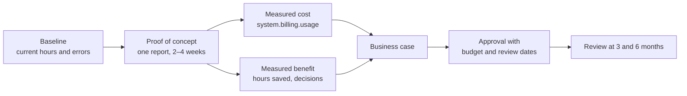

# Building a Business Case

Mastery: `INPUT[inlineSelect(option(new), option(learning), option(solid)):mastery]`

> [!story] Context
> [[Your First 30 Days on Databricks]] produces one trusted report, a measured cost, and a recorded decision. This note explains how to turn those results into a business case that an owner, partner, or board can approve.

> [!eli5] Summary
> A business case compares what the current way of working costs with what the new platform costs and what it enables. It lists the risks and how to reduce them, and it proposes a small, measured first step instead of a large commitment.

## Background

Small businesses rarely have a formal approval process for software, but the decision still needs a written basis: usage pricing has no fixed sticker price, the benefits are largely time saved and better decisions, and the work depends on specific people. A short, structured document makes the trade-off explicit and gives the business a baseline to review after three and six months.

## Overview

A business case for Databricks at small-business scale has seven sections:

| Section | Content | Evidence |
|---|---|---|
| 1. Problem | The reports and decisions that are slow, error-prone, or impossible today | Hours per week spent on manual consolidation; examples of conflicting figures |
| 2. Options | Do nothing, a simpler tool, Databricks, and any other platform considered | [[When Databricks Is Not the Right Fit]], [[Databricks vs Alternatives for Small Teams]] |
| 3. Costs | Databricks usage, cloud provider charges, staff time, other tools, one-time setup | [[Estimating Costs for a Small Business]], trial usage from `system.billing.usage` |
| 4. Benefits | Hours saved, faster decisions, reduced errors, new capabilities | Proof-of-concept results and owner feedback |
| 5. Risks | Cost overrun, skills, key-person dependency, data security, lock-in | Mitigations for each risk |
| 6. Plan | A phased rollout starting with one report | [[Your First 30 Days on Databricks]], [[Migration Strategy Overview]] |
| 7. Decision and review | The approval requested and the review dates | Budget threshold and success metrics |

## How it works



### Costs

Use the estimate from [[Estimating Costs for a Small Business]], corrected with trial usage. Include every cost, not only the two bills:

| Cost line | One-time or recurring | Source |
|---|---|---|
| Databricks usage (DBUs) | Recurring | Corrected estimate; official [Databricks pricing](https://www.databricks.com/product/pricing) |
| Cloud provider: storage, network, classic VMs | Recurring | Cloud provider pricing pages |
| Staff time to operate the platform | Recurring | Hours per week × internal hourly cost |
| Ingestion or BI tools retained or added | Recurring | Vendor contracts |
| Setup and migration effort | One-time | Hours from the proof of concept, scaled to the planned scope |
| Training | One-time | [[Databricks Free Edition and Trials\|Free Edition]] reduces cost for learning |

### Benefits

Express benefits in units that the business already tracks:

```text
hours_saved_per_month = (manual_hours_per_week_before − hours_per_week_after) × 4.3
value_of_time_saved   = hours_saved_per_month × internal_hourly_cost

monthly_net_benefit   = value_of_time_saved
                      + value_of_decisions_enabled      (estimate conservatively or omit)
                      − monthly_platform_cost           (Databricks + cloud + tools)
                      − monthly_operating_time_cost

payback_months        = one_time_costs / monthly_net_benefit   (if monthly_net_benefit > 0)
```

Fill in the worksheet:

| Line | Value |
|---|---|
| Manual hours per week before | |
| Hours per week after (operating the platform) | |
| Internal hourly cost | |
| Value of time saved per month | |
| Monthly platform cost (from the corrected estimate) | |
| Other monthly tool costs | |
| One-time setup and training costs | |
| **Monthly net benefit** | |
| **Payback period (months)** | |

Record benefits that are hard to price, such as fewer reporting errors, faster month-end close, or the ability to build forecasts, as qualitative items with an example from the proof of concept. Do not inflate them to close a gap in the numbers.

### Risks and mitigations

| Risk | Mitigation | Vault reference |
|---|---|---|
| Cost overrun | Budget alerts at the estimated monthly figure, serverless compute, auto-stop, jobs instead of notebooks | [[Budgets and Usage Dashboards]], [[Cost Optimization Checklist]] |
| Insufficient skills | Free Edition for training; role-based learning paths; scope limited to one report at a time | [[Path - One-Person Data Team]], [[Path - Certification Prep]] |
| Key-person dependency | Code in Git folders, jobs run as service principals, documented tables in Unity Catalog | [[Git Folders and Workspace Files]], [[Users Groups and Service Principals]] |
| Data security and compliance | Groups and grants from the start, column masks for sensitive data, audit logs, compliance features where required | [[Unity Catalog]], [[Row Filters and Column Masks]], [[Compliance Security Profile]] |
| Lock-in | Data stored in open formats in cloud storage; pay-as-you-go until usage is stable | [[Open Table Formats]], [[Vendor Lock-In]] |
| Adoption | Business users work in Genie One and dashboards; the old report runs in parallel until trusted | [[Databricks One]], [[Running Old and New in Parallel]] |

### Decision request

State the request precisely, for example:

1. Approve pay-as-you-go use of Databricks on the selected cloud for six months.
2. Approve a monthly budget threshold equal to the upper bound of the corrected estimate, with an alert at the lower bound.
3. Approve the time allocation for the person operating the platform.
4. Schedule reviews at three and six months against the baseline metrics. Consider a committed-use contract only after six months of stable usage.

## Small-business considerations

> [!smallbiz] Small-business considerations
> Keep the document to two pages: the problem with its baseline hours, the corrected cost range, the measured benefit from the proof of concept, the top risks with mitigations, and the decision request. Use pay-as-you-go pricing until usage is stable; committed-use contracts and Azure DBCU prepurchases provide discounts on DBUs but require a forecast you can rely on. If the payback calculation does not work for the first report, compare the result with the lighter options in [[When Databricks Is Not the Right Fit]] rather than adding speculative benefits.

## Cloud differences

> [!azure]- Azure Databricks
> Usage is billed by Microsoft under the Azure subscription, so finance sees it with other Azure costs. Prepurchased Databricks commit units (DBCU) for one or three years discount DBU charges by up to 37% according to Microsoft; include this option only after usage is stable. See [[Azure Billing and Commit Units]].

> [!aws]- Databricks on AWS
> Pay-as-you-go through AWS Marketplace can bill against an existing AWS Enterprise Discount Program (EDP) commitment, which can matter to the finance case. See [[AWS Marketplace and Billing]].

> [!gcp]- Databricks on Google Cloud
> Trial credits cover Databricks usage only, so include the Google Cloud resource charges from the trial in the cost baseline. See [[Google Cloud Marketplace and Billing]].

## Advanced topics

> [!deepdive]- Advanced topics (301–401)
> - **Total cost of ownership.** For a larger replacement, compare a full [[Total Cost of Ownership|TCO]] of the current stack (licences, servers, maintenance, staff) with the new one over three years.
> - **Chargeback.** When several teams share the platform, tag usage by team and report from system tables so that each team's benefits and costs are visible. See [[Tagging for Chargeback]].
> - **Migration scope.** For a migration from an existing warehouse or Hadoop, use [[Assessing Your Current Data Estate]] and [[Migration Strategy Overview]] to size the effort; tools such as [[Lakebridge]] can reduce it.

## Common misconceptions

> [!confusion] A business case is not a price comparison
> Unit prices between vendors are not comparable. Compare total cost and measured benefit for the business's own workloads.

> [!confusion] A committed-use discount is not a reason to start
> Commitments reduce DBU prices for predictable usage. Start on pay-as-you-go, measure, and commit only after usage stabilizes.

## Recall

What are the seven sections of a small-business business case?::Problem, options, costs, benefits, risks, plan, and decision with review dates.
Which costs belong in the business case besides the Databricks and cloud bills?::Staff time, retained or added tools, setup and migration effort, and training.
How is the payback period calculated?::One-time costs divided by the monthly net benefit, when the monthly net benefit is positive.
What evidence should support the cost figure?::A corrected estimate based on measured trial usage from `system.billing.usage`.
When should a committed-use contract be considered?::After several months of stable, forecastable usage.
How is cost-overrun risk mitigated?::Budget alerts, serverless compute, auto-stop, and running recurring work as jobs.

## Next steps

> [!path] Learning path
> **Needs first:** [[Estimating Costs for a Small Business]], [[Your First 30 Days on Databricks]]
> **Unlocks next:** [[Chapter 01 - Foundations]], [[Migration Strategy Overview]], [[Assessing Your Current Data Estate]]

> [!nextup] Next
> [[Chapter 01 - Foundations]] begins Part 1 of the vault: the data concepts, from tables and SQL to cloud storage, that the rest of the platform builds on.

> [!sources]- Sources (last verified: 2026-10-25)
> - [Databricks pricing](https://www.databricks.com/product/pricing)
> - [Databricks pay-as-you-go on AWS Marketplace (press release)](https://www.databricks.com/company/newsroom/press-releases/databricks-strengthens-scope-of-work-with-aws)
> - [Optimize Azure Databricks costs with a prepurchase (Microsoft Learn)](https://learn.microsoft.com/en-us/azure/cost-management-billing/reservations/prepay-databricks-reserved-capacity)
> - [Azure Databricks pricing (Microsoft)](https://azure.microsoft.com/en-us/pricing/details/databricks/)
> - [Start a Databricks free trial on Google Cloud](https://docs.databricks.com/gcp/en/admin/account-settings-gcp/create-subscription)
> - [Create and monitor budgets (AWS)](https://docs.databricks.com/aws/en/admin/account-settings/budgets)
> - [Pricing system table reference (AWS)](https://docs.databricks.com/aws/en/admin/system-tables/pricing)
> - [Best practices for cost optimization (AWS)](https://docs.databricks.com/aws/en/lakehouse-architecture/cost-optimization/best-practices)
> - [Databricks Free Edition limitations (AWS)](https://docs.databricks.com/aws/en/getting-started/free-edition-limitations)
