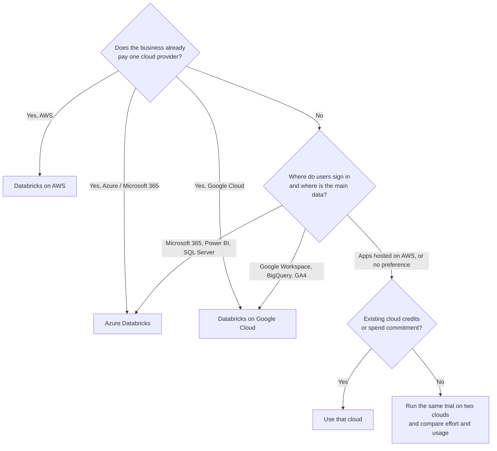

# Choosing a Cloud for Databricks

Mastery: `INPUT[inlineSelect(option(new), option(learning), option(solid)):mastery]`

> [!story] Context
> [[Databricks Free Edition and Trials]] showed that a business trial starts on a specific cloud. This note explains how to choose between Microsoft Azure, Amazon Web Services, and Google Cloud for Databricks. For most small businesses, the cloud and software already in use determine the choice.

> [!eli5] Summary
> Databricks runs on the three largest cloud providers, and the core product works the same way on each. Choose the cloud the business already uses for email, files, applications, or billing, because that keeps sign-in, invoices, and data in one place.

## Background

Databricks does not operate its own data centers for customer workloads. It runs on a cloud provider. The provider determines where storage lives, how users sign in, how the bill arrives, and which surrounding services integrate most directly. Changing clouds later requires moving data and reconfiguring access, so the initial choice has lasting effects.

## Overview

Choosing a cloud for Databricks means picking the provider (Microsoft Azure, Amazon Web Services, or Google Cloud) that hosts the workspaces, storage, sign-in, and billing.

The platform features covered in this vault ([[Unity Catalog]], [[Lakeflow]], [[Databricks SQL]], [[AI-BI Dashboards|AI/BI]], Mosaic AI) are available on all three clouds, though regional availability and release timing can differ. The differences are in the surrounding infrastructure:

| Area | Azure Databricks | Databricks on AWS | Databricks on Google Cloud |
|---|---|---|---|
| Relationship | First-party Microsoft service ([[First-Party Microsoft Service]]) | Databricks service on AWS | Databricks service on Google Cloud |
| How you buy | Azure portal; billed by Microsoft under the Azure subscription | Directly from Databricks, or pay-as-you-go through AWS Marketplace | From Google Cloud |
| Bills | One Azure invoice with Databricks and Azure items | Usually Databricks plus AWS | Databricks charges plus Google Cloud resources |
| Commitment options | Databricks commit unit (DBCU) prepurchase, 1 or 3 years ([[Azure Billing and Commit Units]]) | Databricks commit contracts; Marketplace usage can bill against an AWS EDP commitment ([[AWS Marketplace and Billing]]) | Databricks commit contracts ([[Google Cloud Marketplace and Billing]]) |
| Identity | Microsoft Entra ID ([[Microsoft Entra ID Integration]]) | Your identity provider via [[SCIM Provisioning\|SCIM]] | Your identity provider; [[Google Service Accounts]] for storage access |
| Storage | [[Azure Data Lake Storage]] | [[Amazon S3]] | [[Google Cloud Storage]] |
| Typical integrations | Power BI, Azure Data Factory, SQL Server ([[Azure Data Factory with Databricks]], [[Power BI on Azure Databricks]]) | AWS Glue and other AWS services ([[Hive Metastore Federation for AWS Glue]]) | BigQuery ([[BigQuery Integration]]) |
| Deep dive | [[Chapter 11 - Azure Databricks]] | [[Chapter 12 - Databricks on AWS]] | [[Chapter 13 - Databricks on Google Cloud]] |

## How it works

Answer the questions in order. The first clear answer usually decides.

### Decision factors

| Factor | Why it matters | Guidance |
|---|---|---|
| Existing cloud account and commitments | Spend can count toward existing commitments, and procurement is simpler | Prefer the cloud already under contract |
| Identity | Users sign in with accounts they already have | Microsoft 365 points to Azure; other identity providers work on all clouds |
| Location of the main data | Moving data between clouds incurs [[Egress\|egress]] charges and latency | Run Databricks in the cloud and [[Region\|region]] where the data already lives |
| BI tool | Integration and sign-in are simplest in the same ecosystem | Power BI suggests Azure; Looker or BigQuery suggests Google Cloud |
| Regulatory and data-residency requirements | Region availability and compliance offerings vary | Confirm that the required region and compliance features are available on the chosen cloud |
| Skills | The administrator must manage networking and storage on that cloud | Prefer the cloud the team, or its IT provider, already knows |

## Small-business considerations

> [!smallbiz] Small-business considerations
> Most small businesses should choose the cloud they already use. A Microsoft 365 and Power BI organization should start with Azure Databricks; an organization with applications on AWS should use Databricks on AWS; an organization using Google Workspace, BigQuery, or GA4 exports should consider Databricks on Google Cloud. With no existing cloud, the fastest start is a [[Serverless Compute|serverless]] workspace (Databricks runs the computers for you) through Databricks' express sign-up (on AWS), which requires only an email address. Select a [[Region|region]] close to the business and its data, and keep storage and workspaces in the same region.

## Cloud differences

> [!azure]- Azure Databricks
> - Created in the Azure portal as an Azure resource, with Microsoft Entra ID sign-in and Microsoft billing. See [[Creating an Azure Databricks Workspace]] and [[Azure Databricks Overview]].
> - Standard tier is retired: new workspaces use Premium from April 1, 2026, and remaining Standard workspaces were scheduled for automatic upgrade on October 1, 2026.
> - Networking options include [[VNet Injection]] and [[Azure Private Link]].

> [!aws]- Databricks on AWS
> - Sign up directly with Databricks (express setup creates a serverless workspace with only an email address), with an existing AWS account, or through AWS Marketplace. See [[Account Setup on AWS]] and [[Databricks on AWS Overview]].
> - Networking options include a [[Customer-Managed VPC on AWS|customer-managed VPC]] and [[AWS PrivateLink]]. Regulated public-sector workloads can use [[Databricks on AWS GovCloud]].

> [!gcp]- Databricks on Google Cloud
> - Start from a Google Cloud account. Trial credits cover Databricks usage only; Google Cloud bills classic workspace resources separately. See [[Account Setup on Google Cloud]] and [[Databricks on Google Cloud Overview]].
> - Networking options include a [[Customer-Managed VPC on Google Cloud|customer-managed VPC]] and [[Private Service Connect]].

## Advanced topics

> [!deepdive]- Advanced topics (301–401)
> - **Multi-cloud.** One organization can run Databricks on more than one cloud. Data moves between clouds and regions through sharing ([[OpenSharing]]) rather than through a shared metastore. Databricks states that larger commitments can include use across multiple clouds.
> - **One metastore per region.** Unity Catalog uses one [[Metastore|metastore]] per cloud region. Plan regions before creating workspaces. See [[Unity Catalog]].
> - **Side-by-side comparison.** Identity, networking, storage, keys, and billing are compared in [[Cloud Comparison - Azure vs AWS vs GCP]].

## Common misconceptions

> [!confusion] Databricks is not a different product on each cloud
> The workspace, SQL, notebooks, Unity Catalog, and Lakeflow work the same way. Differences are in identity, networking, storage, and billing.

> [!confusion] A business does not need to know cloud networking on day one
> A serverless workspace with default settings is sufficient for a first project. Private networking can be added before production data is loaded.

## Recall

Which cloud is usually best for a Microsoft 365 and Power BI organization?::Azure, where Azure Databricks is a first-party Microsoft service billed by Microsoft.
What is the main rule for choosing a cloud?::Choose the cloud the business already uses, where its identity, data, and billing already are.
Why run Databricks in the same region as the data?::To avoid cross-region or cross-cloud egress charges and latency.
How can you start on AWS without an AWS account?::Use Databricks express setup, which creates a serverless workspace from an email address.
What do Google Cloud trial credits cover?::Databricks usage only; Google Cloud bills classic workspace resources separately.
Are Databricks features different on each cloud?::The core platform is the same; identity, networking, storage, and billing differ, and regional availability can vary.

## Next steps

> [!path] Learning path
> **Needs first:** [[Servers and the Cloud]], [[Databricks Free Edition and Trials]]
> **Unlocks next:** [[Your First 30 Days on Databricks]], [[Path - Azure Deep Dive]], [[Path - AWS Deep Dive]], [[Path - Google Cloud Deep Dive]]

> [!nextup] Next
> [[Your First 30 Days on Databricks]] provides a week-by-week plan from sign-up to the first trusted dashboard.

> [!sources]- Sources (last verified: 2026-10-25)
> - [Databricks pricing](https://www.databricks.com/product/pricing)
> - [Azure Databricks pricing (Databricks)](https://www.databricks.com/product/azure-pricing)
> - [AWS pricing by Databricks](https://www.databricks.com/product/aws-pricing)
> - [Databricks on Google Cloud pricing](https://www.databricks.com/product/gcp-pricing)
> - [End of life for Standard tier workspaces (Azure Databricks)](https://learn.microsoft.com/en-us/azure/databricks/admin/account-settings/standard-tier)
> - [Optimize Azure Databricks costs with a prepurchase (Microsoft Learn)](https://learn.microsoft.com/en-us/azure/cost-management-billing/reservations/prepay-databricks-reserved-capacity)
> - [Sign up for Databricks with express setup (AWS)](https://docs.databricks.com/aws/en/getting-started/express-setup)
> - [Free trial with an existing AWS account](https://docs.databricks.com/aws/en/getting-started/cloud-setup)
> - [Start a Databricks free trial on Google Cloud](https://docs.databricks.com/gcp/en/admin/account-settings-gcp/create-subscription)
> - [Sign up for Azure Databricks for free (Microsoft Learn)](https://learn.microsoft.com/en-us/azure/databricks/getting-started/free-trial)
> - [Databricks pay-as-you-go on AWS Marketplace (press release)](https://www.databricks.com/company/newsroom/press-releases/databricks-strengthens-scope-of-work-with-aws)
