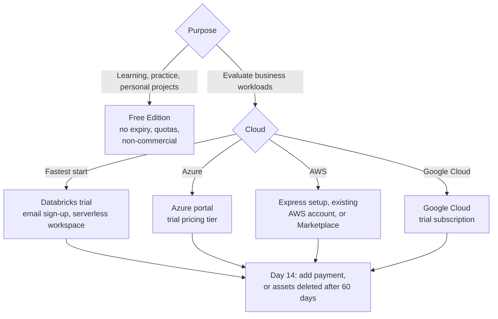

# Databricks Free Edition and Trials

Mastery: `INPUT[inlineSelect(option(new), option(learning), option(solid)):mastery]`

> [!story] Context
> [[Estimating Costs for a Small Business]] recommends validating an estimate with measured trial usage. Databricks offers two free options with different purposes: Free Edition for ongoing, non-commercial learning, and a 14-day free trial for evaluating business workloads.

> [!eli5] Summary
> **Free Edition** is a free practice environment with daily limits that does not expire, intended for learning rather than running a business. **The free trial** provides the full product with free usage credits for 14 days, so a business can test its real workloads before paying.

> [!renamed] Replaced: Community Edition → Free Edition
> - **Databricks Community Edition** was the previous free tier. **Databricks Free Edition** was announced at Data + AI Summit on **June 11, 2025**, launched in Public Preview, and replaced it.
> - Databricks documentation states that Community Edition was retired in 2025. Databricks provides a guide for migrating Community Edition workspaces to Free Edition.

## Background

Organizations need to use a platform before committing to it. Students and career changers need a learning environment without a payment method. Businesses need to test their own data at realistic volumes. Databricks addresses these needs with two offerings that have different terms.

## Overview

Databricks offers two no-cost ways to use the platform: Free Edition, a permanent, quota-limited environment for non-commercial learning, and the free trial, 14 days of usage credits on the full product.

### Comparison

| | Free Edition | Free trial |
|---|---|---|
| Intended users | Students, educators, hobbyists, and anyone learning | Businesses evaluating Databricks |
| Cost | Free, with daily usage quotas | Free usage credits valid for **14 days** |
| Commercial use | **Not permitted** | Permitted |
| Compute | [[Serverless Compute\|Serverless]] only, quota-limited | Serverless workspace by default; classic compute in your own cloud account is optional |
| After the period | No expiry; quotas reset; inactive accounts may be deleted | Add a payment method to continue; workspace assets are deleted 60 days after the trial ends if you do not upgrade |
| Support and [[SLA]] | Not covered by the support policy or SLA | Paid support after upgrade |
| Sign-in | Email one-time passcode, Google, or Microsoft; no [[Single Sign-On\|SSO]] or [[SCIM Provisioning\|SCIM]] | Standard identity options |
| Recommended use | Learning, certification practice, personal projects | A [[Proof of Concept\|proof of concept]] on real data and cost measurement |

### Free Edition limits

Quotas can change; check the official limitations page before relying on a specific value.

| Area | Limit |
|---|---|
| Compute | Serverless only; custom compute not supported |
| SQL | One [[SQL Warehouses\|SQL warehouse]], 2X-Small |
| Jobs | Up to 5 concurrent job tasks per account |
| Apps | Up to 3 [[Databricks Apps]]; apps stop after running up to 24 hours unless restarted |
| Databases | One [[Lakebase]] project with scale-to-zero compute |
| AI | One AI Search endpoint with one search unit; GPU serving endpoints and provisioned throughput unavailable |
| Not supported | R and Scala, custom workspace storage locations, online tables, [[Clean Rooms]], Knowledge Assistant |
| Administration | One workspace and one [[Metastore\|metastore]] per account; no account console; no SSO or SCIM |
| Quota behavior | When a quota is exceeded, compute shuts down until the quota resets; data and settings are retained |
| Terms | Non-commercial use only |

Verifying a LinkedIn profile raises some limits but does not remove them. Free Edition includes notebooks, SQL, [[Unity Catalog]], [[Lakeflow]] pipelines and jobs, [[AI-BI Dashboards|dashboards]], and [[Genie Agents]].

### Free trial limits

| Area | Limit |
|---|---|
| Duration | Credits valid for 14 days from the start of the trial |
| Credits | A fixed amount of free usage credit, stated on the sign-up page |
| Serverless | Limited to 50 [[DBUs]] per hour for notebooks, jobs, and pipelines |
| SQL | One SQL warehouse per workspace |
| GPUs | Not available |
| Cloud charges | With classic compute, the cloud provider can bill its resources separately (see Cloud differences) |

## How it works

Recommended 14-day evaluation plan:

1. **Day 1:** Sign up, upload one real export, and confirm that you can query it.
2. **Days 2–5:** Rebuild the most labor-intensive report as a scheduled job and a dashboard.
3. **Days 6–10:** Let the job run on its schedule. Share the dashboard with the owner in Genie One.
4. **Days 11–13:** Query `system.billing.usage` and update the estimate in [[Estimating Costs for a Small Business]].
5. **Day 14:** Decide whether to add payment, extend the proof of concept, or stop.

## Small-business considerations

> [!smallbiz] Small-business considerations
> Use Free Edition for learning, for example to train the person who will operate the platform. Use the free trial to make the adoption decision, with real data, on the cloud you intend to use. Do not run business workloads on Free Edition: its terms prohibit commercial use and it has no support or SLA. For a first test in a trial, use a de-identified sample instead of sensitive customer, patient, or payroll data.

## Cloud differences

> [!azure]- Azure Databricks
> Create the workspace in the Azure portal and select the **Trial (Premium - 14-Days Free DBUs)** pricing tier. The tier covers Databricks DBUs; plan for Azure to bill the virtual machines, storage, and network the workspace uses under your subscription. See [[Creating an Azure Databricks Workspace]].

> [!aws]- Databricks on AWS
> **Express setup** creates a serverless workspace from an email address, without an AWS account. A trial can also start from an existing AWS account or through AWS Marketplace. A Marketplace trial, or a trial with a payment method on file, converts to pay-as-you-go when the credits are used or expire. See [[Account Setup on AWS]].

> [!gcp]- Databricks on Google Cloud
> Start the trial from Google Cloud. Trial credits cover Databricks usage only; Google Cloud bills separately for classic workspace resources. See [[Account Setup on Google Cloud]].

## Advanced topics

> [!deepdive]- Advanced topics (301–401)
> - **Serverless limitations apply:** Because Free Edition is serverless-only, general serverless limitations also apply, including no Spark UI, limited DBFS access, and a maximum run duration.
> - **Status:** Free Edition launched in Public Preview in June 2025. Check the current documentation for its status and quotas.
> - **Moving to a paid account:** Keep notebooks in [[Git Folders and Workspace Files|Git folders]] so that work can move from a Free Edition account to a paid workspace.
> - **Trial usage in system tables:** Trial usage is metered like paid usage, so `system.billing.usage` previews the production bill.

## Common misconceptions

> [!confusion] Free Edition is not a free trial
> Free Edition does not expire but is quota-limited and non-commercial. The trial provides the full product for 14 days.

> [!confusion] A free trial does not always mean no cloud charges
> With classic compute, the cloud provider still bills for machines and storage. A serverless trial avoids most of these charges.

> [!confusion] Free Edition is not Community Edition
> Community Edition was the earlier free tier and is retired. Free Edition replaced it in 2025.

## Recall

What is Databricks Free Edition?::A no-cost, serverless-only, quota-limited version of Databricks for learning and non-commercial use.
When was Free Edition announced?::June 11, 2025, at Data + AI Summit.
Which offering did Free Edition replace?::Databricks Community Edition.
How long are free-trial credits valid?::14 days from the start of the trial.
Can a business run production workloads on Free Edition?::No. Free Edition is for non-commercial use only and has no support or SLA.
What happens to trial workspace assets if you do not upgrade?::They are deleted 60 days after the trial ends.
How many SQL warehouses does Free Edition allow, and at what size?::One, 2X-Small.
What is the serverless limit during a free trial?::50 DBUs per hour for notebooks, jobs, and pipelines.
Which pricing tier does an Azure trial workspace use?::Trial (Premium - 14-Days Free DBUs).

## Next steps

> [!path] Learning path
> **Needs first:** [[How Databricks Pricing Works]]
> **Unlocks next:** [[Choosing a Cloud for Databricks]], [[Your First 30 Days on Databricks]], [[Proof of Concept]]

> [!nextup] Next
> [[Choosing a Cloud for Databricks]] explains how to select Azure, AWS, or Google Cloud for the trial and for production.

> [!sources]- Sources (last verified: 2026-10-25)
> - [Databricks Free Edition limitations (AWS)](https://docs.databricks.com/aws/en/getting-started/free-edition-limitations)
> - [Databricks Free Edition limitations (GCP)](https://docs.databricks.com/gcp/en/getting-started/free-edition-limitations)
> - [Sign up for Databricks Free Edition (AWS)](https://docs.databricks.com/aws/en/getting-started/free-edition)
> - [Sign up for Databricks: free trial vs Free Edition (AWS)](https://docs.databricks.com/aws/en/getting-started/free-trial-vs-free-edition)
> - [Sign up for Databricks: free trial vs Free Edition (GCP)](https://docs.databricks.com/gcp/en/getting-started/free-trial-vs-free-edition)
> - [Sign up for Azure Databricks (Microsoft Learn)](https://learn.microsoft.com/en-us/azure/databricks/getting-started/free-trial-vs-free-edition)
> - [Sign up for Databricks for free (AWS)](https://docs.databricks.com/aws/en/getting-started/free-trial)
> - [Sign up for Databricks for free (GCP)](https://docs.databricks.com/gcp/en/getting-started/free-trial)
> - [Sign up for Azure Databricks for free (Microsoft Learn)](https://learn.microsoft.com/en-us/azure/databricks/getting-started/free-trial)
> - [Sign up for Databricks with express setup (AWS)](https://docs.databricks.com/aws/en/getting-started/express-setup)
> - [Free trial with an existing AWS account](https://docs.databricks.com/aws/en/getting-started/cloud-setup)
> - [Start a Databricks free trial on Google Cloud](https://docs.databricks.com/gcp/en/admin/account-settings-gcp/create-subscription)
> - [Migrate Community Edition workspaces to Free Edition (AWS)](https://docs.databricks.com/aws/en/getting-started/ce-migration)
> - [Serverless compute limitations (AWS)](https://docs.databricks.com/aws/en/compute/serverless/limitations)
> - [Introducing Databricks Free Edition (blog)](https://www.databricks.com/blog/introducing-databricks-free-edition)
> - [Databricks launches Free Edition (press release, June 2025)](https://www.databricks.com/company/newsroom/press-releases/databricks-launches-free-edition-and-announces-100-million)
