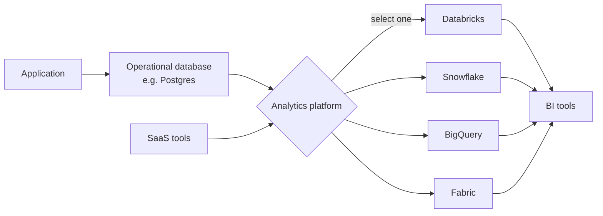

# Databricks vs Alternatives for Small Teams

Mastery: `INPUT[inlineSelect(option(new), option(learning), option(solid)):mastery]`

> [!story] Context
> [[When Databricks Is Not the Right Fit]] listed situations in which a smaller tool is the better choice. This note compares Databricks with the main alternatives a small team typically evaluates: Snowflake, BigQuery, Microsoft Fabric, Power BI alone, Postgres, and DuckDB or MotherDuck.

> [!eli5] Summary
> Several services can serve as a company's central data store. Some focus on reports, some on running an application's database, and some, including Databricks, cover storage, engineering, analytics, and AI together. The best choice depends on the tools the company already uses and who will operate the platform.

## Background

Most published comparisons target large enterprises with dedicated data teams. For a 5–50 person company the deciding factors differ: existing cloud and software commitments, available skills, predictability of the bill, and the cost of moving later.

## Overview

### Comparison

> [!confusion] Scope of the comparison
> Each column was checked against that vendor's own documentation (see Sources). Cells marked "Check vendor docs" are intentionally left open because those capabilities change often. Features and pricing change; consult each vendor's documentation, and see the vault notes [[Snowflake]], [[Google BigQuery]], and [[Microsoft Fabric and OneLake vs Databricks]].

| | Databricks | Snowflake | BigQuery | Microsoft Fabric | Power BI alone | Postgres | DuckDB / MotherDuck |
|---|---|---|---|---|---|---|---|
| **What it is** | Platform for storage, pipelines, SQL, BI, ML, and AI on one copy of the data | Cloud data platform with a SQL warehouse at its core | Google Cloud's serverless data warehouse | Microsoft's software-as-a-service (SaaS) analytics platform built on OneLake | Reporting and dashboard tool | Open-source object-relational database | Small analytics database that runs inside your program (in-process); MotherDuck is a serverless cloud data warehouse built on it |
| **Where it runs** | Azure, AWS, Google Cloud | AWS, Azure, or Google Cloud (one platform per account) | Google Cloud (BigQuery Omni can query data stored in AWS and Azure) | Microsoft (SaaS) | Microsoft (SaaS) | Anywhere | Your laptop or server, or MotherDuck's service on AWS |
| **How you pay** | Pay-as-you-go usage in [[DBUs]] (billed per second), plus cloud costs; committed-use discounts available ([[How Databricks Pricing Works]]) | Usage-based: compute consumes Snowflake credits, plus storage | On-demand (per data scanned) or capacity (slots) | Capacity (F [[SKU\|SKUs]]) plus per-user licenses | Mostly per-user licenses (Pro, Premium Per User), or capacity | Server size | Free and open source under the MIT License (DuckDB); free and paid plans with usage-based pricing (MotherDuck) |
| **Data format** | Open formats: [[Delta Lake]] and managed [[Apache Iceberg]] tables, governed by [[Unity Catalog]] | Check vendor docs | Check vendor docs | Check vendor docs | Its own model | Its own format | Its own files, plus common open files |
| **Python, ML, AI** | Built in: [[Notebooks]], [[MLflow]], [[Agent Bricks]], [[Genie Agents]] | Check vendor docs | Check vendor docs | Check vendor docs | Limited | Outside tools | Through Python |
| **Pipelines** | [[Lakeflow Connect]], [[Lakeflow Spark Declarative Pipelines]], [[Lakeflow Jobs]] | Check vendor docs | Check vendor docs | Check vendor docs | Report refresh | Outside tools | Outside tools |
| **BI** | [[AI-BI Dashboards]] and Genie included; Power BI and Tableau connect too ([[Connecting Power BI]], [[Connecting Tableau and Other BI Tools]]) | Snowsight dashboards and partner BI tools such as Power BI | Google tools (Looker, Data Studio, Connected Sheets) and partner tools such as Tableau | Power BI built in | It *is* the BI | Any BI tool, including Power BI | Any BI tool |
| **Best for a small team when...** | You want SQL, Python, ML, and AI on the same governed data, on any of three clouds | You are SQL-first and want a warehouse | You live in Google Cloud | You are Power BI-first and all-in on Microsoft | You have few clean sources and mostly need reports | You need an app database, or small analytics | One analyst, modest data, tight budget |
| **Watch out for** | Someone must own setup, access, and the bill | Compare real workloads in a trial | Compare real workloads in a trial | Compare real workloads in a trial | It is not a full data platform | Large analytic scans | Shared, governed access for many people |

### Typical decision paths

1. **Microsoft 365 and Power BI in place:** Evaluate in order: Power BI alone, Microsoft Fabric, Azure Databricks. Azure Databricks is a [[First-Party Microsoft Service|first-party Microsoft service]] billed on the Azure subscription, and Power BI connects to it. See [[Microsoft Fabric and OneLake vs Databricks]].
2. **Google Cloud with data in BigQuery:** Remaining on BigQuery requires the least change. Databricks on Google Cloud is the stronger option when Python engineering, ML, AI, or more than one cloud is required. See [[BigQuery Integration]].
3. **SQL-only analysts:** Snowflake, BigQuery, and [[Databricks SQL]] all serve this use case. Compare them on the team's familiarity and on measured usage for representative queries.
4. **Engineering, ML, or AI agents planned:** Databricks provides these capabilities on the same governed tables.
5. **Small data and a small budget:** Postgres or DuckDB is sufficient. Open formats simplify a later move.

## How it works

Most small companies keep an operational database for the application and select one analytics platform:

Use a weighted scorecard to record the evaluation:

| Criterion | Weight (1–3) | Databricks | Option B | Option C |
|---|---|---|---|---|
| Fits the cloud and tools already in use | | | | |
| Current staff can operate it | | | | |
| Supports the required sources (connectors) | | | | |
| SQL experience for analysts | | | | |
| Python, ML, and AI requirements for the next two years | | | | |
| Predictable, controllable billing | | | | |
| Exit cost (open formats) | | | | |
| **Weighted total** | | | | |

## Small-business considerations

> [!smallbiz] Small-business considerations
> The platform that matches the cloud and software already in use, operated by someone familiar with it, is usually the best choice. During free trials, run the same two or three representative queries on each shortlisted platform and compare effort and reported usage. Do not compare list prices per unit; the units differ between vendors.

## Cloud differences

> [!azure]- Azure Databricks
> The main comparison is Microsoft Fabric. Azure Databricks is billed directly by Microsoft under the Azure subscription. Integration between the two is covered in [[Microsoft Fabric and OneLake vs Databricks]].

> [!aws]- Databricks on AWS
> The main comparisons are Snowflake and Amazon Redshift. See [[Snowflake]], [[Amazon Redshift]], and [[Migrating from Amazon Redshift]].

> [!gcp]- Databricks on Google Cloud
> The main comparison is BigQuery. For using both or migrating gradually, see [[BigQuery Integration]], [[Google BigQuery]], and [[Migrating from Google BigQuery]].

## Advanced topics

> [!deepdive]- Advanced topics (301–401)
> - **Units are not comparable:** A DBU is Databricks' normalized unit of processing. Other vendors' billing units measure different quantities, so benchmark representative workloads instead of converting units.
> - **Open formats:** Unity Catalog governs Delta and managed Iceberg tables and exposes an Iceberg REST interface for other engines (see [[Unity Catalog]]). See also [[Open Table Formats]] and [[Delta UniForm]].
> - **Migration tooling:** See [[Lakebridge]] and [[Migration Strategy Overview]] for moving to Databricks from another warehouse.

## Common misconceptions

> [!confusion] Microsoft Fabric is not the same product as Power BI
> Fabric is positioned as a broader analytics platform that includes Power BI. Power BI alone is a reporting tool. Evaluate them as different product categories.

> [!confusion] "Serverless" does not have one meaning across vendors
> On Databricks, serverless compute is compute that Databricks operates for you, billed in DBUs. Other vendors use the term for different billing models.

## Recall

Which three clouds does Databricks run on?::Azure, AWS, and Google Cloud.
Which open formats does Unity Catalog govern?::Delta Lake and Apache Iceberg tables.
When is Databricks' advantage clearest for a small team?::When SQL, Python data engineering, ML, and AI all need the same governed data.
Why should platforms not be compared on price per unit?::Each vendor's billing unit measures a different quantity; benchmark representative workloads instead.
How should a small team compare shortlisted platforms?::Run the same representative queries on each during free trials and compare effort and reported usage.

## Next steps

> [!path] Learning path
> **Needs first:** [[When Databricks Is Not the Right Fit]], [[Data Warehouses]]
> **Unlocks next:** [[How Databricks Pricing Works]], [[Migrating from Snowflake]], [[Migrating from Google BigQuery]]

> [!nextup] Next
> [[How Databricks Pricing Works]] explains DBUs, SKUs, serverless and classic compute, and the two bills.

> [!sources]- Sources (last verified: 2026-10-25)
> - [Databricks pricing](https://www.databricks.com/product/pricing)
> - [Databricks AI/BI (AWS)](https://docs.databricks.com/aws/en/ai-bi)
> - [What is Lakeflow Connect? (GCP)](https://docs.databricks.com/gcp/en/ingestion/overview)
> - [Databricks pay-as-you-go on AWS Marketplace (press release)](https://www.databricks.com/company/newsroom/press-releases/databricks-strengthens-scope-of-work-with-aws)
> - [Supported cloud platforms (Snowflake docs)](https://docs.snowflake.com/en/user-guide/intro-cloud-platforms)
> - [Understanding overall cost (Snowflake docs)](https://docs.snowflake.com/en/user-guide/cost-understanding-overall)
> - [Visualizing data with dashboards (Snowflake docs)](https://docs.snowflake.com/en/user-guide/ui-snowsight-dashboards)
> - [Introduction to BigQuery Omni (Google Cloud)](https://cloud.google.com/bigquery/docs/omni-introduction)
> - [Understand slots (BigQuery docs)](https://cloud.google.com/bigquery/docs/slots)
> - [Analyze data with Data Studio (BigQuery docs)](https://cloud.google.com/bigquery/docs/visualize-looker-studio)
> - [What is Microsoft Fabric? (Microsoft Learn)](https://learn.microsoft.com/en-us/fabric/fundamentals/microsoft-fabric-overview)
> - [Understand Microsoft Fabric licenses and capacity (Microsoft Learn)](https://learn.microsoft.com/en-us/fabric/enterprise/licenses)
> - [Power BI service features by license type (Microsoft Learn)](https://learn.microsoft.com/en-us/power-bi/fundamentals/service-features-license-type)
> - [Snowflake connector for Power Query (Microsoft Learn)](https://learn.microsoft.com/en-us/power-query/connectors/snowflake)
> - [PostgreSQL connector for Power Query (Microsoft Learn)](https://learn.microsoft.com/en-us/power-query/connectors/postgresql)
> - [About PostgreSQL (postgresql.org)](https://www.postgresql.org/about/)
> - [Why DuckDB (duckdb.org)](https://duckdb.org/why_duckdb)
> - [MotherDuck documentation: getting started](https://motherduck.com/docs/getting-started/)
> - [MotherDuck pricing model (MotherDuck docs)](https://motherduck.com/docs/about-motherduck/billing/pricing/)
