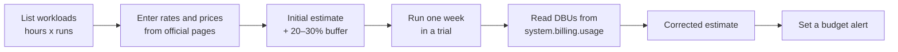

# Estimating Costs for a Small Business

Mastery: `INPUT[inlineSelect(option(new), option(learning), option(solid)):mastery]`

> [!story] Context
> [[How Databricks Pricing Works]] described the meter: DBUs multiplied by a price per SKU, plus cloud provider charges. This note provides a repeatable method for estimating a small company's monthly cost from its own workloads, without relying on published price examples.

> [!eli5] Summary
> List the tasks the platform will run, how long each takes, and how often it runs. Multiply by the rates on the official price list and add storage. Then run the real tasks during a free trial and correct the estimate with measured usage.

## Background

Usage-based pricing has no fixed list price for a whole deployment, which makes budgeting harder. A structured estimate, validated against measured trial usage, produces a figure that finance can plan around. This vault does not quote prices because they vary by cloud, region, tier, and contract and change over time; enter current values from the official pages.

## Overview

### Formula

For each workload *w*:

```text
monthly_DBUs(w)  = DBUs_per_hour(w) × hours_per_run(w) × runs_per_month(w)
monthly_cost(w)  = monthly_DBUs(w) × price_per_DBU(SKU of w)

Databricks total = Σ monthly_cost(w) − committed-use discount (if any)
Cloud total      = classic VM hours × VM price           (0 if all serverless)
                 + storage GB × storage price
                 + egress GB × egress price
Monthly estimate = Databricks total + Cloud total + buffer (20–30% during adoption)
```

### Inputs

| Input | Source |
|---|---|
| `DBUs_per_hour` | The pricing page or calculator for your cloud, for the compute type and size; or measured usage from a trial |
| `hours_per_run` | Measured run time; for SQL warehouses, the hours the warehouse is running, including the auto-stop delay |
| `runs_per_month` | The schedule: nightly ≈ 30; hourly during business hours ≈ 10 × 22 |
| `price_per_DBU` | The official pricing page for your cloud, SKU, tier, and region |
| VM, storage, and egress prices | The cloud provider's pricing pages |

Official pricing pages: [Databricks](https://www.databricks.com/product/pricing), [AWS](https://www.databricks.com/product/aws-pricing), [Azure](https://azure.microsoft.com/en-us/pricing/details/databricks/), and [Google Cloud](https://www.databricks.com/product/gcp-pricing). Each links to the Databricks pricing calculator. Databricks states that its calculators provide an estimate only and that actual cost depends on actual usage. Generative AI workloads have a separate [Generative AI pricing calculator](https://www.databricks.com/product/pricing/genai-pricing-calculator).

## How it works

### Step 1: List the initial workloads

The example below is a three-location retailer. The values are usage assumptions, not prices.

| # | Workload | Compute | Size | Hours per run | Runs per month | Hours per month |
|---|---|---|---|---|---|---|
| 1 | Nightly ingestion: POS, online store, accounting into bronze and silver | Serverless jobs, standard mode | Managed | 0.33 | 30 | 10 |
| 2 | Gold tables and KPIs | Serverless jobs, standard mode | Managed | 0.17 | 30 | 5 |
| 3 | Dashboards and Genie for eight managers | Serverless SQL warehouse with auto-stop | 2X-Small | 3 per business day | 22 | 66 |
| 4 | Analyst exploration in notebooks | Serverless notebooks | Managed | 2 | 12 | 24 |

### Step 2: Enter rates and prices

Copy this worksheet into a spreadsheet. Fill the blank columns from the official pricing pages, or from measured usage in Step 4.

| # | Hours per month (H) | DBUs per hour (R) | Monthly DBUs (H × R) | Price per DBU (P) | Monthly cost (H × R × P) |
|---|---|---|---|---|---|
| 1 | 10 | | | | |
| 2 | 5 | | | | |
| 3 | 66 | | | | |
| 4 | 24 | | | | |
| | | | **Databricks total** | | |
| | Storage: ___ GB × storage price | | | | |
| | Egress: ___ GB × egress price | | | | |
| | Buffer (20–30%) | | | | |
| | | | **Monthly estimate** | | |

Because the example uses serverless compute only, the cloud bill contains storage and network charges but no virtual-machine charges.

### Step 3: Identify the main cost drivers

In most small-business estimates, SQL warehouse hours (row 3) are the largest line, because a warehouse consumes DBUs for every minute it runs. The main levers, in order of typical impact:

1. **Auto-stop:** Stopping the warehouse after a short idle period reduces row 3 more than any other change.
2. **Standard mode for scheduled jobs:** Up to 70% lower than performance-optimized mode for jobs that tolerate a 4–6 minute start-up.
3. **Jobs instead of notebooks** for recurring work.
4. **Committed use** once usage is stable (see [[How Databricks Pricing Works]]).

See [[Cost Optimization Checklist]] for a complete list.

### Step 4: Measure during a trial and correct the estimate

Run the real workloads for one week in a [[Databricks Free Edition and Trials|free trial]], then read the measured DBUs from [[System Tables|system tables]]:

```sql
-- DBUs per job and per SQL warehouse over the last 7 days
SELECT billing_origin_product,
       COALESCE(usage_metadata.job_id, usage_metadata.warehouse_id) AS resource_id,
       sku_name,
       SUM(usage_quantity) AS dbus
FROM   system.billing.usage
WHERE  usage_date >= current_date() - INTERVAL 7 DAYS
GROUP  BY ALL
ORDER  BY dbus DESC;
```

Multiply each `dbus` value by 4.3 (weeks per month) and by the price for its `sku_name`, then replace the Step 2 assumptions. Trial usage is metered in the same way as paid usage, so the measurement reflects production behavior.



## Small-business considerations

> [!smallbiz] Small-business considerations
> Present the result as a range: the corrected trial figure as the lower bound and that figure plus the buffer as the upper bound. Configure a [[Budgets and Usage Dashboards|budget alert]] at the lower bound to detect drift early. Include costs that appear on neither bill: staff time, third-party ingestion tools such as [[Fivetran and ELT Tools|Fivetran]], and BI licences if you keep an existing BI tool. These belong in the [[Total Cost of Ownership|total cost of ownership]] and the [[Building a Business Case|business case]].

## Cloud differences

> [!azure]- Azure Databricks
> Use the Azure Databricks pricing page and the Azure pricing calculator, which show DBU and VM charges together. Prepurchased Databricks commit units (DBCU) draw down at workload-specific ratios, and the discount applies to DBUs only. See [[Azure Billing and Commit Units]].

> [!aws]- Databricks on AWS
> For classic compute, add EC2 instance hours from AWS pricing. If you subscribe through AWS Marketplace, check whether usage counts toward an existing AWS commitment. See [[AWS Marketplace and Billing]] and [[Spot Instances]].

> [!gcp]- Databricks on Google Cloud
> For classic compute, add Compute Engine and Cloud Storage charges from Google Cloud pricing. See [[Google Cloud Marketplace and Billing]] and [[Compute on Google Cloud]].

## Advanced topics

> [!deepdive]- Advanced topics (301–401)
> - **Classic compute uses two rates:** Hourly cost = (DBUs per hour for the instance type × price per DBU) + VM price per hour, multiplied by the node count. With autoscaling, use the average node count.
> - **Photon affects both factors:** Photon increases DBUs per hour and often reduces run time. Measure the net effect. See [[Photon]].
> - **Attribute before optimizing:** Tag jobs and apply serverless usage policies so that system-table costs can be split by team or workload. See [[Tagging for Chargeback]].
> - **Budgets use list prices:** Budgets and `system.billing.list_prices` exclude negotiated discounts, so they overstate the bill for contracted customers.

## Common misconceptions

> [!confusion] A calculator result is not a quote
> A calculator applies list prices to your assumptions. Measured trial usage is more reliable.

> [!confusion] Storage is rarely the largest cost
> For small businesses, compute hours, especially SQL warehouses left running, usually exceed storage costs.

## Recall

What is the formula for a workload's monthly Databricks cost?::DBUs per hour × hours per run × runs per month × price per DBU for its SKU.
Which workload is usually the largest cost for a small company?::SQL warehouse hours for dashboards and queries.
What is the most effective lever on SQL warehouse cost?::Auto-stop, so the warehouse does not run while idle.
How do you validate an estimate?::Run the real workloads during a trial and read measured DBUs from `system.billing.usage`.
Why include a buffer?::Initial estimates omit exploration, reruns, and learning time; 20–30% is a reasonable margin.
Which costs appear on neither bill?::Staff time, third-party ingestion tools, and BI licences.
In an all-serverless setup, what remains on the cloud provider bill?::Storage and network (egress) charges.

## Next steps

> [!path] Learning path
> **Needs first:** [[How Databricks Pricing Works]], [[DBUs]]
> **Unlocks next:** [[Databricks Free Edition and Trials]], [[Building a Business Case]], [[Cost Optimization Checklist]]

> [!nextup] Next
> [[Databricks Free Edition and Trials]] compares the two free ways to try Databricks and their limits.

> [!sources]- Sources (last verified: 2026-10-25)
> - [Databricks pricing](https://www.databricks.com/product/pricing)
> - [AWS pricing by Databricks](https://www.databricks.com/product/aws-pricing)
> - [Azure Databricks pricing (Databricks)](https://www.databricks.com/product/azure-pricing)
> - [Azure Databricks pricing (Microsoft)](https://azure.microsoft.com/en-us/pricing/details/databricks/)
> - [Databricks on Google Cloud pricing](https://www.databricks.com/product/gcp-pricing)
> - [Generative AI pricing calculator](https://www.databricks.com/product/pricing/genai-pricing-calculator)
> - [Optimize Azure Databricks costs with a prepurchase (Microsoft Learn)](https://learn.microsoft.com/en-us/azure/cost-management-billing/reservations/prepay-databricks-reserved-capacity)
> - [Best practices for serverless compute (AWS)](https://docs.databricks.com/aws/en/compute/serverless/best-practices)
> - [Pricing system table reference (AWS)](https://docs.databricks.com/aws/en/admin/system-tables/pricing)
> - [Monitor the cost of serverless compute (AWS)](https://docs.databricks.com/aws/en/admin/system-tables/serverless-billing)
> - [Best practices for cost optimization (AWS)](https://docs.databricks.com/aws/en/lakehouse-architecture/cost-optimization/best-practices)
> - [Create and monitor budgets (AWS)](https://docs.databricks.com/aws/en/admin/account-settings/budgets)
