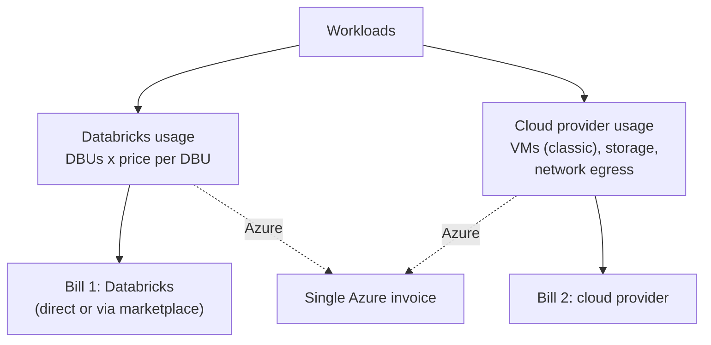

# How Databricks Pricing Works

Mastery: `INPUT[inlineSelect(option(new), option(learning), option(solid)):mastery]`

> [!story] Context
> [[Databricks vs Alternatives for Small Teams]] noted that billing units are not comparable across vendors, so each platform's meter must be understood on its own terms. This note explains the Databricks meter, the DBU, and why most customers receive two bills.

> [!eli5] Summary
> Databricks charges for the computing work you use, measured in units, similar to how an electricity meter measures kilowatt-hours. Different kinds of work have different prices per unit. The cloud provider may bill separately for the machines, storage, and network traffic you use.

> [!analogy]- Analogy: a taxi fare
> | Taxi | Databricks |
> |---|---|
> | Meter reading | DBUs consumed |
> | Fare rate for the trip type | Price per DBU for the SKU |
> | Fuel and tolls paid separately | Cloud provider charges for machines, storage, and network |
> | All-inclusive car service | Serverless compute |
> | Prepaid travel account at a discount | Committed-use contract |

## Background

Traditional software was licensed per server or per user regardless of use. Cloud platforms use usage-based pricing: you pay for what runs, when it runs. This removes upfront cost and idle charges for a small business but makes the bill less predictable. Understanding the meter is the basis for controlling it.

## Overview

Databricks pricing is usage-based: you pay for the DBUs your workloads consume, at a price per DBU set by the type of work, and the cloud provider may bill separately for infrastructure.

Five concepts determine a Databricks bill.

### 1. DBU

Databricks defines a [[DBUs|DBU (Databricks Unit)]] as a normalized unit of processing power used for measurement and pricing. The number of DBUs a workload consumes depends on the compute it uses and how long it runs.

### 2. SKU

Each type of workload is billed under a **SKU**, a price-list entry with its own price per DBU. In general order from lowest to highest price per DBU:

| Workload type | Example | Details |
|---|---|---|
| Automated jobs and pipelines | Nightly ingestion and transformation | [[Jobs Compute]], [[Lakeflow Spark Declarative Pipelines]] |
| SQL warehouses (classic, pro, serverless) | Dashboards and analyst queries | [[SQL Warehouses]] |
| Interactive (all-purpose) compute | Exploratory work in notebooks | [[All-Purpose Compute]] |
| Specialized services | Model serving, vector search, apps, Lakebase | [[Model Serving]], [[Databricks Apps]], [[Lakebase]] |

The same compute costs more as interactive work than as a scheduled job, so moving recurring work from notebooks to [[Lakeflow Jobs|jobs]] is a common saving. Enabling [[Photon]] increases DBU consumption per hour but often shortens run time.

### 3. Pricing tier

Each workspace has a pricing tier. The Standard tier is retired:

| Cloud | Change |
|---|---|
| AWS, Google Cloud | Standard workspaces moved to Premium on October 1, 2025 |
| Azure | New workspaces must use Premium from April 1, 2026; remaining Standard workspaces were scheduled for automatic upgrade to Premium on October 1, 2026 |

New customers should assume the Premium tier.

### 4. Serverless and classic compute

| | Classic compute | [[Serverless Compute\|Serverless compute]] |
|---|---|---|
| Where machines run | In your cloud account | Managed by Databricks |
| Databricks bills | DBUs | DBUs |
| Cloud provider bills | [[Virtual Machine\|Virtual machines]], disks, network, storage | Mainly storage and network |
| Idle cost | Accrues until the [[Cluster\|cluster]] terminates ([[Auto Termination]]) | No cluster for you to leave running |
| Configuration | You choose machine types, sizes, and [[Spot Instances\|spot]] usage | Databricks manages it |

This table summarizes the general model; check your cloud's pricing page for the charges each mode places on each bill. The Google Cloud trial documentation states the split explicitly: trial credits cover Databricks usage, and Google Cloud bills separately for the resources a classic workspace deploys. Pay-as-you-go usage is billed per second.

For jobs and pipelines, serverless compute offers two modes:

| Mode | Start-up | Cost | Availability |
|---|---|---|---|
| Performance-optimized | Fast | Higher DBU consumption | Jobs, pipelines, notebooks |
| Standard | 4–6 minutes | Up to 70% lower, because it consumes fewer DBUs on the same SKU | Jobs and triggered pipelines; not notebooks, continuous pipelines, or SQL warehouse tasks |

To use standard mode, turn off **Performance optimized** in the job or pipeline settings. See [[Serverless Compute]].

### 5. Two bills



- **AWS and Google Cloud:** Databricks bills DBUs (directly or through a cloud marketplace). The cloud provider bills machines, storage, and network separately.
- **Azure:** Microsoft bills Azure Databricks directly under your Azure subscription, so Databricks and Azure resource charges appear on the same Azure invoice as separate items.
- **Serverless:** Databricks manages the machines, so the virtual-machine charges on the cloud bill largely disappear. Storage and [[Egress|egress]] charges remain.

## How it works

### Purchase options

| Option | Description | Use when |
|---|---|---|
| **Pay-as-you-go** | No upfront cost; billed monthly at list prices, per second of usage | Starting out, or usage is small or irregular |
| **Committed use with Databricks** | Commit to a spend level for a term in exchange for discounts; larger commitments bring more benefits, including use across clouds | Usage is steady and forecastable for a year or more |
| **Azure pre-purchase (DBCU)** | Prepay Databricks commit units for one or three years through the Azure portal; Microsoft states savings of up to 37% on DBU charges versus pay-as-you-go | Steady usage on Azure |
| **AWS Marketplace** | Pay-as-you-go through AWS Marketplace; usage can bill against an existing AWS Enterprise Discount Program (EDP) commitment | The organization has an AWS spend commitment |

Committed-use discounts apply to DBU charges only. Virtual machines, storage, and network remain on standard cloud pricing.

### Monitoring spend

DBU usage is recorded in [[System Tables|system tables]]. The following query returns list-price cost by product for the last 30 days:

```sql
SELECT u.usage_date,
       u.billing_origin_product                    AS product,
       SUM(u.usage_quantity)                       AS dbus,
       SUM(u.usage_quantity * lp.pricing.default)  AS list_cost
FROM   system.billing.usage u
JOIN   system.billing.list_prices lp
  ON   u.sku_name = lp.sku_name
 AND   u.cloud    = lp.cloud
 AND   u.usage_end_time >= lp.price_start_time
 AND  (lp.price_end_time IS NULL OR u.usage_end_time < lp.price_end_time)
WHERE  u.usage_date >= current_date() - INTERVAL 30 DAYS
GROUP  BY ALL
ORDER  BY u.usage_date, list_cost DESC;
```

Account admins can create **budgets** with monthly thresholds and email alerts, scoped to the account or filtered by workspace, product, or tag. Budgets are calculated at list price and do not reflect credits or negotiated discounts; alerts can lag usage by up to 24 hours. See [[Budgets and Usage Dashboards]].

## Small-business considerations

> [!smallbiz] Small-business considerations
> Three practices keep the bill predictable:
> 1. Prefer serverless compute while usage is small, so no cluster is left running.
> 2. Run recurring work as scheduled jobs, not as manually run notebooks.
> 3. Configure a budget alert on the first day.
>
> Obtain current prices from the official pages: [Databricks pricing](https://www.databricks.com/product/pricing), [AWS](https://www.databricks.com/product/aws-pricing), [Azure](https://azure.microsoft.com/en-us/pricing/details/databricks/), and [Google Cloud](https://www.databricks.com/product/gcp-pricing). Each links to a pricing calculator. Then complete the estimate in [[Estimating Costs for a Small Business]].

## Cloud differences

> [!azure]- Azure Databricks
> - Microsoft bills Azure Databricks directly under the Azure subscription, alongside the Azure resources it uses.
> - **Databricks commit units (DBCU)** can be prepurchased for one or three years. Usage draws down the pool at a ratio that depends on the workload type, the discount applies to DBUs only, and prepurchased units apply automatically to eligible usage. See [[Azure Billing and Commit Units]].
> - Pricing: [Azure Databricks pricing](https://azure.microsoft.com/en-us/pricing/details/databricks/).

> [!aws]- Databricks on AWS
> - Two bills: Databricks (direct, or pay-as-you-go through AWS Marketplace) and AWS (machines for classic compute, storage, network). Marketplace usage can bill against an existing AWS EDP commitment.
> - For reducing the AWS portion of classic compute, see [[Spot Instances]] and [[EC2 Instance Types and Graviton]]. See also [[AWS Marketplace and Billing]].

> [!gcp]- Databricks on Google Cloud
> - During a trial, credits cover Databricks usage only; Google Cloud bills separately for resources that a classic workspace deploys. Billing integration is covered in [[Google Cloud Marketplace and Billing]].

## Advanced topics

> [!deepdive]- Advanced topics (301–401)
> - **List price versus contract price:** `system.billing.list_prices` contains list prices with start and end times. Negotiated discounts are not included, so budgets and system-table cost queries show list-price amounts.
> - **Attributing serverless spend:** Serverless compute has no cluster to tag. Apply **serverless usage policies**; their tags propagate to the `custom_tags` column of `system.billing.usage`. See [[Tagging for Chargeback]].
> - **SQL warehouses:** DBU consumption increases with warehouse size and running time, so size and auto-stop settings drive cost. See [[SQL Warehouses]].
> - **Genie budgets:** Genie usage has its own budget configuration. The SQL warehouse compute that runs Genie queries is billed separately.

## Common misconceptions

> [!confusion] A DBU is not a currency amount
> A DBU is a quantity. The price per DBU depends on the SKU, tier, cloud, region, and any contract.

> [!confusion] Serverless compute does not eliminate the cloud bill
> It removes most virtual-machine charges. Storage and network charges from the cloud provider remain.

> [!confusion] Two bills are not duplicate charges
> Databricks bills for its platform; the cloud provider bills for infrastructure, storage, and network. On Azure both appear on one invoice.

## Recall

What is a DBU?::A Databricks Unit, a normalized unit of processing power used to measure and price usage.
What determines the price per DBU?::The SKU (workload type), plus the tier, cloud, region, and any committed-use contract.
Which costs less per DBU: jobs compute or interactive compute?::Jobs compute.
Why do most customers receive two bills?::Databricks bills DBUs; the cloud provider bills machines (classic compute), storage, and network.
How does Azure billing differ?::Microsoft bills Azure Databricks directly, so DBUs and Azure resources appear on one Azure invoice.
What changes on the cloud bill with serverless compute?::Databricks manages the machines, so most VM charges disappear; storage and network charges remain.
What is serverless standard mode?::A mode for jobs and triggered pipelines with a 4–6 minute start-up that consumes fewer DBUs, up to 70% less than performance-optimized mode.
What do committed-use discounts cover?::DBU charges only.
Which system table records DBU usage?::`system.billing.usage`, with prices in `system.billing.list_prices`.
What happened to the Standard pricing tier?::It was retired: AWS and Google Cloud moved to Premium on October 1, 2025; Azure's remaining Standard workspaces were scheduled for upgrade on October 1, 2026.

## Next steps

> [!path] Learning path
> **Needs first:** [[What Databricks Is in Plain English]], [[Servers and the Cloud]]
> **Unlocks next:** [[Estimating Costs for a Small Business]], [[DBUs]], [[Cost Optimization Checklist]]

> [!nextup] Next
> [[Estimating Costs for a Small Business]] applies this model to a fill-in monthly estimate.

> [!sources]- Sources (last verified: 2026-10-25)
> - [Databricks pricing](https://www.databricks.com/product/pricing)
> - [Interactive workloads pricing (Databricks)](https://www.databricks.com/product/pricing/datascience-ml)
> - [Databricks SQL pricing](https://www.databricks.com/product/pricing/databricks-sql)
> - [AWS pricing by Databricks](https://www.databricks.com/product/aws-pricing)
> - [Azure Databricks pricing (Databricks)](https://www.databricks.com/product/azure-pricing)
> - [Databricks on Google Cloud pricing](https://www.databricks.com/product/gcp-pricing)
> - [Azure Databricks pricing (Microsoft)](https://azure.microsoft.com/en-us/pricing/details/databricks/)
> - [Optimize Azure Databricks costs with a prepurchase (Microsoft Learn)](https://learn.microsoft.com/en-us/azure/cost-management-billing/reservations/prepay-databricks-reserved-capacity)
> - [End of life for Standard tier workspaces (Azure Databricks)](https://learn.microsoft.com/en-us/azure/databricks/admin/account-settings/standard-tier)
> - [Manage your subscription (Azure Databricks)](https://learn.microsoft.com/en-us/azure/databricks/admin/account-settings/account)
> - [Best practices for serverless compute (AWS)](https://docs.databricks.com/aws/en/compute/serverless/best-practices)
> - [Run Lakeflow Jobs with serverless compute (AWS)](https://docs.databricks.com/aws/en/jobs/run-serverless-jobs)
> - [Serverless compute release notes (AWS)](https://docs.databricks.com/aws/en/release-notes/serverless)
> - [Pricing system table reference (AWS)](https://docs.databricks.com/aws/en/admin/system-tables/pricing)
> - [Monitor the cost of serverless compute (AWS)](https://docs.databricks.com/aws/en/admin/system-tables/serverless-billing)
> - [Create and monitor budgets (AWS)](https://docs.databricks.com/aws/en/admin/account-settings/budgets)
> - [Manage budgets and cost controls for Genie (AWS)](https://docs.databricks.com/aws/en/genie/budgets)
> - [Databricks pay-as-you-go on AWS Marketplace (press release)](https://www.databricks.com/company/newsroom/press-releases/databricks-strengthens-scope-of-work-with-aws)
> - [Start a Databricks free trial on Google Cloud](https://docs.databricks.com/gcp/en/admin/account-settings-gcp/create-subscription)
