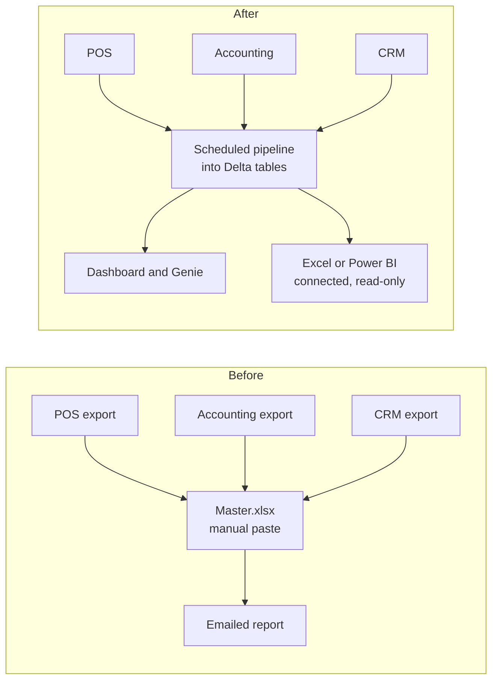

# Signs You Have Outgrown Spreadsheets

Mastery: `INPUT[inlineSelect(option(new), option(learning), option(solid)):mastery]`

> [!story] Context
> [[Who Uses Databricks - Business Types]] described which businesses benefit from a data platform. Most of them start with Excel, Access, or a single reporting tool. This note lists the indicators that such a setup no longer meets the business's needs.

> [!eli5] Summary
> Spreadsheets work well until many people, files, and copies cause the numbers to disagree. When maintaining the spreadsheet takes more time than using it, the business needs a more structured system.

## Background

[[Spreadsheets]] combine three functions that a data platform separates: storing data, calculating with it, and presenting it. This makes them quick to adopt and fragile as a business grows. Each copy of a file becomes its own version of the truth, formulas are hidden in cells, and it becomes unclear which version a report used. A data platform provides a [[Single Source of Truth|single source of truth]].

## Overview

The checklist groups ten indicators. Count one point for each indicator that applies today.

| # | Indicator | Example | What a platform provides |
|---|---|---|---|
| 1 | **Size limits** | Files take minutes to open, sheets approach Excel's row limit, or an Access database approaches its size cap | Tables in cloud storage that scale with the data ([[Delta Lake]]) |
| 2 | **Conflicting copies** | `Sales_FINAL_v7.xlsx`; two managers report different totals for the same period | One governed table read by everyone ([[Unity Catalog]]) |
| 3 | **Manual consolidation** | Someone exports from several systems every week and combines them by hand | Scheduled [[Data Pipeline\|pipelines]] ([[Lakeflow Jobs]], [[Lakeflow Connect]]) |
| 4 | **Key-person dependency** | Only one person understands the macros; reports stop when that person is absent | Shared, version-controlled code and schedules ([[Git Folders and Workspace Files]]) |
| 5 | **Formula errors** | A lookup returns the wrong row; a pasted range overwrites a formula | Tested transformations and [[Expectations and Data Quality\|data-quality checks]] |
| 6 | **No history** | Nobody can reproduce last month's figure before a correction | [[Time Travel]] and [[Data Lineage\|lineage]] |
| 7 | **Uncontrolled access** | Payroll or patient data circulates as email attachments that cannot be revoked | Permissions, [[Row Filters and Column Masks\|column masks]], and [[Audit Logs\|audit logs]] |
| 8 | **Cross-system questions** | Attributing repeat customers to ad campaigns requires joining four systems | [[Join\|Joins]] across all sources in [[SQL]] |
| 9 | **Stale dashboards** | A reporting tool refreshes from a file that was not updated | Dashboards that query current tables ([[AI-BI Dashboards]]) |
| 10 | **New requirements** | The business wants a forecast, a churn score, or an AI assistant on its own data | ML and AI on the same tables ([[MLflow]], [[Genie Agents]]) |

### Interpreting the score

| Score | Interpretation | Recommended action |
|---|---|---|
| 0–2 | Spreadsheets remain adequate | Consolidate to one master file with protected ranges on a shared drive |
| 3–5 | The setup is under strain | Evaluate a small database or BI tool, or [[Databricks Free Edition and Trials\|try Databricks]] on one costly report |
| 6–10 | The setup has been outgrown | Plan a move to a data platform; see [[Your First 30 Days on Databricks]] and [[Migrating from Excel and Access]] |

## How it works

After the move, the spreadsheet is no longer the data store. It becomes, at most, a read-only view of governed tables.



The first step is usually to upload the master sheet as a table and replace lookups with explicit joins:

```sql
-- Equivalent of a lookup that matches customer IDs to regions
SELECT o.order_id, o.order_date, o.total, c.region
FROM   main.sales.orders o
LEFT JOIN main.sales.customers c ON c.customer_id = o.customer_id;
```

## Small-business considerations

> [!smallbiz] Small-business considerations
> Excel can remain in use as a front end that reads governed tables, through a connector or exported results, while the data itself is stored in one place. Start with the report that consumes the most manual hours per week, rebuild it on the platform, and run it alongside the original for a month (see [[Running Old and New in Parallel]]). With a score of 3–5, also review lighter options in [[When Databricks Is Not the Right Fit]].

## Cloud differences

> [!azure]- Azure Databricks
> The indicators are the same on all clouds. Microsoft-centric organizations often keep Excel and Power BI as front ends connected to Azure Databricks tables. See [[Connecting Power BI]].

> [!aws]- Databricks on AWS
> No differences from the other clouds.

> [!gcp]- Databricks on Google Cloud
> No differences from the other clouds. Google Sheets has the same copy-management issues as Excel.

## Advanced topics

> [!deepdive]- Advanced topics (301–401)
> - **Spreadsheets as a source.** Treat recurring spreadsheets as an [[Ingestion|ingestion]] source: place them in a [[Volumes|volume]], load them with [[Auto Loader]] or `COPY INTO`, and enforce a schema ([[Schema Enforcement and Evolution]]).
> - **Access databases** usually contain a relational model of tables, keys, and saved queries. Migrate the tables and rewrite saved queries as views. See [[Migrating from Excel and Access]].
> - **Logic in formulas.** The most effort in a spreadsheet migration goes into identifying business rules embedded in cells. Document each formula as a SQL expression and compare old and new outputs.

## Common misconceptions

> [!confusion] File size is not the main indicator
> Most businesses outgrow spreadsheets because of copies, people, and manual effort, well before reaching size limits.

> [!confusion] A BI tool alone does not resolve a spreadsheet problem
> A dashboard built on an unmanaged spreadsheet inherits its errors. The data itself must move to governed tables.

## Recall

Which three functions does a spreadsheet combine?::Storing data, calculating with it, and presenting it.
What is manual consolidation?::Exporting data from several systems and combining it by hand on a recurring schedule.
What checklist score indicates that spreadsheets have been outgrown?::Six or more of the ten indicators.
Must Excel be abandoned when moving to Databricks?::No. Excel and Power BI can remain as front ends that read governed tables.
Which report should be migrated first?::The one that consumes the most manual hours per week.
How should recurring spreadsheet files be loaded?::As an ingestion source, for example into a volume with Auto Loader or `COPY INTO`, with schema enforcement.

## Next steps

> [!path] Learning path
> **Needs first:** [[Spreadsheets]], [[Who Uses Databricks - Business Types]]
> **Unlocks next:** [[When Databricks Is Not the Right Fit]], [[Migrating from Excel and Access]], [[Building a Business Case]]

> [!nextup] Next
> [[When Databricks Is Not the Right Fit]] lists situations where a simpler tool is the better choice.

> [!sources]- Sources (last verified: 2026-10-25)
> - [What is Lakeflow Connect? (GCP)](https://docs.databricks.com/gcp/en/ingestion/overview)
> - [Databricks AI/BI (AWS)](https://docs.databricks.com/aws/en/ai-bi)
> - [Tutorial: Explore dashboards and query data in Genie One (GCP)](https://docs.databricks.com/gcp/en/getting-started/analyst-get-started)
> - Excel and Access size limits are not quoted here because they were not confirmed against Microsoft's specifications in this review.
