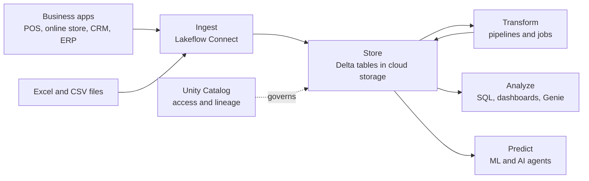

# What Databricks Is in Plain English

Mastery: `INPUT[inlineSelect(option(new), option(learning), option(solid)):mastery]`

> [!story] Context
> [[Chapter 00 - Is Databricks for You|Chapter 00]] helps a business decide whether to adopt Databricks. This note defines the platform without assuming any background in data.

> [!eli5] Summary
> Databricks is an online service where a business stores its records, cleans and combines them, analyzes them, and builds AI tools on top of them. It is rented by usage rather than installed on owned servers, and the data stays in storage the business controls.

> [!analogy]- Analogy: a shared commercial kitchen
> | Kitchen | Databricks |
> |---|---|
> | Pantry shelves with standard containers | Cloud storage holding open-format files ([[Delta Lake]], [[Apache Parquet\|Parquet]]) |
> | Stoves, paid for by the gas burned | Compute, billed in [[DBUs]] |
> | Recipe cards | [[Notebooks]], [[SQL]] queries, and [[Lakeflow Jobs\|scheduled jobs]] |
> | Head chef's inventory and access list | [[Unity Catalog]] |
> | Front-of-house menu | [[AI-BI Dashboards\|Dashboards]] and [[Genie]] |

## Background

Business data is usually spread across several systems: a point-of-sale system or online store, an accounting package, a CRM, and spreadsheets. For years the standard architecture paired a [[Data Lakes|data lake]] for low-cost raw storage with a [[Data Warehouses|data warehouse]] for curated reporting. Keeping the two in sync was slow and costly; this vault calls it [[The Two-Tier Architecture Problem]].

Databricks is built on [[The Lakehouse Idea|the lakehouse]] architecture: one copy of the data, stored in open file formats, serving reporting, data engineering, and machine learning. The company's origin and its relationship to the open-source [[Apache Spark]] engine are covered in [[The Founding of Databricks]].

## Overview

Databricks is a cloud data platform delivered as a managed service on Microsoft Azure, Amazon Web Services, or Google Cloud. Databricks calls it the [[The Data Intelligence Platform|Data Intelligence Platform]]. It combines six functions that previously required separate products:

| Function | Description | Databricks product | Details |
|---|---|---|---|
| Store | Keep tables and files in one place, in open formats | Delta Lake tables, volumes | [[Delta Lake]], [[Volumes]] |
| Ingest | Copy data from applications and databases on a schedule | Lakeflow Connect | [[Lakeflow Connect]] |
| Transform | Turn raw exports into trusted tables | Lakeflow Spark Declarative Pipelines, Lakeflow Jobs | [[Lakeflow Spark Declarative Pipelines]], [[Lakeflow Jobs]] |
| Govern | Control access and track where values come from | Unity Catalog | [[Unity Catalog]] |
| Analyze | SQL, dashboards, natural-language questions | Databricks SQL, AI/BI dashboards, Genie | [[Databricks SQL]], [[AI-BI Dashboards]], [[Genie]] |
| Predict and automate | Forecasts, machine learning, AI agents | Mosaic AI, MLflow, Agent Bricks | [[MLflow]], [[Agent Bricks]] |

Two properties matter most to a business reader:

- **Data stays in open formats in storage you control.** Tables are files in cloud object storage, either your own or Databricks-managed default storage. Other engines can read open formats, which reduces [[Vendor Lock-In]].
- **Pricing is usage-based.** Pay-as-you-go usage is measured in [[DBUs]], a normalized unit of processing, and billed per second. Cloud provider charges may apply separately. See [[How Databricks Pricing Works]].

## How it works



A typical first task is to upload a sales export as a table and query it:

```sql
-- Top five products by revenue in the previous calendar month
SELECT product_name,
       SUM(quantity * unit_price) AS revenue
FROM   main.sales.orders
WHERE  order_date >= date_trunc('month', current_date()) - INTERVAL 1 MONTH
  AND  order_date <  date_trunc('month', current_date())
GROUP  BY product_name
ORDER  BY revenue DESC
LIMIT  5;
```

The same table can then feed a dashboard, a scheduled alert, and a forecast without copying data between systems.

Business users do not need to use notebooks or compute settings. **Genie One** (formerly Databricks One, renamed in 2026) is the simplified interface where they open dashboards, ask questions in natural language, and use apps. See [[Databricks One]] and [[Genie]].

## Small-business considerations

> [!smallbiz] Small-business considerations
> Databricks is the step after "spreadsheets plus one reporting tool". It is worth evaluating when data lives in several systems, someone spends hours each week combining exports, or you want forecasting or AI on your own records. It is more than you need if all your data is in one application with adequate built-in reports. To evaluate it, use [[Databricks Free Edition and Trials|Free Edition or a free trial]], and read [[Signs You Have Outgrown Spreadsheets]] and [[When Databricks Is Not the Right Fit]].

## Cloud differences

> [!azure]- Azure Databricks
> Azure Databricks is a first-party Microsoft service (see [[First-Party Microsoft Service]]). You create it in the Azure portal, and Microsoft bills it directly under your Azure subscription. See [[Azure Databricks Overview]].

> [!aws]- Databricks on AWS
> You can sign up with Databricks directly (express setup requires only an email address) or subscribe pay-as-you-go through AWS Marketplace. See [[Databricks on AWS Overview]].

> [!gcp]- Databricks on Google Cloud
> You start from a Google Cloud account. Billing is covered in [[Google Cloud Marketplace and Billing]]. See [[Databricks on Google Cloud Overview]].

## Advanced topics

> [!deepdive]- Advanced topics (301–401)
> - **Control plane and compute plane.** The division between the services Databricks operates and the compute that processes your data is covered in [[Control Plane and Compute Plane]] and [[Serverless Compute]].
> - **Open formats.** Unity Catalog governs [[Delta Lake]] and managed [[Apache Iceberg]] tables, and external engines can read through its Iceberg REST interface. See [[Open Table Formats]] and [[Delta UniForm]].
> - **Accounts and workspaces.** One Databricks account contains one or more workspaces. Governance is defined at the account level. See [[Accounts and Workspaces]].

## Common misconceptions

> [!confusion] Databricks is not installed software
> Databricks is a managed cloud service. It stores data as files in cloud object storage rather than inside a single database engine on a server you own.

> [!confusion] Databricks is not only for very large data
> Most tables in a small business are small. The value at that scale is one governed place for data, schedules, dashboards, and AI.

> [!confusion] Databricks is not the same as Apache Spark
> Apache Spark is an open-source processing engine. Databricks is a platform that uses Spark and adds a catalog, pipelines, BI, and AI tools. See [[Apache Spark]] and [[Photon]].

## Recall

What is Databricks in one sentence?::A cloud data platform for storing, transforming, governing, analyzing, and building AI on an organization's data in one place.
Which three clouds does Databricks run on?::Microsoft Azure, Amazon Web Services, and Google Cloud.
What unit does Databricks use to measure usage?::The DBU (Databricks Unit), a normalized unit of processing.
Where is table data stored on Databricks?::As open-format files (usually Delta Lake) in cloud object storage.
What does Unity Catalog do?::Catalogs all data and AI assets, controls access, and records lineage and usage.
What is the current name of the business-user interface?::Genie One (formerly Databricks One), renamed in 2026.

## Next steps

> [!path] Learning path
> **Needs first:** [[What Is Data]]
> **Unlocks next:** [[Who Uses Databricks - Roles]], [[The Data Intelligence Platform]], [[Accounts and Workspaces]]

> [!nextup] Next
> [[Who Uses Databricks - Roles]] describes the job roles that use Databricks and the tools each one uses.

> [!sources]- Sources (last verified: 2026-10-25)
> - [Databricks AI/BI (AWS)](https://docs.databricks.com/aws/en/ai-bi)
> - [Use Genie One (Azure Databricks)](https://learn.microsoft.com/en-us/azure/databricks/genie-one/)
> - [AI/BI and Genie One release notes 2026 (AWS)](https://docs.databricks.com/aws/en/ai-bi/release-notes/2026)
> - [What is Lakeflow Connect? (GCP)](https://docs.databricks.com/gcp/en/ingestion/overview)
> - [Databricks pricing](https://www.databricks.com/product/pricing)
> - [Sign up for Databricks with express setup (AWS)](https://docs.databricks.com/aws/en/getting-started/express-setup)
> - [Databricks pay-as-you-go on AWS Marketplace (press release)](https://www.databricks.com/company/newsroom/press-releases/databricks-strengthens-scope-of-work-with-aws)
