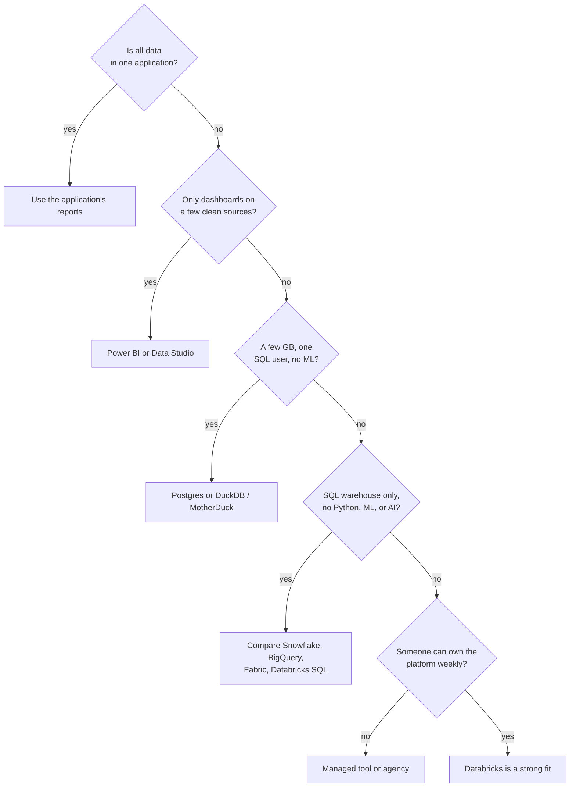

# When Databricks Is Not the Right Fit

Mastery: `INPUT[inlineSelect(option(new), option(learning), option(solid)):mastery]`

> [!story] Context
> [[Signs You Have Outgrown Spreadsheets]] provides a score that indicates when a business needs more than spreadsheets. A high score does not by itself mean that Databricks is the right replacement. This note lists situations where a smaller or simpler tool is the better choice.

> [!eli5] Summary
> Databricks is a large, flexible platform. When a business only needs a few reports or a simple database, a smaller tool is cheaper and faster to adopt. Choose the smallest tool that meets current needs and leaves room to grow.

## Background

Selecting a platform that is larger than necessary costs a small business twice: in the bill and in the staff time needed to learn and operate it. Databricks is pay-as-you-go, so the main risk is not license cost but setup effort, required skills, and unused complexity. See [[Total Cost of Ownership]].

## Overview

Databricks is not the right fit when a smaller tool meets the business's current needs at lower cost and with less effort to operate.

The table lists ten situations, the better fit for each, and the condition under which Databricks becomes the stronger option.

> [!confusion] About the other products named here
> The short descriptions of Power BI, Data Studio (formerly Looker Studio), Postgres, DuckDB, MotherDuck, Snowflake, BigQuery, and Microsoft Fabric were checked against each vendor's documentation (see Sources). Features and pricing change often; consult each vendor's documentation before deciding.

| # | Situation | Better fit | Databricks becomes the stronger option when |
|---|---|---|---|
| 1 | **All data is in one application** with adequate built-in reports (for example an online store, accounting package, or practice-management system) | The application's own reports or analytics add-on | A second or third system must be combined with it |
| 2 | **Dashboards on a few clean sources** in a Microsoft environment | **Power BI** on its own | Refreshes become slow, logic is duplicated across reports, or Python and [[Machine Learning Basics\|machine learning (ML)]] are needed |
| 3 | **Simple charts on Google data** (Sheets, GA4, Google Ads) | **Data Studio** (formerly Looker Studio), a no-cost Google tool | Governed history, joins across many non-Google sources, or scheduled transformations are needed |
| 4 | **A database for an application** (orders, bookings, user accounts) | An operational database such as **Postgres** or MySQL | Heavy analytics on that data is also needed; replicate it to a [[The Lakehouse Idea\|lakehouse]] with [[Change Data Capture\|CDC]] (see [[OLTP vs OLAP]]). Databricks also offers [[Lakebase]] for operational data |
| 5 | **A few gigabytes of analytics data** and one SQL user | **Postgres** as a small [[Data Warehouses\|warehouse]], or **DuckDB** locally (**MotherDuck** is a hosted service built on DuckDB) | Several people need shared, governed access, or data volume and schedules grow |
| 6 | **A SQL-only team that needs only a warehouse** | **Snowflake** or **BigQuery** are established options | Python data engineering, ML, streaming, or AI agents are needed on the same data |
| 7 | **An organization standardized on Microsoft Fabric** with Power BI at the center | **Microsoft Fabric** | Multiple clouds, deeper engineering and ML tooling, or direct control over open-format storage is needed (see [[Microsoft Fabric and OneLake vs Databricks]]) |
| 8 | **No one can own the platform**: no staff member or contractor can spend a few hours a week on data | A managed reporting tool or an agency service | A data person is hired or contracted |
| 9 | **Fixed monthly costs are required** and no one can configure budgets or alerts | A per-seat [[SaaS PaaS and IaaS\|SaaS]] tool with a flat fee | The organization accepts usage billing with [[Budgets and Usage Dashboards\|budgets]] and auto-termination |
| 10 | **A one-time analysis** | Excel, or Databricks [[Databricks Free Edition and Trials\|Free Edition]] for learning (non-commercial use only) | The analysis becomes a recurring job |

## How it works

Evaluate the questions in order and stop at the first that applies.

## Small-business considerations

> [!smallbiz] Small-business considerations
> Starting with a smaller tool and moving later is a low-cost mistake, because the data and its definitions carry over. Starting with a large platform and no one to operate it is a high-cost mistake. When the decision is unclear, run a two-week [[Proof of Concept|proof of concept]] on a [[Databricks Free Edition and Trials|free trial]] using the most labor-intensive report. Continue if it saves measurable time and the usage is understood; otherwise use a simpler tool.

## Cloud differences

> [!azure]- Azure Databricks
> Microsoft-centric organizations typically compare Azure Databricks with Power BI alone and with Microsoft Fabric. Power BI can connect to Azure Databricks, so the options are not mutually exclusive. See [[Connecting Power BI]], [[Power BI on Azure Databricks]], and [[Microsoft Fabric and OneLake vs Databricks]].

> [!aws]- Databricks on AWS
> AWS-based organizations typically compare Databricks with Amazon Redshift and with a managed Postgres database. See [[Amazon Redshift]].

> [!gcp]- Databricks on Google Cloud
> Google Cloud organizations typically compare Databricks with BigQuery. For using both or migrating gradually, see [[BigQuery Integration]] and [[Google BigQuery]].

## Advanced topics

> [!deepdive]- Advanced topics (301–401)
> - **Total cost.** Compare staff time, setup, and future migration effort, not only compute rates. See [[Total Cost of Ownership]].
> - **Open formats reduce switching cost.** Databricks stores tables in open formats ([[Delta Lake]], [[Apache Iceberg]]), which simplifies moving in either direction. See [[Open Table Formats]] and [[Vendor Lock-In]].
> - **Mixed architectures.** Many organizations keep an operational database for the application, a BI tool for reports, and Databricks for engineering and ML. [[Lakehouse Federation]] queries some external databases in place.

## Common misconceptions

> [!confusion] Pay-as-you-go is not zero cost when idle
> Classic compute that is left running continues to incur charges. Serverless compute and [[Auto Termination|auto-termination]] reduce this risk, but someone must still monitor usage.

> [!confusion] A reporting tool is not a data platform
> Power BI models and transforms data for reports. It is not designed to be the governed store for all of an organization's data, pipelines, and ML.

## Recall

Name three situations in which Databricks is more than a business needs.::All data in one application with adequate reports; dashboards only on a few clean sources; no one available to own the platform.
What is a better fit for an application's own database?::An operational database such as Postgres or MySQL, or Databricks Lakebase if it should run inside Databricks.
When does a SQL-only warehouse team have a stronger case for Databricks?::When Python data engineering, ML, streaming, or AI agents are needed on the same data.
What is the lowest-cost way to test fit?::A short proof of concept on a free trial using the most labor-intensive report.
Why is starting with a smaller tool a low-risk choice?::The data and its definitions carry over, and open formats simplify a later move.

## Next steps

> [!path] Learning path
> **Needs first:** [[Signs You Have Outgrown Spreadsheets]]
> **Unlocks next:** [[Databricks vs Alternatives for Small Teams]], [[Building a Business Case]]

> [!nextup] Next
> [[Databricks vs Alternatives for Small Teams]] compares Databricks with the main alternatives side by side.

> [!sources]- Sources (last verified: 2026-10-25)
> - [Databricks pricing](https://www.databricks.com/product/pricing)
> - [Sign up for Databricks: free trial vs Free Edition (AWS)](https://docs.databricks.com/aws/en/getting-started/free-trial-vs-free-edition)
> - [Databricks Free Edition limitations (AWS)](https://docs.databricks.com/aws/en/getting-started/free-edition-limitations)
> - [Managed database connectors (GCP)](https://docs.databricks.com/gcp/en/ingestion/lakeflow-connect/cdc-overview)
> - [Welcome to Data Studio: Looker Studio is now called Data Studio (Google Cloud)](https://docs.cloud.google.com/data-studio/welcome)
> - [Data Studio: connect to Google Ads (Google Cloud)](https://docs.cloud.google.com/data-studio/connect-to-google-ads)
> - [Power BI service features by license type (Microsoft Learn)](https://learn.microsoft.com/en-us/power-bi/fundamentals/service-features-license-type)
> - [What is Microsoft Fabric? (Microsoft Learn)](https://learn.microsoft.com/en-us/fabric/fundamentals/microsoft-fabric-overview)
> - [About PostgreSQL (postgresql.org)](https://www.postgresql.org/about/)
> - [Why DuckDB (duckdb.org)](https://duckdb.org/why_duckdb)
> - [MotherDuck documentation: getting started](https://motherduck.com/docs/getting-started/)
> - [Supported cloud platforms (Snowflake docs)](https://docs.snowflake.com/en/user-guide/intro-cloud-platforms)
> - [Understand slots (BigQuery docs)](https://cloud.google.com/bigquery/docs/slots)
