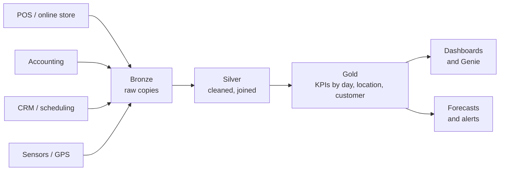

# Who Uses Databricks - Business Types

Mastery: `INPUT[inlineSelect(option(new), option(learning), option(solid)):mastery]`

> [!story] Context
> [[Who Uses Databricks - Roles]] described the people who use Databricks. This note describes the kinds of businesses that use it, their typical data sources, the features that matter to each, and an assessment of fit at small-business scale.

> [!eli5] Summary
> Databricks helps any business whose records are spread across several programs and who wants them combined in one place to measure what is working. Online stores, groups of clinics, small factories, and charities all have this need. The more sources and locations a business has, the more value it gets.

## Background

Small and mid-sized businesses rarely have very large data volumes. They have many separate systems, each with its own reports, and none connected to the others. Questions that span systems, such as which marketing channel produces repeat customers, require joining advertising, sales, and CRM data. Without a platform, answering them means manually exporting and combining files every week. See [[Signs You Have Outgrown Spreadsheets]].

## Overview

The table lists common business types with their usual data sources, the relevant Databricks features, example questions, and a fit assessment.

| Business type | Usual data sources | Relevant Databricks features | Example questions | Fit at small scale |
|---|---|---|---|---|
| **E-commerce and DTC brands** | Shopify or WooCommerce, Google Analytics 4, ad platforms, email tool, Stripe | [[Lakeflow Connect]] (GA4, Google Ads, and others), [[AI-BI Dashboards]], [[Genie]], [[Machine Learning Basics\|ML]] for churn and lifetime value | Which channel produces repeat buyers? Which products are bought together? | Strong once ad spend and order volume make attribution material. A single-channel store with adequate built-in reports may not need it yet. |
| **Multi-location retail and restaurants** | POS per location, inventory, scheduling and payroll, delivery apps, loyalty program | Scheduled [[Lakeflow Jobs]], [[Medallion Architecture]], [[Metric Views]] for consistent definitions, [[SQL Alerts]] | Which location is understaffed on Fridays? What quantity should each location order next week? | Typically from about three locations, when comparing locations manually becomes a recurring task. |
| **Franchises** | Each franchisee's POS (often different vendors), royalties, marketing fund, customer surveys | One shared catalog with [[Row Filters and Column Masks\|row filters]] per franchisee, [[AI-BI Dashboards]], [[OpenSharing]] for partners | Which franchisees are declining? How is a new menu item performing across units? | Strong. The franchisor's core task is comparing many similar units; row-level security is the key feature. |
| **Clinics and dental groups** | Practice management or EHR exports, scheduling, billing and claims, patient surveys | [[Unity Catalog]], [[Row Filters and Column Masks\|column masks]] on [[PII]], [[Audit Logs]], [[Compliance Security Profile]] | Where are no-show rates highest? Which procedures have the longest claim delays? | Suitable for multi-practice groups. Patient data is regulated (for example [[HIPAA]] in the US); confirm that your contract and workspace configuration support it before loading data. |
| **Logistics and field services** | Dispatch and routing software, GPS or telematics, job tickets, parts inventory | [[Structured Streaming on Databricks\|Streaming]] for vehicle data, [[Auto Loader]] for file drops, forecasting | Which routes run late? How many technicians are needed next month? | Strong when telematics or sensor data arrives continuously. |
| **Small manufacturers** | Machine sensors ([[IoT]]), ERP, quality logs, supplier data | [[Auto Loader]] and streaming for sensor data, [[Lakeflow Spark Declarative Pipelines]], [[MLflow]] for predictive maintenance | Which machine is likely to fail? Which supplier's parts correlate with defects? | Strong with connected machines. Without sensor data, ERP reporting may be sufficient. |
| **SaaS and fintech startups** | Product database (Postgres or MySQL), event tracking, billing, support tickets | [[Lakeflow Connect]] database connectors with [[Change Data Capture\|CDC]], [[Delta Lake]], [[Databricks Apps]], [[Lakebase]], AI agents | Which behaviors predict an upgrade? Which accounts are at risk? | Good for engineering-led teams that want SQL, Python, and AI on one platform. Very early startups can use a database plus a BI tool for some time. |
| **Agencies (marketing, analytics, consulting)** | Each client's ad accounts, web analytics, CRM, spreadsheets | Catalogs per client, [[Privileges and Grants]], [[OpenSharing]] to deliver results, dashboards per client | Which campaigns outperform the benchmark across clients? | Suitable when the agency delivers repeatable reporting for many clients. Keep each client's data in separate catalogs or schemas. |
| **Nonprofits and schools** | Donor CRM, fundraising platform, program data, student information system, grants | [[AI-BI Dashboards]] for boards and funders, [[Genie]] for staff, governance for donor and student [[PII]] | Which donors are lapsing? Which programs reach the most people per unit of spend? | Often limited by budget and skills unless a data person is available. [[Databricks Free Edition and Trials\|Free Edition]] supports learning but not production or commercial use. |
| **Microsoft-centric organizations** | Dynamics 365, SQL Server, SharePoint and Excel, Power BI | [[Azure Databricks Overview\|Azure Databricks]], [[Connecting Power BI]], [[Power BI on Azure Databricks]], [[Migrating from SQL Server]] | Can Power BI read governed tables instead of many spreadsheets? | Natural fit on Azure, where Azure Databricks is a first-party Microsoft service. Also evaluate Microsoft Fabric (see [[Microsoft Fabric and OneLake vs Databricks]]). |

### A typical week by business type

| Business type | Recurring activity on Databricks |
|---|---|
| E-commerce | A nightly job loads orders, sessions, and ad spend; the owner reviews channel return on ad spend every Monday in a dashboard. |
| Multi-location retail | Each morning, location managers open a dashboard of the previous day's sales per labor hour; an alert fires when a location falls below target. |
| Franchise | Each franchisee sees only their own units in a shared dashboard; head office compares all units in the same dashboard without a filter. |
| Clinic group | A weekly job computes no-show rates by provider and weekday; masked columns hide patient identifiers from non-clinical staff. |
| Logistics | GPS events stream into a table; a dispatcher reviews late-route exceptions each afternoon. |
| Manufacturer | Sensor files land every few minutes; a model scores each machine daily and writes a maintenance list. |
| SaaS startup | Product database changes replicate continuously; the team reviews a weekly account-health table. |
| Agency | A scheduled job refreshes each client's catalog; account managers share dashboards with clients. |
| Nonprofit | A monthly job prepares a board dashboard of donations and program reach. |
| Microsoft-centric | Power BI reports refresh from Azure Databricks tables instead of spreadsheets on SharePoint. |

## How it works

Most business types follow the same pattern; only the sources differ.



Example gold table for a multi-location business:

```sql
CREATE OR REPLACE TABLE analytics.gold.daily_store_kpis AS
SELECT s.store_name,
       o.order_date,
       COUNT(DISTINCT o.order_id)             AS orders,
       SUM(o.total)                           AS revenue,
       SUM(o.total) / NULLIF(SUM(l.hours), 0) AS revenue_per_labor_hour
FROM   analytics.silver.orders o
JOIN   analytics.silver.stores s USING (store_id)
LEFT JOIN analytics.silver.labor_hours l
       ON l.store_id = o.store_id AND l.work_date = o.order_date
GROUP  BY ALL;
```

A franchise adds a [[Row Filters and Column Masks|row filter]] so each franchisee group sees only its own `store_id` values.

## Small-business considerations

> [!smallbiz] Small-business considerations
> Databricks is usually justified when at least two of the following are true: data lives in three or more systems; someone spends several hours a week combining exports; the same metrics are needed across many locations, clients, or franchisees; data arrives continuously (sensors, GPS, web events); or you need forecasts or AI on your own records. If only one is true, a simpler tool may cost less; see [[When Databricks Is Not the Right Fit]].
>
> Not every source has a managed connector. Lakeflow Connect includes connectors for many SaaS applications and databases (for example Salesforce, Google Analytics, SQL Server, ServiceNow, and HubSpot). For other systems, including many POS products, use a partner tool such as [[Fivetran and ELT Tools|Fivetran]], a scheduled file export, or the vendor's API.

## Cloud differences

> [!azure]- Azure Databricks
> The usual choice for Microsoft-centric organizations: Microsoft Entra ID sign-in, billing on the Azure subscription, and integration with Power BI, Azure Data Factory, and SQL Server. See [[Azure Databricks Overview]] and [[Choosing a Cloud for Databricks]].

> [!aws]- Databricks on AWS
> Common for e-commerce, SaaS, and fintech teams whose applications already run on AWS, for example with files in [[Amazon S3]]. See [[Databricks on AWS Overview]].

> [!gcp]- Databricks on Google Cloud
> Suited to businesses already using Google Cloud and BigQuery. See [[BigQuery Integration]] and [[Databricks on Google Cloud Overview]].

## Advanced topics

> [!deepdive]- Advanced topics (301–401)
> - **Multi-tenant patterns.** Franchises and agencies choose between one catalog per tenant (strong isolation, more objects) and one shared catalog with row filters (simpler, requires careful policy design). [[Attribute-Based Access Control]] scales the shared pattern with tags.
> - **Regulated data.** For health, payment, and education data, configure the [[Compliance Security Profile]], [[Encryption|customer-managed keys]], and private networking ([[Network Security Overview]]) before go-live.
> - **Batch first.** Most small businesses need hourly or daily refresh. Use streaming only where latency has a measurable cost. See [[Batch vs Streaming]].

## Common misconceptions

> [!confusion] Fit depends on complexity, not company size
> The number of systems, the manual effort to combine them, and the need for governed sharing determine fit more than row counts do.

> [!confusion] A managed connector is not available for every application
> Check the current Lakeflow Connect connector list for your cloud. Where a connector is missing, use a partner tool, a file export, or an API.

## Recall

Which business types benefit most from Databricks?::Those with data in many systems, many similar units to compare, continuous data such as sensors or GPS, or a need for forecasting and AI.
Which feature restricts each franchisee to their own locations?::Row filters in Unity Catalog, or ABAC policies based on tags.
What must a clinic confirm before loading patient data?::That its contract and workspace configuration support regulated data such as HIPAA, for example with the compliance security profile, column masks, and audit logs.
Why is Azure Databricks a natural fit for Microsoft-centric organizations?::It is a first-party Microsoft service with Entra ID sign-in, Azure billing, and Power BI integration.
What is the alternative when Lakeflow Connect has no connector for a source?::A partner ingestion tool, a scheduled file export, or the vendor's API.
What is the general threshold for adopting Databricks?::At least two of: many systems, hours of manual consolidation, many units to compare, continuous data, or a need for ML or AI.

## Next steps

> [!path] Learning path
> **Needs first:** [[What Databricks Is in Plain English]], [[Who Uses Databricks - Roles]]
> **Unlocks next:** [[Signs You Have Outgrown Spreadsheets]], [[Estimating Costs for a Small Business]]

> [!nextup] Next
> [[Signs You Have Outgrown Spreadsheets]] lists the indicators that a business needs a data platform.

> [!sources]- Sources (last verified: 2026-10-25)
> - [Managed SaaS connectors (AWS)](https://docs.databricks.com/aws/en/ingestion/lakeflow-connect/saas-overview)
> - [Managed database connectors (GCP)](https://docs.databricks.com/gcp/en/ingestion/lakeflow-connect/cdc-overview)
> - [Managed connector FAQs (AWS)](https://docs.databricks.com/aws/en/ingestion/lakeflow-connect/faq)
> - [Databricks AI/BI (AWS)](https://docs.databricks.com/aws/en/ai-bi)
> - [Genie (Azure Databricks)](https://learn.microsoft.com/en-us/azure/databricks/genie/)
> - [Databricks pricing](https://www.databricks.com/product/pricing)
