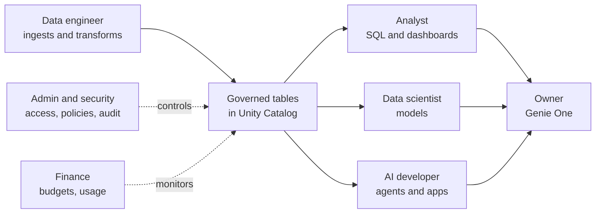

# Who Uses Databricks - Roles

Mastery: `INPUT[inlineSelect(option(new), option(learning), option(solid)):mastery]`

> [!story] Context
> [[What Databricks Is in Plain English]] defined the platform. This note describes the eight job roles that work in it, what each role does day to day, and which Databricks tools each one uses.

> [!eli5] Summary
> Different people use Databricks for different jobs: some view reports, some build the data feeds, some build predictions, and some manage security and cost. In a small company, one person often covers several of these roles.

## Background

Earlier data stacks gave each role a separate tool: analysts used a [[Data Warehouses|warehouse]], engineers used a [[Apache Hadoop|Hadoop]] [[Cluster|cluster]], data scientists used local machines, and administrators used separate access tools. Every hand-off required exporting and copying data, and the copies drifted apart. Databricks places all roles on one copy of the data under one permission model ([[Unity Catalog]]), so a dashboard and a forecast read the same table.

## Overview

A role in this note is a job function, such as analyst or data engineer, that determines which Databricks tools a person uses; it is not a permission level. Databricks grants permissions to [[Users Groups and Service Principals|users, groups, and service principals]]. The recommended practice is one group per role (for example `analysts`, `engineers`, `admins`), so that onboarding a new person requires only a group membership.

### Roles and tools

| Role | Vault persona | Main Databricks tools | Example questions | Learning path |
|---|---|---|---|---|
| Business owner or executive | `owner` | [[Genie One\|Genie One]], [[AI-BI Dashboards]], [[Genie Agents]] | Which locations grew this quarter? What is the sales forecast for next month? | [[Path - Business Owner]] |
| Analyst or BI developer | `analyst` | [[SQL Editor]], [[SQL Warehouses]], [[AI-BI Dashboards]], [[Metric Views]], [[Connecting Power BI\|Power BI]] | What is the repeat-customer rate by channel? | [[Path - Analyst]] |
| Data engineer | `engineer` | [[Lakeflow Connect]], [[Lakeflow Spark Declarative Pipelines]], [[Lakeflow Jobs]], [[Notebooks]] | Did the overnight load complete, and is the data complete? | [[Path - Data Engineer]] |
| Data scientist or ML engineer | `scientist` | [[Notebooks]], [[MLflow]], [[AutoML]], [[Feature Engineering and Feature Store]], [[Model Serving]] | Which customers are likely to churn? | [[Path - Data Scientist and ML Engineer]] |
| AI or application developer | `ai-dev` | [[Agent Bricks]], [[Mosaic AI Agent Framework]], [[AI Search]], [[Databricks Apps]], [[Lakebase]] | Can staff query the policy manual and receive cited answers? | [[Path - AI App Developer]] |
| Platform or cloud admin | `admin` | [[Account Console]], [[Compute Policies]], [[SCIM Provisioning]], [[Declarative Automation Bundles]] | Who has access to production? Does all compute shut down when idle? | [[Path - Platform Admin]] |
| Security, privacy, or compliance lead | `security` | [[Unity Catalog]], [[Row Filters and Column Masks]], [[Audit Logs]], [[Data Classification]] | Who accessed patient records last week? | [[Path - Platform Admin]] |
| Finance or FinOps (cloud cost management) | `finance` | [[Budgets and Usage Dashboards]], [[System Tables]], [[Tagging for Chargeback]] | What did data workloads cost last month, and which team incurred the cost? | [[Cost Management Basics]] |

This vault defines a ninth persona, `solo`: the one-person data team at a 10–50 person company who acts as analyst, engineer, admin, and cost owner. See [[Path - One-Person Data Team]].

## How it works

All roles work on the same governed tables. Data flows from ingestion to consumption; access control and cost monitoring apply across the flow.



### Typical tasks by role

| Role | Recurring task | Project task | Outcome |
|---|---|---|---|
| Owner | Reviews the daily sales dashboard in Genie One | Asks Genie to compare this week with the same week last year by store | A staffing or purchasing decision based on current data |
| Analyst | Maintains the weekly [[KPI]] dashboard | Defines "active customer" once in a metric view so all reports agree | Reports that use one consistent definition |
| Data engineer | Checks overnight [[Lakeflow Jobs\|job]] runs and data-quality [[Expectations and Data Quality\|expectations]] | Adds a new source, such as a CRM, through Lakeflow Connect | New data lands on schedule in tested [[Medallion Architecture\|silver and gold]] tables |
| Data scientist | Explores order history in a notebook | Trains a demand forecast, tracks runs in MLflow, and registers the selected model | A forecast table refreshed weekly |
| AI developer | Indexes internal documents for [[Retrieval-Augmented Generation\|RAG]] | Deploys an internal assistant with Databricks Apps | Grounded answers with source citations |
| Admin | Reviews access requests and group membership | Updates a compute policy to enforce auto-termination | No unmanaged or oversized compute |
| Security | Reviews [[Audit Logs\|audit logs]] for sensitive tables | Adds a column mask on phone numbers | Sensitive columns visible only to authorized groups |
| Finance | Reviews the monthly usage dashboard | Configures a budget alert per workspace | Spend tracked against a monthly threshold |

### Mapping roles to grants

Administrators implement roles as groups and grants:

```sql
-- Analysts read curated data; engineers can also modify it
GRANT USE CATALOG ON CATALOG analytics TO `analysts`;
GRANT USE SCHEMA, SELECT ON SCHEMA analytics.sales TO `analysts`;

GRANT USE CATALOG ON CATALOG analytics TO `engineers`;
GRANT ALL PRIVILEGES ON SCHEMA analytics.sales TO `engineers`;
```

## Small-business considerations

> [!smallbiz] Small-business considerations
> A 5–50 person company usually has two effective roles: a few people who view results (owner and managers) and one or two people who build. Create groups from the start (for example `viewers`, `builders`, `admins`); this has no cost and avoids a later clean-up. Viewers can work entirely in [[Genie One|Genie One]] without learning compute or notebooks. Plan for the builder to spend regular time on administration and cost review.

## Cloud differences

> [!azure]- Azure Databricks
> Users and groups usually come from Microsoft Entra ID, so Databricks groups can mirror existing Microsoft 365 groups. Azure resource permissions and Databricks permissions are separate systems. See [[Microsoft Entra ID Integration]].

> [!aws]- Databricks on AWS
> Users and groups are usually synced from an [[Identity Provider|identity provider]] (see [[SCIM Provisioning]]). AWS IAM roles appear in the setup, but they grant Databricks access to storage rather than identifying people. See [[S3 Access via Unity Catalog]] and [[Cross-Account IAM Role]].

> [!gcp]- Databricks on Google Cloud
> [[Google Service Accounts|Google service accounts]] grant Databricks access to storage (see [[GCS Access via Unity Catalog]]). People are managed as Databricks users and groups, as on the other clouds.

## Advanced topics

> [!deepdive]- Advanced topics (301–401)
> - **Layered admin roles:** Administration is split between the account and each workspace. See [[Admin Roles]] and [[Account Console]].
> - **Service principals for automation:** Run scheduled jobs as a [[Users Groups and Service Principals|service principal]] rather than a person, so they continue to run when staff change.
> - **Least privilege:** Grant at the schema level to groups, and reserve individual grants for exceptions. See [[Least Privilege]] and [[Privileges and Grants]].
> - **Persona mapping:** The vault's persona-to-note mapping is generated in the [[Persona Map]].

## Common misconceptions

> [!confusion] A role is not a Databricks permission
> The eight roles are job functions. Access is controlled by groups and grants in Unity Catalog. One person can hold several roles, and one group can serve several people.

> [!confusion] Business viewers do not need notebooks
> Owners and managers can use Genie One, dashboards, and Genie exclusively. Notebooks and pipelines are tools for builders.

## Recall

Name the eight roles that use Databricks.::Owner, analyst, data engineer, data scientist, AI or application developer, platform admin, security or compliance lead, finance or FinOps.
Which Databricks interface is designed for business users?::Genie One (formerly Databricks One), which provides dashboards, Genie, and apps.
What is the `solo` persona?::The one-person data team at a small business who covers several roles.
Which tool does a data engineer use to schedule work?::Lakeflow Jobs.
Which tool does a data scientist use to track experiments and models?::MLflow.
Where does a finance user review Databricks spend?::Budgets and usage dashboards, and the billing system tables.
Why grant access to groups instead of individuals?::Onboarding requires only a group membership, and access stays consistent and auditable.

## Next steps

> [!path] Learning path
> **Needs first:** [[What Databricks Is in Plain English]]
> **Unlocks next:** [[Who Uses Databricks - Business Types]], [[Persona Map]], the role paths in [[Chapter 80 - Learning Paths]]

> [!nextup] Next
> [[Who Uses Databricks - Business Types]] maps common business types to their data sources, Databricks features, and fit.

> [!sources]- Sources (last verified: 2026-10-25)
> - [Databricks AI/BI (AWS)](https://docs.databricks.com/aws/en/ai-bi)
> - [Use Genie One (AWS)](https://docs.databricks.com/aws/en/genie-one)
> - [Tutorial: Explore dashboards and query data in Genie One (Azure Databricks)](https://learn.microsoft.com/en-us/azure/databricks/getting-started/analyst-get-started)
> - [Genie Agents (Azure Databricks)](https://learn.microsoft.com/en-us/azure/databricks/genie-agents/)
> - [Managed SaaS connectors (AWS)](https://docs.databricks.com/aws/en/ingestion/lakeflow-connect/saas-overview)
> - [Create and monitor budgets (AWS)](https://docs.databricks.com/aws/en/admin/account-settings/budgets)
