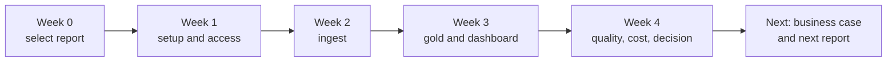

# Your First 30 Days on Databricks

Mastery: `INPUT[inlineSelect(option(new), option(learning), option(solid)):mastery]`

> [!story] Context
> [[Choosing a Cloud for Databricks]] selected the cloud. This note is a week-by-week plan for a small business, from sign-up to the first dashboard that the owner uses for decisions, with links to the vault notes that cover each task.

> [!eli5] Summary
> The first month has one goal: replace one time-consuming report with an automatic, trustworthy one. Week 1 sets up access and cost alerts, week 2 brings the data in, week 3 builds the dashboard, and week 4 checks quality and cost before deciding what comes next.

## Background

Data platform projects in small companies often stall because they attempt to migrate everything at once. A narrow first project, one report and three or fewer sources, delivers a measurable result within a month and establishes the conventions (catalogs, groups, schedules, budgets) that later projects reuse. See [[Proof of Concept]] and [[Migration Strategy Overview]].

## Overview

| Week | Goal | Exit criteria |
|---|---|---|
| 0 (preparation) | Select the target report and cloud | A named report, its sources, its owner, and the hours it currently costs per week |
| 1 | Workspace, access, and cost controls | Groups, catalogs, and a budget alert exist; the first file is queryable |
| 2 | Data ingestion | All sources for the report land in bronze and silver tables on a schedule |
| 3 | Gold tables and dashboard | A dashboard and a Genie Agent answer the report's questions |
| 4 | Quality, cost, and decision | Quality checks pass, the new report matches the old one, measured cost is known, and a go or no-go decision is recorded |

## How it works



### Week 0: Preparation

1. Choose the report that costs the most manual hours per week (see [[Signs You Have Outgrown Spreadsheets]]).
2. List its sources and confirm how each one will be ingested: a [[Lakeflow Connect]] connector, a partner tool, or a file export.
3. Record the current effort in hours per week as the baseline for the [[Building a Business Case|business case]].
4. Choose the cloud ([[Choosing a Cloud for Databricks]]) and start a [[Databricks Free Edition and Trials|free trial]] there.

### Week 1: Setup, access, and cost controls

1. Create groups for the roles you have, for example `viewers`, `builders`, and `admins` (see [[Users Groups and Service Principals]]).
2. Create a small catalog structure in [[Unity Catalog]] and grant access to groups:

   ```sql
   CREATE CATALOG IF NOT EXISTS analytics;
   CREATE SCHEMA  IF NOT EXISTS analytics.bronze;
   CREATE SCHEMA  IF NOT EXISTS analytics.silver;
   CREATE SCHEMA  IF NOT EXISTS analytics.gold;

   GRANT USE CATALOG ON CATALOG analytics TO `builders`;
   GRANT ALL PRIVILEGES ON SCHEMA analytics.bronze TO `builders`;
   GRANT ALL PRIVILEGES ON SCHEMA analytics.silver TO `builders`;
   GRANT ALL PRIVILEGES ON SCHEMA analytics.gold   TO `builders`;

   GRANT USE CATALOG ON CATALOG analytics TO `viewers`;
   GRANT USE SCHEMA, SELECT ON SCHEMA analytics.gold TO `viewers`;
   ```

3. Create a budget with an email alert in the account console (see [[Budgets and Usage Dashboards]]).
4. Confirm that SQL warehouses have auto-stop enabled and that any classic compute has [[Auto Termination|auto-termination]] and a [[Compute Policies|compute policy]].
5. Create a [[Volumes|volume]] and upload one real export. Query it in the [[SQL Editor]].

### Week 2: Ingestion

1. Connect each source. Use [[Lakeflow Connect]] where a managed connector exists; otherwise schedule a file export into a volume.
2. Load file exports into bronze tables incrementally with [[COPY INTO]] or [[Auto Loader]]:

   ```sql
   CREATE TABLE IF NOT EXISTS analytics.bronze.pos_sales;

   COPY INTO analytics.bronze.pos_sales
   FROM '/Volumes/analytics/bronze/landing/pos/'
   FILEFORMAT = CSV
   FORMAT_OPTIONS ('header' = 'true', 'inferSchema' = 'true')
   COPY_OPTIONS ('mergeSchema' = 'true');
   ```

3. Build silver tables that clean types, remove duplicates, and standardize keys, following the [[Medallion Architecture]]. For declarative pipelines, see [[Lakeflow Spark Declarative Pipelines]].
4. Schedule the steps as one [[Lakeflow Jobs|job]] on serverless compute. Use standard mode if a start-up delay of a few minutes is acceptable.
5. Keep code in a [[Git Folders and Workspace Files|Git folder]].

### Week 3: Gold tables and dashboard

1. Build gold tables at the grain the report needs, for example one row per location per day (see [[Data Modeling Basics]] and [[Star Schema]]).
2. Define key measures once as [[Metric Views|metric views]] so every consumer uses the same definitions.
3. Build an [[AI-BI Dashboards|AI/BI dashboard]] that reproduces the report.
4. Create a [[Genie Agents]] Agent on the gold tables, with sample questions and business rules.
5. Share the dashboard with the `viewers` group, who open it in [[Genie One|Genie One]]. If the business uses Power BI, connect it instead (see [[Connecting Power BI]]).

### Week 4: Quality, cost, and decision

1. Add data-quality checks ([[Expectations and Data Quality]]) for row counts, nulls in keys, and value ranges.
2. Compare the new report with the old one for the same periods (see [[Running Old and New in Parallel]]). Resolve every difference.
3. Add a [[SQL Alerts|SQL alert]] for the most important threshold, such as daily revenue below target.
4. Read measured usage from `system.billing.usage` and update [[Estimating Costs for a Small Business|the cost estimate]].
5. Record the decision: adopt, extend the trial or proof of concept, or stop. If adopting, add a payment method before the trial credits expire and start the [[Building a Business Case|business case]].

## Small-business considerations

> [!smallbiz] Small-business considerations
> The plan assumes one builder spending part of each week on it. Keep the scope to one report and no more than three sources; defer machine learning, streaming, private networking, and full migration until the first report is trusted. Free-trial credits last 14 days, so complete weeks 1 and 2 within the trial, or add a payment method with a budget alert before the credits expire. Use a de-identified sample until security settings for sensitive data are confirmed.

## Cloud differences

> [!azure]- Azure Databricks
> Week 1 starts in the Azure portal: create the workspace ([[Creating an Azure Databricks Workspace]]), then add Microsoft Entra ID groups ([[Microsoft Entra ID Integration]]). Microsoft bills usage on the Azure subscription.

> [!aws]- Databricks on AWS
> Week 1 can start with express setup, which creates a serverless workspace without an AWS account. To use your own S3 storage, see [[Account Setup on AWS]] and [[S3 Access via Unity Catalog]].

> [!gcp]- Databricks on Google Cloud
> Week 1 starts from a Google Cloud account ([[Account Setup on Google Cloud]]). Trial credits cover Databricks usage only; Google Cloud bills classic workspace resources separately. For storage access, see [[GCS Access via Unity Catalog]].

## Advanced topics

> [!deepdive]- Advanced topics (301–401)
> - **Promote to production with code.** After the first month, define jobs and pipelines in [[Declarative Automation Bundles]] and deploy through [[CI-CD for Data Pipelines|CI/CD]].
> - **Separate environments.** Create `dev` and `prod` catalogs or workspaces and use [[Users Groups and Service Principals|service principals]] for scheduled jobs.
> - **Cost attribution.** Tag jobs and apply serverless usage policies from the start so that later chargeback is possible. See [[Tagging for Chargeback]].
> - **Next sources.** Use the [[Migration Checklist]] and [[Assessing Your Current Data Estate]] to plan the next reports.

## Common misconceptions

> [!confusion] The first month is not a full migration
> The goal is one trusted report and reusable conventions. Migrating every report comes later.

> [!confusion] A dashboard is not trusted until it matches the old report
> Run the old and new reports in parallel and resolve differences before retiring the old process.

## Recall

What is the goal of the first 30 days?::Replace one labor-intensive report with an automated, trusted one, and establish reusable conventions.
What should be in place by the end of week 1?::Groups, a catalog structure with grants, a budget alert, auto-stop or auto-termination, and one queryable file.
How are file exports loaded incrementally into bronze tables?::With `COPY INTO` or Auto Loader.
Why define measures as metric views?::So that every dashboard, Genie Agent, and BI tool uses the same definitions.
How do you confirm the new report is correct?::Run it in parallel with the old report for the same periods and resolve all differences.
Where do you read measured usage at the end of the month?::`system.billing.usage`.
What should be deferred until after the first report is trusted?::Machine learning, streaming, private networking, and full migration.

## Next steps

> [!path] Learning path
> **Needs first:** [[Choosing a Cloud for Databricks]], [[Databricks Free Edition and Trials]]
> **Unlocks next:** [[Building a Business Case]], [[Migration Checklist]], [[Path - One-Person Data Team]]

> [!nextup] Next
> [[Building a Business Case]] uses the first month's results to justify adoption to an owner or board.

> [!sources]- Sources (last verified: 2026-10-25)
> - [Sign up for Databricks for free (AWS)](https://docs.databricks.com/aws/en/getting-started/free-trial)
> - [Sign up for Databricks with express setup (AWS)](https://docs.databricks.com/aws/en/getting-started/express-setup)
> - [Sign up for Azure Databricks for free (Microsoft Learn)](https://learn.microsoft.com/en-us/azure/databricks/getting-started/free-trial)
> - [Start a Databricks free trial on Google Cloud](https://docs.databricks.com/gcp/en/admin/account-settings-gcp/create-subscription)
> - [What is Lakeflow Connect? (GCP)](https://docs.databricks.com/gcp/en/ingestion/overview)
> - [Run Lakeflow Jobs with serverless compute (AWS)](https://docs.databricks.com/aws/en/jobs/run-serverless-jobs)
> - [Databricks AI/BI (AWS)](https://docs.databricks.com/aws/en/ai-bi)
> - [Create and manage a Genie Agent (AWS)](https://docs.databricks.com/aws/en/genie-agents/set-up)
> - [Tutorial: Explore dashboards and query data in Genie One (Azure Databricks)](https://learn.microsoft.com/en-us/azure/databricks/getting-started/analyst-get-started)
> - [Create and monitor budgets (AWS)](https://docs.databricks.com/aws/en/admin/account-settings/budgets)
> - [Monitor the cost of serverless compute (AWS)](https://docs.databricks.com/aws/en/admin/system-tables/serverless-billing)
