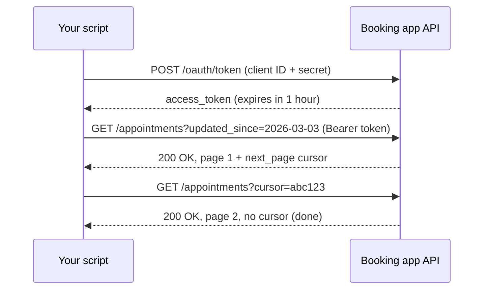

# APIs

Mastery: `INPUT[inlineSelect(option(new), option(learning), option(solid)):mastery]`

> [!story] Context
> [[Python for Data]] showed how to process data once it is available. Much of a small business's data sits inside [[SaaS PaaS and IaaS|SaaS]] applications (point-of-sale, booking, accounting, customer relationship management), and the standard way for a program to retrieve it is the application's API.

> [!eli5] Summary
> An API is a defined way for one program to ask another program for information or to tell it to do something. A booking app's API lets another program request "all appointments from yesterday" and receive them in a structured format, without anyone clicking an export button.

> [!analogy]- Analogy: a restaurant's ordering window
> | Ordering window | API |
> |---|---|
> | The printed menu of what can be ordered | API documentation: the available endpoints |
> | Placing an order at the window | A request |
> | The tray handed back | A response, usually JSON |
> | Showing a membership card first | Authentication with a [[Token\|token]] |
> | "Maximum five orders per minute" | Rate limits |
> | A text message when your order is ready | A [[Webhook\|webhook]] |

## Background

Before web APIs, getting data out of business software meant direct database access (rarely allowed for hosted software), scheduled file exports, or manual downloads. Each of these is fragile: file layouts change, someone forgets to click export, and the data is only as fresh as the last download.

As software moved to the web and to SaaS, vendors began publishing APIs: documented, versioned interfaces that other programs can call over HTTP (the protocol web browsers use). Roy Fielding's 2000 doctoral dissertation at the University of California, Irvine described the **REST** architectural style that most web APIs follow today. See [[REST]].

For a small business, APIs are now the main route to its own data, because the systems of record are SaaS applications it does not host.

## Overview

An **API (application programming interface)** is a contract that defines which requests a program can make, what each request needs, and what it returns. Most data APIs are web APIs over HTTPS:

| Part | What it is | Booking-app example |
|---|---|---|
| **Base URL** | Where the API lives | `https://api.bookingapp.example/v2` |
| **Endpoint** | A resource you can access | `/appointments` |
| **Method** | The action | `GET` read, `POST` create, `PUT`/`PATCH` update, `DELETE` remove |
| **Parameters** | Filters and options | `?updated_since=2026-03-03&page=2` |
| **Authentication** | Proof of who is calling | An API key, or an [[OAuth]] access token |
| **Response** | The returned data and a status code | [[CSV and JSON\|JSON]] body, `200 OK` or `429 Too Many Requests` |
| **Pagination** | Results split across pages | `next_page` cursor in the response |
| **Rate limit** | Maximum requests per period | 100 requests per minute |

Other interface types appear in data work:

| Interface | Used for | Note |
|---|---|---|
| **REST / JSON over HTTPS** | Most SaaS data | The default for web services |
| **[[Webhook\|Webhooks]]** | The application pushes an event to your URL when something changes | Avoids polling (repeatedly asking whether anything changed) |
| **[[JDBC and ODBC]]** | SQL connections to databases and warehouses | How [[BI Tools\|BI tools]] connect to [[Databricks SQL]] |
| **SDKs** (software development kits) | Language libraries that wrap an API | For example the Databricks SDK for Python |

## How it works



A minimal incremental pull in Python. The endpoint is illustrative; real APIs document their own paths and parameters:

```python
import os, requests, json

BASE = "https://api.bookingapp.example/v2"
headers = {"Authorization": f"Bearer {os.environ['BOOKING_API_TOKEN']}"}  # never hard-code secrets
params = {"updated_since": "2026-03-03T00:00:00Z", "page_size": 100}

rows, url = [], f"{BASE}/appointments"
while url:
    r = requests.get(url, headers=headers, params=params, timeout=30)
    r.raise_for_status()                      # stop on 4xx/5xx errors
    body = r.json()
    rows.extend(body["data"])
    url, params = body.get("next_page"), None # follow pagination

with open("/Volumes/clinic/raw/bookings/2026-03-03.json", "w") as f:
    for row in rows:
        f.write(json.dumps(row) + "\n")       # JSON Lines: one record per line
```

Databricks itself is also controlled through a REST API. Listing clusters with the [[Databricks CLI]] or with `curl` (the Clusters API endpoint is `GET /api/2.1/clusters/list`):

```bash
# Uses OAuth or a token configured for the CLI
databricks clusters list

# The same call over raw HTTP
curl -s -H "Authorization: Bearer $DATABRICKS_TOKEN" \
  "https://$DATABRICKS_HOST/api/2.1/clusters/list"
```

## Small-business considerations

> [!smallbiz] Small-business considerations
> - **Check for a managed connector first.** Writing and maintaining API code (pagination, retries, schema changes, rate limits) is ongoing work. If [[Lakeflow Connect]] or a tool such as [[Fivetran and ELT Tools|Fivetran]] supports your application, it usually costs less in staff time than custom code.
> - **Write custom API code for the long tail:** a niche booking system or a local supplier's portal that no connector supports.
> - **Store credentials as secrets,** never in notebooks or scripts. See [[Secrets Management]].
> - **Pull incrementally.** Request only records changed since the last run (`updated_since`), not the full history every time.

> [!bridge]- In Databricks today
> - **Managed SaaS connectors:** [[Lakeflow Connect]] provides managed connectors for applications such as Salesforce and Workday (Workday HCM, Workday Reports, and Workday Activity Logging). Each connector uses a Unity Catalog connection to store credentials, an ingestion pipeline, and streaming destination tables, and runs on serverless compute. The connectors handle authentication, incremental reads, schema evolution, and retries. You choose objects, destination, schedule, and permissions, but not the ingestion logic itself.
> - **Custom APIs:** write Python in a notebook or job, land the raw JSON in a [[Volumes|volume]] or table, and schedule it with [[Lakeflow Jobs]].
> - **Automating Databricks:** the Databricks REST API, the [[Databricks CLI]], and the SDKs. See [[Databricks SDKs and REST API]].
> - **Authentication to Databricks:** Databricks strongly recommends OAuth for both users and service principals. Personal access tokens (PATs) are a legacy option. See [[Authentication - Tokens and OAuth]].

## Cloud differences

> [!azure]- Azure Databricks
> Azure Databricks also accepts Microsoft Entra ID access tokens, for users and service principals, to authenticate REST API calls. Workspace URLs and OAuth endpoints differ from AWS and Google Cloud, so check the Azure Databricks authentication docs before copying examples.

> [!aws]- Databricks on AWS
> OAuth and PAT authentication work as described in Advanced topics. Endpoint paths are documented on the AWS docs pages.

> [!gcp]- Databricks on Google Cloud
> OAuth user-to-machine authentication is documented for Google Cloud. Check the GCP docs for endpoint paths, which can differ by cloud.

## Advanced topics

> [!deepdive]- Advanced topics (301–401)
> - **OAuth on Databricks.** User-to-machine (U2M) tokens come from the `/oidc/v1/token` endpoint and are valid for one hour; the SDKs and CLI refresh them automatically. Machine-to-machine (M2M) authentication uses a service principal's client ID and secret. A service principal can have up to five OAuth secrets, each valid for up to two years, and access tokens expire after one hour.
> - **Personal access tokens.** A PAT is valid for one workspace only. A user can create up to 600 PATs per workspace, Databricks automatically revokes PATs unused for 90 days, PATs cannot automate account-level APIs, and admins can disable PAT authentication for a workspace.
> - **Idempotent requests.** Retries after a timeout can create duplicates if the request is not [[Idempotency|idempotent]]. `GET` and `PUT` are idempotent by design; for `POST`, use idempotency keys where the API supports them, or deduplicate downstream with [[MERGE and Upserts|MERGE]].
> - **Incremental extraction patterns.** Cursor-based pagination is safer than page numbers when records change during extraction. Filtering by `updated_at` can miss deletes; use a deletes endpoint, a [[Webhook|webhook]], or periodic full reconciliation.
> - **Rate limits and backoff.** Handle `429` and `5xx` responses with exponential backoff and jitter, and respect `Retry-After` headers.
> - **Schema drift.** SaaS vendors add fields without notice. Land raw JSON first (as `VARIANT` or JSON files), then parse into typed columns, so a new field does not break the load. See [[Schema Enforcement and Evolution]].

## Common misconceptions

> [!confusion] An API is not a database connection
> An API exposes only what the vendor chooses, in the shape the vendor chooses, with rate limits. A database connection lets you run arbitrary SQL. SaaS vendors almost always offer the former, not the latter.

> [!confusion] "REST API" and "API" are not synonyms
> REST is one architectural style for web APIs. Other approaches include GraphQL (a query language for APIs), gRPC (a remote procedure call framework), and SOAP (an XML-based messaging protocol). Most SaaS data APIs are REST-style.

## Recall

What does API stand for?::Application programming interface.
What is an API endpoint?::A specific resource path an API exposes, such as `/appointments`.
Which HTTP methods read, create, and delete?::`GET` reads, `POST` creates, `DELETE` removes (`PUT`/`PATCH` update).
What does HTTP status 429 mean?::Too many requests: a rate limit was exceeded.
What is a webhook?::The application sends an HTTP request to your URL when an event happens, instead of you polling.
Which Databricks product provides managed connectors to SaaS applications?::Lakeflow Connect.
Which authentication method does Databricks recommend for its REST API?::OAuth, for both users and service principals.
How long are Databricks OAuth access tokens valid?::One hour.
After how many days of non-use does Databricks revoke a personal access token?::90 days.

## Next steps

> [!path] Learning path
> **Needs first:** [[CSV and JSON]], [[Python for Data]]
> **Unlocks next:** [[ETL vs ELT]], [[Lakeflow Connect]], [[Databricks SDKs and REST API]], [[Ingestion]]

> [!nextup] Next
> [[ETL vs ELT]] covers the overall pattern for extracting data from sources such as APIs, transforming it, and loading it into an analytical store.

> [!sources]- Sources (last verified: 2026-10-25)
> - [Managed SaaS connectors (AWS)](https://docs.databricks.com/aws/en/ingestion/lakeflow-connect/saas-overview)
> - [Managed SaaS connectors (GCP)](https://docs.databricks.com/gcp/en/ingestion/lakeflow-connect/saas-overview)
> - [Managed SaaS connectors (Azure Databricks)](https://learn.microsoft.com/en-us/azure/databricks/ingestion/lakeflow-connect/saas-overview)
> - [Managed connector FAQs (AWS)](https://docs.databricks.com/aws/en/ingestion/lakeflow-connect/faq)
> - [Databricks REST API reference](https://docs.databricks.com/api/workspace/introduction)
> - [Authorize service principal access with OAuth (AWS)](https://docs.databricks.com/aws/en/dev-tools/auth/oauth-m2m)
> - [Authenticate with personal access tokens, legacy (AWS)](https://docs.databricks.com/aws/en/dev-tools/auth/pat)
> - [Authorize user access with OAuth (Azure Databricks)](https://learn.microsoft.com/en-us/azure/databricks/dev-tools/auth/oauth-u2m)
> - [Authorize user access with OAuth (GCP)](https://docs.databricks.com/gcp/en/dev-tools/auth/oauth-u2m)
> - [Roy T. Fielding, Architectural Styles and the Design of Network-based Software Architectures (dissertation, UC Irvine, 2000)](https://ics.uci.edu/~fielding/pubs/dissertation/top.htm)
> - [List clusters: GET /api/2.1/clusters/list (Databricks REST API reference)](https://docs.databricks.com/api/workspace/clusters/list)
> - [Databricks CLI commands (AWS)](https://docs.databricks.com/aws/en/dev-tools/cli/commands)
> - [Get Microsoft Entra ID tokens manually (Azure Databricks)](https://learn.microsoft.com/en-us/azure/databricks/dev-tools/auth/user-aad-token)
> - [What is GraphQL? (graphql.org)](https://graphql.org/)
> - [Introduction to gRPC (grpc.io)](https://grpc.io/docs/what-is-grpc/introduction/)
> - [SOAP Version 1.2 Part 1: Messaging Framework (W3C Recommendation)](https://www.w3.org/TR/soap12-part1/)
