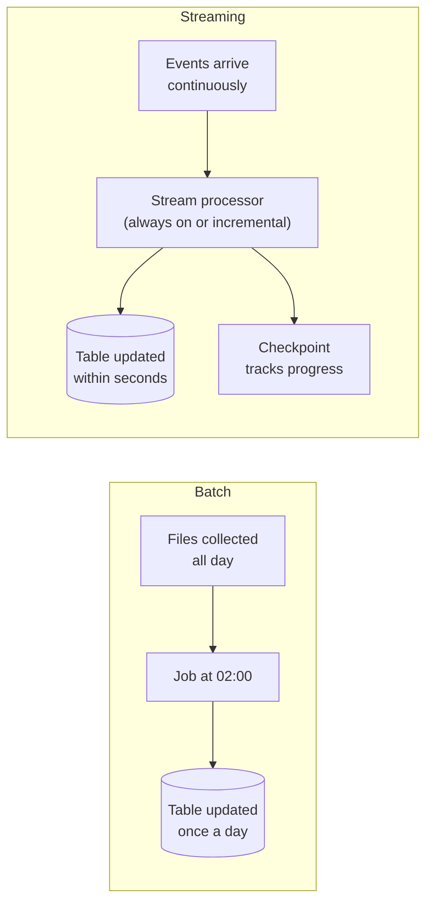

# Batch vs Streaming

Mastery: `INPUT[inlineSelect(option(new), option(learning), option(solid)):mastery]`

> [!story] Context
> [[ETL vs ELT]] described how data moves from sources into an analytical store. A pipeline also needs a cadence: it can process data in scheduled chunks, or continuously as each record arrives.

> [!eli5] Summary
> Batch processing collects data and handles it all at once on a schedule, such as every night. Streaming handles each piece of data within seconds of its arrival. Batch is simpler and cheaper; streaming is for decisions that cannot wait.

> [!analogy]- Analogy: mail and a phone call
> | Communication | Processing style |
> |---|---|
> | Mail collected and delivered once a day | Batch |
> | A phone call, answered as it happens | Streaming |
> | Checking a mailbox every few minutes | Micro-batch |
> | The time between sending and reading | [[Latency]] |

## Background

Early data processing was batch by necessity: jobs ran overnight on mainframes (large central computers), and reports were ready the next morning. Nightly batch loads into a [[Data Warehouses|data warehouse]] remain the most common pattern in analytics.

Some decisions cannot wait for the next morning:

- Blocking a fraudulent card payment before it completes.
- Alerting a clinic when a patient checks in.
- Updating stock levels on a website as items sell.
- Monitoring sensor readings from equipment ([[IoT]]).

These needs led to streaming systems that process [[Event|events]] continuously, usually reading from a [[Message Queue|message queue]] or event log such as [[Apache Kafka]]. Later chapters cover how [[Structured Streaming]] in Apache Spark unified both styles in one API.

## Overview

Batch processing handles a bounded set of data in one run on a schedule, while streaming processes an unbounded flow of records continuously as they arrive.

| | Batch | Streaming |
|---|---|---|
| **Processes** | A bounded set of data: yesterday's files, last hour's rows | An unbounded flow of records |
| **Runs** | On a schedule or on demand, then stops | Continuously, or in frequent small increments |
| **[[Latency]]** | Minutes to hours | Seconds to sub-second |
| **Cost profile** | Compute runs only during the job | Compute runs as long as the stream runs, unless triggered incrementally |
| **Complexity** | Lower: rerun the job to fix an error | Higher: late and out-of-order data, state (running results kept between records), [[Checkpoint\|checkpoints]] |
| **Typical use** | Daily sales reports, monthly finance, model training | Fraud checks, live dashboards, alerts, operational sync |
| **Typical sources** | Files, database extracts, API pulls | Message queues, event logs, [[Change Data Capture\|CDC]] feeds |

The two are not strictly separate. A streaming engine can run **incrementally on a schedule**: start, process everything that arrived since the last run, and stop. This gives batch-like cost with streaming-style bookkeeping of what has already been processed.

## How it works



In Apache Spark Structured Streaming on Databricks, the same code can run in either style. The **trigger** controls the cadence:

```python
# Read new POS export files as a stream, using Auto Loader (options per the Auto Loader docs)
orders = (spark.readStream
    .format("cloudFiles")
    .option("cloudFiles.format", "csv")
    .option("header", "true")
    .load("/Volumes/bakery/raw/pos_exports/"))

# Incremental batch: process everything new, then stop.
# Schedule this with Lakeflow Jobs (for example, hourly).
(orders.writeStream
    .option("checkpointLocation", "/Volumes/bakery/raw/_checkpoints/orders")
    .trigger(availableNow=True)
    .toTable("bakery.bronze.orders"))
```

Trigger options on Databricks:

| Trigger | Behavior | Use when |
|---|---|---|
| `availableNow=True` | Processes all available data, then stops | Scheduled incremental batch; minute-level freshness at lower cost |
| `processingTime="1 minute"` | Runs fixed-interval micro-batches and keeps running; the interval sets how often the query checks for new data | Continuous pipelines with near-real-time needs |
| `realTime="5 minutes"` | Real-time mode; the interval sets the long-running batch and checkpoint duration, not per-record latency | Operational workloads that need sub-second latency |
| `once=True` | Processes one batch and stops | Deprecated; migrate to `availableNow` |

## Small-business considerations

> [!smallbiz] Small-business considerations
> - **Default to batch:** Nightly or hourly refreshes meet nearly all small-business reporting needs and keep compute costs low.
> - **Use incremental batch rather than full reloads:** `availableNow` with a checkpoint processes only new files, so the hourly job stays fast as history grows.
> - **Choose streaming only for a concrete decision** that needs data within seconds, such as fraud checks or live stock levels, and estimate the cost of always-on compute first.

> [!bridge]- In Databricks today
> - **One engine for both:** [[Structured Streaming on Databricks|Structured Streaming]] runs batch, incremental, and continuous workloads with the same API.
> - **Serverless:** on serverless notebooks and jobs, the supported triggers are `availableNow` and `once`. The Spark default, `processingTime("0 seconds")`, is not supported on serverless compute.
> - **Real-time mode:** the docs describe end-to-end latency under one second at the tail and around 300 ms in common cases, and a newer Google Cloud page cites latency as low as five milliseconds. Real-time mode is available in Lakeflow pipelines and Structured Streaming. Some connectors do not support it on serverless, so check the trigger documentation for your source.
> - **Declarative pipelines:** [[Streaming Tables|streaming tables]] in [[Lakeflow Spark Declarative Pipelines]] process new data incrementally, and [[Materialized Views|materialized views]] keep aggregates up to date.
> - **Files and SaaS sources:** [[Auto Loader]] ingests new files incrementally, and [[Lakeflow Connect]] managed connectors write to streaming destination tables.
> - **Scheduling:** [[Lakeflow Jobs]] runs incremental batch jobs on a schedule or when files arrive.

## Cloud differences

> [!note] Nothing differs by cloud
> Batch and streaming behave the same on Azure, AWS, and Google Cloud. Message-queue services differ by cloud (Azure Event Hubs, Amazon Kinesis, and Google Pub/Sub), and Databricks has a streaming connector for each; Event Hubs is read through its Kafka-compatible endpoint. Kafka runs on all three.

## Advanced topics

> [!deepdive]- Advanced topics (301–401)
> - **Event time vs. processing time:** Event time is when something happened; processing time is when the system sees it. Mobile apps and sensors send late data, so aggregations by event time need a [[Watermark|watermark]] that defines how late data may arrive before a window closes.
> - **State and checkpoints:** Streaming aggregations and joins keep state across micro-batches. A [[Checkpoint|checkpoint]] in durable storage records offsets and state so a restarted query resumes where it stopped. Changing a query in incompatible ways can require a new checkpoint.
> - **Delivery guarantees:** At-most-once can lose data, at-least-once can duplicate it, and [[Exactly-Once Processing|exactly-once]] requires replayable sources, checkpoints, and idempotent or transactional sinks. When Structured Streaming writes to a Delta table, the Delta transaction log guarantees exactly-once processing, even with other streams or batch queries writing to the same table.
> - **Changing triggers:** Switching a query from a time-based interval to `availableNow` can cause a micro-batch to run as an incremental batch before all available records are processed. Plan trigger changes deliberately.
> - **Guidance by workload:** The Databricks production guidance recommends real-time mode for operational, sub-second workloads and `availableNow` for cost-sensitive, minute-level freshness, and advises against `availableNow`, `once`, or continuous triggers for operational workloads.
> - **Lambda and Kappa architectures:** Lambda runs separate batch and streaming paths and merges results; Kappa uses a single streaming path and replays the log for reprocessing. A single engine that handles both styles on the same tables removes most of the reason for Lambda.

## Common misconceptions

> [!confusion] Streaming does not have to run all the time
> With `availableNow`, a streaming query runs on a schedule, processes new data, and stops. Streaming describes how progress is tracked, not only how often the job runs.

> [!confusion] "Real time" is not one number
> For a dashboard, five minutes may count as real time. For fraud detection, it may mean under a second. Define the latency the decision needs before choosing an architecture.

## Recall

What is batch processing?::Processing a bounded set of data on a schedule or on demand, then stopping.
What is stream processing?::Processing an unbounded flow of records continuously, within seconds of arrival.
What does `trigger(availableNow=True)` do?::Processes all data available now, then stops.
Which triggers are supported on Databricks serverless notebooks and jobs?::`availableNow` and `once`.
What replaces the deprecated `Trigger.Once()`?::`Trigger.AvailableNow()`.
What does a streaming checkpoint store?::Progress (offsets) and state, so a restarted query resumes where it stopped.
What is a watermark?::A threshold for how late event-time data may arrive before an aggregation window closes.
Which Databricks trigger targets sub-second operational latency?::Real-time mode (`trigger(realTime=...)`).

## Next steps

> [!path] Learning path
> **Needs first:** [[ETL vs ELT]], [[Storage vs Compute]]
> **Unlocks next:** [[Structured Streaming]], [[Apache Kafka]], [[Streaming Tables]], [[Chapter 02 - The Big Data Era]]

> [!nextup] Next
> [[Chapter 02 - The Big Data Era]] covers what happened when data volumes outgrew a single server, starting with Google's papers and Apache Hadoop.

> [!sources]- Sources (last verified: 2026-10-25)
> - [Configure Structured Streaming trigger intervals (AWS)](https://docs.databricks.com/aws/en/structured-streaming/triggers)
> - [Configure Structured Streaming trigger intervals (GCP)](https://docs.databricks.com/gcp/en/structured-streaming/triggers)
> - [Production considerations for Structured Streaming (AWS)](https://docs.databricks.com/aws/en/structured-streaming/production)
> - [Streaming on serverless compute (Azure Databricks)](https://learn.microsoft.com/en-us/azure/databricks/compute/serverless/streaming)
> - [Managed SaaS connectors (AWS)](https://docs.databricks.com/aws/en/ingestion/lakeflow-connect/saas-overview)
> - [Dimensional modeling in Lakeflow pipelines (AWS)](https://docs.databricks.com/aws/en/ldp/best-practices/dimensional-modeling)
> - [Delta table streaming reads and writes (AWS)](https://docs.databricks.com/aws/en/structured-streaming/delta-lake)
> - [Connect to Amazon Kinesis (AWS)](https://docs.databricks.com/aws/en/connect/streaming/kinesis)
> - [Subscribe to Google Pub/Sub (GCP)](https://docs.databricks.com/gcp/en/connect/streaming/pub-sub)
> - [Stream processing with Apache Kafka, including Azure Event Hubs (Azure Databricks)](https://learn.microsoft.com/en-us/azure/databricks/connect/streaming/kafka)
