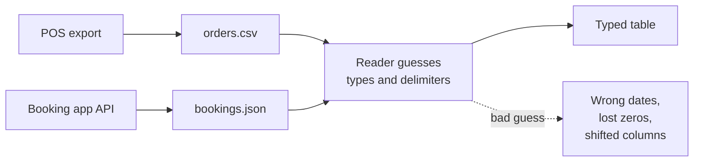

# CSV and JSON

Mastery: `INPUT[inlineSelect(option(new), option(learning), option(solid)):mastery]`

> [!story] Context
> [[Files and File Formats]] showed that a file's layout affects speed and cost. CSV and JSON are the two plain-text formats that most export functions and web [[APIs]] use.

> [!eli5] Summary
> CSV stores a table as plain text, one line per row, with commas between values. JSON stores labeled values, such as `"name": "Maria"`, and can nest lists and groups inside each other. Any program can read both, but neither records whether a value is a number, a date, or text.

> [!analogy]- Analogy: lists and lunchboxes
> | Everyday object | Format |
> |---|---|
> | A list written in columns on lined paper | CSV |
> | A lunchbox with labeled compartments, some holding smaller labeled boxes | JSON |
> | No nutrition label on either | No declared [[Data Type\|data types]] |

## Background

**CSV** (comma-separated values) was in use long before any formal specification: RFC 4180 notes that spreadsheet programs had exchanged CSV data "for quite some time" while the format had "never been formally documented". It is widespread because it is the simplest way to get a table from one program to another. RFC 4180, published in October 2005, documented the common format and registered the `text/csv` media type, but it is an informational document, not a standard, and the RFC itself notes there is no single master specification. Programs still disagree on details.

**JSON** (JavaScript Object Notation) is derived from the object literals of JavaScript (as defined in the third edition of the ECMAScript standard), was first documented as an IETF RFC in RFC 4627 (July 2006), and became the default way web services exchange data. It is formally specified today in RFC 8259 (December 2017) and ECMA-404. Compared with CSV, it handles nested data (an order with a list of items) that CSV cannot, and it carries field names with every record.

Both formats are widely used because **people can read them and nearly every tool can write them.**

## Overview

CSV and JSON are plain-text file formats: CSV holds one flat table of comma-separated values, and JSON holds labeled, optionally nested values.

The same two bakery orders in each format:

```text
order_id,order_time,customer,item,quantity,price
1001,2026-03-03 08:05,Maria,croissant,3,2.50
1002,2026-03-03 08:09,"Lee, Sam",baguette,1,3.10
```

```json
[
  {"order_id": 1001, "order_time": "2026-03-03T08:05:00", "customer": "Maria",
   "items": [{"item": "croissant", "quantity": 3, "price": 2.50}]},
  {"order_id": 1002, "order_time": "2026-03-03T08:09:00", "customer": "Lee, Sam",
   "items": [{"item": "baguette", "quantity": 1, "price": 3.10},
             {"item": "coffee", "quantity": 2, "price": 2.00}]}
]
```

Notice what each one can and cannot do:

| | CSV | JSON |
|---|---|---|
| **Shape** | Flat table only | Nested objects and lists |
| **Field names** | Once, in an optional header row | Repeated in every record |
| **Types** | None. Everything is text | String, number, true/false, [[Null\|null]], object, array. No date type |
| **Escaping** | Quotes around values with commas or line breaks | Quotes around all strings, backslash escapes |
| **Size** | Compact | Larger, because labels repeat |
| **Best for** | Exports, spreadsheets, bulk loads | [[APIs]], app logs, config, events |
| **Spec** | RFC 4180 (informational, 2005) | RFC 8259 and ECMA-404 |

A common variant, **JSON Lines** (also called newline-delimited JSON), puts one JSON object per line with no surrounding `[ ]`. [[The Three Vs of Big Data|Big data]] tools prefer it because each line can be read on its own.

## How it works



Where CSV and JSON break at scale:

1. **No types:** `03/04/2026` can be March or April. ZIP code `02134` becomes the number `2134`. Prices with a comma as decimal separator split into two columns.
2. **Inference is slow and fragile:** To guess types, a reader samples rows. Row 2,000,001 may contain `N/A` in a numeric column and fail the load.
3. **Everything is read every time:** To total one column, a reader must parse every byte of every row. See [[Columnar Storage]].
4. **No safe updates:** You cannot change one row in place, and there is no record of who changed what.
5. **Messy escaping:** A customer note containing a comma and a line break breaks naive parsers.

In Databricks you read both with `read_files`, and you can state the [[Schema|schema]] (the column names and types) to stop the guessing:

```sql
-- CSV: header row, explicit schema, stop on bad rows
SELECT * FROM read_files(
  '/Volumes/bakery/raw/pos_exports/',
  format => 'csv',
  header => true,
  schema => 'order_id INT, order_time TIMESTAMP, customer STRING, item STRING, quantity INT, price DECIMAL(6,2)',
  mode => 'FAILFAST'
);

-- JSON: one object per file spread over many lines
SELECT * FROM read_files(
  '/Volumes/clinic/raw/bookings/',
  format => 'json',
  multiLine => true
);
```

## Small-business considerations

> [!smallbiz] Small-business considerations
> CSV is how most of your data will first arrive, and that is fine. Three habits avoid most pain:
> 1. **Export with a header row and ISO dates** (`2026-03-03`) whenever the tool allows it.
> 2. **Keep codes as text:** Phone numbers, ZIP codes, and product SKUs are labels, not numbers. Declare them as strings.
> 3. **Load once, then stop using the file:** Turn the CSV into a table, check row counts against the source, and query the table from then on.

> [!bridge]- In Databricks today
> - **One-off and SQL reads:** the `read_files` table-valued function (Databricks SQL and Databricks Runtime 13.3 LTS and above). Databricks recommends it over the older `USING CSV` / `USING JSON` syntax because it accepts a schema and more options.
> - **Repeated loads of new files:** [[Auto Loader]] and [[COPY INTO]] pick up only files they have not seen yet: Auto Loader tracks discovered files in its checkpoint, and `COPY INTO` skips files that were already loaded.
> - **Keeping JSON flexible:** store it in a `VARIANT` column (see [[Structured vs Unstructured Data]]).
> - **Bad rows:** CSV read modes include `PERMISSIVE` (keep going, null out bad fields) and `FAILFAST` (stop at the first bad row). In `PERMISSIVE` mode, fields that cannot be parsed can be captured in the rescued data column (Databricks Runtime 8.3 and above) instead of being lost. See [[Schema Enforcement and Evolution]].

## Cloud differences

> [!note] Nothing differs by cloud
> CSV and JSON handling is identical on Azure, AWS, and Google Cloud. Only the storage path changes (`abfss://`, `s3://`, `gs://`), and with Unity Catalog [[Volumes]] you can use the same `/Volumes/...` path everywhere.

## Advanced topics

> [!deepdive]- Advanced topics (301–401)
> - **RFC 4180 rules worth knowing:** records end in CRLF; fields containing commas, double quotes, or line breaks must be enclosed in double quotes; a double quote inside a quoted field is escaped by doubling it (`""`). Many exporters ignore some of these.
> - **Multi-line CSV fields** force a parser to track quote state across lines, which prevents splitting the file at arbitrary line breaks. Spark has a `multiLine` option for this, at the cost of parallelism.
> - **JSON numbers** have no fixed precision in the spec. RFC 8259 warns that numbers beyond IEEE 754 double precision may not interoperate. Large IDs (above 2^53) can silently lose digits in JavaScript-based tools; send them as strings.
> - **Duplicate keys** in a JSON object are allowed by ECMA-404 but RFC 8259 says names "SHOULD be unique", and behavior varies by parser.
> - **Inference cost:** Schema inference on JSON may scan a sample or all files. On large landing zones, supply a schema or use schema hints to avoid long startup times and type flip-flopping between runs.

## Common misconceptions

> [!confusion] "Excel file" and "CSV" are not the same thing
> A `.xlsx` workbook is a zipped bundle of XML with formatting, formulas, and multiple sheets. A CSV is one plain-text table with no formatting. Excel can open both, which hides the difference.

> [!confusion] JSON is not a database
> JSON is a format for writing data down. Storing many JSON files does not give you queries, indexes, or transactions. You need a database or table format on top.

## Recall

What does CSV stand for?::Comma-separated values.
What does JSON stand for?::JavaScript Object Notation.
Which RFC documents CSV, and is it a formal standard?::RFC 4180 (October 2005). It is informational, not a standard.
What can JSON represent that CSV cannot?::Nested data: objects inside objects and lists of values.
Why do ZIP codes often break in CSV loads?::CSV has no types, so readers may treat `02134` as a number and drop the leading zero.
What is JSON Lines?::One complete JSON object per line, with no surrounding array, so each line can be read independently.
Which Databricks function reads CSV and JSON files with SQL?::`read_files`.

## Next steps

> [!path] Learning path
> **Needs first:** [[Files and File Formats]]
> **Unlocks next:** [[Spreadsheets]], [[APIs]], [[Auto Loader]]

> [!nextup] Next
> [[Spreadsheets]] covers the tool in which most CSV files are created and opened, and where it stops scaling.

> [!sources]- Sources (last verified: 2026-10-25)
> - [RFC 4180: Common Format and MIME Type for Comma-Separated Values (CSV) Files (IETF)](https://www.rfc-editor.org/rfc/rfc4180)
> - [RFC 8259: The JavaScript Object Notation (JSON) Data Interchange Format (IETF)](https://datatracker.ietf.org/doc/rfc8259)
> - [read_files table-valued function (AWS)](https://docs.databricks.com/aws/en/sql/language-manual/functions/read_files)
> - [Read and write CSV files (AWS)](https://docs.databricks.com/aws/en/query/formats/csv)
> - [Read and write CSV files (Azure Databricks)](https://learn.microsoft.com/en-us/azure/databricks/query/formats/csv)
> - [Read and write JSON files (AWS)](https://docs.databricks.com/aws/en/query/formats/json)
> - [Work with files in Unity Catalog volumes (AWS)](https://docs.databricks.com/aws/en/volumes/volume-files)
> - [Ingest data as semi-structured variant type (Azure Databricks)](https://learn.microsoft.com/en-us/azure/databricks/ingestion/variant)
> - [RFC 4627: The application/json Media Type for JSON (July 2006)](https://www.rfc-editor.org/rfc/rfc4627)
> - [What is Auto Loader? (AWS)](https://docs.databricks.com/aws/en/ingestion/cloud-object-storage/auto-loader/)
> - [Get started using COPY INTO to load data (AWS)](https://docs.databricks.com/aws/en/ingestion/cloud-object-storage/copy-into/)
