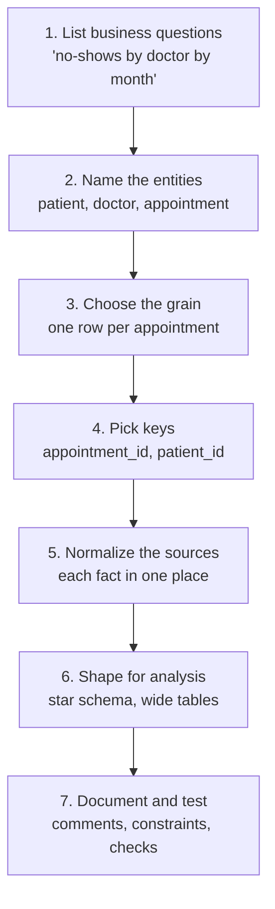

# Data Modeling Basics

Mastery: `INPUT[inlineSelect(option(new), option(learning), option(solid)):mastery]`

> [!story] Context
> [[OLTP vs OLAP]] showed that operational and analytical systems need different table designs. Data modeling is the process of deciding which tables exist, what one row represents, and how tables relate.

> [!eli5] Summary
> Data modeling is planning how information is organized before it is stored: which things to track (customers, products, orders), what to record about each, and how they connect. A clear model makes correct reports easy to produce.

> [!analogy]- Analogy: organizing a kitchen
> | Kitchen | Modeling concept |
> |---|---|
> | Deciding on a fridge, a pantry, and a spice rack | Entities |
> | The label on each jar | Attributes |
> | Each shelf holds one kind of item | Grain |
> | Salt kept in one place | [[Normalization]] |
> | A second salt jar by the stove | [[Denormalization]] |

## Background

Many reporting problems trace back to the model rather than the tools:

- A clinic stores the doctor's name on every appointment. The doctor changes her name, and reports now show two doctors.
- A bakery's "sales" table has some rows per order and some per day. Every total double counts.
- A spreadsheet has one column per month. Adding a new month means changing every formula.

A good model makes correct queries straightforward and incorrect ones difficult. Models also outlast tools: a well-chosen set of tables usually survives several platform changes.

## Overview

Data modeling happens at three levels:

| Level | Question it answers | Bakery example | Audience |
|---|---|---|---|
| **Conceptual** | What things matter and how do they relate? | Customers place orders; orders contain products | The business |
| **Logical** | What tables, columns, keys, and relationships? | `orders(order_id PK, customer_id FK, order_time)` | Analysts and engineers |
| **Physical** | How is it stored and optimized in a specific system? | Delta table, clustered by `order_date` | Engineers |

The core vocabulary:

- **Entity:** a thing the business tracks (customer, product, appointment). Usually becomes a table.
- **Attribute:** a property of an entity (name, price). Becomes a column.
- **Relationship:** how entities connect, with **cardinality**: one-to-one, one-to-many (one customer, many orders), or many-to-many (many orders, many products, linked through an order-lines table).
- **Grain:** the precise meaning of one row. "One row per order line" is a grain. Declare it in writing for every table.
- **[[Normalization]]:** organizing tables so each fact lives in exactly one place. Codd introduced the idea in 1970; third normal form (3NF) is the usual target for operational systems.
- **[[Denormalization]]:** deliberately copying or pre-joining data to make reads simpler and faster. Common in analytics.

Two broad styles follow from [[OLTP vs OLAP]]:

| | Normalized (3NF) | Dimensional ([[Star Schema\|star]]) |
|---|---|---|
| **Built for** | Safe, fast updates | Simple, fast analysis |
| **Tables** | Many narrow tables | A few wide dimension tables around fact tables |
| **Joins per question** | Many | Few |
| **Redundancy** | Minimal | Some, on purpose |
| **Typical home** | App databases | Warehouses, gold layer of a lakehouse |

## How it works

A practical process for any new subject area:



Normalizing a clinic's spreadsheet export, step by step. The raw export repeats details on every row:

```text
appt_id | date       | patient     | patient_phone | doctor  | doctor_specialty | status
A-1042  | 2026-03-04 | Ana Silva   | 555-0101      | Dr. Lee | Pediatrics       | no-show
A-1043  | 2026-03-04 | Ben Okafor  | 555-0102      | Dr. Lee | Pediatrics       | attended
A-1050  | 2026-03-05 | Ana Silva   | 555-0101      | Dr. Ruiz| Dermatology      | attended
```

Ana's phone and Dr. Lee's specialty are stored more than once, so they can drift apart. In third normal form, each fact gets one home:

```sql
CREATE TABLE clinic.core.patients (
  patient_id STRING NOT NULL, name STRING, phone STRING,
  CONSTRAINT patients_pk PRIMARY KEY (patient_id)
) COMMENT 'Grain: one row per patient';

CREATE TABLE clinic.core.doctors (
  doctor_id STRING NOT NULL, name STRING, specialty STRING,
  CONSTRAINT doctors_pk PRIMARY KEY (doctor_id)
) COMMENT 'Grain: one row per doctor';

CREATE TABLE clinic.core.appointments (
  appointment_id STRING NOT NULL,
  patient_id STRING, doctor_id STRING,
  start_time TIMESTAMP, status STRING,
  CONSTRAINT appointments_pk PRIMARY KEY (appointment_id),
  CONSTRAINT appt_patient_fk FOREIGN KEY (patient_id) REFERENCES clinic.core.patients,
  CONSTRAINT appt_doctor_fk  FOREIGN KEY (doctor_id)  REFERENCES clinic.core.doctors
) COMMENT 'Grain: one row per appointment';
```

For analysis you then reshape these into a star (see [[Star Schema]]), where the appointment table becomes a fact table and patients and doctors become dimensions.

## Small-business considerations

> [!smallbiz] Small-business considerations
> You do not need a modeling tool or a consultant to start. You need three things written down:
> 1. **Your five to ten core entities** (customer, product, order, order line, payment; or patient, doctor, appointment, invoice).
> 2. **The grain of every table**, in its `COMMENT`.
> 3. **One ID for each entity**, and which system it comes from.
>
> That page of notes will save more time than any feature you buy. Skip advanced patterns like Data Vault unless you have many sources and auditors asking for full history.

> [!bridge]- In Databricks today
> - **Where models live:** in [[Unity Catalog]]'s [[Three-Level Namespace|three-level namespace]], `catalog.schema.table`. A common layout is one catalog per environment or domain and one schema per subject area. See [[Catalogs Schemas and Tables]].
> - **Layers instead of one model:** the [[Medallion Architecture]] keeps raw data (bronze), cleaned and conformed data (silver, often close to normalized), and business-ready models (gold, often a star schema).
> - **Declaring the model:** table and column comments, informational [[Primary and Foreign Keys|primary and foreign keys]] (with `RELY` to help the optimizer), and enforced `NOT NULL` and `CHECK` constraints.
> - **Business definitions:** [[Metric Views]] define measures and dimensions once on top of the tables, so every dashboard computes "no-show rate" the same way.
> - **Databricks guidance** places star schemas at the gold layer, recommends facts as streaming tables and dimensions as materialized views in [[Lakeflow Spark Declarative Pipelines]], and uses SCD Type 2 only where change history is needed.

## Cloud differences

> [!note] Nothing differs by cloud
> Data modeling is a design activity. The same model works on Azure, AWS, and Google Cloud.

## Advanced topics

> [!deepdive]- Advanced topics (301–401)
> - **Normal forms in one line each:** 1NF: atomic values, no repeating groups (no `month1, month2, month3` columns). 2NF: every non-key column depends on the whole key. 3NF: no non-key column depends on another non-key column (doctor specialty depends on doctor, not on appointment). Boyce-Codd normal form (BCNF) is Codd's stricter "improved third normal form". Fourth normal form (Ronald Fagin, 1977) addresses multivalued dependencies. Microsoft's normalization guidance notes that third normal form is the highest level necessary for most applications.
> - **Three schools of warehouse modeling:** Bill Inmon's top-down approach stores cleaned data in a normalized, enterprise-wide warehouse first and builds data marts for specific business areas from it. Ralph Kimball's bottom-up approach (from *The Data Warehouse Toolkit*, first published in 1996) builds dimensional star schemas per business process, tied together by conformed dimensions. Data Vault models hubs (core business entities), links (relationships between hubs), and satellites (attributes of hubs or links). Databricks guidance blends them across lakehouse layers: 3NF-like or Data Vault-like models in silver, and Kimball-style star schemas or Inmon-style data marts in gold.
> - **One big table (OBT):** Columnar engines make very wide, fully denormalized tables cheap to scan, so some teams skip stars for simple use cases. The cost is duplicated logic and painful updates when a dimension attribute changes.
> - **Grain mistakes are the most expensive:** Mixing grains, or joining a fact to a dimension at a finer grain, multiplies rows (fan-out) and inflates totals. Always test `COUNT(*)` before and after a join.
> - **Physical design on Delta:** Physical modeling on Databricks is mostly about file layout: [[Liquid Clustering|liquid clustering]] keys chosen from common filters and joins, and avoiding over-[[Partitions|partitioning]]. Indexes in the B-tree sense do not exist.

## Common misconceptions

> [!confusion] A data model is not a diagram tool
> The model is the set of decisions: entities, grain, keys, relationships. A diagram is one way to represent them. A page of `CREATE TABLE` statements with comments is also a model.

> [!confusion] Normalized is not "better", denormalized is not "sloppy"
> Each fits a job. Normalize where data is written and must stay consistent. Denormalize where data is read many times and simplicity matters.

## Recall

What is data modeling?::Deciding which tables to have, what each row means, and how the tables connect.
What is the grain of a table?::The precise meaning of one row, such as one row per order line.
What are the three levels of data model?::Conceptual, logical, and physical.
What does normalization achieve?::Each fact is stored in exactly one place, avoiding inconsistent copies.
What does third normal form forbid?::Non-key columns that depend on other non-key columns.
When is denormalization a good idea?::For analytics, where data is read often and simpler, faster queries matter more than update efficiency.
In the medallion architecture, which layer usually holds the star schema?::Gold.

## Next steps

> [!path] Learning path
> **Needs first:** [[Relational Databases]], [[Primary and Foreign Keys]], [[OLTP vs OLAP]]
> **Unlocks next:** [[Star Schema]], [[Slowly Changing Dimensions]], [[Medallion Architecture]], [[Normalization]]

> [!nextup] Next
> [[Star Schema]] describes the standard analytical model: a fact table of events surrounded by dimension tables.

> [!sources]- Sources (last verified: 2026-10-25)
> - [E. F. Codd, "A Relational Model of Data for Large Shared Data Banks", Communications of the ACM 13(6), June 1970 (PDF)](https://web.eecs.umich.edu/~michjc/eecs584/Papers/codd_1970.pdf)
> - [Data modeling (AWS)](https://docs.databricks.com/aws/en/transform/data-modeling)
> - [Dimensional modeling in Lakeflow pipelines (AWS)](https://docs.databricks.com/aws/en/ldp/best-practices/dimensional-modeling)
> - [Data preparation cheat sheet (AWS)](https://docs.databricks.com/aws/en/cheat-sheet/bi-serving-data-prep)
> - [Constraints on Databricks (AWS)](https://docs.databricks.com/aws/en/tables/constraints)
> - [Model metric views (AWS)](https://docs.databricks.com/aws/en/business-semantics/metric-views/basic-modeling)
> - [Description of the database normalization basics (Microsoft Learn)](https://learn.microsoft.com/en-us/troubleshoot/microsoft-365-apps/access/database-normalization-description)
> - [Fagin, "Multivalued Dependencies and a New Normal Form for Relational Databases", ACM TODS, September 1977](https://dl.acm.org/doi/10.1145/320557.320571)
> - [Introduction to data warehouse architecture: Inmon vs. Kimball (Databricks)](https://www.databricks.com/discover/data-warehouse-architecture)
> - [Data warehousing modeling techniques and their implementation on the Databricks Lakehouse Platform (Databricks blog)](https://www.databricks.com/blog/2022/06/24/data-warehousing-modeling-techniques-and-their-implementation-on-the-databricks-lakehouse-platform.html)
> - [What is a medallion architecture? (Databricks glossary)](https://www.databricks.com/glossary/medallion-architecture)
> - [Dimensional modeling techniques (Kimball Group)](https://www.kimballgroup.com/data-warehouse-business-intelligence-resources/kimball-techniques/dimensional-modeling-techniques/)
> - [The Data Warehouse Toolkit, 3rd Edition (Wiley)](https://www.wiley.com/en-ie/The+Data+Warehouse+Toolkit:+The+Definitive+Guide+to+Dimensional+Modeling,+3rd+Edition-p-9781118530801)
