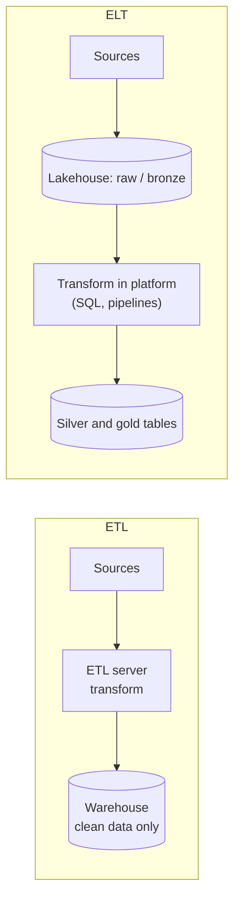

# ETL vs ELT

Mastery: `INPUT[inlineSelect(option(new), option(learning), option(solid)):mastery]`

> [!story] Context
> [[APIs]] and file exports get data out of operational systems. [[OLTP vs OLAP]] established that analysis happens in a separate store. ETL and ELT are the two standard patterns for moving data from sources into that store and preparing it for use.

> [!eli5] Summary
> Data has to be collected from where it is created, cleaned up, and put where people can analyze it. ETL cleans the data before storing it. ELT stores the raw data first and cleans it afterward inside the analytics system. Cloud platforms made the second approach the common default.

> [!analogy]- Analogy: groceries
> | Groceries | Data pipeline |
> |---|---|
> | Washing and chopping vegetables at the market, then bringing home only what fits the recipe | ETL |
> | Bringing everything home, storing it, and preparing each meal as needed | ELT |
> | The fridge | The analytical store |
> | Keeping the receipt and the unwashed produce | Keeping raw data for reprocessing |

## Background

Both patterns have the same three steps:

1. **Extract:** read data from source systems (databases, files, [[APIs]]).
2. **Transform:** clean, standardize, join, deduplicate, and reshape it, for example into a [[Star Schema|star schema]].
3. **Load:** write it into the analytical store.

**ETL** performs the transformation before loading. It was the standard for on-premises [[Data Warehouses|data warehouses]], where storage and compute were expensive and fixed in size. A separate ETL server transformed data so that only clean, consistently formatted rows reached the warehouse.

**ELT** loads raw data first and transforms it inside the analytical platform. It became the common default with cloud platforms because:

- Cloud storage is inexpensive, so keeping raw data costs little.
- [[Storage vs Compute|Separated, elastic compute]] can run large transformations on demand inside the platform.
- Raw data can be re-transformed when business rules change, without extracting it again.
- Transformations can be written in [[SQL]] by analysts, rather than in a separate ETL tool.

## Overview

ETL (extract, transform, load) and ELT (extract, load, transform) are the two standard patterns for moving data from source systems into an analytical store; they differ in whether the data is cleaned before or after it is loaded.

| | ETL | ELT |
|---|---|---|
| **Order** | Extract → Transform → Load | Extract → Load → Transform |
| **Where transformation runs** | A separate ETL server or tool | Inside the warehouse or [[The Lakehouse Idea\|lakehouse]] |
| **Raw data kept** | Often not | Yes, in a raw or bronze layer ([[Medallion Architecture]]) |
| **Change a business rule** | Re-extract and re-run | Re-run the transformation on stored raw data |
| **Typical tools** | Informatica, SSIS, Talend, Azure Data Factory mapping data flows | [[Fivetran and ELT Tools\|Fivetran]] or [[Lakeflow Connect]] for EL, [[dbt]] or [[Lakeflow Spark Declarative Pipelines]] for T |
| **Main risk** | Rigid; lost raw data | Raw data accumulates without governance ([[Data Swamps\|data swamp]]) |
| **When it still fits** | Removing sensitive fields before data leaves a source; strict regulatory filtering | Most cloud analytics |

ETL has not disappeared. Masking or dropping [[PII|personal data]] before it lands is a transform-before-load step, and it is still good practice for regulated data.

## How it works



An ELT flow for the bakery on Databricks, following the [[Medallion Architecture|medallion]] layers:

```sql
-- 1. Load: raw POS exports land unchanged in bronze
CREATE OR REPLACE TABLE bakery.bronze.pos_orders AS
SELECT *, _metadata.file_path AS source_file  -- file metadata column
FROM read_files('/Volumes/bakery/raw/pos_exports/', format => 'csv', header => true);

-- 2. Transform: typed, deduplicated silver table
CREATE OR REPLACE TABLE bakery.silver.orders AS
SELECT DISTINCT
  CAST(order_id AS BIGINT)        AS order_id,
  CAST(order_time AS TIMESTAMP)   AS order_time,
  sku,
  CAST(quantity AS INT)           AS quantity,
  CAST(price AS DECIMAL(6,2))     AS price
FROM bakery.bronze.pos_orders
WHERE order_id IS NOT NULL;

-- 3. Transform: business-ready gold table for dashboards
CREATE OR REPLACE TABLE bakery.gold.daily_sales AS
SELECT DATE(order_time) AS order_date, sku, SUM(quantity * price) AS revenue
FROM bakery.silver.orders
GROUP BY ALL;
```

In production, the same steps are usually declared in a pipeline that loads only new files and updates tables incrementally, rather than rebuilt with `CREATE OR REPLACE`.

## Small-business considerations

> [!smallbiz] Small-business considerations
> - **Use ELT:** Land raw exports and API responses first, then transform with SQL. You can fix a mistake by re-running the transformation instead of asking the vendor for old data.
> - **Use managed extraction where possible:** A managed connector for your [[SaaS PaaS and IaaS|SaaS]] applications removes most custom extraction code.
> - **Start with three layers:** raw (bronze), cleaned (silver), and reporting (gold). Add more only when needed.
> - **Mask sensitive data early:** A clinic should restrict or mask patient identifiers as soon as data lands, not only in the reporting layer.

> [!bridge]- In Databricks today
> Databricks groups its data engineering features under [[Lakeflow]], a unified solution for ingestion, transformation, and orchestration:
> - **Extract and load:** [[Lakeflow Connect]] for managed connectors to SaaS applications and databases, and [[Auto Loader]] or [[COPY INTO]] for files.
> - **Transform:** [[Lakeflow Spark Declarative Pipelines]] for declarative SQL or Python pipelines with built-in data quality [[Expectations and Data Quality|expectations]], or [[dbt on Databricks|dbt]] if you already use it.
> - **Orchestrate:** [[Lakeflow Jobs]] to schedule and chain tasks.
> - **Layering:** Databricks guidance uses bronze and silver layers for ingestion and cleaning, and a gold layer for business-ready models such as star schemas.
> - **Third-party tools** such as Fivetran and Azure Data Factory also load into Databricks. See [[Fivetran and ELT Tools]] and [[Migrating ETL Tools]].

## Cloud differences

> [!azure]- Azure Databricks
> Many Azure customers already use Azure Data Factory for extraction and orchestration, and its Azure Databricks Notebook and Job activities run Databricks notebooks and jobs (including serverless jobs) from a pipeline. See [[Azure Data Factory with Databricks]].

> [!aws]- Databricks on AWS
> AWS Glue is a common existing ETL tool. Hive metastore federation can connect an AWS Glue catalog to Unity Catalog as a foreign catalog, which is read-only from Databricks. See [[Hive Metastore Federation for AWS Glue]].

> [!gcp]- Databricks on Google Cloud
> BigQuery is a common source or destination. See [[BigQuery Integration]].

## Advanced topics

> [!deepdive]- Advanced topics (301–401)
> - **Incremental processing:** Rebuilding every table from all raw data each night does not scale. Incremental pipelines process only new or changed data: new files (Auto Loader), changed rows ([[Change Data Capture]], [[Change Data Feed]]), or new stream records. [[Streaming Tables|Streaming tables]] and [[Materialized Views|materialized views]] in Lakeflow pipelines manage this automatically.
> - **Idempotency:** A pipeline step should produce the same result if it runs twice, so retries and [[Backfill|backfills]] are safe. Use `MERGE` on keys or overwrite partitions instead of blind appends. See [[Idempotency]] and [[MERGE and Upserts]].
> - **EtLT:** Many teams apply light transformation during extraction (type casting, PII masking, deduplication) and heavy business transformation after loading.
> - **Reverse ETL** sends modeled data back into operational tools (CRM, marketing). See [[Reverse ETL]].
> - **Data contracts:** As sources multiply, agreeing schemas and quality rules with source owners prevents breakage. Enforce them with [[Schema Enforcement and Evolution|schema enforcement]] and expectations.
> - **Zero-ETL and federation:** Some sources can be queried in place, without copying, through [[Lakehouse Federation]]. This trades copy cost for query-time dependence on the source system.

## Common misconceptions

> [!confusion] ELT does not mean "no transformation"
> ELT still transforms data. It changes where and when the transformation runs, not whether it happens.

> [!confusion] Keeping raw data is not a data swamp by itself
> Raw data becomes a swamp when it is undocumented and ungoverned. A governed bronze layer with owners and retention rules is good practice.

## Recall

What do ETL and ELT stand for?::Extract, transform, load; and extract, load, transform.
What is the key difference between ETL and ELT?::ETL transforms before loading; ELT loads raw data first and transforms inside the analytical platform.
Why did ELT become the default in the cloud?::Cheap storage, elastic compute inside the platform, and the ability to re-transform stored raw data.
When does transforming before loading still make sense?::When sensitive data must be masked or removed before it leaves the source.
Which Databricks product handles managed extraction from SaaS applications?::Lakeflow Connect.
Which Databricks product handles declarative transformation pipelines?::Lakeflow Spark Declarative Pipelines.
Which Databricks product schedules and orchestrates tasks?::Lakeflow Jobs.
What are the three medallion layers?::Bronze (raw), silver (cleaned), and gold (business-ready).

## Next steps

> [!path] Learning path
> **Needs first:** [[APIs]], [[Storage vs Compute]], [[OLTP vs OLAP]]
> **Unlocks next:** [[Batch vs Streaming]], [[Medallion Architecture]], [[Fivetran and ELT Tools]], [[Lakeflow]]

> [!nextup] Next
> [[Batch vs Streaming]] covers how often a pipeline runs: on a schedule, or continuously as data arrives.

> [!sources]- Sources (last verified: 2026-10-25)
> - [What is Lakeflow Connect? (AWS)](https://docs.databricks.com/aws/en/ingestion/overview)
> - [What is Lakeflow Connect? (Azure Databricks)](https://learn.microsoft.com/en-us/azure/databricks/ingestion/overview)
> - [Managed SaaS connectors (AWS)](https://docs.databricks.com/aws/en/ingestion/lakeflow-connect/saas-overview)
> - [Dimensional modeling in Lakeflow pipelines (AWS)](https://docs.databricks.com/aws/en/ldp/best-practices/dimensional-modeling)
> - [read_files table-valued function (AWS)](https://docs.databricks.com/aws/en/sql/language-manual/functions/read_files)
> - [Data modeling (AWS)](https://docs.databricks.com/aws/en/transform/data-modeling)
> - [Data engineering with Databricks (Lakeflow) (AWS)](https://docs.databricks.com/aws/en/data-engineering/)
> - [Lakeflow Connect (AWS)](https://docs.databricks.com/aws/en/ingestion/lakeflow-connect/)
> - [Mapping data flows in Azure Data Factory (Microsoft Learn)](https://learn.microsoft.com/en-us/azure/data-factory/concepts-data-flow-overview)
> - [SQL Server Integration Services (Microsoft Learn)](https://learn.microsoft.com/en-us/sql/integration-services/sql-server-integration-services)
> - [Run a Databricks notebook with the Databricks Notebook Activity in Azure Data Factory (Microsoft Learn)](https://learn.microsoft.com/en-us/azure/data-factory/transform-data-databricks-notebook)
> - [Transform data with a Databricks Job in Azure Data Factory (Microsoft Learn)](https://learn.microsoft.com/en-us/azure/data-factory/transform-data-databricks-job)
> - [Enable Hive metastore federation for AWS Glue metastores (AWS)](https://docs.databricks.com/aws/en/query-federation/hms-federation-glue)
> - [Hive metastore federation concepts (AWS)](https://docs.databricks.com/aws/en/query-federation/hms-federation-concepts)
