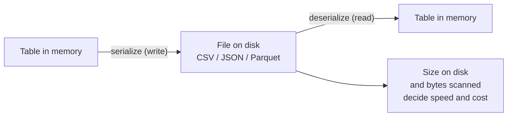

# Files and File Formats

Mastery: `INPUT[inlineSelect(option(new), option(learning), option(solid)):mastery]`

> [!story] Context
> [[Structured vs Unstructured Data]] classified data by shape. Regardless of shape, data is stored in files, and a file's internal layout determines how fast and how cheaply it can be read.

> [!eli5] Summary
> A file format is the agreed layout of information inside a file, so that programs know how to read it. Some formats are easy for people to read. Others are compact and much faster for computers to process, which matters as data grows.

> [!analogy]- Analogy: storing receipts
> | Receipt storage | File format concept |
> |---|---|
> | A shoebox of receipts in date order | Row-oriented file |
> | A ledger with one page per column (dates, items, prices) | Column-oriented file ([[Columnar Storage]]) |
> | Handwritten notes vs. a typed fixed form | Text vs. binary format |
> | Vacuum-packing the box | [[Compression]] |

## Background

Programs must agree on how bytes are arranged in order to read a file. Early on the main goal was **interchange**: get data from one program to another. CSV and fixed-width text did that well for small data.

As data volumes grew, three further requirements appeared:

1. **Speed.** Reading a 50 GB text file to answer a question about one column wastes most of the work.
2. **Cost.** In the cloud you pay for storage and often for the bytes a query scans. A format that is five times smaller can be five times cheaper to query.
3. **Trust.** Plain text carries no types. `03/04/2026` can mean March 4 or April 3, and `00123` can be a number or a code. Each reader interprets them differently.

Later formats address each of these problems, from CSV to [[Apache Parquet]] to [[Delta Lake]].

## Overview

A **file format** is a specification for how data is encoded as bytes. Two choices define most formats:

- **Text vs. binary.** Text formats (CSV, JSON, XML) store characters you can open in a text editor. Binary formats (Parquet, ORC, Avro) store compact encoded values that need a library to read.
- **Row vs. column layout.** Row formats keep each record together. Column formats keep each field together. See [[Columnar Storage]].

| Format | Text or binary | Layout | Has types and [[Schema\|schema]] | Typical use |
|---|---|---|---|---|
| CSV | Text | Row | No | Exports, spreadsheets, quick sharing |
| JSON | Text | Row (nested) | Self-describing labels, weak types | [[APIs]], app logs |
| XML | Text | Row (nested) | Optional schema | Older enterprise systems, invoices |
| Avro | Binary | Row | Yes, embedded | Streaming messages, record-by-record writes |
| [[Apache Parquet\|Parquet]] | Binary | Column | Yes, embedded | Analytics, [[Data Lakes\|data lakes]] |
| [[Apache ORC\|ORC]] | Binary | Column | Yes, embedded | Analytics in the [[Apache Hadoop\|Hadoop]]/[[Apache Hive\|Hive]] world |
| [[Delta Lake]] | Parquet files plus a transaction log | Column | Yes, enforced | Tables in Databricks |

Unstructured files have their own formats too (PDF, JPEG, PNG, MP3, DOCX), and they matter for AI work, but this note focuses on formats for tabular data.

## How it works



Turning in-memory data into bytes is called [[Serialization|serialization]]; reading it back is deserialization. The format decides how much work each step takes.

A small experiment shows the difference. Here a bakery saves the same 1 million order lines two ways using Python and [[Pandas|pandas]]:

```python
import pandas as pd

orders = pd.read_csv("orders_2026.csv")         # 1,000,000 rows, 6 columns

orders.to_parquet("orders_2026.parquet")        # binary, columnar, compressed

# Reading one column from CSV still parses every byte of every row.
pd.read_csv("orders_2026.csv", usecols=["price"])

# Reading one column from Parquet reads only that column's bytes.
pd.read_parquet("orders_2026.parquet", columns=["price"])
```

On typical data[^unverified] the Parquet file is several times smaller than the CSV, and the single-column read is much faster, because Parquet stores each column together, compresses similar values well, and keeps types so nothing has to be guessed. Exact ratios depend on the data, so measure your own.

## Small-business considerations

> [!smallbiz] Small-business considerations
> - **CSV is fine for getting data in and out.** Your point-of-sale (POS) and accounting tools export CSV, and that is a perfectly good starting point.
> - **Do not use CSV as your long-term store.** Once data lands in a platform like Databricks, keep it as tables, not as a folder of CSVs. You get types, speed, and history for free.
> - **Keep the original files anyway.** Saving the raw export before you clean it means you can always redo the cleaning. This is the "bronze" idea in the [[Medallion Architecture]].

> [!bridge]- In Databricks today
> Databricks reads every common format: the `read_files` function handles CSV, JSON, XML, text, binary files, Parquet, Avro, and ORC, and Excel has its own reader. Tables you create are stored as [[Delta Lake]] by default[^unverified]: Parquet data files plus a transaction log that adds [[ACID Transactions|ACID transactions]], [[Time Travel|time travel]], and [[Schema Enforcement and Evolution|schema enforcement]]. Through [[Delta UniForm]], the same tables can also be read as [[Apache Iceberg]][^unverified]. The general idea of "a table made of open files plus metadata" is covered in [[Open Table Formats]].

## Cloud differences

> [!note] Nothing differs by cloud
> File formats are the same on Azure, AWS, and Google Cloud. The files sit in each cloud's [[Object Storage|object storage]] (ADLS, S3, GCS), but a Parquet file is a Parquet file everywhere.

## Advanced topics

> [!deepdive]- Advanced topics (301–401)
> - **Splittability.**[^unverified] Distributed engines want to split a big file so many machines read it in parallel. Uncompressed CSV can be split at line breaks; gzip-compressed CSV cannot, so one machine reads the whole file. Parquet is splittable by row group. This is one reason a single huge `.csv.gz` loads slowly in Spark.
> - **Parquet's internals.**[^unverified] A Parquet file is divided into row groups; each row group holds one column chunk per column; each chunk holds pages with encodings such as dictionary and run-length encoding. The footer holds the schema and per-chunk min/max statistics, which let engines skip chunks that cannot match a filter (see [[Data Skipping]]).
> - **Files vs. tables.** A folder of Parquet files has no transactions: two writers can corrupt it, and a reader can see half-written data. Table formats ([[Delta Lake]], [[Apache Iceberg]], [[Apache Hudi]]) add a log or manifest on top so a set of files behaves like one consistent table. That leap is chapter 05's story.
> - **The small-files problem.** Thousands of tiny files are slow to list and open, especially on object storage. Compaction (in Delta, `OPTIMIZE`[^unverified]) rewrites them into fewer, larger files. See [[OPTIMIZE and VACUUM]].
> - **In-memory formats are a separate layer.** Apache Arrow (first release 0.1.0, October 2016) is a columnar format for data *in memory*, designed as the complement to Parquet on disk. It lets tools like pandas and Spark exchange data without converting it row by row.

## Common misconceptions

> [!confusion] The file extension is not the format
> Renaming `orders.csv` to `orders.parquet` does not convert it. The extension is a hint; the bytes inside define the format.

> [!confusion] "Columnar" does not mean "spreadsheet columns"
> Every table has columns. A *columnar format* means the file physically stores all values of one column next to each other on disk.

## Recall

What is a file format?::An agreed way of laying out data as bytes in a file so programs know how to read it.
What is the difference between row-oriented and column-oriented files?::Row files keep each record together; column files keep each field's values together.
Why is Parquet usually faster than CSV for analytics?::It is columnar, compressed, and typed, so queries read only the columns they need and nothing is re-parsed.
What is serialization?::Turning data in memory into bytes to store or send; deserialization reads it back.

## Next steps

> [!path] Learning path
> **Needs first:** [[What Is Data]], [[Structured vs Unstructured Data]]
> **Unlocks next:** [[CSV and JSON]], [[Columnar Storage]], [[Apache Parquet]]

> [!nextup] Next
> [[CSV and JSON]] covers the two plain-text formats used most often to move data between systems, and their limits.

> [!sources]- Sources (last verified: 2026-10-25)
> - [Apache Arrow is 10 years old (Apache Arrow project blog)](https://arrow.apache.org/blog/2026/02/12/arrow-anniversary/)
> - [read_files table-valued function (AWS)](https://docs.databricks.com/aws/en/sql/language-manual/functions/read_files)
> - [read_files table-valued function (Azure Databricks)](https://learn.microsoft.com/en-us/azure/databricks/sql/language-manual/functions/read_files)
> - [Read and stream Excel files (AWS)](https://docs.databricks.com/aws/en/query/formats/excel)

[^unverified]: Unconfirmed: not yet checked against an official or primary source.
