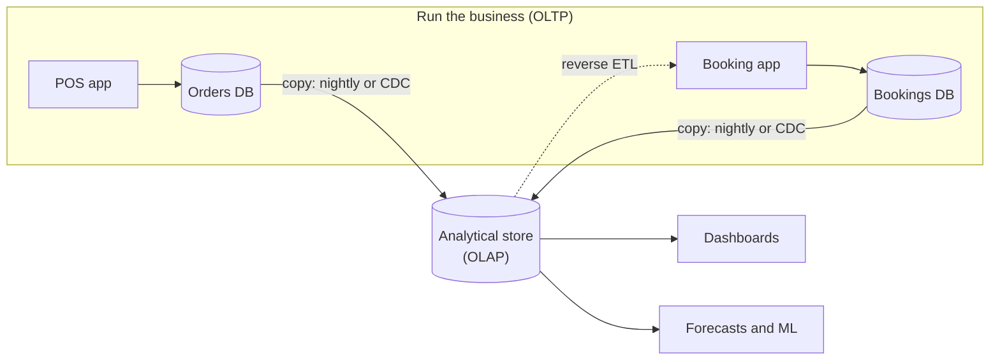

# OLTP vs OLAP

Mastery: `INPUT[inlineSelect(option(new), option(learning), option(solid)):mastery]`

> [!story] Context
> [[Primary and Foreign Keys]] keep an operational database consistent under many small, concurrent changes. Analytical queries over years of history have different requirements, and running them on the same system degrades both workloads.

> [!eli5] Summary
> Some systems record business events as they happen, such as a sale or a booking, and must respond in milliseconds. Other systems analyze large volumes of past events to find totals and trends. The two jobs need different designs, so most organizations run separate systems for each.

> [!analogy]- Analogy: a shop
> | Shop | System |
> |---|---|
> | The counter, serving one customer at a time | OLTP |
> | The back office, totaling a year of receipts | OLAP |
> | Doing year-end accounts at the counter | Analytical queries on the operational database |
> | Carrying the day's receipts to the back office | A pipeline ([[ETL vs ELT]]) |

## Background

Relational databases were first built to **run** businesses: bank transfers, airline seats, stock levels. These workloads are many small reads and writes that must be correct and immediate. They became known as **OLTP**, online transaction processing.

By the 1980s and 1990s, businesses also wanted to **analyze** years of those transactions. Those queries scan millions of rows, join many tables, and add things up. Run on the operational database, they slowed the operational workload, and the operational schema (designed for safe updates) was awkward for analysis. This second category became known as **OLAP**, online analytical processing. A white paper by E. F. Codd, S. B. Codd, and C. T. Salley, "Providing OLAP (On-Line Analytical Processing) to User-Analysts: An IT Mandate", distributed by the vendor Arbor Software, defined twelve rules for OLAP products.

The standard answer became two systems: OLTP databases that run the business, and a separate analytical store, the [[Data Warehouses|data warehouse]], fed by a nightly copy.

## Overview

| | OLTP (run the business) | OLAP (analyze the business) |
|---|---|---|
| **Typical question** | "Is Dr. Lee free at 10:30?" | "No-show rate by doctor by month, last 3 years" |
| **Rows touched per query** | A handful, found by key | Millions to billions, scanned |
| **Columns touched** | Most columns of a few rows | A few columns of many rows |
| **Writes** | Constant small inserts and updates | Bulk loads, mostly appends |
| **Users** | Many concurrent app users and staff | Fewer analysts, dashboards, models |
| **Speed goal** | Milliseconds per transaction ([[Latency\|latency]]) | Seconds per big query ([[Throughput\|throughput]]) |
| **Data freshness** | Right now | Minutes to a day behind, traditionally |
| **Schema** | Normalized, to avoid update anomalies | Denormalized or star schema, to make reads simple |
| **Storage layout** | Row-oriented with B-tree [[Index\|indexes]] | Column-oriented, compressed |
| **Examples** | PostgreSQL, MySQL, SQL Server, [[Lakebase]] | [[Data Warehouses\|Warehouses]], [[Databricks SQL]] on Delta tables |

## How it works



The same data, asked two ways:

```sql
-- OLTP: one row by key. A B-tree index finds it in microseconds.
SELECT status FROM appointments WHERE appointment_id = 'A-1042';

UPDATE appointments SET status = 'attended' WHERE appointment_id = 'A-1042';

-- OLAP: scan years of rows, read 3 of 20 columns, aggregate.
SELECT doctor_id,
       date_trunc('MONTH', start_time) AS month,
       AVG(CASE WHEN status = 'no-show' THEN 1 ELSE 0 END) AS no_show_rate
FROM clinic.analytics.appointments
WHERE start_time >= '2023-01-01'
GROUP BY ALL
ORDER BY month, doctor_id;
```

The first pair wants a row store with an index. The last query wants a column store that reads only `doctor_id`, `start_time`, and `status`. One storage layout cannot be best at both, which is the root of the split.

## Small-business considerations

> [!smallbiz] Small-business considerations
> - **Your OLTP systems are your vendors' apps** (POS, booking, accounting). Do not run heavy reports against them directly; use their exports or APIs.
> - **Your OLAP system is where those copies meet.** For a very small shop that may be a spreadsheet. Once you have several sources or years of history, it should be an analytics platform.
> - **Freshness is a choice.** A nightly copy is fine for most small-business reports and is the cheapest. Only pay for near-real-time when a decision needs it.

> [!bridge]- In Databricks today
> Databricks started on the OLAP side and now covers both:
> - **OLAP:** [[Delta Lake]] tables queried through [[Databricks SQL]] on [[SQL Warehouses]], with [[Photon]] as the vectorized engine.
> - **OLTP:** [[Lakebase]], a managed Postgres database inside Databricks, generally available since January 22, 2026, with autoscaling, scale-to-zero, branching, and point-in-time recovery.
> - **Between them:** synced tables serve lakehouse data into Lakebase for apps (reverse direction, like [[Reverse ETL]]), and [[Lakeflow Connect]] and [[Change Data Capture]] bring operational data into the lakehouse. Some write-back features (LTAP direct writes) are in Beta as of October 2026.
> - **The bigger idea:** keeping one copy of data for many workloads, instead of a separate warehouse, is the [[The Lakehouse Idea|lakehouse idea]] and the answer to [[The Two-Tier Architecture Problem]].

## Cloud differences

> [!azure]- Azure Databricks
> Typical OLTP sources are Azure SQL Database and Azure Database for PostgreSQL. Lakebase is documented for Azure Databricks; check regional availability in the Azure docs.

> [!aws]- Databricks on AWS
> Typical OLTP sources are Amazon RDS and Aurora. Lakebase is documented for AWS workspaces.

> [!gcp]- Databricks on Google Cloud
> Typical OLTP sources are Cloud SQL and AlloyDB. Check the Lakebase docs for Google Cloud availability before planning on it.

## Advanced topics

> [!deepdive]- Advanced topics (301–401)
> - **Row stores vs. column stores, mechanically.** A B-tree over row pages finds a key in a few page reads, but scanning one column still reads every page of the table. A columnar format such as Parquet lets a query skip the columns it does not need and compresses each column well, because values in one column are similar. Vectorized engines such as Photon then process thousands of rows per batch so the CPU can use SIMD instructions. The cost shows up on point updates: without deletion vectors, changing a single row in a Delta table rewrites the entire Parquet file that contains it. See [[Columnar Storage]] and [[Photon]].
> - **Isolation and concurrency differ.** OLTP systems need fine-grained row locks or MVCC so thousands of tiny transactions do not block each other. Analytical tables use optimistic concurrency at the file or table level: Delta tables default to WriteSerializable isolation, offer Serializable, and add row-level concurrency to reduce conflicts between concurrent writers.
> - **HTAP.** Hybrid transactional/analytical processing tries to serve both from one system, often by keeping a row store and a column replica in sync. Lakebase plus synced tables is Databricks' version of the pattern: two engines, one governed platform.
> - **MOLAP vs. ROLAP.** Multidimensional OLAP (MOLAP) servers store multidimensional data directly in special structures such as arrays, often called cubes. Relational OLAP (ROLAP) servers keep the data in a relational database, usually in star or snowflake schemas, and map multidimensional operations to SQL. On Databricks, [[Metric Views]] and [[Semantic Layer|semantic layers]] fill the role of defining measures once and slicing them by dimensions at query time.
> - **The freshness gap.** The classic split meant analytics was always a day behind. [[Change Data Capture]] and streaming ingestion shrink it to minutes or seconds. See [[Batch vs Streaming]].

## Common misconceptions

> [!confusion] OLAP is not a product
> OLAP is a category of workload. Warehouses, cube servers, and Databricks SQL all do OLAP.

> [!confusion] A read replica is not an analytics system
> Copying the OLTP database to a read-only replica protects the app, but the replica still has a row layout and a normalized schema, so big analytical queries remain slow.

## Recall

What do OLTP and OLAP stand for?::Online transaction processing and online analytical processing.
Give a typical OLTP query and a typical OLAP query.::OLTP: look up or update one appointment by ID. OLAP: no-show rate by doctor by month over three years.
Why should you not run heavy reports on the operational database?::Large scans compete with small transactions and slow down the app the business runs on.
Which storage layout suits OLTP, and which suits OLAP?::Row-oriented with B-tree indexes for OLTP; column-oriented and compressed for OLAP.
What is Lakebase?::Databricks' managed Postgres (OLTP) database, generally available since January 22, 2026.
What is HTAP?::Hybrid transactional/analytical processing: serving both workloads from one system.

## Next steps

> [!path] Learning path
> **Needs first:** [[Relational Databases]], [[SQL]], [[Primary and Foreign Keys]]
> **Unlocks next:** [[Data Modeling Basics]], [[Data Warehouses]], [[Columnar Storage]], [[ETL vs ELT]]

> [!nextup] Next
> [[Data Modeling Basics]] covers how to choose tables, grain, and relationships for either kind of system.

> [!sources]- Sources (last verified: 2026-10-25)
> - [Lakebase release notes (AWS)](https://docs.databricks.com/aws/en/release-notes/lakebase/)
> - [Lakebase Postgres compatibility (AWS)](https://docs.databricks.com/aws/en/oltp/projects/compatibility)
> - [Serve lakehouse data with synced tables (AWS)](https://docs.databricks.com/aws/en/oltp/projects/sync-tables)
> - [Isolation levels: WriteSerializable and Serializable (AWS)](https://docs.databricks.com/aws/en/optimizations/isolation/isolation-levels)
> - [Isolation levels (Azure Databricks)](https://learn.microsoft.com/en-us/azure/databricks/optimizations/isolation/isolation-levels)
> - [Row-level concurrency (AWS)](https://docs.databricks.com/aws/en/optimizations/isolation/row-level-concurrency)
> - [Chaudhuri and Dayal, "An Overview of Data Warehousing and OLAP Technology", ACM SIGMOD Record 26(1), March 1997](https://dl.acm.org/doi/10.1145/248603.248616)
> - [What is Parquet? (Databricks glossary)](https://www.databricks.com/glossary/what-is-parquet)
> - [What is Photon? (AWS)](https://docs.databricks.com/aws/en/compute/photon)
> - [Deletion vectors (AWS)](https://docs.databricks.com/aws/en/delta/deletion-vectors)
> - [Unity Catalog metric views (AWS)](https://docs.databricks.com/aws/en/metric-views/)
