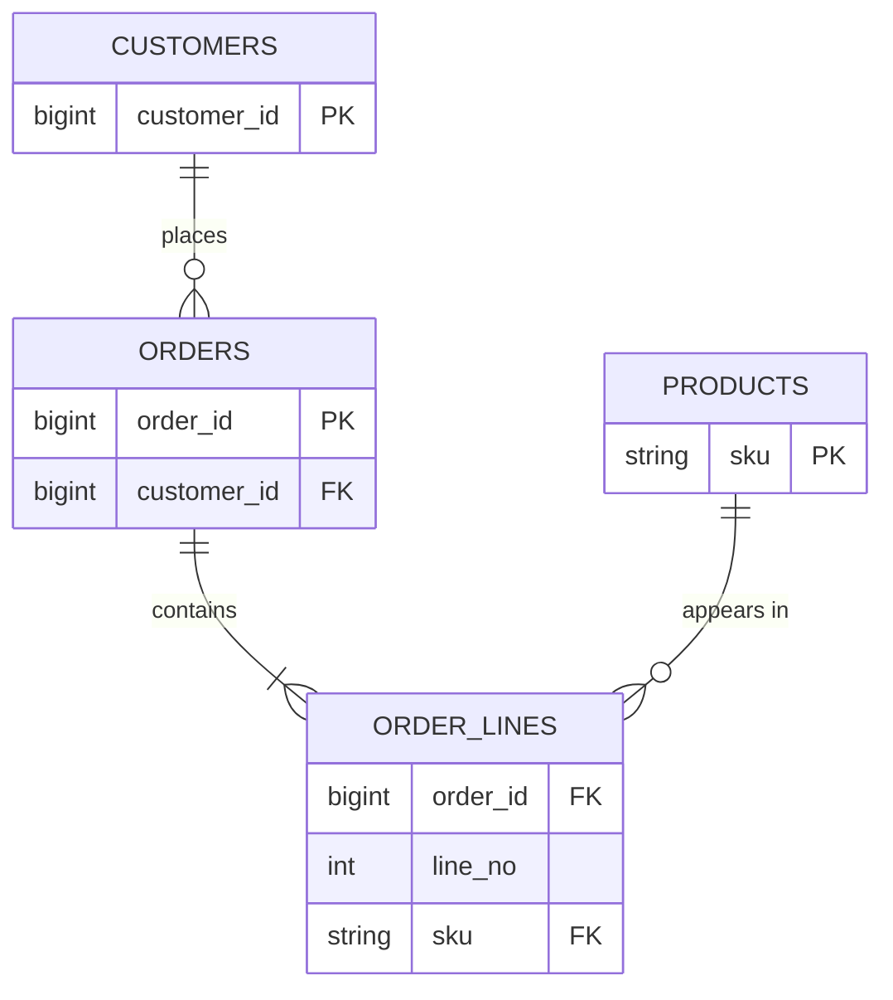

# Primary and Foreign Keys

Mastery: `INPUT[inlineSelect(option(new), option(learning), option(solid)):mastery]`

> [!story] Context
> The join examples in [[SQL]] match rows across tables by a shared column. Joins are reliable only if each row has a unique, stable identifier and every reference points to a row that exists.

> [!eli5] Summary
> A primary key is a value that identifies exactly one row, like a library card number. A foreign key is that same value stored in another table to record a link, like the card number written on a loan slip.

> [!analogy]- Analogy: a coat check
> | Coat check | Keys |
> |---|---|
> | The numbered ticket on each coat | Primary key |
> | The ticket stub the customer keeps | Foreign key |
> | A stub whose number matches no coat | Referential integrity violation |
> | Using coat color as the ID | A poor key: not unique, not stable |

## Background

Without keys, tables can only be matched by names and descriptions, and those are unreliable:

- Two customers are both called "Sam Lee".
- One customer is "Sam Lee" in the POS and "Samuel Lee" in the loyalty app.
- A product is renamed from "Croissant" to "Butter Croissant", and last year's orders no longer match it.

Keys address this. Each row gets an identifier that is **unique** and **does not change**, and other tables store that identifier instead of copying descriptive details. Codd's 1970 paper built the relational model on exactly this idea: tables relate through shared values, not hidden pointers.

## Overview

| Term | Definition | Clinic example |
|---|---|---|
| **Primary key (PK)** | A column (or set of columns) whose value uniquely identifies each row. Cannot be null | `patients.patient_id = 'P-311'` |
| **Foreign key (FK)** | A column in one table that refers to the primary key of another | `appointments.patient_id` points at `patients.patient_id` |
| **Composite key** | A key made of several columns together | `(doctor_id, start_time)` in a schedule |
| **Natural key** | A key that already exists in the real world or source system | A product barcode, a tax ID, the POS's order number |
| **Surrogate key** | A meaningless ID the system generates | An auto-incrementing number or a UUID |
| **Unique constraint** | A rule that values must not repeat, without being the main key | Each patient's email is unique |

Rules a traditional database enforces:

- **Entity integrity:** a primary key is never null and never duplicated.
- **Referential integrity:** a foreign key value must exist in the referenced table (or be null if allowed). Deleting a patient who still has appointments is blocked or cascades, depending on the rule.

## How it works



Reading the diagram: one customer places many orders; one order contains one or more lines; each line points to one product. `ORDER_LINES` has a composite key of `(order_id, line_no)`.

In Databricks SQL, the bakery's schema with keys declared:

```sql
CREATE TABLE bakery.sales.customers (
  customer_id BIGINT GENERATED ALWAYS AS IDENTITY,   -- surrogate key
  email       STRING,
  name        STRING,
  CONSTRAINT customers_pk PRIMARY KEY (customer_id)
);

CREATE TABLE bakery.sales.products (
  sku   STRING NOT NULL,                              -- natural key from the POS
  name  STRING,
  CONSTRAINT products_pk PRIMARY KEY (sku)
);

CREATE TABLE bakery.sales.orders (
  order_id    BIGINT NOT NULL,
  customer_id BIGINT,
  order_time  TIMESTAMP,
  CONSTRAINT orders_pk PRIMARY KEY (order_id),
  CONSTRAINT orders_customer_fk FOREIGN KEY (customer_id)
    REFERENCES bakery.sales.customers
);
```

Because Databricks does not enforce these constraints (see below), check them yourself:

```sql
-- Duplicate primary keys?
SELECT order_id, COUNT(*) FROM bakery.sales.orders GROUP BY order_id HAVING COUNT(*) > 1;

-- Orphan foreign keys: orders pointing at customers that do not exist
SELECT o.order_id
FROM bakery.sales.orders o
LEFT ANTI JOIN bakery.sales.customers c ON o.customer_id = c.customer_id;
```

## Small-business considerations

> [!smallbiz] Small-business considerations
> - **Use the IDs your systems already give you.** The POS's order number and product SKU are good natural keys, as long as the vendor never reuses them.
> - **Customers are the hard case.** The same person appears in the POS, the booking app, and the email tool with different IDs. Pick one system as the master, and keep a mapping table from the other systems' IDs to it.
> - **Never key on names or phone numbers.** They repeat and change.
> - **Run the duplicate and orphan checks above** on a schedule. They catch most data quality problems early.

> [!bridge]- In Databricks today
> - **Keys are informational.** In Databricks, primary key, foreign key, and unique constraints are not enforced. The database will let you insert duplicates. Enforced checks are `NOT NULL` and `CHECK` constraints, and pipeline [[Expectations and Data Quality|expectations]].
> - **`RELY` makes them useful.** Declaring a constraint with `RELY` tells the optimizer it may trust it, for example to remove unnecessary joins or `DISTINCT`s. The default is `NORELY`. RELY on primary keys arrived in Databricks Runtime 14.2 and on foreign keys in 15.4, and the optimizations need Photon-enabled compute. If you claim `RELY` and the data violates it, query results can be wrong.
> - **Identity columns** (`GENERATED ALWAYS AS IDENTITY`) generate surrogate keys. Values are unique but not guaranteed contiguous, must be `BIGINT`, and Databricks advises using them only where concurrent writes to the table are not needed.
> - **Upserts use keys:** [[MERGE and Upserts|MERGE]] matches incoming rows to existing ones on a key.
> - **BI tools read them:** declared keys help tools such as Power BI and [[Metric Views]] understand how tables join.

## Cloud differences

> [!note] Nothing differs by cloud
> Constraint syntax and behavior are the same on Azure, AWS, and Google Cloud.

## Advanced topics

> [!deepdive]- Advanced topics (301–401)
> - **Why Databricks does not enforce keys.** Enforcing uniqueness on a distributed table means checking every write against every existing key, across many files and concurrent writers. That costs coordination that analytic workloads rarely want to pay. The data pipeline is responsible for uniqueness, usually through `MERGE` or deduplication.
> - **Natural vs. surrogate keys in analytics.** Databricks' dimensional modeling guidance prefers natural keys when the source's key is stable and usable, and reserves surrogate keys for sources that reuse or change IDs. Identity columns are safe when the upstream table is append-only and never fully refreshed; a full rebuild can assign different IDs and break fact-to-dimension joins.
> - **Deterministic surrogate keys.**[^unverified] An alternative to identity columns is hashing the natural key (for example `xxhash64(source_system, source_id)`), which gives the same key on every rebuild. Collisions are rare but possible, so test for them at large scale.
> - **Keys and indexes.** In OLTP databases a primary key automatically creates a unique [[Index|index]], usually a B-tree. Delta tables do not have B-tree indexes[^unverified]; lookups by key rely on file statistics, [[Data Skipping|data skipping]], and [[Liquid Clustering|liquid clustering]] on the key columns.
> - **Keys in slowly changing dimensions.** When you keep history of a customer's address, one natural key maps to several rows, so the dimension needs a surrogate or a `(natural_key, valid_from)` key. See [[Slowly Changing Dimensions]].

## Common misconceptions

> [!confusion] "Declared" is not "enforced" in Databricks
> Writing `PRIMARY KEY` in Databricks documents the rule and can help the optimizer, but does not stop duplicate rows. Coming from Postgres or SQL Server, this is the most common surprise.

> [!confusion] A foreign key is not a copy of the other row
> It stores only the referenced ID. To see the customer's name, you [[Join|join]] to the customers table.

## Recall

What is a primary key?::A column or set of columns that uniquely identifies each row and is never null.
What is a foreign key?::A column that stores the primary key of a row in another table, linking the two.
What is referential integrity?::The rule that every foreign key value must match an existing primary key.
Natural key vs. surrogate key?::A natural key comes from the real world or source system; a surrogate key is a meaningless ID the system generates.
Does Databricks enforce primary and foreign keys?::No, they are informational. NOT NULL and CHECK constraints are enforced.
What does RELY do on a Databricks constraint?::Lets the optimizer trust the constraint to rewrite and speed up queries.
How do you find orphan foreign keys in SQL?::LEFT ANTI JOIN the child table to the parent on the key.
What data type must a Databricks identity column be?::BIGINT.

## Next steps

> [!path] Learning path
> **Needs first:** [[Relational Databases]], [[SQL]]
> **Unlocks next:** [[Data Modeling Basics]], [[Star Schema]], [[MERGE and Upserts]]

> [!nextup] Next
> [[OLTP vs OLAP]] explains why systems that process transactions and systems that analyze them are usually separate.

> [!sources]- Sources (last verified: 2026-10-25)
> - [E. F. Codd, "A Relational Model of Data for Large Shared Data Banks", Communications of the ACM 13(6), June 1970 (PDF)](https://web.eecs.umich.edu/~michjc/eecs584/Papers/codd_1970.pdf)
> - [Constraints on Databricks (AWS)](https://docs.databricks.com/aws/en/tables/constraints)
> - [CONSTRAINT clause (AWS)](https://docs.databricks.com/aws/en/sql/language-manual/sql-ref-syntax-ddl-create-table-constraint)
> - [CONSTRAINT clause (Azure Databricks)](https://learn.microsoft.com/en-us/azure/databricks/sql/language-manual/sql-ref-syntax-ddl-create-table-constraint)
> - [ADD CONSTRAINT clause (AWS)](https://docs.databricks.com/aws/en/sql/language-manual/sql-ref-syntax-ddl-alter-table-add-constraint)
> - [Query optimization using primary key and unique constraints (AWS)](https://docs.databricks.com/aws/en/sql/user/queries/query-optimization-constraints)
> - [Query optimization using primary key and unique constraints (Azure Databricks)](https://learn.microsoft.com/en-us/azure/databricks/sql/user/queries/query-optimization-constraints)
> - [Dimensional modeling in Lakeflow pipelines (AWS)](https://docs.databricks.com/aws/en/ldp/best-practices/dimensional-modeling)
> - [Delta Lake generated columns (AWS)](https://docs.databricks.com/aws/en/delta/generated-columns)

[^unverified]: Unconfirmed: not yet checked against an official or primary source.
