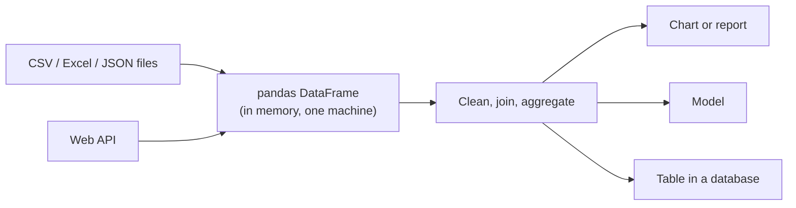

# Python for Data

Mastery: `INPUT[inlineSelect(option(new), option(learning), option(solid)):mastery]`

> [!story] Context
> [[Storage vs Compute]] separated where data is kept from the machines that process it. [[SQL]] covers most questions asked of tables, but cleaning files, calling web services, and building models need a general-purpose programming language. In data work, that language is usually Python.

> [!eli5] Summary
> Python is a programming language that is relatively easy to read and write. With add-on packages such as pandas, a few lines of Python can load a spreadsheet export, clean it, combine it with other data, and produce a chart or a forecast.

> [!analogy]- Analogy: a kitchen
> | Kitchen | Python for data |
> |---|---|
> | The cook | Python, the language |
> | Specialized appliances: mixer, oven, scale | Libraries: pandas, NumPy, scikit-learn, matplotlib |
> | A recipe card that anyone can follow | A script or [[Notebooks\|notebook]] |
> | The counter where the ingredients are laid out | A [[DataFrames\|DataFrame]] in memory |
> | Moving to an industrial kitchen for a banquet | Moving from pandas to [[PySpark]] |

## Background

SQL describes questions about tables. Many data tasks are not questions about tables:

- Reading a folder of inconsistently formatted CSV files and fixing each one.
- Calling a booking system's [[APIs|API]] page by page and saving the JSON.
- Training a model to forecast next week's demand.
- Producing charts and automating a weekly report.

Python, first posted publicly by Guido van Rossum in February 1991, became the most common language for these tasks. It is approachable for beginning programmers, it runs on every operating system, and it has a large ecosystem of [[Open Source|open-source]] libraries for numerical computing, statistics, [[Machine Learning Basics|machine learning]], and data access. The pandas library, whose development began in 2008 at AQR Capital Management with Wes McKinney as its original lead, added a table-like data structure, the DataFrame, that made Python practical for analysts used to spreadsheets and SQL.

## Overview

Python for data is the use of the Python programming language, plus a set of add-on libraries, to load, clean, analyze, and model data.

The core Python data stack:

| Library | Purpose | Example use |
|---|---|---|
| **[[Pandas\|pandas]]** | DataFrames: load, clean, join, group, reshape tables in memory | Clean a point-of-sale (POS) export |
| **NumPy** | Fast numeric arrays, the foundation for most other libraries | Vector math on prices |
| **matplotlib / plotly** | Charts | Weekly sales chart |
| **scikit-learn** | Classic machine learning | Predict no-shows |
| **requests** | HTTP calls to web [[APIs]] | Pull bookings from a [[SaaS PaaS and IaaS\|SaaS]] app |
| **PyArrow** | Apache Arrow columnar memory format, [[Apache Parquet\|Parquet]] reading and writing | Fast exchange between pandas and Spark |
| **[[PySpark]]** | Python API for Apache Spark, for data larger than one machine | Process years of order lines |

Python and SQL are complementary. SQL is usually clearer for filtering, joining, and aggregating tables. Python is better for procedural logic, calling external services, and machine learning. Platforms such as Databricks let you mix both in one [[Notebooks|notebook]].

## How it works



A pandas workflow for a bakery's daily sales:

```python
import pandas as pd

orders = pd.read_csv("orders_2026.csv", parse_dates=["order_time"],
                     dtype={"sku": "string"})          # keep codes as text
products = pd.read_csv("products.csv", dtype={"sku": "string"})

daily = (
    orders.merge(products, on="sku", how="left")       # join, like SQL JOIN
          .assign(order_date=lambda d: d["order_time"].dt.date,
                  amount=lambda d: d["quantity"] * d["price"])
          .groupby(["order_date", "category"], as_index=False)["amount"].sum()
)

daily.to_parquet("daily_sales.parquet")                 # typed, compressed output
```

pandas holds the whole DataFrame in the memory of one machine. That limit is the main reason the story moves to distributed engines in later chapters. The same logic in PySpark runs across a [[Cluster|cluster]]:

```python
# PySpark on Databricks: the same steps, distributed across a cluster
from pyspark.sql import functions as F

orders   = spark.table("bakery.silver.orders")
products = spark.table("bakery.silver.products")

daily = (orders.join(products, "sku", "left")
               .withColumn("order_date", F.to_date("order_time"))
               .withColumn("amount", F.col("quantity") * F.col("price"))
               .groupBy("order_date", "category")
               .agg(F.sum("amount").alias("amount")))

daily.write.mode("overwrite").saveAsTable("bakery.gold.daily_sales")
```

## Small-business considerations

> [!smallbiz] Small-business considerations
> - **Learn SQL first, then Python:** For a one-person data team, SQL covers most reporting. Add Python when you need to call APIs, automate file cleanup, or forecast.
> - **pandas is enough for small data:** If your data fits comfortably in a laptop's memory, pandas is simpler than a distributed engine.
> - **Keep scripts out of personal laptops:** A script that only runs on one person's machine is the Python version of the master spreadsheet. Store code in [[Git]] and run it on shared, scheduled compute.

> [!bridge]- In Databricks today
> - **Notebooks:** Databricks [[Notebooks|notebooks]] run Python, SQL, Scala, and R, and cells in different languages can share tables.
> - **pandas on Databricks:** you can use plain pandas on the [[Driver and Executors|driver]] node (the machine that coordinates a cluster). The **pandas API on Spark** (`import pyspark.pandas as ps`, Databricks Runtime 10.0 and above) provides pandas-equivalent APIs that run on Apache Spark.
> - **Moving between pandas and Spark:** `toPandas()` and `spark.createDataFrame(pandas_df)` use Apache Arrow when `spark.sql.execution.arrow.pyspark.enabled` is `true`. The docs note this is on by default except on High Concurrency clusters and user isolation clusters in Unity Catalog-enabled workspaces. Even with Arrow, `toPandas()` collects every row to the driver, so use it only on small results.
> - **Custom Python logic at scale:** pandas [[UDF|user-defined functions]] process Spark data in Arrow batches.
> - **Local development:** [[Databricks Connect]] runs PySpark code from a local IDE (code editor), such as Visual Studio Code, PyCharm, or IntelliJ IDEA, against Databricks compute.
> - **Libraries:** see [[Libraries and Environments]].

## Cloud differences

> [!note] Nothing differs by cloud
> Python, pandas, and PySpark behave the same on Azure, AWS, and Google Cloud.

## Advanced topics

> [!deepdive]- Advanced topics (301–401)
> - **Why pandas is fast enough on one machine:** pandas is built on top of NumPy, so vectorized column operations avoid slow Python loops. Row-by-row `apply` with Python functions loses that advantage; the pandas performance guide recommends removing for-loops in favor of NumPy vectorization.
> - **Apache Arrow:** Arrow (first release 0.1.0 in October 2016) is a language-independent columnar in-memory format. It lets pandas, Spark, and other tools exchange data without converting it row by row, and it is the complement to Parquet on disk. On Databricks, Arrow-based conversion supports all Spark SQL types except `ArrayType` of `TimestampType`.
> - **Arrow fallback:** If an error occurs before computation starts in Spark, Arrow-enabled conversions can fall back to a non-Arrow path. `spark.sql.execution.arrow.pyspark.fallback.enabled` controls this.
> - **Batch size for pandas UDFs:** Spark converts partitions to Arrow record batches, which can temporarily use a lot of JVM memory. `spark.sql.execution.arrow.maxRecordsPerBatch` defaults to 10,000 rows; lower it for very wide data.
> - **The driver bottleneck:** In a cluster, the [[Driver and Executors|driver]] coordinates and executors do the work. Plain pandas runs only on the driver, so a pandas script on a large cluster still uses one machine.

## Common misconceptions

> [!confusion] pandas is not a database
> pandas works on data in memory. It does not store data permanently, enforce constraints, or manage concurrent users. Results must be saved to files or tables.

> [!confusion] PySpark is not "faster pandas"
> PySpark distributes work across many machines, which adds overhead. For small data, pandas is often faster. PySpark is the right choice when data or computation exceeds one machine.

## Recall

What is pandas?::A Python library that provides DataFrames for loading, cleaning, joining, and aggregating tables in memory.
What is the main limit of pandas?::It holds data in the memory of one machine.
When is SQL a better choice than Python?::For filtering, joining, and aggregating tables.
What is the pandas API on Spark?::A pandas-compatible API (`pyspark.pandas`) that runs on Apache Spark, available in Databricks Runtime 10.0 and above.
Which Spark setting enables Arrow for `toPandas()`?::`spark.sql.execution.arrow.pyspark.enabled`.
Why should `toPandas()` be used only on small results?::It collects every row to the driver, even with Arrow.
What is the default Arrow batch size for pandas UDFs?::10,000 records per batch (`spark.sql.execution.arrow.maxRecordsPerBatch`).

## Next steps

> [!path] Learning path
> **Needs first:** [[CSV and JSON]], [[SQL]]
> **Unlocks next:** [[APIs]], [[Pandas]], [[DataFrames]], [[PySpark]], [[Notebooks]]

> [!nextup] Next
> [[APIs]] covers how programs, including Python scripts, request data from other software such as SaaS applications.

> [!sources]- Sources (last verified: 2026-10-25)
> - [Can you use pandas on Databricks? (AWS)](https://docs.databricks.com/aws/en/pandas/)
> - [Convert between PySpark and pandas DataFrames (AWS)](https://docs.databricks.com/aws/en/pandas/pyspark-pandas-conversion)
> - [Convert between PySpark and pandas DataFrames (Azure Databricks)](https://learn.microsoft.com/en-us/azure/databricks/pandas/pyspark-pandas-conversion)
> - [Pandas API on Spark (Azure Databricks)](https://learn.microsoft.com/en-us/azure/databricks/pandas/pandas-on-spark)
> - [pandas user-defined functions (Azure Databricks)](https://learn.microsoft.com/en-us/azure/databricks/udf/pandas)
> - [Apache Arrow is 10 years old (Apache Arrow project blog)](https://arrow.apache.org/blog/2026/02/12/arrow-anniversary/)
> - [General Python FAQ: Why was Python created in the first place? (python.org)](https://docs.python.org/3/faq/general.html)
> - [About pandas: history of development (pandas.pydata.org)](https://pandas.pydata.org/about/)
> - [pandas project governance (pandas.pydata.org)](https://pandas.pydata.org/about/governance.html)
> - [pandas package overview (pandas.pydata.org)](https://pandas.pydata.org/docs/getting_started/overview.html)
> - [pandas: Enhancing performance (pandas.pydata.org)](https://pandas.pydata.org/docs/user_guide/enhancingperf.html)
> - [Databricks notebooks (AWS)](https://docs.databricks.com/aws/en/notebooks/)
> - [What is Databricks Connect? (AWS)](https://docs.databricks.com/aws/en/dev-tools/databricks-connect/)
