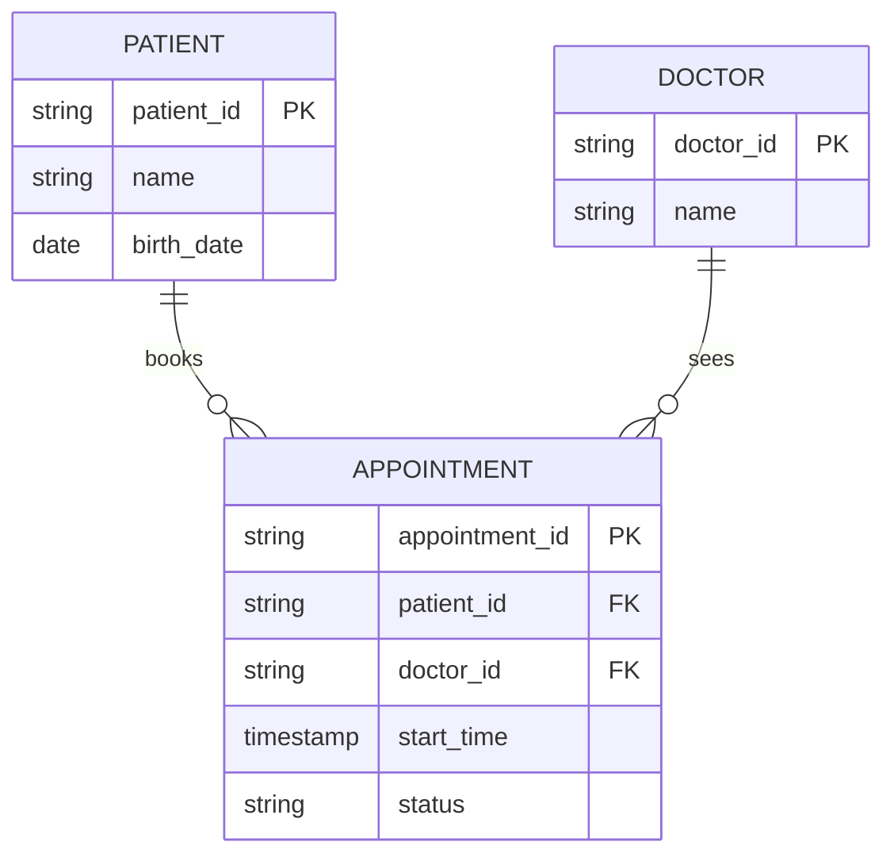

# Relational Databases

Mastery: `INPUT[inlineSelect(option(new), option(learning), option(solid)):mastery]`

> [!story] Context
> [[Spreadsheets]] work for one person but not as a shared system: copies diverge, types drift, and nothing prevents invalid edits. A relational database keeps one shared copy of each table and enforces rules on every change.

> [!eli5] Summary
> A relational database stores data in tables and is managed by a program that checks every change against rules, such as "a price must be a number" or "every appointment must belong to a real patient". Many people and applications can read and write the same data at the same time without conflicts.

> [!analogy]- Analogy: a clinic's records office
> | Records office | Relational database |
> |---|---|
> | Filing cabinets for patients, doctors, and appointments | Tables |
> | The patient number on every folder | [[Primary and Foreign Keys\|Primary key]] |
> | The patient number written on an appointment slip | Foreign key |
> | The clerk who files and retrieves on request | Database management system (DBMS) |
> | Requests handed to the clerk | [[SQL]] queries |
> | Index cards at the front desk | [[Index\|Indexes]] |
> | A booking and its deposit filed together or not at all | A transaction ([[ACID Transactions]]) |

## Background

Business databases before the relational model stored records in fixed hierarchies (tree-structured files) or networks of pointers. To ask a new question, a programmer had to know exactly how records were linked on disk and write code to walk those links. Changing the layout broke the programs.

In June 1970, **E. F. Codd**, a researcher at IBM's San Jose lab, published "A Relational Model of Data for Large Shared Data Banks" in *Communications of the ACM*. His core idea was **data independence**: users should describe *what* data they want, and the system should work out *how* to get it, regardless of how data is physically stored. Data would be organized as **relations** (tables) linked by shared values rather than hidden pointers.

IBM's System R project and the University of California, Berkeley's INGRES project built working prototypes in the 1970s (both described in *ACM Transactions on Database Systems* in 1976), and [[SQL]] came out of System R. In 1979, Relational Software, Inc. (now Oracle) introduced the first commercially available implementation of SQL, followed by IBM DB2, Microsoft SQL Server, and the [[Open Source|open-source]] MySQL and PostgreSQL. Most operational business systems, from bank ledgers to clinic booking apps, still run on relational databases.

## Overview

A **relational database** stores data in **tables** (relations) made of **rows** (records) and **columns** (attributes), and links tables through shared key values. A **relational database management system (RDBMS)** is the software that stores the tables, enforces the rules, answers queries, and manages concurrent users.

What it adds over a spreadsheet:

| Capability | What it means | Clinic example |
|---|---|---|
| **[[Schema\|Schema]] with types** | Every column has a declared type | `start_time` must be a timestamp |
| **Constraints** | Rules checked on every write: `NOT NULL`, `UNIQUE`, `CHECK`, keys | No appointment without a patient |
| **Relationships** | Tables link through [[Primary and Foreign Keys\|keys]] | Appointment points to patient P-311 |
| **Transactions** | Groups of changes succeed or fail together | Booking and deposit saved as one unit |
| **Concurrency** | Many users safely read and write at once | Two receptionists cannot double-book Dr. Lee |
| **Security** | Users and permissions per table | The front desk cannot read billing |
| **Query language** | [[SQL]] to ask any question | "No-shows by doctor last month" |

The common products today:

| Product | Type | Typical home |
|---|---|---|
| **PostgreSQL** | Open source | Startups, [[SaaS PaaS and IaaS\|SaaS]] apps, cloud-managed services |
| **MySQL / MariaDB** | Open source | Web apps, e-commerce |
| **Microsoft SQL Server** | Commercial | Windows-centric businesses, line-of-business apps |
| **Oracle Database** | Commercial | Large enterprises, ERP (enterprise resource planning) systems |
| **SQLite** | Open source, embedded in a file | Phone apps, small tools |

Each cloud also sells these as managed services, so nobody has to patch the server.

## How it works



The schema above in SQL (PostgreSQL syntax), with rules the database enforces:

```sql
CREATE TABLE patients (
  patient_id  TEXT PRIMARY KEY,
  name        TEXT NOT NULL,
  birth_date  DATE
);

CREATE TABLE doctors (
  doctor_id   TEXT PRIMARY KEY,
  name        TEXT NOT NULL
);

CREATE TABLE appointments (
  appointment_id  TEXT PRIMARY KEY,
  patient_id      TEXT NOT NULL REFERENCES patients(patient_id),
  doctor_id       TEXT NOT NULL REFERENCES doctors(doctor_id),
  start_time      TIMESTAMP NOT NULL,
  status          TEXT CHECK (status IN ('booked','attended','no-show','cancelled')),
  UNIQUE (doctor_id, start_time)          -- no double-booking
);

-- Book an appointment and take a deposit as one all-or-nothing unit
BEGIN;
  INSERT INTO appointments VALUES ('A-1044','P-311','D-02','2026-03-05 09:00','booked');
  INSERT INTO payments     VALUES ('PAY-881','A-1044', 25.00);
COMMIT;
```

If the second insert fails, the first is rolled back, so there is never a booking without its deposit.

## Small-business considerations

> [!smallbiz] Small-business considerations
> Point-of-sale (POS), booking, and accounting software typically run on a relational database, so you rarely need to operate one yourself. Key points:
> - **Your vendor's database is the source of truth** for daily operations. Do not run heavy reports against it during opening hours.
> - **For analysis, copy the data out** into an analytics platform. That split is explained in [[OLTP vs OLAP]].
> - **If you build your own app**, use a managed Postgres service rather than a spreadsheet as its back end.

> [!bridge]- In Databricks today
> - **Analytics tables:** Databricks tables behave like relational tables (schemas, types, SQL, transactions through [[Delta Lake]]), but they are built for analysis, not for thousands of tiny updates per second.
> - **Operational database:** [[Lakebase]] is a managed PostgreSQL database inside Databricks for application workloads, generally available since January 22, 2026. It supports Postgres 16, 17, and 18 (17 is the default), and synced tables can serve lakehouse data into it.
> - **Querying your existing databases without copying:** [[Lakehouse Federation]] lets Databricks query PostgreSQL, MySQL, SQL Server, Oracle, and other databases in place, without copying the data first.
> - **Moving off them:** see [[Migrating from Postgres and MySQL]] and [[Migrating from SQL Server]].
> - **Keys are informational:** Databricks lets you declare primary and foreign keys, but does not enforce them. See [[Primary and Foreign Keys]].

## Cloud differences

> [!azure]- Azure Databricks
> The Lakehouse Federation SQL Server connector supports SQL Server, Azure SQL Database, and Azure SQL Managed Instance. Azure Synapse (SQL Data Warehouse) has its own connector.

> [!aws]- Databricks on AWS
> Federated queries to Amazon RDS for PostgreSQL and Amazon RDS for MySQL can authenticate with AWS IAM instead of a username and password. Amazon Redshift has its own connector.

> [!gcp]- Databricks on Google Cloud
> Google BigQuery has its own Lakehouse Federation connector. The PostgreSQL, MySQL, and SQL Server connectors work the same as on the other clouds.

## Advanced topics

> [!deepdive]- Advanced topics (301–401)
> - **Storage engines and B-trees:** OLTP databases store rows in fixed-size pages (usually 8 kB in PostgreSQL, 16 KB by default in MySQL's InnoDB) and index them with B-trees, multi-level balanced trees that find a key in a few page reads. InnoDB stores the table itself in a clustered index on the primary key; PostgreSQL stores table rows separately from its indexes and does not keep them in index order (its `CLUSTER` command reorders a table once, but later changes are not clustered). Both are optimized for fetching a few rows by key, which is why they struggle with "scan a billion rows, read two columns" analytics. See [[Columnar Storage]].
> - **Write-ahead logging (WAL):** Changes are first appended to a log, then applied to data pages. After a crash, the log is replayed. Logical decoding of that log is the basis of [[Change Data Capture]].
> - **Isolation levels:** The SQL standard defines Read Uncommitted, Read Committed, Repeatable Read, and Serializable by which anomalies they allow (dirty reads, non-repeatable reads, phantoms). Postgres defaults to Read Committed and implements isolation with multi-version concurrency control ([[MVCC]]): readers see a snapshot and do not block writers. Delta tables on Databricks offer two write isolation levels, WriteSerializable (the default) and Serializable, with snapshot isolation for reads.
> - **Normal forms:** Codd's 1970 paper introduced normalization to remove redundancy. Third normal form is the usual target for operational schemas. Analytics often deliberately denormalizes. See [[Normalization]] and [[Denormalization]].
> - **Scaling limits:** A single relational server scales *up* (bigger machine) far more easily than *out* (many machines), because joins and transactions across machines are hard. This limit is what chapter 02 is about. See [[Scaling Up vs Scaling Out]].

## Common misconceptions

> [!confusion] "Relational" does not mean "has relationships between tables"
> In Codd's model, a *relation* is the mathematical name for a table: a set of rows with the same columns. Relationships between tables are a consequence, not the origin of the name.

> [!confusion] The database is not the same as the DBMS
> The *database* is the data. The *DBMS* (PostgreSQL, SQL Server) is the software that manages it. People use "database" for both.

## Recall

Who introduced the relational model, and where was it published?::E. F. Codd of IBM, in Communications of the ACM, June 1970.
What is data independence?::Users say what data they want, and the system decides how to fetch it, regardless of physical storage.
What is an RDBMS?::Relational database management system: software that stores tables, enforces rules, runs queries, and manages concurrent users.
Name four open-source or commercial relational databases.::PostgreSQL, MySQL, Microsoft SQL Server, Oracle (also SQLite, MariaDB, DB2).
What does a transaction guarantee?::A group of changes either all succeeds or all fails, so data is never left half-updated.
What is Lakebase?::A managed PostgreSQL database inside Databricks for operational workloads, GA since January 2026.
Does Databricks enforce primary and foreign keys?::No. They are informational, though the optimizer can use them with RELY.

## Next steps

> [!path] Learning path
> **Needs first:** [[What Is Data]], [[Spreadsheets]]
> **Unlocks next:** [[SQL]], [[Primary and Foreign Keys]], [[OLTP vs OLAP]], [[ACID Transactions]]

> [!nextup] Next
> [[SQL]] is the language used to define, query, and change data in a relational database.

> [!sources]- Sources (last verified: 2026-10-25)
> - [E. F. Codd, "A Relational Model of Data for Large Shared Data Banks", Communications of the ACM 13(6), June 1970 (PDF)](https://web.eecs.umich.edu/~michjc/eecs584/Papers/codd_1970.pdf)
> - [Constraints on Databricks (AWS)](https://docs.databricks.com/aws/en/tables/constraints)
> - [Isolation levels: WriteSerializable and Serializable (AWS)](https://docs.databricks.com/aws/en/optimizations/isolation/isolation-levels)
> - [What are ACID guarantees on Databricks? (AWS)](https://docs.databricks.com/aws/en/lakehouse/acid)
> - [Lakebase release notes (AWS)](https://docs.databricks.com/aws/en/release-notes/lakebase/)
> - [Lakebase Postgres compatibility (Azure Databricks)](https://learn.microsoft.com/en-us/azure/databricks/oltp/projects/compatibility)
> - [Serve lakehouse data with synced tables (AWS)](https://docs.databricks.com/aws/en/oltp/projects/sync-tables)
> - [E. F. Codd, "A Relational Model of Data for Large Shared Data Banks" (ACM Digital Library)](https://dl.acm.org/doi/10.1145/362384.362685)
> - [Astrahan et al., "System R: Relational Approach to Database Management", ACM TODS 1(2), June 1976](https://dl.acm.org/doi/10.1145/320455.320457)
> - [Stonebraker et al., "The Design and Implementation of INGRES", ACM TODS 1(3), September 1976](https://dl.acm.org/doi/10.1145/320473.320476)
> - [History of SQL (Oracle Database SQL Language Reference 19c)](https://docs.oracle.com/en/database/oracle/oracle-database/19/sqlrf/History-of-SQL.html)
> - [What is query federation? (AWS)](https://docs.databricks.com/aws/en/query-federation/)
> - [Run federated queries on Microsoft SQL Server (AWS)](https://docs.databricks.com/aws/en/query-federation/sql-server)
> - [Run federated queries on PostgreSQL (AWS)](https://docs.databricks.com/aws/en/query-federation/postgresql)
> - [Run federated queries on MySQL (AWS)](https://docs.databricks.com/aws/en/query-federation/mysql)
> - [PostgreSQL: Database page layout](https://www.postgresql.org/docs/current/storage-page-layout.html)
> - [PostgreSQL: Index types](https://www.postgresql.org/docs/current/indexes-types.html)
> - [PostgreSQL: B-tree indexes](https://www.postgresql.org/docs/current/btree.html)
> - [PostgreSQL: CLUSTER](https://www.postgresql.org/docs/current/sql-cluster.html)
> - [PostgreSQL: Transaction isolation](https://www.postgresql.org/docs/current/transaction-iso.html)
> - [MySQL 8.4: InnoDB file space management](https://dev.mysql.com/doc/refman/8.4/en/innodb-file-space.html)
> - [MySQL 8.4: InnoDB clustered and secondary indexes](https://dev.mysql.com/doc/refman/8.4/en/innodb-index-types.html)
