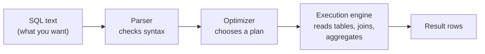

# SQL

Mastery: `INPUT[inlineSelect(option(new), option(learning), option(solid)):mastery]`

> [!story] Context
> [[Relational Databases]] store shared tables and enforce rules through a database management system. Applications and people interact with that system through SQL.

> [!eli5] Summary
> SQL is a language for asking a database questions and changing its data. You describe the result you want, such as "total croissant sales per day in March", and the database determines how to produce it.

> [!analogy]- Analogy: ordering at a restaurant
> | Restaurant | SQL |
> |---|---|
> | Ordering a dish without instructing the cook | Declarative query |
> | The chef choosing how to prepare it | Query optimizer |
> | "These dishes", "from this menu", "vegetarian only" | `SELECT`, `FROM`, `WHERE` |
> | "One plate per table", "starters first" | `GROUP BY`, `ORDER BY` |
> | Combining items from two menus | [[Join]] |

## Background

Codd's 1970 relational model described *what* a query language should do, in mathematical notation that few business users could read. At the IBM Research Laboratory in San Jose, **Donald Chamberlin and Raymond Boyce** first designed, with colleagues, a language called SQUARE (described in a 1973 IBM report), whose subscript-heavy notation proved hard to use, and then a successor, **SEQUEL** (Structured English Query Language), presented in May 1974 and used in IBM's System R prototype. A trademark conflict led to the shorter name **SQL**. Many people still pronounce it "sequel".

The design goal was to let people who are not programmers query a database. **ANSI published the first SQL standard in 1986 (X3.135-1986) and ISO followed in 1987 (ISO 9075:1987)** (today ISO/IEC 9075), with major revisions such as SQL-92 and many since. Every major relational database adopted it, and later so did [[The Three Vs of Big Data|big data]] engines, cloud [[Data Warehouses|warehouses]], and Databricks.

No product follows the standard exactly, so SQL varies a little between systems ("dialects"). The core is the same everywhere, which makes SQL knowledge portable across systems.

## Overview

**SQL (Structured Query Language) is a declarative language for defining, changing, and querying data in tables.** It has a few families of statements:

| Family | Purpose | Main statements |
|---|---|---|
| **Query** | Read data | `SELECT ... FROM ... WHERE ... GROUP BY ... HAVING ... ORDER BY` |
| **DML** (data manipulation) | Change rows | `INSERT`, `UPDATE`, `DELETE`, `MERGE` |
| **DDL** (data definition) | Define structure | `CREATE`, `ALTER`, `DROP` tables and views |
| **DCL** (data control) | Permissions | `GRANT`, `REVOKE` |
| **Transaction control** | Group changes | `BEGIN`, `COMMIT`, `ROLLBACK` |

Why it is still the most important data skill:

- **It is everywhere.** Databases, warehouses, [[Apache Spark|Spark]], Databricks, [[BI Tools|BI tools]], and even spreadsheet add-ons speak it.
- **It describes intent, so engines can improve under you.** The same `SELECT` from 1995 runs on a distributed engine today, and runs faster.
- **It is readable by the business.** An accountant can check a SQL query's logic in a way they cannot check a 300-line script.
- **AI tools generate it.** Plain-English assistants like [[Genie Agents]] and [[Genie Code]] write SQL for you, so being able to read and verify SQL matters more, not less.

## How it works



A clause runs in a different order from how you write it. Writing order is `SELECT, FROM, WHERE, GROUP BY, HAVING, ORDER BY`; logical order is `FROM → WHERE → GROUP BY → HAVING → SELECT → ORDER BY`. That is why you cannot use a column alias from `SELECT` inside `WHERE` in most dialects.

The bakery's questions, in SQL that runs on Databricks and almost any other database:

```sql
-- 1. Filter: what did Maria buy in March?
SELECT order_time, item, quantity
FROM bakery.sales.orders
WHERE customer = 'Maria'
  AND order_time >= '2026-03-01' AND order_time < '2026-04-01';

-- 2. Aggregate: units and revenue per item, best sellers first
SELECT item,
       SUM(quantity)          AS units,
       SUM(quantity * price)  AS revenue
FROM bakery.sales.orders
GROUP BY item
ORDER BY revenue DESC;

-- 3. Join: revenue by product category (categories live in another table)
SELECT p.category, SUM(o.quantity * o.price) AS revenue
FROM bakery.sales.orders   AS o
JOIN bakery.sales.products AS p ON o.item = p.item
GROUP BY p.category;

-- 4. Window function: each day's revenue next to the 7-day average
SELECT order_date, revenue,
       AVG(revenue) OVER (ORDER BY order_date ROWS BETWEEN 6 PRECEDING AND CURRENT ROW) AS avg_7d
FROM bakery.sales.daily_revenue;
```

## Small-business considerations

> [!smallbiz] Small-business considerations
> If one person on the team learns one technical skill, make it SQL. A week of practice covers `SELECT`, `WHERE`, `GROUP BY`, and `JOIN`, which answer most business questions. It pays off in every tool: your point-of-sale (POS) system's reporting, Power BI, and Databricks all use it. Even if you use plain-English tools like [[Genie Agents]], knowing SQL lets you check that the answer is right.

> [!bridge]- In Databricks today
> - **[[Databricks SQL]]** is the SQL experience for analysts: the [[SQL Editor]], [[SQL Warehouses]] as compute, dashboards, and alerts.
> - **[[Spark SQL]]** is the engine underneath, which runs SQL across many machines. The [[Catalyst Optimizer]] and [[Photon]] make it fast.
> - **Governance is SQL too:** `GRANT SELECT ON TABLE ... TO analysts` in [[Unity Catalog]]. See [[Privileges and Grants]].
> - **AI is callable from SQL:** [[AI Functions in SQL]] such as `ai_parse_document` run inside a `SELECT`.
> - **Business definitions live in SQL:** [[Metric Views]] define [[KPI|KPIs]] once; [[dbt]] and [[Lakeflow Spark Declarative Pipelines]] build tables from SQL.

## Cloud differences

> [!note] Nothing differs by cloud
> Databricks SQL is the same language on Azure, AWS, and Google Cloud. Your queries move between clouds unchanged.

## Advanced topics

> [!deepdive]- Advanced topics (301–401)
> - **Relational algebra.** Every SQL query maps to operators from Codd's algebra: selection (`WHERE`), projection (`SELECT` columns), join, union, difference, and grouping. Optimizers rewrite the operator tree (push filters down, reorder joins) without changing the result.
> - **Cost-based optimization** estimates rows at each step from table statistics and picks the cheapest plan. Bad statistics produce bad plans. In Spark, [[Adaptive Query Execution]] re-optimizes the plan while the query runs, using the actual data sizes measured at each shuffle or broadcast exchange.
> - **Three-valued logic.** `NULL` is "unknown", so `NULL = NULL` is not true, and `WHERE col <> 'x'` silently drops rows where `col` is `NULL`. Use `IS NULL`, `IS DISTINCT FROM`, or `COALESCE`.
> - **Dialects.** Databricks SQL follows the SQL standard by default (`ANSI_MODE` is `TRUE` for accounts created on or after October 19, 2022, and ANSI mode is on by default in Databricks Runtime 17.0 and above), with extensions such as lambda functions, `QUALIFY`, `VARIANT` path expressions, and `MERGE` with `WHEN NOT MATCHED BY SOURCE`. T-SQL (control-of-flow keywords such as `IF...ELSE` and `WHILE`), PostgreSQL's PL/pgSQL, and Oracle PL/SQL add procedural features. [[Lakebridge]] includes a transpiler for converting other dialects during migrations.
> - **Declarative pipelines** extend the same idea from one query to a whole pipeline: you declare tables, and the engine works out order, retries, and incremental updates. See [[Lakeflow Spark Declarative Pipelines]].

## Common misconceptions

> [!confusion] SQL is a language, not a product
> "SQL" is the language. "SQL Server" is Microsoft's database product; "MySQL" and "PostgreSQL" are other products. All of them speak SQL.

> [!confusion] `WHERE` vs. `HAVING`
> `WHERE` filters rows before grouping. `HAVING` filters groups after aggregation, for example `HAVING SUM(quantity) > 100`.

## Recall

What does SQL stand for?::Structured Query Language.
What does it mean that SQL is declarative?::You describe the result you want, and the engine decides how to compute it.
What is the logical order in which SELECT clauses are evaluated?::FROM, WHERE, GROUP BY, HAVING, SELECT, ORDER BY.
What is the difference between WHERE and HAVING?::WHERE filters rows before grouping; HAVING filters groups after aggregation.
Why does `NULL = NULL` not return true?::NULL means unknown, so the comparison is unknown, not true.
What is the Databricks product for analysts writing SQL?::Databricks SQL, with the SQL editor and SQL warehouses.

## Next steps

> [!path] Learning path
> **Needs first:** [[Relational Databases]]
> **Unlocks next:** [[Primary and Foreign Keys]], [[Spark SQL]], [[Databricks SQL]], [[SQL Editor]]

> [!nextup] Next
> [[Primary and Foreign Keys]] explains how rows get unique identifiers and how tables reference each other, which joins depend on.

> [!sources]- Sources (last verified: 2026-10-25)
> - [E. F. Codd, "A Relational Model of Data for Large Shared Data Banks", Communications of the ACM 13(6), June 1970 (PDF)](https://web.eecs.umich.edu/~michjc/eecs584/Papers/codd_1970.pdf)
> - [ai_parse_document function (AWS)](https://docs.databricks.com/aws/en/sql/language-manual/functions/ai_parse_document)
> - [read_files table-valued function (AWS)](https://docs.databricks.com/aws/en/sql/language-manual/functions/read_files)
> - [Model metric views (AWS)](https://docs.databricks.com/aws/en/business-semantics/metric-views/basic-modeling)
> - [Chamberlin and Boyce, "SEQUEL: A Structured English Query Language", ACM SIGFIDET workshop, May 1974](https://dl.acm.org/doi/10.1145/800296.811515)
> - [Astrahan et al., "System R: Relational Approach to Database Management", ACM TODS, June 1976](https://dl.acm.org/doi/10.1145/320455.320457)
> - [ISO 9075:1987 Information processing systems: Database language SQL (iso.org)](https://www.iso.org/standard/16661.html)
> - [FIPS PUB 127: Database Language SQL, adopting ANSI X3.135-1986 (NIST)](https://nvlpubs.nist.gov/nistpubs/Legacy/FIPS/fipspub127.pdf)
> - [Adaptive query execution (AWS)](https://docs.databricks.com/aws/en/optimizations/aqe)
> - [ANSI_MODE (AWS)](https://docs.databricks.com/aws/en/sql/language-manual/parameters/ansi_mode)
> - [ANSI compliance in Databricks Runtime (AWS)](https://docs.databricks.com/aws/en/sql/language-manual/sql-ref-ansi-compliance)
> - [Lambda functions (AWS)](https://docs.databricks.com/aws/en/sql/language-manual/sql-ref-lambda-functions)
> - [QUALIFY clause (AWS)](https://docs.databricks.com/aws/en/sql/language-manual/sql-ref-syntax-qry-select-qualify)
> - [MERGE INTO (AWS)](https://docs.databricks.com/aws/en/sql/language-manual/delta-merge-into)
> - [Transact-SQL control-of-flow (Microsoft Learn)](https://learn.microsoft.com/en-us/sql/t-sql/language-elements/control-of-flow)
> - [PL/pgSQL overview (PostgreSQL)](https://www.postgresql.org/docs/current/plpgsql-overview.html)
> - [SQL Standards (Oracle Database SQL Language Reference 19c)](https://docs.oracle.com/en/database/oracle/oracle-database/19/sqlrf/SQL-Standards.html)
> - [Lakebridge (Databricks Labs)](https://databrickslabs.github.io/lakebridge/)
