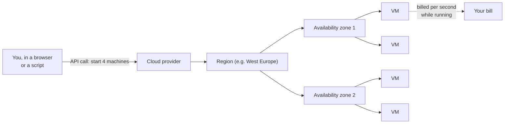

# Servers and the Cloud

Mastery: `INPUT[inlineSelect(option(new), option(learning), option(solid)):mastery]`

> [!story] Context
> The preceding notes covered how data is stored, queried, and modeled. All of it runs on servers, which businesses historically bought and operated themselves and now usually rent from cloud providers.

> [!eli5] Summary
> A server is a computer that provides services to other computers over a network. Cloud computing means renting servers and storage from a provider such as Microsoft, Amazon, or Google, paying for what you use, and releasing them when you no longer need them.

> [!analogy]- Analogy: vehicles
> | Vehicle | Cloud concept |
> |---|---|
> | Buying a delivery van | Buying a server |
> | Renting a van by the hour | A cloud [[Virtual Machine\|virtual machine]] |
> | Renting ten vans for the holiday rush | Elasticity |
> | Rental depots in different cities | [[Region\|Regions]] |
> | Separate garages in one city | [[Availability Zone\|Availability zones]] |
> | Taking a taxi | [[Serverless Compute\|Serverless]] |

## Background

Before the cloud, a business that needed a database server bought hardware, put it in a back room or a rented data center rack, and kept it running. That meant:

- **Big up-front cost** for capacity you might need in two years.
- **Long lead times.** Ordering, shipping, installing, and configuring took weeks.
- **Idle waste.** The server sized for December sat mostly unused in February.
- **Staff time** spent on power, cooling, patches, backups, and disk failures.

Cloud providers turned servers into a metered utility. Amazon Web Services launched its storage service, S3, and its rental servers, EC2, in 2006[^unverified]. Microsoft Azure and Google Cloud followed. Today most new data platforms, Databricks included, run on one of these three.

## Overview

A **server** is a computer (usually without a screen, in a rack) that runs software other computers connect to. A **data center** is a building full of them. **Cloud computing** is renting computing resources (servers, storage, networks, managed services) on demand over the internet, paying for what you use.

The U.S. National Institute of Standards and Technology (NIST) defines cloud computing in SP 800-145 by five essential characteristics: on-demand self-service, broad network access, resource pooling, rapid elasticity, and measured service. In practice, these properties distinguish it from owning hardware:

| Property | What it means | Bakery example |
|---|---|---|
| **On-demand self-service** | Start a server from a web page or API in minutes | Spin up a machine to process a year of orders |
| **Elasticity** | Scale up and down, sometimes automatically | Ten machines for the year-end report, zero overnight |
| **Pay per use** | Billed by the second, minute, or hour, or per gigabyte | No bill on days nothing runs |
| **Managed services** | The provider runs the database, storage, or platform for you | No one patches the database server |
| **Global footprint** | Regions around the world | Keep EU customer data in an EU region |

Clouds sell at different levels of "how much they manage for you". See [[SaaS PaaS and IaaS]]:

| Level | You manage | Provider manages | Example |
|---|---|---|---|
| **IaaS** (infrastructure) | Operating system, software, data | Hardware, network, data center | A rented [[Virtual Machine\|virtual machine]] |
| **PaaS** (platform) | Your code and data | Everything underneath | Managed Postgres, Databricks |
| **SaaS** (software) | Your data and settings | The whole application | Your POS or booking app |

The three big providers and their basic building blocks:

| Building block | Azure | AWS | Google Cloud |
|---|---|---|---|
| Rented server | Azure Virtual Machines | Amazon EC2 | Compute Engine |
| [[Object Storage\|Object storage]] | [[Azure Data Lake Storage]] (on Blob Storage) | [[Amazon S3]] | [[Google Cloud Storage]] |
| Private network | [[VPC and VNet\|VNet]] | [[VPC and VNet\|VPC]] | [[VPC and VNet\|VPC]] |
| Identity | Microsoft Entra ID | [[IAM]] | [[IAM]] and service accounts |

## How it works

When you start a cloud server, you choose a **region**, a **machine size** (CPU cores, memory, sometimes [[GPU|GPUs]]), a **disk**, and a **network**. Many machines working together on one job form a [[Cluster|cluster]], and each machine in it is a [[Node|node]]. You can also pay less for spare capacity that the provider may take back at short notice; see [[Spot Instances]].

## Small-business considerations

> [!smallbiz] Small-business considerations
> - **You are probably already in the cloud.** Microsoft 365 or Google Workspace, your POS, and your booking app are all SaaS.
> - **Pick the cloud you already use** for a data platform, unless you have a strong reason not to. Identity, billing, and support are simpler. See [[Choosing a Cloud for Databricks]].
> - **The meter is the main risk.** Cloud costs nothing when idle, but a machine left running all weekend is billed all weekend. Use auto-shutdown and budgets from day one. See [[Auto Termination]] and [[Cost Management Basics]].
> - **Region matters** for privacy laws and speed. Choose one close to you and your customers.

> [!bridge]- In Databricks today
> Databricks does not own data centers. It runs on Azure, AWS, and Google Cloud:
> - **Classic compute** starts virtual machines in the cloud and forms clusters from them. See [[Compute Types]] and [[Cluster]].
> - **Serverless compute** is managed by Databricks, so you do not choose or start machines at all. Some features are serverless-only; for example, Lakeflow Connect's managed SaaS connectors run only on serverless infrastructure. See [[Serverless Compute]].
> - **Your data** stays in cloud object storage, usually in your own account. See [[Storage vs Compute]].
> - **Billing** is measured in [[DBUs]] for Databricks plus, for classic compute, the cloud provider's charges for the machines. See [[How Databricks Pricing Works]] for the meter, and the official pricing page for rates.

## Cloud differences

> [!azure]- Azure Databricks
> Azure Databricks is a first-party Microsoft service, sold and billed through Azure, with identity from Microsoft Entra ID. See [[Azure Databricks Overview]] and [[First-Party Microsoft Service]].

> [!aws]- Databricks on AWS
> Classic compute runs on EC2 instances in your AWS account; storage is S3. See [[Databricks on AWS Overview]] and [[EC2 Instance Types and Graviton]].

> [!gcp]- Databricks on Google Cloud
> Classic compute runs on Google Compute Engine; storage is Google Cloud Storage. See [[Databricks on Google Cloud Overview]] and [[Compute on Google Cloud]].

## Advanced topics

> [!deepdive]- Advanced topics (301–401)
> - **Virtualization and multi-tenancy.** A cloud "server" is usually a [[Virtual Machine|virtual machine]] sharing a physical host with other customers, isolated by a hypervisor. [[Container|Containers]] and [[Kubernetes]] isolate at the operating-system level instead, and start faster.
> - **Elasticity changes architecture.** When servers are rented by the second, it becomes rational to start a big cluster, finish a job in ten minutes, and shut it down, rather than keep a medium cluster running all day. This only works if data does not live on the machines, which is the subject of [[Storage vs Compute]].
> - **Failure is normal at scale.** In a large fleet, machines fail every day. Cloud-native systems assume any node can disappear and design for it with [[Replication|replication]] and retries. See [[Fault Tolerance]].
> - **Egress and data gravity.** Moving data out of a cloud or across regions is charged and slow. Data tends to stay where it is first stored, and compute moves to it. See [[Egress]].
> - **Shared responsibility.** The provider secures the hardware and data centers; you secure your accounts, networks, keys, and data. Databricks adds its own layer. See [[Network Security Overview]].

## Common misconceptions

> [!confusion] "The cloud" is not one place
> It is many data centers run by several companies, organized into regions. Your data is in specific buildings in a specific region you chose.

> [!confusion] Serverless still uses servers
> "Serverless" means someone else picks, starts, patches, and stops the servers. You pay for the work done, not for machines.

## Recall

What is a server?::A computer that runs software other computers connect to, usually in a data center.
What is cloud computing?::Renting computing resources on demand over the internet and paying for what you use.
What are NIST's five essential characteristics of cloud computing?::On-demand self-service, broad network access, resource pooling, rapid elasticity, and measured service.
What is elasticity?::Scaling resources up and down with demand, often automatically.
What is the difference between a region and an availability zone?::A region is a geographic area; availability zones are separate data centers within a region.
What do IaaS, PaaS, and SaaS stand for?::Infrastructure, platform, and software as a service.
Name each big cloud's object storage service.::Azure Data Lake Storage (Blob Storage), Amazon S3, Google Cloud Storage.
What does serverless mean?::The provider manages the servers; you just run work and pay for it.
On which clouds does Databricks run?::Azure, AWS, and Google Cloud.

## Next steps

> [!path] Learning path
> **Needs first:** [[What Is Data]]
> **Unlocks next:** [[Storage vs Compute]], [[Virtual Machine]], [[SaaS PaaS and IaaS]], [[Choosing a Cloud for Databricks]]

> [!nextup] Next
> [[Storage vs Compute]] explains why separating where data is stored from what processes it makes renting compute by the minute practical.

> [!sources]- Sources (last verified: 2026-10-25)
> - [NIST SP 800-145, The NIST Definition of Cloud Computing (PDF)](https://nvlpubs.nist.gov/nistpubs/Legacy/SP/nistspecialpublication800-145.pdf)
> - [Managed connector FAQs (AWS)](https://docs.databricks.com/aws/en/ingestion/lakeflow-connect/faq)
> - [Managed SaaS connectors (Azure Databricks)](https://learn.microsoft.com/en-us/azure/databricks/ingestion/lakeflow-connect/saas-overview)
> - [Streaming on serverless compute (Azure Databricks)](https://learn.microsoft.com/en-us/azure/databricks/compute/serverless/streaming)
> - [Work with files in Unity Catalog volumes (AWS)](https://docs.databricks.com/aws/en/volumes/volume-files)

[^unverified]: Unconfirmed: not yet checked against an official or primary source.
