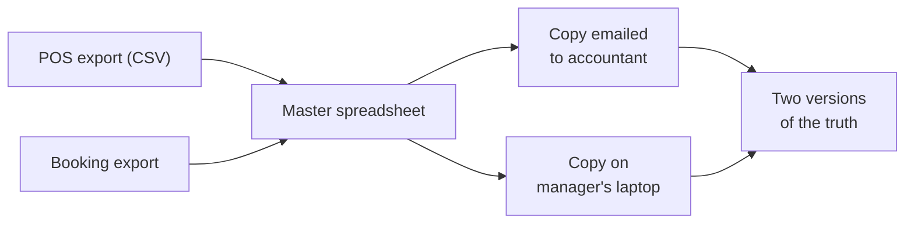

# Spreadsheets

Mastery: `INPUT[inlineSelect(option(new), option(learning), option(solid)):mastery]`

> [!story] Context
> [[CSV and JSON]] are the usual formats for moving data between systems. At the destination, the data is usually opened in a spreadsheet, which for many small businesses is the main data system.

> [!eli5] Summary
> A spreadsheet is a grid of cells. You type values into cells and write formulas, such as "add up this column", that recalculate when values change. Spreadsheets work well for one person and small data, and poorly as a shared system of record.

> [!analogy]- Analogy: a kitchen whiteboard
> | Whiteboard | Spreadsheet |
> |---|---|
> | A whiteboard anyone can write on | A shared sheet |
> | "Total = sum of the column above" | A formula |
> | Three whiteboards, each listing today's orders | Conflicting file copies |
> | A line erased by accident, with no record | No audit history |
> | Running out of wall space | Row and performance limits |

## Background

Before spreadsheets, a business "model" (a budget, a price list, a forecast) lived on paper ledgers, and changing one assumption meant recalculating everything by hand. **VisiCalc**[^unverified], released for the Apple II in 1979 by Dan Bricklin and Bob Frankston, made the grid recalculate automatically and drove early adoption of personal computers in small businesses. **Lotus 1-2-3** (January 1983) took over on the IBM PC, adding charts, named ranges, and macros. **Microsoft Excel** arrived in 1985[^unverified], first on the Mac, and eventually became the default. Google Sheets later added real-time collaboration in the browser.

Spreadsheets won because they give one person **instant, visual control** of data with no programmer, no database, and no IT ticket.

## Overview

A spreadsheet is a grid of **cells** addressed by column letter and row number (`B7`). A cell holds a value or a **formula** that computes from other cells. A file (a **workbook**) holds several **sheets**.

Spreadsheets are well suited to:

- **Ad hoc analysis.** Sort, filter, pivot, and chart in minutes.
- **What-if modeling.** Change the flour price and see next month's margin.
- **Small shared lists.** A clinic's list of referring doctors, a staff rota.
- **Universal literacy.** Almost everyone in a business can use one.

Where they break:

| Limit | What happens | Bakery or clinic example |
|---|---|---|
| **Size** | Excel caps a sheet at about a million rows[^unverified], and slows well before that | Two years of item-level POS lines no longer fit |
| **No enforced types** | A column can mix numbers, text, and blanks | "3", "three", and "3 boxes" in the quantity column |
| **Copies everywhere** | Files get emailed and edited in parallel | `Sales_FINAL_v3_Sam_edits.xlsx` |
| **Fragile formulas** | One wrong range or hard-coded number silently breaks totals | A `SUM` that stops at row 500 after rows were added |
| **No real history or permissions** | Hard to see who changed what, or to show one person only some rows | The receptionist can see every patient's billing |
| **Manual refresh** | Someone has to paste in this week's export | The report is only as fresh as the last person who updated it |
| **One person's head** | Logic lives in hidden columns and macros | The owner's nephew built it and has moved away |

Spreadsheet errors are a familiar story in finance and research. The problem is not the tool; it is using a personal tool as a shared system.

## How it works



A typical small-business workflow, and its database equivalent:

```text
Spreadsheet:  =SUMIFS(D:D, B:B, "croissant", A:A, ">="&DATE(2026,3,1))
```

```sql
-- The same question against a table: every order, typed, one copy
SELECT SUM(quantity) AS croissants_sold
FROM bakery.sales.orders
WHERE item = 'croissant' AND order_time >= DATE'2026-03-01';
```

The formula and the query express the same idea. The difference is in the surrounding system: the table enforces types, holds every row, has one copy, and records who can read it.

## Small-business considerations

> [!smallbiz] Small-business considerations
> Keep using spreadsheets for what they are good at: quick analysis, models, and small lists. Move the **source data** out of them when you see the signs in [[Signs You Have Outgrown Spreadsheets]]: more than one "master" copy, files too slow to open, numbers that differ between people, or a weekly hour spent pasting exports. Then let the spreadsheet *read* from a governed table instead of *being* the table. See [[Migrating from Excel and Access]].

> [!bridge]- In Databricks today
> - **Reading Excel files:** Databricks has a built-in Excel reader (`read_files` with `format => 'excel'`, or `spark.read.excel`) on Databricks Runtime 17.1 and above. It reads one sheet at a time, returns formulas as their computed values, keeps only the top-left value of merged cells, and can target a sheet or range with `dataAddress`. Excel files can also be ingested from SharePoint. Check the docs for current release status.
> - **Replacing the master spreadsheet:** a [[Delta Lake]] table in [[Unity Catalog]], with grants per group.
> - **Replacing the pivot-table report:** [[AI-BI Dashboards]], or [[Genie Agents]] for asking questions in plain English.
> - **Keeping Excel as the front end:** Excel and [[Connecting Power BI|Power BI]] can query Databricks tables directly through [[SQL Warehouses]] and the [[JDBC and ODBC|ODBC]] driver[^unverified].

## Cloud differences

> [!azure]- Azure Databricks
> Microsoft 365 shops can keep Excel and Power BI as the front end and connect them to Azure Databricks with Microsoft Entra ID sign-in[^unverified]. See [[Power BI on Azure Databricks]].

> [!aws]- Databricks on AWS
> Nothing Excel-specific differs. Files usually arrive through S3 or a Unity Catalog volume.

> [!gcp]- Databricks on Google Cloud
> Teams on Google Workspace often start from Google Sheets. Export to CSV, or load through an ingestion tool, since the Excel reader handles `.xlsx` files rather than live Sheets.

## Advanced topics

> [!deepdive]- Advanced topics (301–401)
> - **Excel's grid limit**[^unverified] is 1,048,576 rows by 16,384 columns per worksheet. Power Pivot and the Data Model can hold more rows in compressed columnar memory, which is effectively a small embedded analytical database.
> - **Spreadsheets are a functional programming language.** Each formula is a pure function of other cells, and the recalculation engine maintains a dependency graph (a [[DAG]]). Data pipelines, dbt models, and declarative pipelines in Databricks use the same idea at a larger scale.
> - **Type coercion.** Excel converts values that look like dates into dates on entry, so codes such as `MAR1` or `3-4` can become dates without warning.
> - **The Excel reader's limits** (single sheet per read, no schema evolution when streaming with Auto Loader, merged cells collapsed) mean spreadsheets with several tables per sheet need a `dataAddress` per table, or a one-time cleanup.

## Common misconceptions

> [!confusion] A spreadsheet is not a database
> It stores data in a grid, but it does not enforce types, relationships, or permissions per row, and it is not built for many people writing at once. A database is. See [[Relational Databases]].

> [!confusion] "Excel" and "CSV" are different files
> CSV is plain text with one table. `.xlsx` is a workbook with sheets, formulas, and formatting. Saving a workbook as CSV keeps only the active sheet's values.

## Recall

Name three ways spreadsheets break as a business grows.::Size limits, no enforced types, multiple conflicting copies, fragile formulas, no audit trail or row-level permissions, manual refresh (any three).
What should replace the "master spreadsheet" in a data platform?::A governed table, with the spreadsheet or BI tool reading from it.
Which Databricks Runtime version is needed for the built-in Excel reader?::Databricks Runtime 17.1 or above.
What does the Databricks Excel reader do with formulas?::Loads their computed values.

## Next steps

> [!path] Learning path
> **Needs first:** [[What Is Data]], [[CSV and JSON]]
> **Unlocks next:** [[Relational Databases]], [[Signs You Have Outgrown Spreadsheets]], [[Migrating from Excel and Access]]

> [!nextup] Next
> [[Relational Databases]] address the shared-copy, type, and rule problems by storing tables in software that enforces constraints.

> [!sources]- Sources (last verified: 2026-10-25)
> - [Read and stream Excel files (AWS)](https://docs.databricks.com/aws/en/query/formats/excel)
> - [Read and stream Excel files (Azure Databricks)](https://learn.microsoft.com/en-us/azure/databricks/query/formats/excel)
> - [Ingest files from SharePoint (GCP)](https://docs.databricks.com/gcp/en/ingestion/sharepoint)
> - [Reading .xlsx files with xlrd fails (Azure Databricks KB)](https://learn.microsoft.com/vi-vn/azure/databricks/kb/libraries/xlsx-file-not-supported-xlrd)

[^unverified]: Unconfirmed: not yet checked against an official or primary source.
