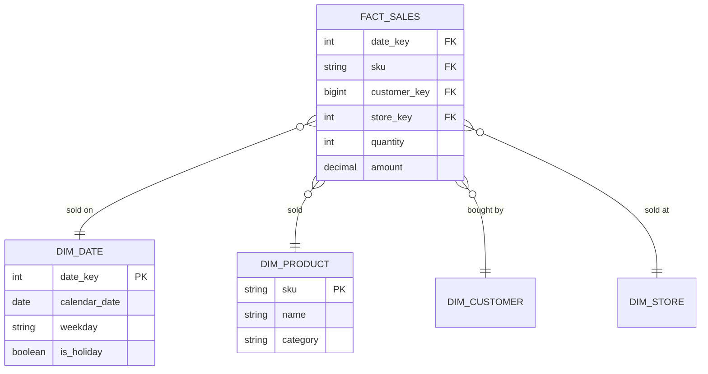

# Star Schema

Mastery: `INPUT[inlineSelect(option(new), option(learning), option(solid)):mastery]`

> [!story] Context
> [[Data Modeling Basics]] normalized the clinic's data so each fact is stored once. Normalized models suit updates but require many joins for analysis. The star schema is the standard alternative for analytics.

> [!eli5] Summary
> A star schema stores events, such as sales or appointments, in one central table, and the descriptions of those events (who, what, when, where) in smaller surrounding tables. Most reports add up the central table, grouped by something in a surrounding table.

> [!analogy]- Analogy: shop records
> | Shop records | Star schema |
> |---|---|
> | A pile of till receipts | [[Fact Table\|Fact table]] |
> | Reference binders for products, customers, the calendar, and stores | [[Dimension Table\|Dimension tables]] |
> | The SKU code printed on a receipt | Foreign key to a dimension |
> | "Sales by category by weekday" | A star query |

## Background

Normalized models (see [[Data Modeling Basics]]) are built for safe updates, so a single business question can need many joins. Business users found them hard to understand, and older databases ran them slowly.

The star schema reorganizes data around **business processes** (selling, booking, shipping) and **the ways people slice them** (by product, by date, by customer). It became the standard pattern for [[Data Warehouses|data warehouses]] through the work of Ralph Kimball, popularized by his book *The Data Warehouse Toolkit* (1996)[^unverified]. Its main properties:

- **Easy to understand.** Business people recognize "sales" and "products".
- **Easy to query.** Every question is one fact table joined to a few dimensions.
- **Fast.** Engines and BI tools are tuned for this shape.
- **Consistent.** One shared `dim_date` or `dim_customer` makes every report agree on what a "customer" or a "week" is.

## Overview

| Part | What it holds | Bakery example | Shape |
|---|---|---|---|
| **[[Fact Table\|Fact table]]** | One row per event at a declared grain, with numeric measures and foreign keys to dimensions | `fact_sales`: one row per order line, with `quantity`, `amount` | Tall and narrow, grows constantly |
| **[[Dimension Table\|Dimension table]]** | One row per thing, with descriptive attributes for filtering and grouping | `dim_product`: SKU, name, category, is_seasonal | Short and wide, changes slowly |
| **Grain** | What exactly one fact row means | "One item on one order" | Declared before anything else |
| **Measures** | Numbers you aggregate | `quantity`, `amount`, `discount` | Additive, semi-additive, or non-additive |
| **Conformed dimension** | A dimension shared by several fact tables | `dim_date` used by both sales and staffing facts | Makes cross-process reports line up |

A **snowflake schema** is a star whose dimensions are themselves normalized (for example `dim_product` pointing to a separate `dim_category`). It saves a little space and costs extra joins. Most modern guidance prefers the plain star.

## How it works



Building and querying the bakery's star in Databricks SQL:

```sql
-- Dimension: one row per product, described for slicing
CREATE OR REPLACE TABLE bakery.gold.dim_product (
  sku       STRING NOT NULL,
  name      STRING,
  category  STRING,
  CONSTRAINT dim_product_pk PRIMARY KEY (sku) RELY
) COMMENT 'Grain: one row per product SKU';

-- Fact: one row per order line, numbers plus keys
CREATE OR REPLACE TABLE bakery.gold.fact_sales (
  date_key      INT,
  sku           STRING,
  customer_key  BIGINT,
  quantity      INT,
  amount        DECIMAL(10,2),
  CONSTRAINT fact_sales_product_fk FOREIGN KEY (sku) REFERENCES bakery.gold.dim_product RELY
) COMMENT 'Grain: one row per item on an order';

-- The classic star query: facts summed, grouped by dimension attributes
SELECT d.weekday, p.category, SUM(f.amount) AS revenue
FROM bakery.gold.fact_sales  f
JOIN bakery.gold.dim_date    d ON f.date_key = d.date_key
JOIN bakery.gold.dim_product p ON f.sku      = p.sku
WHERE d.calendar_date >= '2026-01-01'
GROUP BY d.weekday, p.category
ORDER BY revenue DESC;
```

The clinic's version has `fact_appointments` (one row per appointment, with a `no_show` flag as a 0/1 measure) surrounded by `dim_patient`, `dim_doctor`, `dim_date`, and `dim_location`.

## Small-business considerations

> [!smallbiz] Small-business considerations
> Adopt a star schema once you report on a business process regularly. Start small:
> - **One fact table per process:** `fact_sales` for the bakery, `fact_appointments` for the clinic.
> - **Three or four dimensions:** date, product or service, customer or patient, location.
> - **A real date dimension.** A table with one row per day and columns like `weekday`, `is_holiday`, and `fiscal_month` replaces repeated date formulas.
>
> Power BI and most [[BI Tools|BI tools]] work best with this shape, so building it once makes every dashboard simpler.

> [!bridge]- In Databricks today
> - **Where it lives:** Databricks guidance places the star schema at the **gold** layer of the [[Medallion Architecture]], with bronze and silver handling ingestion and cleaning.
> - **How to build it:** in [[Lakeflow Spark Declarative Pipelines]], the recommended pattern is facts as [[Streaming Tables|streaming tables]] and dimensions as [[Materialized Views|materialized views]], using `AUTO CDC` with SCD Type 2 only when you need change history. See [[Slowly Changing Dimensions]].
> - **Keys:** prefer natural keys where the source key is stable; use surrogate keys only when a source reuses or changes IDs. Declare primary and foreign keys with `RELY`, which Databricks recommends because it can eliminate unnecessary joins.
> - **Business definitions on top:** [[Metric Views]] support star schemas directly, with the fact table joined to dimensions as many-to-one relationships, so measures like revenue are defined once.
> - **BI:** tools such as [[Connecting Power BI|Power BI]] query the gold tables through [[SQL Warehouses]].

## Cloud differences

> [!note] Nothing differs by cloud
> A star schema is the same design on Azure, AWS, and Google Cloud, and the Databricks SQL above runs unchanged on all three.

## Advanced topics

> [!deepdive]- Advanced topics (301–401)
> - **Types of fact tables.**[^unverified] *Transaction* facts store one row per event (each sale). *Periodic snapshot* facts store one row per period per thing (stock level per product per day). *Accumulating snapshot* facts store one row per process instance, updated as it moves through milestones (an order from placed to delivered). *Factless* facts record that something happened with no measure (a class attendance).
> - **Additivity.** Sales amounts add up across every dimension. Balances and stock levels are *semi-additive*: they add across products but not across time (you average or take the last value). Ratios such as no-show rate are *non-additive*: store numerator and denominator and compute the ratio at query time. [[Metric Views]] are a good place to encode these rules.
> - **Fan-out traps.** Joining a fact to a dimension at a finer grain than its key (for example, a product dimension with one row per supplier) duplicates fact rows and inflates totals. Declare the grain of every table and test `COUNT(*)` before and after joins.
> - **Identity columns as surrogate keys** are safe only when the upstream table is append-only and never fully refreshed; a rebuild can assign different IDs and break fact-to-dimension joins. Identity values are unique but not guaranteed contiguous.
> - **Star vs. one big table.** Columnar engines make wide denormalized tables cheap, and some teams flatten a star into one table for a single dashboard. Keeping the star underneath preserves one definition of each dimension.
> - **Bus matrix.**[^unverified] Kimball's enterprise bus matrix lists business processes as rows and conformed dimensions as columns. It is a simple planning tool for deciding which dimensions must be shared.

## Common misconceptions

> [!confusion] "Schema" in star schema is not a Unity Catalog schema
> A *star schema* is a design pattern for tables. A *schema* in Unity Catalog is a container (`catalog.schema.table`). A star schema's tables usually live together in one Unity Catalog schema, such as `bakery.gold`. See [[Schema]].

> [!confusion] Fact tables are not "the important table"
> Facts hold the events and numbers; dimensions hold the meaning. A fact table without good dimensions is a pile of codes nobody can read.

## Recall

What is a star schema?::A design with a central fact table of events and measures, surrounded by dimension tables that describe them.
What does a fact table hold?::One row per event at a declared grain, with numeric measures and foreign keys to dimensions.
What does a dimension table hold?::One row per thing (product, customer, date) with descriptive attributes for filtering and grouping.
What is a snowflake schema?::A star schema whose dimensions are further normalized into sub-tables.
What is a conformed dimension?::A dimension shared by several fact tables, so reports across processes agree.
In Databricks' medallion architecture, where does the star schema belong?::The gold layer.
In Lakeflow pipelines, what does Databricks recommend for facts and for dimensions?::Facts as streaming tables, dimensions as materialized views.
Why declare keys with RELY on a star schema in Databricks?::So the optimizer can trust them and eliminate unnecessary joins.

## Next steps

> [!path] Learning path
> **Needs first:** [[Data Modeling Basics]], [[Primary and Foreign Keys]], [[OLTP vs OLAP]]
> **Unlocks next:** [[Medallion Architecture]], [[Metric Views]], [[Slowly Changing Dimensions]], [[Data Warehouses]]

> [!nextup] Next
> [[Servers and the Cloud]] covers the infrastructure that databases and analytical systems run on.

> [!sources]- Sources (last verified: 2026-10-25)
> - [Dimensional modeling in Lakeflow pipelines (AWS)](https://docs.databricks.com/aws/en/ldp/best-practices/dimensional-modeling)
> - [Data preparation cheat sheet (AWS)](https://docs.databricks.com/aws/en/cheat-sheet/bi-serving-data-prep)
> - [Model metric views (AWS)](https://docs.databricks.com/aws/en/business-semantics/metric-views/basic-modeling)
> - [Data modeling (AWS)](https://docs.databricks.com/aws/en/transform/data-modeling)
> - [Constraints on Databricks (AWS)](https://docs.databricks.com/aws/en/tables/constraints)
> - [Query optimization using primary key and unique constraints (Azure Databricks)](https://learn.microsoft.com/en-us/azure/databricks/sql/user/queries/query-optimization-constraints)
> - [Delta Lake generated columns (AWS)](https://docs.databricks.com/aws/en/delta/generated-columns)

[^unverified]: Unconfirmed: not yet checked against an official or primary source.
