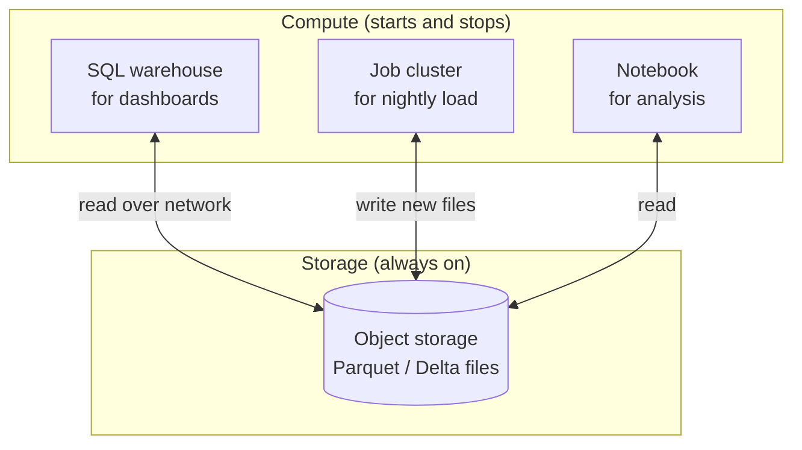

# Storage vs Compute

Mastery: `INPUT[inlineSelect(option(new), option(learning), option(solid)):mastery]`

> [!story] Context
> [[Servers and the Cloud]] described renting servers by the minute. That model saves money only if servers can be turned off without losing data, which requires keeping data somewhere other than on the servers that process it.

> [!eli5] Summary
> Storage is where data is kept. Compute is the processing power that reads the data and does the work. Keeping them separate lets a business keep all its data permanently at low cost, and pay for processing only while it is running.

> [!analogy]- Analogy: a library and its reading room
> | Library | Data platform |
> |---|---|
> | The book stacks, open all year | Storage ([[Object Storage\|object storage]]) |
> | Readers who come in, work, and leave | Compute (servers, [[Cluster\|clusters]]) |
> | Adding readers during exam week | Scaling compute without adding storage |
> | Adding shelves without hiring staff | Scaling storage without adding compute |
> | A library where books leave with each reader | Storage and compute coupled on one machine |

## Background

In a traditional database server, the disks that hold the data and the processors that query it are in the same machine, or in machines that are always paired. This coupling has three consequences:

- **They scale together:** More data means a bigger server, even if query volume is unchanged. More queries mean a bigger server, even if data volume is unchanged.
- **They must stay on:** Switching off the server makes the data unavailable.
- **They compete:** A heavy report and a nightly load share the same CPU, memory, and disks.

Early [[The Three Vs of Big Data|big data]] systems such as [[HDFS]] also stored data on the same machines that processed it, on the principle that "moving computation is cheaper than moving data". That design reduced network traffic but kept the coupling. See [[Apache Hadoop]].

Cloud [[Object Storage|object storage]] changed the economics. Storage became a separate, durable, pay-per-gigabyte service, reachable over the network from any number of machines. Compute became something that can start for a job and stop afterward.

## Overview

Storage is the service that keeps data durably, and compute is the processing power that reads and changes it; a platform that separates them can scale, start, and stop each one independently.

| | Storage | Compute |
|---|---|---|
| **What it does** | Keeps data durably | Reads, transforms, and queries data |
| **Typical cloud service** | Object storage: [[Amazon S3]], [[Azure Data Lake Storage]], [[Google Cloud Storage]] | [[Virtual Machine\|Virtual machines]], clusters, serverless engines |
| **How it is billed** | Per gigabyte stored per month, plus requests | Per second or hour while running |
| **Lifetime** | Permanent | Temporary: minutes to hours |
| **Scales with** | Data volume | Query and processing volume |
| **Failure impact** | Must never lose data, so it is replicated | Can be restarted; work is retried |

When the two are separated:

1. **Each scales independently:** Ten years of orders can sit in storage while compute is sized for today's queries.
2. **Compute can stop:** With nothing running, the remaining cost is storage, which is usually small compared with compute.
3. **Many engines can share one copy of data:** A SQL engine, a Python notebook, and a [[Machine Learning Basics|machine learning (ML)]] training job can read the same files without copying them.
4. **Workloads stop competing:** The nightly load and the morning dashboards can run on different compute against the same data.

## How it works



A bakery's typical day with separated storage and compute:

| Time | Compute running | Storage |
|---|---|---|
| 02:00–02:15 | A job cluster loads yesterday's point-of-sale (POS) export and stops | New files are added |
| 08:00–09:00 | A SQL warehouse serves the morning dashboard, then stops when idle | Read only |
| 14:00–14:30 | A notebook trains a demand forecast | Read only |
| All other hours | Nothing | Data stays in place |

In Databricks, the separation is visible in how you refer to data and compute. A table name points at files in storage; the compute is chosen separately when a query runs:

```sql
-- The table's files live in cloud storage, managed by Unity Catalog.
-- Any SQL warehouse or cluster with permission can run this query.
SELECT order_date, SUM(amount) AS revenue
FROM bakery.gold.fact_sales
GROUP BY order_date;
```

```python
# Unstructured files live in a Unity Catalog volume, which is also cloud storage.
files = dbutils.fs.ls("/Volumes/bakery/raw/pos_exports/")
```

## Small-business considerations

> [!smallbiz] Small-business considerations
> - **Storage is rarely the cost to worry about:** A small business's data usually amounts to gigabytes, not terabytes. Compute that runs longer than needed is the usual cause of unexpected bills.
> - **Make compute stop when idle:** Use [[Auto Termination|auto termination]] on clusters and auto stop on [[SQL Warehouses|SQL warehouses]] (an idle warehouse keeps accruing DBU and cloud instance charges until it stops), or use [[Serverless Compute|serverless]] options that start and stop automatically.
> - **Keep one copy of data:** Point every tool at the same tables instead of exporting copies to each tool.
>
> The meter for each part is explained in [[How Databricks Pricing Works]]; rates are on the official pricing page.

> [!bridge]- In Databricks today
> - **Storage:** tables are files in cloud object storage, governed by [[Unity Catalog]]. Non-tabular files live in [[Volumes]]. See [[Managed vs External Tables]] for who manages the storage location.
> - **Compute:** [[Compute Types|compute types]] include classic all-purpose compute, classic jobs compute, [[SQL Warehouses|SQL warehouses]], and [[Serverless Compute|serverless compute]] for notebooks, jobs, and pipelines. All of them read the same governed data. Some features run only on serverless; for example, Lakeflow Connect's managed SaaS connectors run only on serverless infrastructure.
> - **Platform split:** Databricks also separates its own management services from the machines that process data. See [[Control Plane and Compute Plane]].
> - **Operational databases too:** [[Lakebase]], Databricks' managed Postgres service, was released as generally available on January 22, 2026 with autoscaling and scale-to-zero compute.

## Cloud differences

> [!azure]- Azure Databricks
> Storage is usually [[Azure Data Lake Storage]] Gen2. Classic compute runs as Azure virtual machines. See [[ADLS and Access Connectors]].

> [!aws]- Databricks on AWS
> Storage is [[Amazon S3]]. Classic compute runs as EC2 instances. See [[S3 Access via Unity Catalog]].

> [!gcp]- Databricks on Google Cloud
> Storage is [[Google Cloud Storage]]. Classic compute runs on Compute Engine. See [[GCS Access via Unity Catalog]].

## Advanced topics

> [!deepdive]- Advanced topics (301–401)
> - **The network is the new disk:** Separated compute reads data over the network, which has higher [[Latency|latency]] than local disk. Engines compensate with columnar formats that read less data, [[Data Skipping|data skipping]] from file statistics, and local [[Caching|caching]] of hot files on the compute nodes.
> - **Object storage is not a file system:** Object stores such as Amazon S3, Azure Blob Storage, and Google Cloud Storage are key-value stores: you `PUT`, `GET`, and `LIST` whole objects, updating an object usually means rewriting it, renames of objects or "directories" are not cheap, and updates across several objects are not atomic. (ADLS Gen2 adds directories and atomic renames, but atomic updates across many files still need a table format.) Table formats such as [[Delta Lake]] add a transaction log so that a set of immutable files behaves like a table with [[ACID Transactions|ACID transactions]]. This is the core idea of chapter 05.
> - **Elastic compute needs stateless design:** If any node can disappear, results must be written to storage, not kept on local disks. Streaming jobs persist progress in a [[Checkpoint|checkpoint]] in storage for the same reason.
> - **Data gravity and egress:** Compute should run in the same cloud [[Region|region]] as the data. Reading across regions or clouds adds latency and [[Egress|egress]] charges.
> - **Separation inside OLTP databases:** Some modern Postgres services separate the storage layer from the compute nodes, which enables scale-to-zero and fast branching. Lakebase's GA feature list (autoscaling, scale-to-zero, instant branching, [[Point-in-Time Recovery|point-in-time recovery]]) follows this pattern.

## Common misconceptions

> [!confusion] "Separated" does not mean "in different companies"
> Storage and compute usually run in the same cloud account and region. They are separate services, not separate locations.

> [!confusion] Stopping compute does not delete data
> When a cluster or warehouse stops, the tables remain in storage, ready for the next query.

## Recall

What is storage, and what is compute?::Storage keeps data durably; compute is the processing power that reads and transforms it.
Name three benefits of separating storage and compute.::Independent scaling, compute that can stop when idle, many engines sharing one copy of data, and workloads that do not compete (any three).
Which cloud services usually provide storage for Databricks?::Azure Data Lake Storage, Amazon S3, and Google Cloud Storage.
What happens to table data when a Databricks cluster stops?::Nothing. It stays in cloud object storage.
Why do engines that read from object storage rely on columnar formats and caching?::Network reads are slower than local disk, so engines read less data and cache frequently used files.
What does a table format such as Delta Lake add on top of object storage?::A transaction log, so immutable files behave like one consistent table.
Which Databricks feature separates its management services from the machines that process data?::The control plane and compute plane split.

## Next steps

> [!path] Learning path
> **Needs first:** [[Servers and the Cloud]], [[Files and File Formats]]
> **Unlocks next:** [[Object Storage]], [[Data Lakes]], [[Control Plane and Compute Plane]], [[Serverless Compute]]

> [!nextup] Next
> [[Python for Data]] covers the programming language most commonly used to process data on that compute.

> [!sources]- Sources (last verified: 2026-10-25)
> - [Work with files in Unity Catalog volumes (AWS)](https://docs.databricks.com/aws/en/volumes/volume-files)
> - [What are Unity Catalog volumes? (Azure Databricks)](https://learn.microsoft.com/en-us/azure/databricks/volumes/)
> - [Managed connector FAQs (AWS)](https://docs.databricks.com/aws/en/ingestion/lakeflow-connect/faq)
> - [Lakebase release notes (AWS)](https://docs.databricks.com/aws/en/release-notes/lakebase/)
> - [Streaming on serverless compute (Azure Databricks)](https://learn.microsoft.com/en-us/azure/databricks/compute/serverless/streaming)
> - [NIST SP 800-145, The NIST Definition of Cloud Computing (PDF)](https://nvlpubs.nist.gov/nistpubs/Legacy/SP/nistspecialpublication800-145.pdf)
> - [HDFS Architecture: Moving computation is cheaper than moving data (hadoop.apache.org)](https://hadoop.apache.org/docs/stable/hadoop-project-dist/hadoop-hdfs/HdfsDesign.html)
> - [Create a SQL warehouse: Auto stop (AWS)](https://docs.databricks.com/aws/en/compute/sql-warehouse/create)
> - [Compute (AWS)](https://docs.databricks.com/aws/en/compute/)
> - [Configure compute for jobs (AWS)](https://docs.databricks.com/aws/en/jobs/compute)
> - [Armbrust et al., "Delta Lake: High-Performance ACID Table Storage over Cloud Object Stores", PVLDB 13(12), 2020](https://www.vldb.org/pvldb/vol13/p3411-armbrust.pdf)
