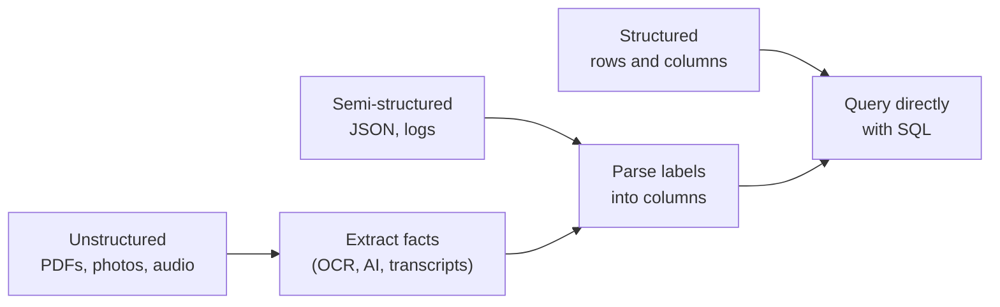

# Structured vs Unstructured Data

Mastery: `INPUT[inlineSelect(option(new), option(learning), option(solid)):mastery]`

> [!story] Context
> [[What Is Data]] defined data as recorded facts and showed a bakery order as a typed row. Much business data, such as emails, receipt photos, and call recordings, does not fit that row-and-column form.

> [!eli5] Summary
> Some data fits a grid with the same fields for every entry, such as an appointment list. Some has labels that vary between entries, such as data exchanged by web apps. Some has no fixed fields at all, such as photos and documents. The amount of structure determines which tools can read the data.

> [!analogy]- Analogy: a clinic's front desk
> | Front desk | Data category |
> |---|---|
> | Appointment book with the same columns on every line | Structured |
> | Intake forms with labeled boxes, some skipped, some with extra pages | Semi-structured |
> | Handwritten notes, X-ray images, voicemails | Unstructured |
> | The label on each patient folder | [[Metadata]] |

## Background

The split matters because computers handle the three kinds very differently:

- **Structured data is easy to query.** A question such as the number of 10:30 no-shows returns an exact answer in milliseconds. This is what [[Relational Databases|relational databases]] and [[SQL]] were built for.
- **Unstructured data was, for decades, nearly impossible to query.** A computer could store a scanned referral letter, but not tell you what it said. It sat in shared drives and was searched by hand.
- **Semi-structured data appeared with the web.** Web apps and [[APIs]] exchange JSON, where each record carries its own labels. It is flexible, but two records can disagree about which fields exist.

In most businesses, unstructured files outnumber structured records, although the proportion is hard to measure. Much of the tooling in later chapters ([[Data Lakes|data lakes]], the lakehouse, and AI functions) exists to make unstructured and semi-structured data usable alongside tables.

## Overview

| Kind | Shape | Examples in a small business | Classic home |
|---|---|---|---|
| **Structured** | Fixed columns and types, decided up front | Orders, invoices, appointments, inventory | Spreadsheet, relational database, [[Data Warehouses\|warehouse]] |
| **Semi-structured** | Self-describing: each record carries labels (keys), which can vary | JSON from a booking app's API, web logs, XML invoices, sensor readings | Files, document databases, [[Data Lakes\|data lakes]] |
| **Unstructured** | No predefined fields | Receipt photos, PDFs, emails, call recordings, product photos, reviews | File shares, [[Object Storage\|object storage]] |

The key idea that separates them is **when the [[Schema|schema]] is decided**:

- **Schema on write.** You define columns before saving anything. Bad data is rejected at the door. This is how databases work.
- **Schema on read.** You save whatever arrives and decide what it means when you read it. This is how data lakes started, and it is flexible but risky (see [[Data Swamps]]).

## How it works



The same booking can arrive in all three forms.

Structured, as a row:

```text
appointment_id | patient_id | doctor  | start_time        | status
A-1042         | P-311      | Dr. Lee | 2026-03-04 10:30  | no-show
```

Semi-structured, as JSON from the booking app's API. The second record has a field the first lacks:

```json
{"appointment_id": "A-1042", "patient_id": "P-311", "doctor": "Dr. Lee",
 "start": "2026-03-04T10:30:00", "status": "no-show"}
{"appointment_id": "A-1043", "patient_id": "P-512", "doctor": "Dr. Ruiz",
 "start": "2026-03-04T11:00:00", "status": "attended",
 "reminder": {"channel": "sms", "sent_at": "2026-03-03T09:00:00"}}
```

Unstructured, as a scanned referral letter: a PDF with no fields at all until something reads it.

In Databricks, the semi-structured case has its own data type, `VARIANT`, and the unstructured case has AI functions that turn documents into fields:

```sql
-- Semi-structured: keep raw JSON flexible, still query it with SQL
SELECT parse_json('{"status": "no-show", "reminder": {"channel": "sms"}}'):reminder.channel;
-- returns "sms"

-- Unstructured: parse PDFs stored in a Unity Catalog volume
SELECT path, ai_parse_document(content, map('version', '2.0')) AS parsed
FROM read_files('/Volumes/clinic/raw/referrals/', format => 'binaryFile', fileNamePattern => '*.pdf');
```

## Small-business considerations

> [!smallbiz] Small-business considerations
> Structure data in this order:
> 1. **Get the structured data right first.** Orders, appointments, and invoices answer most business questions.
> 2. **Keep semi-structured data raw, then pull out what you need.** Store the API's JSON as-is, then extract the five fields you actually report on.
> 3. **Treat unstructured data as a later project** unless it is your core business. Customer reviews, referral letters, and support emails become valuable once AI can read them, but they need governance first because they often contain [[PII|personal data]].

> [!bridge]- In Databricks today
> - **Structured** data becomes [[Delta Lake]] tables in [[Unity Catalog]].
> - **Semi-structured** data can be stored in a `VARIANT` column, which Databricks recommends over keeping JSON as plain strings. Databricks SQL and recent Databricks Runtime versions support it (the docs give 15.3 in one place and 15.4 in another).
> - **Unstructured** files live in Unity Catalog [[Volumes]], with the same permissions model as tables. Functions such as `ai_parse_document` (PDF, DOC/DOCX, PPT/PPTX, TIFF) turn documents into structured output, and a newer `FILE` data type for file references is in Beta as of October 2026. See [[AI Functions in SQL]] and [[Vector Search]].

## Cloud differences

> [!note] Nothing differs by cloud
> Structured, semi-structured, and unstructured data behave the same everywhere. Only the underlying storage service changes (S3, ADLS, or GCS), covered in [[Storage vs Compute]].

## Advanced topics

> [!deepdive]- Advanced topics (301–401)
> - **"Unstructured" usually means "structure not yet extracted".** A PDF invoice has a very regular structure; it is encoded as pixels and text positions. OCR, layout models, and [[LLM|LLMs]] recover it. Images and audio get turned into [[Embedding|embeddings]] for similarity search instead of columns.
> - **VARIANT vs. JSON strings vs. structs.** A JSON string must be re-parsed on every read. A `STRUCT` column is fast but forces a fixed schema. `VARIANT` stores a binary encoding that keeps flexibility and is faster to query than strings. The Databricks docs note limits: `VARIANT` cannot be used for comparisons, grouping, ordering, or set operations, cannot be a clustering, partition, or Z-order key, and ingested records are capped at 16 MB. Round-tripping is not exact: `to_json(parse_json(s))` may not equal `s`.
> - **Path case sensitivity.** In VARIANT path expressions, `col:Status` and `col:status` look for different fields. JSON from different source systems often disagrees on case.
> - **Schema evolution is the real cost of semi-structured data.** When a vendor adds a field, schema-on-read systems absorb it silently, and downstream reports may never see it. See [[Schema Enforcement and Evolution]].

## Common misconceptions

> [!confusion] "Semi-structured" is not "badly structured"
> JSON and XML are precise formats. They are called semi-structured because each record describes itself and records can differ, not because they are sloppy.

> [!confusion] A CSV file is structured data
> Structure is about the data's shape, not where it is stored. A CSV has fixed columns, so it is structured. A database can also hold unstructured blobs.

## Recall

What makes data "structured"?::It has fixed fields and types decided in advance, like rows and columns.
What makes data "semi-structured"?::Each record carries its own labels (keys), and records can have different fields, like JSON.
Give three examples of unstructured data.::Photos, PDFs, emails, audio recordings, free-text reviews (any three).
What is schema on write?::Defining the structure before saving data, so invalid data is rejected on the way in.
What is schema on read?::Saving data as it arrives and deciding its structure when reading it.
Which Databricks data type is designed for semi-structured data like JSON?::`VARIANT`.
Where do unstructured files live in Databricks?::Unity Catalog volumes.
What SQL function in Databricks turns a PDF into structured output?::`ai_parse_document`.

## Next steps

> [!path] Learning path
> **Needs first:** [[What Is Data]]
> **Unlocks next:** [[Files and File Formats]], [[CSV and JSON]], [[Data Lakes]], [[Volumes]]

> [!nextup] Next
> [[Files and File Formats]] explains how data of any shape is encoded on disk and why the format affects speed and cost.

> [!sources]- Sources (last verified: 2026-10-25)
> - [VARIANT type (AWS)](https://docs.databricks.com/aws/en/sql/language-manual/data-types/variant-type)
> - [VARIANT type (GCP)](https://docs.databricks.com/gcp/en/sql/language-manual/data-types/variant-type)
> - [Query variant data (AWS)](https://docs.databricks.com/aws/en/semi-structured/variant)
> - [Query variant data (Azure Databricks)](https://learn.microsoft.com/en-us/azure/databricks/semi-structured/variant)
> - [How is variant different than JSON strings? (AWS)](https://docs.databricks.com/aws/en/semi-structured/variant-json-diff)
> - [parse_json function (AWS)](https://docs.databricks.com/aws/en/sql/language-manual/functions/parse_json)
> - [ai_parse_document function (AWS)](https://docs.databricks.com/aws/en/sql/language-manual/functions/ai_parse_document)
> - [ai_parse_document function (Azure Databricks)](https://learn.microsoft.com/en-us/azure/databricks/sql/language-manual/functions/ai_parse_document)
> - [Work with unstructured data in volumes (AWS)](https://docs.databricks.com/aws/en/volumes/unstructured-data-tutorial)
> - [Work with unstructured data (Azure Databricks)](https://learn.microsoft.com/en-us/azure/databricks/unstructured/)
> - [FILE type and unstructured data (AWS)](https://docs.databricks.com/aws/en/unstructured/file)
