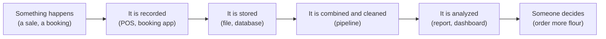

# What Is Data

Mastery: `INPUT[inlineSelect(option(new), option(learning), option(solid)):mastery]`

> [!story] Context
> This note opens [[Chapter 01 - Foundations|chapter 01]], which covers the concepts that later chapters assume. Every system in this vault stores, moves, or analyzes data, so this note defines the term first.

> [!eli5] Summary
> Data is information that a business records so it can use it later, such as a bakery's list of orders. Keeping records lets a business run daily operations, prove what happened, and find patterns that inform decisions.

> [!analogy]- Analogy: a bakery's order book
> | Order book | Data concept |
> |---|---|
> | One line: "Tue 8:05, 3 croissants, Maria, cash" | A record |
> | The columns filled in on every line | Fields, defined by a [[Schema\|schema]] |
> | The kind of value in each column (time, number, name) | [[Data Type\|Data type]] |
> | The label on the cover: "Orders 2026, kept by Sam" | [[Metadata]] |
> | Reading back through the book to find best sellers | Analysis |

## Background

A business that serves hundreds of customers a day cannot rely on memory to track what happened. Recorded facts serve four purposes:

1. **Running the business today.** The clinic needs to know who is booked at 10:30. The bakery needs to know who already paid.
2. **Proving what happened.** Tax authorities, insurers, and customers require evidence, and a record provides it.
3. **Learning from the past.** A pattern such as higher croissant sales on rainy Saturdays is visible only after enough Saturdays are recorded.
4. **Planning.** Next week's flour order is an estimate based on recorded weeks.

Later chapters describe how these four jobs are done when the records grow to millions of rows spread across many systems.

## Overview

**Data is recorded facts.** A single fact ("Maria bought 3 croissants") is sometimes called a datum. Three related terms are distinct:

| Word | What it is | Bakery example |
|---|---|---|
| **Data** | Raw recorded facts | 4,812 order lines from March |
| **Information** | Data organized to answer a question | "Croissants were 31% of March orders" |
| **Insight** | Information that changes a decision | "Bake 40 more croissants on Saturdays" |

Four properties determine how useful data is:

- **Granularity (grain).** The grain is what one record represents: one order, one item on an order, or one day's total. Finer grain answers more questions. Details can be summed into totals, but totals cannot be split back into details. This idea returns in [[Data Modeling Basics]].
- **Quality.** Data must be correct, complete, and timely. A wrong price on 10% of orders distorts every report built on it. See [[Data Quality]].
- **Ownership and sensitivity.** A clinic's appointment list includes names and health details, which are [[PII|personal data]] and often regulated. Who may see what is the job of [[Data Governance|data governance]].
- **Size.** Computers store data as bytes. A bakery's year of orders might be a few megabytes; a website's click history can be terabytes. See [[Bytes and Data Sizes]].

Where data comes from in a small business:

| Source | Example facts | Usual home |
|---|---|---|
| Point of sale (POS) | Orders, items, payments | The POS vendor's cloud, exportable as files |
| Booking system | Clinic appointments, no-shows | A [[SaaS PaaS and IaaS\|SaaS]] app with an export or an [[APIs\|API]] |
| Accounting | Invoices, expenses | QuickBooks, Xero, or similar |
| Website and ads | Visits, clicks, campaigns | Analytics tools |
| People | Notes, emails, photos of receipts | Inboxes and shared drives |

## How it works

Business data follows the same life cycle regardless of the tools used:



The same fact can be recorded with increasing strictness. A computer can do more with stricter forms:

```text
Tue 8:05 - Maria - 3 croissants - cash          <- a sentence in a notebook
2026-03-03 08:05,Maria,croissant,3,cash         <- a line in a CSV file
```

```sql
-- a row in a database table, where every column has a declared type
CREATE TABLE orders (
  order_time  TIMESTAMP,
  customer    STRING,
  item        STRING,
  quantity    INT,
  payment     STRING
);
INSERT INTO orders VALUES ('2026-03-03 08:05:00', 'Maria', 'croissant', 3, 'cash');
```

In the typed table, the database can sort, sum, and reject a `quantity` that is not a number. The difference between loose and strict forms is covered in [[Structured vs Unstructured Data]].

## Small-business considerations

> [!smallbiz] Small-business considerations
> A 10-person clinic typically has several systems that each hold part of its data: bookings, billing, the phone system, and a spreadsheet of referrals.
> - **Start by listing your sources** in a table like the one above. That list is the first step of any data project, including a move to Databricks (see [[Assessing Your Current Data Estate]]).
> - **Decide your grain early.** Keep the most detailed records you can (each order line, each appointment) and build totals from them.
> - **Pick one home for each fact.** Two systems that both store a customer's phone number eventually disagree. One trusted copy is a [[Single Source of Truth|single source of truth]].

> [!bridge]- In Databricks today
> In Databricks, the order book becomes **tables** governed by [[Unity Catalog]], and loose files (photos, PDFs) live in [[Volumes]]. Every table carries its [[Metadata|metadata]] (owner, comments, tags, [[Data Lineage|lineage]]) in the catalog, so ownership and origin are recorded for every table. Records, fields, types, grain, quality, and ownership all map directly to Databricks features.

## Cloud differences

> [!note] Nothing differs by cloud
> What data is does not change between Azure, AWS, and Google Cloud. Where it is stored does, and that starts in [[Servers and the Cloud]].

## Advanced topics

> [!deepdive]- Advanced topics (301–401)
> - **Data vs. state vs. events.** Engineers distinguish *state* ("Maria's balance is 12") from *events* ("Maria paid 3"). Storing events lets you rebuild any past state; storing only state loses history. This choice resurfaces in [[Change Data Capture]], [[Slowly Changing Dimensions]], and Delta [[Time Travel]].
> - **Grain is a contract.** Mixing grains in one table (some rows are orders, some are daily totals) is a common source of double counting. Dimensional modeling makes the grain of every fact table explicit; see [[Star Schema]].
> - **Codd's data independence.** E. F. Codd's 1970 paper argued that people asking questions of data should not need to know how it is physically laid out on disk. The same separation of logical structure from physical storage underlies modern engines that store tables as files in [[Object Storage|object storage]].
> - **Data has a cost even at rest.** Storage is cheap per gigabyte, but every copy of a dataset is another thing to secure, keep consistent, and clean up when privacy rules such as [[GDPR]] require it. Fewer, governed copies reduce that work.

## Common misconceptions

> [!confusion] "Data" is not "information"
> Data is the raw facts. Information is those facts arranged to answer a question. A pile of 5,000 receipts is data; "Saturday is our busiest day" is information.

> [!confusion] More data is not automatically better
> A smaller set of correct, well-defined records is more useful than a large set that is not trusted. Quality and clear definitions come before volume.

## Recall

What is data, in one phrase?::Recorded facts about things that happened or exist.
What is the difference between data and information?::Data is raw facts; information is data organized to answer a question.
What is a record?::One entry describing one thing or event, such as one order line.
What is metadata?::Data about data, such as who owns a table, when it was updated, and what each column means.
Why keep data at the finest grain you can?::You can always add details up into totals, but you cannot split totals back into details.
What is a single source of truth?::One agreed, trusted home for each fact, so systems do not disagree.

## Next steps

> [!path] Learning path
> **Needs first:** nothing. This is the start.
> **Unlocks next:** [[Structured vs Unstructured Data]], [[Files and File Formats]], [[Spreadsheets]], [[Relational Databases]]

> [!nextup] Next
> [[Structured vs Unstructured Data]] classifies data by how much fixed structure it has, from tables to documents and images.

> [!sources]- Sources (last verified: 2026-10-25)
> - [E. F. Codd, "A Relational Model of Data for Large Shared Data Banks", Communications of the ACM 13(6), June 1970 (PDF)](https://web.eecs.umich.edu/~michjc/eecs584/Papers/codd_1970.pdf)
> - [Work with unstructured data in volumes (AWS)](https://docs.databricks.com/aws/en/volumes/unstructured-data-tutorial)
> - [What are Unity Catalog volumes? (Azure Databricks)](https://learn.microsoft.com/en-us/azure/databricks/volumes/)

