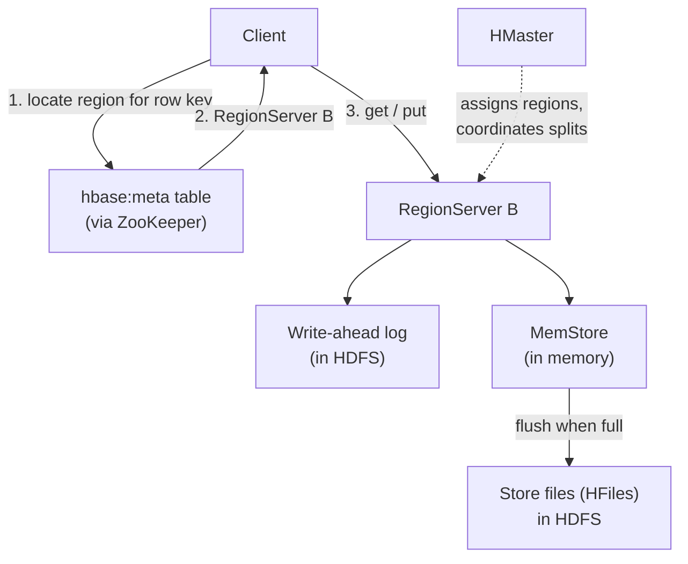

# Apache HBase

Mastery: `INPUT[inlineSelect(option(new), option(learning), option(solid)):mastery]`

> [!story] Context
> [[Apache Hive]] and the [[Hive Metastore]] support analytical queries that scan large amounts of data. Applications also need single-row reads and writes in milliseconds across billions of rows, which [[HDFS]] does not support: it is optimized for large sequential reads of write-once files. Apache HBase provides low-latency key-based access on top of HDFS, modeled after Google's Bigtable.

> [!eli5] Summary
> HBase is a very large, very fast lookup table. Given a row's key, it returns that row in milliseconds, even when the table holds billions of rows across hundreds of computers. It is designed for retrieving and updating individual records, not for summarizing large amounts of data.

> [!analogy]- Analogy: a warehouse with numbered bins
> | Warehouse | HBase |
> |---|---|
> | Bin number, with bins in sorted order | Row key |
> | An aisle covering a range of bin numbers | Region |
> | Worker responsible for several aisles | RegionServer |
> | Labeled drawers inside each bin | Column families |
> | Dated labels on stored items | Cell versions (timestamps) |

## Background

HDFS supports large sequential reads of write-once files. MapReduce and Hive jobs have startup costs measured in seconds. Neither supports fast lookup or in-place update of a single row.

The Apache HBase project describes HBase as an open-source, distributed, versioned, non-relational database modeled after Google's Bigtable. It provides Bigtable-like capabilities on top of Hadoop and HDFS, in the same way that Bigtable runs on the Google File System. HBase was added as a Hadoop subproject after Hadoop became an Apache top-level project in 2008, and later became a top-level project itself.

Typical uses include time series, counters, user profiles, messaging data, and serving precomputed results to applications.

## Overview

HBase is a **wide-column store**: rows sorted by row key, with columns grouped into column families.

| Concept | Definition |
|---|---|
| **Row key** | The primary and only built-in index. Rows are stored sorted by row key, so key lookups and key-range scans are efficient. |
| **Column family** | A group of columns that must be defined when the table is created. Each family is stored separately. |
| **Column qualifier** | A column name within a family, added freely at write time, such as `profile:email`. |
| **Cell** | The value at a row, column, and timestamp. Multiple versions can be retained per cell. |
| **Region** | A contiguous range of row keys. A region that grows too large splits automatically at its middle key. |
| **RegionServer** | A server process that serves many regions. Each region is assigned to exactly one RegionServer. |
| **HMaster** | Assigns regions to RegionServers and coordinates splits, failover, and schema changes. |
| **ZooKeeper** | Coordination service tracking live servers and cluster state. |

Comparison with a [[Relational Databases|relational database]]:

| | Relational database | HBase |
|---|---|---|
| Query interface | SQL | Get, Put, Scan, and Delete by key; SQL only through add-on projects |
| Indexes | Any column | Row key only |
| Joins and transactions | Supported | No joins; atomicity within a single row |
| Schema | Fixed columns | Fixed column families; free-form columns |
| Scale | Typically one primary server | Hundreds of servers |

## How it works



- **Write path.** A write is sent to the RegionServer that owns the key's region. It is appended to a write-ahead log in HDFS for durability and buffered in an in-memory MemStore. Full MemStores are flushed to immutable, sorted store files in HDFS. Background compactions merge store files to keep reads efficient.
- **Read path.** The client locates the region through the `hbase:meta` table, caches the location, and reads from the RegionServer, which merges data from the MemStore and store files.

HBase shell example:

```ruby
# Create a table with two column families; keep 3 versions of profile cells
create 'users', {NAME => 'profile', VERSIONS => 3}, {NAME => 'activity'}

# Write cells: row key, family:qualifier, value
put 'users', 'user#48213', 'profile:email', 'ana@example.com'
put 'users', 'user#48213', 'profile:city',  'Champaign'
put 'users', 'user#48213', 'activity:2024-06-01', '17 page views'

# Point lookup by row key
get 'users', 'user#48213'

# Range scan over sorted row keys
scan 'users', {STARTROW => 'user#48000', STOPROW => 'user#49000', LIMIT => 10}
```

## Small-business considerations

> [!smallbiz] Small-business considerations
> A small business does not need HBase. It targets billions of rows with millisecond access and high write rates, and it requires specialized operational skills.
>
> For an application database, use a managed relational database, such as [[Lakebase]] on Databricks or your cloud provider's managed PostgreSQL or MySQL. Keep analytical data in Databricks tables.

> [!bridge]- In Databricks today
> Databricks has no direct HBase equivalent. HBase is an operational store for key-based access; Databricks is primarily an analytics platform. HBase workloads typically move as follows:
> - **Low-latency application reads and writes:** [[Lakebase]], the managed PostgreSQL database in Databricks, or a cloud NoSQL service outside Databricks.
> - **Analytics over HBase data:** [[Delta Lake]] tables. `MERGE` covers the upsert patterns HBase often served. See [[MERGE and Upserts]].
> - **Serving features or model outputs to applications:** see [[Model Serving]] and [[Feature Engineering and Feature Store]].

## Cloud differences

> [!azure]- Azure Databricks
> Azure Databricks does not host HBase. Application data moves to [[Lakebase]] or a separate Azure database service; analytical data moves to Delta tables on ADLS Gen2.

> [!aws]- Databricks on AWS
> Databricks on AWS does not host HBase. Amazon EMR runs HBase and supports an **HBase on Amazon S3** storage mode (EMR 5.2.0 and later), which stores the HBase root directory, store files, and table metadata in S3 so clusters can be terminated without data loss. AWS documentation notes higher read latency from S3 than from HDFS and recommends caching on instance storage. Only one cluster at a time can write to an HBase location in S3, with optional read-replica clusters.

> [!gcp]- Databricks on Google Cloud
> Databricks on Google Cloud does not host HBase. Google Cloud **Bigtable** supports the Apache HBase 1.x and 2.x client APIs, so HBase applications can connect by using the Bigtable HBase client library. Managed Service for Apache Spark (formerly Dataproc) no longer offers the optional HBase component starting with image version 2.1.

## Advanced topics

> [!deepdive]- Advanced topics (301–401)
> - **Row key design.** Rows are stored in key order, so monotonically increasing keys (timestamps, sequential IDs) route all new writes to one region, creating a hotspot. Common mitigations are a hashed prefix (salting), reversed keys, and composite keys such as `deviceId#reverseTimestamp`. Similar reasoning applies when choosing keys for [[Liquid Clustering]].
> - **Column family count.** Each family has its own MemStore and store files, and flushes occur per region. Many families, or families with very different sizes, increase flush and compaction work.
> - **Consistency.** HBase provides strong consistency per row because each region has exactly one serving RegionServer. When that server fails, its regions are unavailable until they are reassigned and the write-ahead log is replayed.
> - **Compactions.** Major compactions rewrite all store files in a region and consume significant disk and network capacity. Operators typically schedule them outside peak hours.
> - **Analytical scans.** Spark and Hive can read HBase tables through connectors, but large scans are slow compared with columnar formats such as [[Apache Parquet]].

## Common misconceptions

> [!confusion] Column families are not columnar storage
> HBase stores data by row key within each column family. It is not an analytical columnar format, and scanning one column across all rows is slow.

> [!confusion] HBase is not Hive
> Hive is a SQL engine for batch analytics over files. HBase is a database for key-based reads and writes. They ran on the same clusters and solve different problems.

## Recall

What is Apache HBase modeled after?::Google's Bigtable.
What is the only built-in index in HBase?::The row key; rows are stored sorted by it.
What is an HBase region?::A contiguous range of row keys, served by exactly one RegionServer, that splits automatically when it grows too large.
What must be defined when an HBase table is created?::Its column families.
Describe the HBase write path.::Append to the write-ahead log in HDFS, buffer in the MemStore, then flush to sorted store files in HDFS.
What is an HBase hotspot, and one mitigation?::All writes targeting one region because of sequential keys; mitigate with salting, reversed keys, or composite keys.
Which Google Cloud service supports the HBase client API?::Bigtable (HBase 1.x and 2.x APIs).
What is the Databricks option for low-latency application data?::Lakebase, the managed PostgreSQL database in Databricks.

## Next steps

> [!path] Learning path
> **Needs first:** [[HDFS]], [[OLTP vs OLAP]]
> **Unlocks next:** [[Lakebase]]

> [!nextup] Next
> [[Cloudera and Hortonworks]] covers the vendors that packaged and supported Hadoop and its ecosystem projects, including HBase.

> [!sources]- Sources (last verified: 2026-10-25)
> - [Apache HBase home page (2.1)](https://hbase.apache.org/2.1/)
> - [HBase history (Apache HBase)](https://hbase.apache.org/docs/hbase-history/)
> - [Apache HBase on Amazon EMR](https://docs.aws.amazon.com/emr/latest/ReleaseGuide/emr-hbase.html)
> - [HBase on Amazon S3 (Amazon S3 storage mode)](https://docs.aws.amazon.com/emr/latest/ReleaseGuide/emr-hbase-s3.html)
> - [Integrations with Bigtable (Google Cloud)](https://docs.cloud.google.com/bigtable/docs/integrations)
> - [Bigtable with Managed Service for Apache Spark (Google Cloud)](https://cloud.google.com/dataproc/docs/concepts/connectors/cloud-bigtable)
> - [Managed Service for Apache Spark optional HBase component (Google Cloud)](https://docs.cloud.google.com/dataproc/docs/concepts/components/hbase)
