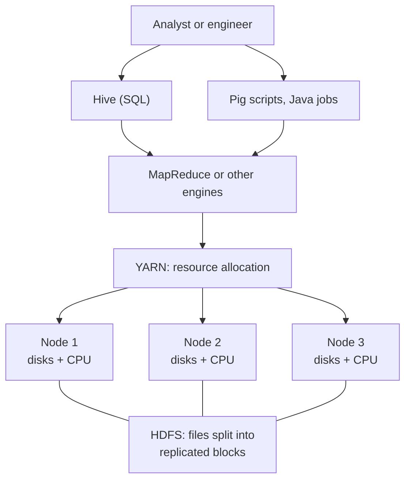

# Apache Hadoop

Mastery: `INPUT[inlineSelect(option(new), option(learning), option(solid)):mastery]`

> [!story] Context
> The [[Google File System and MapReduce Papers]] described distributed storage and processing on commodity machines, but Google did not release the software. Apache Hadoop is the open-source implementation of both designs, and it made scale-out data processing available to any organization.

> [!eli5] Summary
> Hadoop is free software that connects many ordinary computers into one large storage system and one large processing system. It allowed companies other than Google to store and analyze very large amounts of data on inexpensive hardware.

> [!analogy]- Analogy: a shared warehouse
> | Warehouse | Hadoop |
> |---|---|
> | Storage floor where every box is split and copied to several shelves | [[HDFS]] |
> | Workers who process the boxes nearest to them | [[MapReduce]] |
> | Foreman who assigns forklifts to work crews | [[YARN]] |
> | Front desk that accepts plain-language requests | [[Apache Hive]] |

## Background

Hadoop originated in Apache Nutch, an [[Open Source|open-source]] web search engine and crawler (a program that downloads web pages). HDFS was originally built as infrastructure for Nutch. In early 2006, Doug Cutting proposed decoupling Nutch's distributed computing components (MapReduce and the Nutch Distributed File System, NDFS) into a new Apache Lucene sub-project named Hadoop. Its first committers included Mike Cafarella and Doug Cutting from Nutch. By mid-2006 Yahoo was contributing many developers to the project and had run Hadoop on clusters of over 600 machines.

Confirmed milestones:

| Date | Milestone | Source |
|---|---|---|
| 2003 | GFS paper published (SOSP) | Paper |
| 2004 | MapReduce paper published (OSDI) | Paper |
| Early 2006 | Nutch's MapReduce and NDFS code splits out into Hadoop, a sub-project of Apache Lucene | ASF board minutes, March 2006 |
| January 2008 | Hadoop becomes an Apache top-level project, moving out from under Apache Lucene | ApacheCon Europe 2008 Hadoop presentation; Apache HBase history |
| October 15, 2013 | Hadoop 2.2.0, the first generally available 2.x release, ships [[YARN]], HDFS high availability, HDFS federation, and HDFS snapshots | Apache Hadoop release announcement |
| January 3, 2019 | Cloudera completes its merger with Hortonworks, the two largest Hadoop vendors | Cloudera SEC filing; see [[Cloudera and Hortonworks]] |

For roughly a decade, "Hadoop" and "[[The Three Vs of Big Data|big data]]" were used almost interchangeably. Web companies, banks, retailers, and telecommunications providers operated large on-premises (company-owned) Hadoop [[Cluster|clusters]].

## Overview

Apache Hadoop is an open-source framework that stores and processes very large datasets across a cluster of ordinary computers.

"Hadoop" refers to both the core project and the surrounding ecosystem.

**Core modules:**

| Module | Function | Note |
|---|---|---|
| **Hadoop Common** | Shared libraries and utilities | |
| **HDFS** | Distributed, replicated file storage | [[HDFS]] |
| **YARN** | Cluster resource management and scheduling (Hadoop 2 and later) | [[YARN]] |
| **MapReduce** | Batch processing engine | [[MapReduce]] |

**Ecosystem projects** (separate Apache projects commonly deployed with Hadoop):

| Project | Function | Databricks equivalent |
|---|---|---|
| [[Apache Hive]] | SQL on Hadoop; the [[Hive Metastore]] table catalog | [[Spark SQL]], [[Databricks SQL]]; [[Unity Catalog]] |
| [[Apache HBase]] | [[Latency\|Low-latency]] key-value storage on HDFS | No direct equivalent; see the HBase note |
| Apache Pig | Scripting language compiled to MapReduce | [[PySpark]], Spark SQL |
| Apache Sqoop | Bulk transfer between relational databases and HDFS | [[Lakeflow Connect]], [[Lakehouse Federation]] |
| Apache Oozie | Workflow scheduling for Hadoop jobs | [[Lakeflow Jobs]] |
| Apache ZooKeeper | Coordination service (leader election, configuration) | Managed internally by the platform |
| [[Apache Spark]] | In-memory engine that could run on YARN and read HDFS | The Databricks engine |

## How it works



The defining design choice is that **each node both stores data and runs computation**. HDFS distributes file blocks across the local disks of all nodes, and the scheduler runs each task on a node that holds its input. This data locality minimized network traffic on the data-center networks of the time.

Typical command-line usage:

```bash
# Copy a local file into HDFS
hdfs dfs -mkdir -p /data/weblogs
hdfs dfs -put access-2014-06-01.log /data/weblogs/

# Run the bundled word-count example as a MapReduce job on YARN
hadoop jar $HADOOP_HOME/share/hadoop/mapreduce/hadoop-mapreduce-examples-*.jar \
  wordcount /data/weblogs /output/wordcount

# Read the result
hdfs dfs -cat /output/wordcount/part-r-00000 | head
```

## Small-business considerations

> [!smallbiz] Small-business considerations
> Do not build a new Hadoop cluster. Hadoop assumes owned hardware running continuously and a team to operate it. For a small company this means paying for idle capacity and specialist staff. See [[The Pain of Hadoop]].
>
> Hadoop remains relevant in two situations: understanding the design principles inside current tools, and migrating an inherited cluster. For the second, see [[Migrating from Hadoop]].

> [!bridge]- In Databricks today
> Each Hadoop component maps to a Databricks capability:
>
> | Hadoop component | Databricks equivalent |
> |---|---|
> | HDFS | Cloud [[Object Storage]] (S3, ADLS Gen2, GCS) with [[Delta Lake]] tables and Unity Catalog [[Volumes]] |
> | MapReduce | [[Apache Spark]] and [[Photon]] |
> | YARN | Databricks compute: clusters, [[Autoscaling\|autoscaling]], [[Serverless Compute\|serverless compute]] |
> | Hive SQL | [[Spark SQL]] and [[Databricks SQL]] |
> | Hive Metastore | [[Unity Catalog]]; the legacy `hive_metastore` catalog remains readable |
> | Oozie | [[Lakeflow Jobs]] |
> | Sqoop, Flume | [[Lakeflow Connect]], [[Auto Loader]] |
>
> The Databricks migration documentation states that most Hive workloads run on Databricks with minimal refactoring, and that [[ETL vs ELT|ETL]] written in languages other than SQL, Spark, or Hive may require substantial refactoring. See [[Open Source vs Databricks - Who Replaced What]].

## Cloud differences

The component mapping is the same on all clouds. The differences are the target storage service and the cloud's own managed Hadoop service, which often appears in migrations.

> [!azure]- Azure Databricks
> - HDFS data moves to **ADLS Gen2** (`abfss://container@account.dfs.core.windows.net/path`). See [[Azure Data Lake Storage]].
> - Microsoft's managed Hadoop service is **Azure HDInsight**. HDInsight on AKS was retired on January 31, 2025, and Microsoft directs those users to Microsoft Fabric or an equivalent Azure service. HDInsight 4.0 and 5.0 were retired in March 2025, with HDInsight 5.1 as the recommended version.

> [!aws]- Databricks on AWS
> - HDFS data moves to **Amazon S3** (`s3://bucket/path`).
> - AWS's managed Hadoop service is **Amazon EMR**, which runs Hadoop ecosystem applications on EC2.
> - Unity Catalog can federate an AWS Glue catalog used by older Hive setups. See [[Hive Metastore Federation for AWS Glue]].

> [!gcp]- Databricks on Google Cloud
> - HDFS data moves to **Google Cloud Storage** (`gs://bucket/path`).
> - Google's managed Hadoop and Spark service is now named **Managed Service for Apache Spark** (formerly Dataproc). Its clusters support Hadoop and other open-source components.

## Advanced topics

> [!deepdive]- Advanced topics (301–401)
> - **Hadoop 1 and Hadoop 2.** In Hadoop 1, the JobTracker both managed cluster resources and scheduled MapReduce tasks, so the cluster could run only MapReduce. Hadoop 2.2.0 separated resource management into [[YARN]] and added HDFS high availability, federation, and snapshots.
> - **Decline of data locality.** Hadoop assumed the network was the bottleneck. Faster data-center networks and cloud object storage made remote reads practical, so co-locating storage and compute became a cost rather than an advantage. See [[Storage vs Compute]].
> - **Spark as a Hadoop application.** Early [[Apache Spark]] deployments ran on YARN and read from HDFS. Spark first replaced MapReduce; cloud object storage later replaced HDFS.
> - **Distributions.** Most organizations ran a vendor distribution, a tested bundle of ecosystem projects with management tooling, rather than raw Apache releases. See [[Cloudera and Hortonworks]].

## Common misconceptions

> [!confusion] Hadoop is not a database
> Hadoop is a distributed file system plus processing and scheduling frameworks. Hive and HBase add table and database behavior on top.

> [!confusion] Hadoop and big data are not synonyms
> Most large-scale data processing now runs on cloud object storage with Spark or a cloud warehouse, without a Hadoop cluster.

## Recall

What are Hadoop's four core modules?::Hadoop Common, HDFS, YARN, and MapReduce.
When did Hadoop become an Apache top-level project?::January 2008.
Which Hadoop release introduced YARN as generally available, and when?::Hadoop 2.2.0, October 15, 2013.
What is data locality in Hadoop?::Running each task on a node that already stores its input data to minimize network traffic.
Which Databricks capability fills the role of HDFS?::Cloud object storage (S3, ADLS Gen2, GCS) with Delta Lake tables and Unity Catalog volumes.
Which Databricks capability fills the role of MapReduce?::Apache Spark and the Photon engine.
Which Databricks capability fills the role of Oozie?::Lakeflow Jobs.
What is Azure's managed Hadoop service?::Azure HDInsight.
What is Google Cloud's managed Hadoop and Spark service now called?::Managed Service for Apache Spark (formerly Dataproc).

## Next steps

> [!path] Learning path
> **Needs first:** [[Google File System and MapReduce Papers]], [[Scaling Up vs Scaling Out]]
> **Unlocks next:** [[HDFS]], [[MapReduce]], [[YARN]], [[Apache Hive]]

> [!nextup] Next
> [[HDFS]] covers Hadoop's storage layer: how it splits, replicates, and tracks file blocks.

> [!sources]- Sources (last verified: 2026-10-25)
> - [Hadoop tour, ApacheCon Europe 2008 (Tom White, Apache wiki)](https://cwiki-test.apache.org/confluence/download/attachments/120729986/ApacheConEU2008HadoopTourTomWhite.pdf?api=v2)
> - [HBase history (Apache HBase)](https://hbase.apache.org/docs/hbase-history/)
> - [Release 2.2.0 available (Apache Hadoop)](https://hadoop.apache.org/release/2.2.0.html)
> - [MapReduce Tutorial (Apache Hadoop 3.5.0)](https://hadoop.apache.org/docs/current/hadoop-mapreduce-client/hadoop-mapreduce-client-core/MapReduceTutorial.html)
> - [Cloudera Q4 FY2019 results, Form 8-K exhibit (SEC)](https://www.sec.gov/Archives/edgar/data/1535379/000162828019002873/q4-19cldrexhibit991.htm)
> - [Migrate data applications to Databricks (AWS)](https://docs.databricks.com/aws/en/migration/)
> - [Migrate data applications to Azure Databricks](https://learn.microsoft.com/en-us/azure/databricks/migration/)
> - [Migrate ETL pipelines to Databricks (GCP)](https://docs.databricks.com/gcp/en/migration/etl)
> - [Release notes for Azure HDInsight on AKS](https://learn.microsoft.com/en-us/azure/hdinsight-aks/release-notes/hdinsight-aks-release-notes)
> - [Azure HDInsight retired versions](https://learn.microsoft.com/en-us/azure/hdinsight/hdinsight-retired-versions)
> - [Apache Hadoop on Amazon EMR](https://docs.aws.amazon.com/emr/latest/ReleaseGuide/emr-hadoop.html)
> - [Managed Service for Apache Spark (formerly Dataproc)](https://cloud.google.com/products/managed-service-for-apache-spark)
> - [HDFS Architecture (Apache Hadoop)](https://hadoop.apache.org/docs/current/hadoop-project-dist/hadoop-hdfs/HdfsDesign.html)
> - [ASF board meeting minutes, 15 March 2006 (Lucene report)](https://www.apache.org/foundation/records/minutes/2006/board_minutes_2006_03_15.txt)
> - [ASF board meeting minutes, Lucene PMC reports (19 July 2006 report)](https://whimsy.apache.org/board/minutes/Lucene.html)
