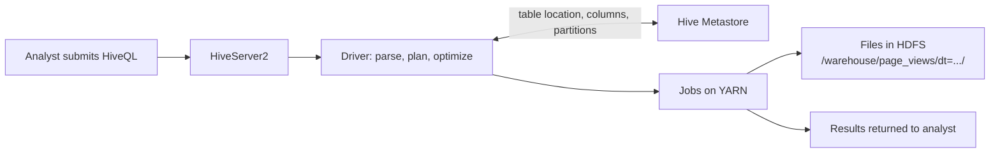

# Apache Hive

Mastery: `INPUT[inlineSelect(option(new), option(learning), option(solid)):mastery]`

> [!story] Context
> With [[YARN]], a Hadoop cluster could store petabytes and run multiple frameworks, but queries still required [[MapReduce]] programs written in Java. Most people who needed answers from the data used [[SQL]]. Apache Hive, created at Facebook, provides a SQL interface to data in Hadoop.

> [!eli5] Summary
> Hive lets people query very large collections of files with SQL, the same language used with ordinary databases. Hive translates each SQL query into the lower-level jobs the cluster runs.

> [!analogy]- Analogy: an interpreter at a factory
> | Factory | Hive |
> |---|---|
> | Workers who follow only detailed step-by-step work orders | The cluster running MapReduce jobs |
> | A request in plain business language | A SQL query |
> | The interpreter who writes the work order | Hive's compiler |
> | The interpreter's register of what each crate contains | The [[Hive Metastore]] |

## Background

Facebook's data infrastructure team built Hive to let analysts query data in Hadoop with a SQL-like language instead of custom MapReduce programs. Facebook open-sourced Hive in August 2008, and it became an Apache project.

The VLDB 2009 paper *"Hive: A Warehousing Solution Over a Map-Reduce Framework"* (Thusoo et al., Facebook) describes the system. It reports that Facebook's Hive warehouse held over 700 TB across several thousand tables and was used by more than 100 people.

Hive introduced four ideas that persist in current platforms:

1. **SQL instead of Java:** HiveQL queries compile into jobs on the cluster.
2. **Tables over files:** A table is a directory of files in [[HDFS]], with a name, columns, and types defined separately.
3. **Schema-on-read:** Hive does not validate files when they are added. It applies the table schema at query time, which accommodates the *variety* described in [[The Three Vs of Big Data]].
4. **A shared catalog:** Table definitions are stored in the [[Hive Metastore]], so multiple tools see the same tables.

## Overview

Hive is a SQL engine and data warehouse layer for Hadoop:

| Component | Function |
|---|---|
| **HiveQL** | A SQL dialect with file-oriented clauses: `PARTITIONED BY`, `STORED AS`, `ROW FORMAT`, `LOCATION` |
| **Driver and compiler** | Parses, plans, and optimizes queries, and compiles them into a graph of jobs |
| **Execution engine** | Originally MapReduce; later versions support other engines |
| **[[Hive Metastore]]** | Stores databases, tables, columns, partitions, and file locations in a relational database |
| **HiveServer2** | Accepts SQL over [[JDBC and ODBC]] so BI tools can connect |
| **SerDe** | A serializer/deserializer that defines how Hive reads and writes a file format (delimited text, JSON, [[Apache ORC\|ORC]], [[Apache Parquet\|Parquet]], and others) |

**Partitions** are Hive's primary performance mechanism. A table partitioned by date stores each date in a subdirectory, such as `/warehouse/logs/dt=2014-06-01/`. A query filtering on `dt` reads only matching directories. This is [[Partition Pruning|partition pruning]].

## How it works



A typical HiveQL workflow:

```sql
-- External table: Hive records the schema; dropping the table keeps the files
CREATE EXTERNAL TABLE page_views (
  user_id     BIGINT,
  url         STRING,
  referrer    STRING,
  view_time   TIMESTAMP
)
PARTITIONED BY (dt STRING)
ROW FORMAT DELIMITED FIELDS TERMINATED BY '\t'
STORED AS TEXTFILE
LOCATION 'hdfs:///data/raw/page_views';

-- Register a new day's directory as a partition
ALTER TABLE page_views ADD PARTITION (dt='2014-06-01')
  LOCATION 'hdfs:///data/raw/page_views/dt=2014-06-01';

-- Managed table in a columnar format
CREATE TABLE page_views_orc (
  user_id BIGINT, url STRING, referrer STRING, view_time TIMESTAMP
)
PARTITIONED BY (dt STRING)
STORED AS ORC;

-- Load with dynamic partitioning
SET hive.exec.dynamic.partition.mode=nonstrict;
INSERT OVERWRITE TABLE page_views_orc PARTITION (dt)
SELECT user_id, url, referrer, view_time, dt FROM page_views;

-- Analytical query; reads only seven partitions
SELECT dt, COUNT(DISTINCT user_id) AS daily_users
FROM page_views_orc
WHERE dt BETWEEN '2014-06-01' AND '2014-06-07'
GROUP BY dt
ORDER BY dt;
```

On MapReduce, each query compiled into one or more jobs, each with job startup cost and intermediate disk writes. Query latency of minutes was common.

The equivalent table on Databricks, as a [[Delta Lake]] table in [[Unity Catalog]]:

```sql
CREATE TABLE main.web.page_views (
  user_id   BIGINT,
  url       STRING,
  referrer  STRING,
  view_time TIMESTAMP,
  dt        DATE
)
USING DELTA            -- Hive DDL uses STORED AS; Databricks uses USING
CLUSTER BY (dt);       -- liquid clustering instead of directory partitions

SELECT dt, COUNT(DISTINCT user_id) AS daily_users
FROM main.web.page_views
WHERE dt BETWEEN '2014-06-01' AND '2014-06-07'
GROUP BY dt
ORDER BY dt;
```

## Small-business considerations

> [!smallbiz] Small-business considerations
> Do not deploy Hive. Its lasting effect is that SQL became the primary interface for large-scale data. On Databricks, you write standard SQL in the [[SQL Editor]] or a [[Notebooks|notebook]] and connect BI tools through a [[SQL Warehouses|SQL warehouse]]. Inherited Hive scripts usually run on Databricks with minor changes.

> [!bridge]- In Databricks today
> Hive's two functions moved to two places:
> - **SQL engine:** [[Spark SQL]] and [[Databricks SQL]] on [[Photon]].
> - **Catalog:** [[Unity Catalog]]. The legacy [[Hive Metastore]] remains available in many workspaces as the `hive_metastore` catalog.
>
> The Databricks migration documentation states that most Hive workloads run with minimal refactoring and lists the typical changes:
> 1. Update Hive SerDes to Databricks-native file formats.
> 2. Change table DDL from `STORED AS` to `USING`.
> 3. Install Hive UDFs as cluster libraries, or rewrite them as native Spark.
> 4. Adjust table directory layouts, because Databricks uses partitions differently than Hive.
>
> See [[Migrating from Hadoop]].

## Cloud differences

> [!azure]- Azure Databricks
> HiveQL support and migration steps are the same on every cloud; the Azure Databricks ETL migration guide lists the same Hive changes. Storage paths change from `hdfs://` to `abfss://`.

> [!aws]- Databricks on AWS
> HiveQL support is the same. If legacy Hive tables were registered in AWS Glue rather than a Hive metastore, Unity Catalog can federate Glue as a read-only foreign catalog. Storage paths change to `s3://`.

> [!gcp]- Databricks on Google Cloud
> HiveQL support is the same. Storage paths change to `gs://`.

## Advanced topics

> [!deepdive]- Advanced topics (301–401)
> - **Execution engines:** Hive originally compiled queries to MapReduce. Later versions added Apache Tez, a YARN application framework that runs a query as a directed acyclic graph (DAG) of tasks instead of a chain of separate MapReduce jobs. Hive 2.0 added LLAP (Live Long and Process), long-lived daemons with data caching for interactive, low-latency queries.
> - **Transactions:** Hive tables were append-and-overwrite only for most of their history. Hive later added transactional tables with `UPDATE` and `DELETE`, implemented with base and delta directories and background compaction that a metastore instance coordinates. Full ACID tables use ORC; other formats support insert-only transactional tables. [[Delta Lake]] and [[Apache Iceberg]] provide [[ACID Transactions]] in an engine-neutral way.
> - **Over-partitioning:** Partitioning by a high-cardinality column creates very large numbers of directories and metastore entries, which slows query planning. The same mistake applies to Delta tables. Databricks provides [[Liquid Clustering]] as an alternative to directory partitioning.
> - **Managed and external tables:** Hive's `EXTERNAL` keyword (dropping the table keeps the files) versus managed tables (dropping the table deletes the files) is the origin of [[Managed vs External Tables]] in Unity Catalog.

## Common misconceptions

> [!confusion] Hive is not a database
> Hive stores no data itself. Tables are files in HDFS or object storage. Hive provides the SQL engine and, through the metastore, the table definitions.

> [!confusion] Hive and the Hive Metastore are separate components
> Hive is the SQL engine. The [[Hive Metastore]] is its catalog service. Spark and other engines use the metastore without running Hive queries.

## Recall

Which company created Apache Hive?::Facebook.
What did Hive originally compile SQL queries into?::MapReduce jobs.
What is schema-on-read?::Applying a table's schema at query time rather than validating data when it is loaded.
How is a Hive partition stored?::As a subdirectory per partition value, such as dt=2014-06-01.
What does an EXTERNAL Hive table mean?::Hive tracks the schema, and dropping the table leaves the data files in place.
What does Hive's STORED AS become on Databricks?::USING, for example USING DELTA.
Where did Hive's SQL engine role move on Databricks?::Spark SQL and Databricks SQL on Photon.
What size did the 2009 VLDB paper report for Facebook's Hive warehouse?::Over 700 TB across several thousand tables.

## Next steps

> [!path] Learning path
> **Needs first:** [[SQL]], [[MapReduce]], [[HDFS]]
> **Unlocks next:** [[Hive Metastore]], [[Spark SQL]], [[Apache ORC]]

> [!nextup] Next
> [[Hive Metastore]] covers Hive's table catalog, the component that Spark and early Databricks adopted.

> [!sources]- Sources (last verified: 2026-10-25)
> - [Apache Hive home page (feature overview)](https://hive.apache.org/)
> - [Apache Hive: Hive on Tez (design document)](https://hive.apache.org/development/designdocs/hive-on-tez/)
> - [Apache Hive: LLAP (design document)](https://hive.apache.org/development/designdocs/llap/)
> - [Apache Hive: ACID Transactions](https://hive.apache.org/docs/latest/user/hive-transactions/)
> - [Hive: A Warehousing Solution Over a Map-Reduce Framework (VLDB 2009)](https://www.vldb.org/pvldb/vol2/vldb09-938.pdf)
> - [Hive: A Petabyte Scale Data Warehouse Using Hadoop (ICDE 2010)](https://courses.cs.washington.edu/courses/csep544/21sp/papers/hive-icde-2010.pdf)
> - [Apache Hive: Metastore administration](https://hive.apache.org/docs/latest/admin/adminmanual-metastore-administration/)
> - [Migrate ETL pipelines to Databricks (GCP)](https://docs.databricks.com/gcp/en/migration/etl)
> - [Migrate ETL pipelines to Azure Databricks](https://learn.microsoft.com/en-us/azure/databricks/migration/etl)
> - [Migrate data applications to Databricks (AWS)](https://docs.databricks.com/aws/en/migration/)
> - [Hive metastore federation concepts (AWS)](https://docs.databricks.com/aws/en/query-federation/hms-federation-concepts)
> - [When to partition tables on Databricks (GCP)](https://docs.databricks.com/gcp/en/tables/partitions)
