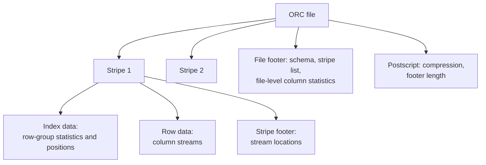

# Apache ORC

Mastery: `INPUT[inlineSelect(option(new), option(learning), option(solid)):mastery]`

> [!story] Context
> [[Apache Parquet]] became the general-purpose columnar format for the Hadoop ecosystem. Apache ORC (Optimized Row Columnar) was developed in parallel, in January 2013, specifically to speed up [[Apache Hive]] and reduce storage size in Hadoop. ORC and Parquet were the two main columnar formats of the Hadoop era.

> [!eli5] Summary
> ORC is a file format that stores tables column by column, compresses them, and keeps small indexes inside the file so programs can skip data they do not need. It was built to make Hive queries faster. Parquet does the same job and is more widely used today.

> [!analogy]- Analogy: shipping containers with manifests
> | Shipping | ORC file |
> |---|---|
> | Containers, each holding a batch of goods | Stripes |
> | Goods sorted by type within a container | Column streams within a stripe |
> | A manifest on each container | Stripe index with column statistics |
> | The ship's overall manifest | File footer and postscript |

## Background

Hive originally stored tables mainly as text or row-oriented binary files, so queries read entire rows. The ORC project states that ORC files were created in January 2013 as part of an initiative to speed up Apache Hive and improve the storage efficiency of data in Hadoop.

ORC initially shipped inside Hive. Because depending on the large Hive JAR pulled in many unrelated dependencies, the ORC developers split it into a separate project to serve non-Hive users. ORC became an Apache top-level project in **April 2015**. The ORC adopters page reports that Facebook, with more than 300 PB of data, was an early adopter and put ORC into production.

## Overview

| Feature | Description |
|---|---|
| **Columnar layout** | Files are divided into stripes; each column is stored as separate streams within a stripe |
| **Lightweight indexes** | Column statistics at file, stripe, and row-group level allow readers to skip data |
| **Compression** | Type-specific encodings plus a general compression codec |
| **Types** | Full Hive type system, including complex types (struct, list, map, union) |
| **Hive ACID** | Hive full ACID transactional tables (`UPDATE`, `DELETE`) are implemented on ORC |
| **Implementations** | Java, plus a C++ reader and writer developed under the Apache project |

**ORC compared with Parquet:**

| | ORC | Parquet |
|---|---|---|
| **Origin** | Hive performance initiative, January 2013 | Twitter and Cloudera, announced March 2013 |
| **Horizontal unit** | Stripe | Row group |
| **Nested data model** | Hive type system | Dremel-based encoding |
| **Strongest ecosystem** | Hive and Hive-centric distributions | Spark, Databricks, cloud warehouses, Python |
| **Role on Databricks** | Supported for reading and writing; migrate to Delta | Data-file format inside Delta Lake |

## How it works



- A file contains a sequence of **stripes**. The ORC background documentation gives a default stripe size of roughly 64 MB; the v1 specification describes stripes as typically about 200 MB. Treat stripe size as version- and configuration-dependent.
- Each stripe stores **index data**, **row data** (one or more streams per column), and a **stripe footer**.
- The **file footer** lists the stripes and file-level statistics, and the **postscript** records compression parameters.
- A reader uses file and stripe statistics to skip stripes, then index data to skip row groups within a stripe, then reads only the needed column streams.

Creating an ORC table in Hive:

```sql
CREATE TABLE events_orc (
  event_id   BIGINT,
  user_id    BIGINT,
  event_type STRING,
  event_time TIMESTAMP
)
PARTITIONED BY (dt STRING)
STORED AS ORC
TBLPROPERTIES ('orc.compress' = 'ZLIB');
```

Reading ORC on Databricks and converting it to Delta:

```python
# Read ORC files; an explicit schema avoids inference overhead
schema = "event_id BIGINT, user_id BIGINT, event_type STRING, event_time TIMESTAMP"
df = spark.read.format("orc").schema(schema).load("/Volumes/main/legacy/hive_export/events_orc/")

# Write to a Delta table, the recommended Databricks-native format
df.write.saveAsTable("main.analytics.events")
```

```sql
-- Query ORC files in place
SELECT event_type, COUNT(*)
FROM read_files('/Volumes/main/legacy/hive_export/events_orc/', format => 'orc')
GROUP BY event_type;
```

## Small-business considerations

> [!smallbiz] Small-business considerations
> You are unlikely to create ORC files. You may receive them when migrating data from a Hadoop or Hive environment. Read them on Databricks and convert them to Delta tables; Databricks recommends Delta Lake as the native format when migrating from ORC.

> [!bridge]- In Databricks today
> Databricks reads and writes ORC with `spark.read.format("orc")`, `read_files`, and [[COPY INTO]]. ORC is a supported interchange format, not the native storage format. The Databricks documentation states that if you are migrating from a Hive or Hadoop environment using ORC, Delta Lake is the recommended Databricks-native format. [[Delta Lake]] stores its data in [[Apache Parquet]] files.

## Cloud differences

> [!azure]- Azure Databricks
> Nothing differs by cloud. ORC support is the same; ORC files from HDInsight-era Hive tables are typically copied to ADLS Gen2 before conversion.

> [!aws]- Databricks on AWS
> Nothing differs by cloud. Files are read from Amazon S3.

> [!gcp]- Databricks on Google Cloud
> Nothing differs by cloud. Files are read from Google Cloud Storage.

## Advanced topics

> [!deepdive]- Advanced topics (301–401)
> - **Three levels of statistics:** File-level, stripe-level, and row-group-level statistics let readers skip progressively finer units of data.
> - **Hive ACID internals:** Hive full ACID tables store a base directory plus delta directories of ORC files for inserts, updates, and deletes. Readers merge base and delta files at read time, and compaction consolidates them. This design is Hive-specific; [[Delta Lake]] provides transactions through a separate log over Parquet files.
> - **Schema merging:** When reading many ORC files with differing schemas, the `mergeSchema` option (default `false`) controls whether Spark merges them.
> - **Engine affinity:** ORC readers in Hive-centric engines were heavily optimized. Spark supports ORC, but most Spark and Databricks optimization work, including Delta features, targets Parquet.

## Common misconceptions

> [!confusion] ORC is not obsolete
> ORC remains an active Apache project and is still used in Hive-based environments. On Databricks it is supported as an input and output format, but Delta (Parquet-based) is the recommended table format.

> [!confusion] "Optimized Row Columnar" does not mean row-oriented
> ORC is a columnar format. The name refers to rows grouped into stripes, with columns stored separately within each stripe.

## Recall

What does ORC stand for?::Optimized Row Columnar.
When and why was ORC created?::January 2013, to speed up Apache Hive and improve storage efficiency in Hadoop.
When did ORC become an Apache top-level project?::April 2015.
Why did ORC split from Hive?::Depending on the Hive JAR pulled in many unrelated dependencies, so a separate project served non-Hive users better.
What is ORC's horizontal unit of storage called?::A stripe.
At which levels does ORC store column statistics?::File, stripe, and row group.
Which Hive feature is built on ORC?::Hive ACID transactional tables.
What does Databricks recommend when migrating ORC data from Hive?::Converting it to Delta Lake, the recommended Databricks-native format.

## Next steps

> [!path] Learning path
> **Needs first:** [[Columnar Storage]], [[Apache Hive]]
> **Unlocks next:** [[Delta Lake]], [[Migrating from Hadoop]]

> [!nextup] Next
> [[The Pain of Hadoop]] summarizes the operational and performance problems that led to Spark and cloud data platforms.

> [!sources]- Sources (last verified: 2026-10-25)
> - [ORC becomes an Apache Top Level Project (Apache ORC)](https://orc.apache.org/news/2015/04/22/orc-as-tlp/)
> - [Apache ORC: Background](https://orc.apache.org/docs/)
> - [ORC Specification v1](https://orc.apache.org/specification/ORCv1/)
> - [ORC adopters](https://orc.apache.org/docs/adopters.html)
> - [Read and write ORC files (AWS)](https://docs.databricks.com/aws/en/query/formats/orc)
> - [Data format options (AWS)](https://docs.databricks.com/aws/en/query/formats/)
> - [Data format options (Azure Databricks)](https://learn.microsoft.com/en-us/azure/databricks/query/formats/)
> - [read_files table-valued function (AWS)](https://docs.databricks.com/aws/en/sql/language-manual/functions/read_files)
> - [Spark API options reference (AWS)](https://docs.databricks.com/aws/en/spark/api-options)
> - [Get started using COPY INTO to load data (AWS)](https://docs.databricks.com/aws/en/ingestion/cloud-object-storage/copy-into/)
> - [Apache Hive: Metastore administration (transactions and compaction)](https://hive.apache.org/docs/latest/admin/adminmanual-metastore-administration/)
> - [Apache Hive: ACID Transactions](https://hive.apache.org/docs/latest/user/hive-transactions/)
> - [Apache Hive home page (full ACID for ORC tables)](https://hive.apache.org/)
