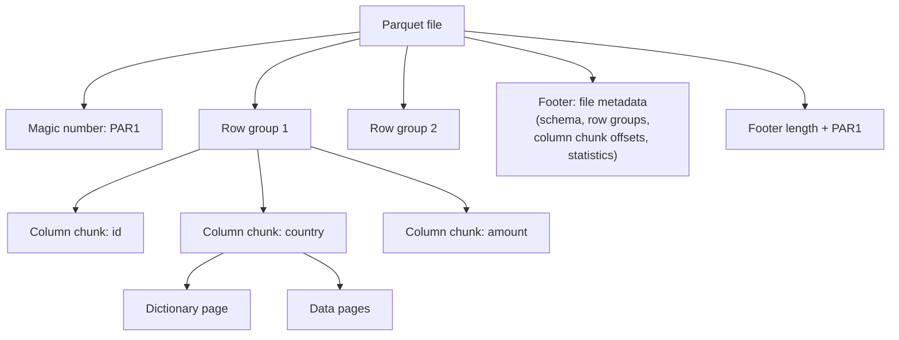

# Apache Parquet

Mastery: `INPUT[inlineSelect(option(new), option(learning), option(solid)):mastery]`

> [!story] Context
> [[Columnar Storage]] describes why analytical data should be stored column by column. Apache Parquet is the open columnar file format that became the standard for that layout. It was announced by Twitter and Cloudera in 2013, and today it stores the data files of [[Delta Lake]], [[Apache Iceberg]], and most lakehouse tables.

> [!eli5] Summary
> Parquet is a file format for storing tables efficiently. It keeps each column's values together, compresses them, and records summary information so that programs can read only the parts they need. Almost every modern data tool can read and write it.

> [!analogy]- Analogy: a well-indexed binder
> | Binder | Parquet file |
> |---|---|
> | Sections, each holding a batch of pages | Row groups |
> | Within a section, one tab per subject | Column chunks |
> | Individual pages | Pages, the unit of encoding and compression |
> | Table of contents at the back | Footer metadata with schema, locations, and statistics |

## Background

Early Hadoop data was mostly stored as text. Columnar options were tied to specific tools. In March 2013, Twitter and Cloudera announced Parquet as a joint open-source project to provide a columnar storage format for any project in the Hadoop ecosystem, regardless of processing framework, data model, or programming language. Twitter stated that it adopted the record shredding and assembly approach from Google's Dremel paper to store nested data in columns. Parquet 1.0 was released in July 2013. Parquet later became an Apache project. (Its graduation date is unconfirmed against the sources used for this vault.)

## Overview

Parquet is a self-describing, binary, columnar file format.

| Feature | Description |
|---|---|
| **Columnar layout** | Values for each column are stored contiguously within a row group |
| **Nested data** | Structs, lists, and maps are represented column by column (Dremel encoding) |
| **Encodings** | Dictionary, run-length, and other encodings applied per column |
| **Compression** | Applied per page with a configurable codec |
| **Statistics** | Per-column statistics (such as min and max) in metadata; optional page index and Bloom filters |
| **Schema in the file** | The footer contains the schema, so readers need no external definition |
| **Broad support** | Spark, Databricks, cloud warehouses, Python libraries, and most query engines |

Parquet is a file format, not a table format. It has no concept of transactions, table versions, or which files belong to a table. [[Delta Lake]] adds those capabilities with a transaction log over Parquet files. See [[Open Table Formats]].

## How it works



The file structure, from the Parquet specification:

| Level | Definition |
|---|---|
| **File** | Begins and ends with the magic number `PAR1`. File metadata is written after the data, in the footer. |
| **Row group** | A horizontal partition of the rows. Contains one column chunk per column. |
| **Column chunk** | The data for one column in one row group. Guaranteed to be contiguous in the file. |
| **Page** | The indivisible unit of encoding and compression. A dictionary page, if present, comes first in the column chunk. |

A reader first reads the footer to find the column chunks it needs, then reads only those byte ranges. The Parquet documentation suggests row groups of 512 MB to 1 GB and data pages of 8 KB.

Reading and writing Parquet on Databricks:

```python
# Read Parquet files directly; no extra configuration is required
df = spark.read.format("parquet").load("/Volumes/main/raw/exports/orders_parquet/")

# Write Parquet with a compression codec
df.write.format("parquet").option("compression", "snappy") \
  .mode("overwrite").save("/Volumes/main/raw/exports/orders_copy/")
```

```sql
-- Query Parquet files in place, without creating a table
SELECT country, SUM(amount)
FROM read_files('/Volumes/main/raw/exports/orders_parquet/', format => 'parquet')
GROUP BY country;

-- Convert an existing Parquet directory to a Delta table without rewriting data
CONVERT TO DELTA parquet.`/Volumes/main/raw/exports/orders_parquet/`;
```

`CONVERT TO DELTA` lists the files in the directory and creates a Delta transaction log that tracks them, without rewriting the Parquet data.

## Small-business considerations

> [!smallbiz] Small-business considerations
> On Databricks, you use Parquet through Delta tables, usually without handling Parquet files directly. Parquet is useful on its own for exchanging data with other tools: many SaaS exports and Python libraries read and write it. When choosing an export format from another system, prefer Parquet over CSV for size and type fidelity. Use Delta tables for data you update or query repeatedly.

> [!bridge]- In Databricks today
> Parquet is the data-file format inside [[Delta Lake]], the default table format on Databricks. Databricks documents that Delta Lake extends Parquet data files with a file-based transaction log for ACID transactions and scalable metadata handling. Databricks also reads and writes plain Parquet files, supports streaming Parquet ingestion through [[Auto Loader]], and loads Parquet with [[COPY INTO]]. Databricks warns against modifying the Parquet files of a Delta table directly, because this can corrupt the table.

## Cloud differences

> [!azure]- Azure Databricks
> Nothing differs by cloud. Parquet reading and writing behave the same; the Azure Databricks documentation covers the same options. Files are stored on ADLS Gen2.

> [!aws]- Databricks on AWS
> Nothing differs by cloud. Files are stored on Amazon S3.

> [!gcp]- Databricks on Google Cloud
> Nothing differs by cloud. Files are stored on Google Cloud Storage.

## Advanced topics

> [!deepdive]- Advanced topics (301–401)
> - **Footer dependence.** File metadata is written last, so a writer that fails before completing the footer leaves an unreadable file. The Parquet documentation states that corrupt file metadata makes the entire file unreadable, while corrupt column metadata affects only that column chunk.
> - **Page index.** Optional `ColumnIndex` and `OffsetIndex` structures, stored near the footer, provide page-level statistics so readers can skip pages within a column chunk. Support varies by implementation.
> - **Small files.** Many small Parquet files increase metadata and request overhead. On Delta tables, [[OPTIMIZE and VACUUM|OPTIMIZE]] compacts them.
> - **Schema merging.** Reading a directory whose files have different schemas requires the `mergeSchema` option. Delta tables avoid this through [[Schema Enforcement and Evolution]].
> - **Timestamp compatibility.** Databricks exposes Parquet read options such as `datetimeRebaseMode` and `int96RebaseMode` for files written by older systems with legacy date and timestamp representations.
> - **Encryption.** The Parquet specification includes modular encryption of columns and footers. Support depends on the reading engine.

## Common misconceptions

> [!confusion] Parquet is not a table format
> Parquet defines how one file is laid out. It does not track which files make up a table or provide transactions. Delta Lake, Apache Iceberg, and Apache Hudi add those capabilities on top of Parquet files.

> [!confusion] A Delta table is not a different file type
> A Delta table is a directory of Parquet data files plus a `_delta_log` transaction log. Converting Parquet to Delta adds the log; it does not rewrite the data.

## Recall

Which companies announced Parquet, and when?::Twitter and Cloudera, in March 2013.
When was Parquet 1.0 released?::July 2013.
Which Google paper's approach does Parquet use for nested data?::Dremel.
What are the levels of a Parquet file's structure?::File, row group, column chunk, and page.
Where is Parquet file metadata stored?::In the footer, written after the data.
What is the indivisible unit of encoding and compression in Parquet?::The page.
How does Delta Lake relate to Parquet?::Delta Lake stores data in Parquet files and adds a file-based transaction log.
What does CONVERT TO DELTA do to existing Parquet files?::Creates a transaction log that tracks them, without rewriting the data.
Which row group size does the Parquet documentation suggest?::512 MB to 1 GB.

## Next steps

> [!path] Learning path
> **Needs first:** [[Columnar Storage]], [[Files and File Formats]]
> **Unlocks next:** [[Delta Lake]], [[Open Table Formats]], [[Apache ORC]]

> [!nextup] Next
> [[Apache ORC]] covers the columnar format created for Hive, Parquet's main counterpart in the Hadoop ecosystem.

> [!sources]- Sources (last verified: 2026-10-25)
> - [Announcing Parquet 1.0: columnar storage for Hadoop (Twitter Engineering)](https://blog.twitter.com/2013/announcing-parquet-10-columnar-storage-for-hadoop)
> - [Apache Parquet: File format](https://parquet.apache.org/docs/file-format/)
> - [Apache Parquet: Concepts](https://parquet.apache.org/docs/concepts/)
> - [Apache Parquet: Column chunks](https://parquet.apache.org/docs/file-format/data-pages/columnchunks/)
> - [Apache Parquet: Configurations](https://parquet.apache.org/docs/file-format/configurations/)
> - [Apache Parquet: Page index](https://parquet.apache.org/docs/file-format/pageindex/)
> - [Apache Parquet: Error recovery](https://parquet.apache.org/docs/file-format/data-pages/errorrecovery/)
> - [Read and write Parquet files (AWS)](https://docs.databricks.com/aws/en/query/formats/parquet)
> - [Read and write Parquet files (Azure Databricks)](https://learn.microsoft.com/en-us/azure/databricks/query/formats/parquet)
> - [read_files table-valued function (AWS)](https://docs.databricks.com/aws/en/sql/language-manual/functions/read_files)
> - [Spark API options reference (AWS)](https://docs.databricks.com/aws/en/spark/api-options)
> - [What is Delta Lake in Databricks? (AWS)](https://docs.databricks.com/aws/en/delta)
> - [CONVERT TO DELTA (AWS)](https://docs.databricks.com/aws/en/sql/language-manual/delta-convert-to-delta)
> - [Get started using COPY INTO to load data (AWS)](https://docs.databricks.com/aws/en/ingestion/cloud-object-storage/copy-into/)
