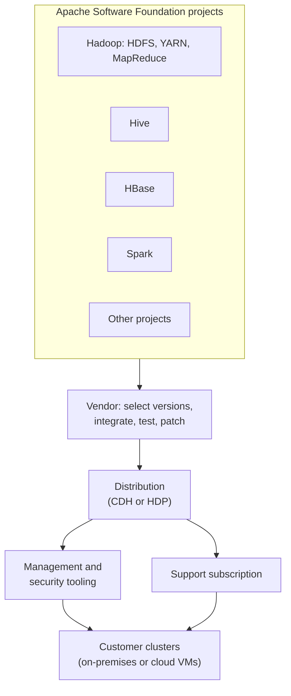

# Cloudera and Hortonworks

Mastery: `INPUT[inlineSelect(option(new), option(learning), option(solid)):mastery]`

> [!story] Context
> By the time of [[Apache HBase]], a working Hadoop deployment combined many separately released Apache projects: [[HDFS]], [[YARN]], [[Apache Hive]], HBase, and others. Integrating, testing, securing, and supporting that combination required dedicated expertise. Cloudera and Hortonworks were the two largest companies that sold it as a supported product. They announced a merger in October 2018 and completed it in January 2019.

> [!eli5] Summary
> Hadoop is free, but assembling and maintaining its many parts is difficult. Cloudera and Hortonworks sold tested bundles of Hadoop software with support contracts. In 2019 the two companies combined into one, keeping the Cloudera name.

> [!analogy]- Analogy: Linux distributions
> | Linux | Hadoop |
> |---|---|
> | The Linux kernel and open-source packages | Apache Hadoop and its ecosystem projects |
> | A distribution such as a commercially supported Linux release | A Hadoop distribution from Cloudera or Hortonworks |
> | Vendor support contracts and management tools | Vendor support, cluster management, and security tooling |

## Background

Apache Hadoop is a set of independent projects, each with its own release schedule. A production cluster needed compatible versions of 20 or more of them, plus installation, configuration, monitoring, security integration, and upgrade tooling. Most enterprises bought a **distribution**: a tested, versioned bundle with a support contract.

Several vendors offered distributions. Cloudera and Hortonworks were the largest independent ones, and their competition shaped the Hadoop market in the 2010s. According to their SEC filings, Cloudera was incorporated in Delaware in June 2008, and Hortonworks was incorporated in Delaware in April 2011 and introduced its first product in 2012.

## Overview

| | Cloudera | Hortonworks |
|---|---|---|
| **Distribution** | CDH (Cloudera's Distribution including Apache Hadoop) | HDP (Hortonworks Data Platform) |
| **Business model** | Subscription support plus proprietary management tooling | Subscription support for a distribution built from Apache projects |
| **Stock listing before the merger** | NYSE: CLDR | Nasdaq: HDP |

Merger facts, from the companies' filings with the U.S. Securities and Exchange Commission (SEC):

| Item | Detail |
|---|---|
| **Announced** | October 3, 2018 |
| **Structure** | All-stock merger of equals, unanimously approved by both boards |
| **Stated goal** | A combined platform spanning multi-cloud, on-premises, and edge deployments, described as "the industry's first enterprise data cloud" |
| **Leadership (announced)** | Tom Reilly as CEO of the combined company; Arun Murthy as Chief Product Officer |
| **Expected close** | First quarter of calendar 2019, subject to stockholder approval and regulatory clearance |
| **Closed** | January 3, 2019 |
| **Surviving name** | Cloudera |
| **Afterward** | Cloudera was taken private by funds advised by Clayton, Dubilier & Rice and KKR; that merger closed on October 8, 2021 |

The merger reflected a shrinking on-premises Hadoop market. Customers were moving storage to cloud [[Object Storage]] and processing to [[Apache Spark]] and cloud services, which reduced demand for two competing on-premises distributions. See [[The Pain of Hadoop]].

## How it works

A distribution vendor performs the following work for each release:

1. Selects mutually compatible versions of each Apache project.
2. Back-ports security and bug fixes into those versions.
3. Tests the combination as a unit.
4. Ships installers and a cluster management console.
5. Integrates authentication (typically Kerberos), authorization, and auditing.
6. Provides support under a subscription.

The customer still provides the hardware or VMs, operates the cluster, and plans upgrades.

## Small-business considerations

> [!smallbiz] Small-business considerations
> The distribution model assumed an organization with its own infrastructure and an operations team. Small businesses rarely adopted it. If you inherit a CDH or HDP cluster through an acquisition, plan a migration rather than a renewal; old distribution versions eventually reach end of support. See [[Migrating from Hadoop]] and [[Total Cost of Ownership]].

> [!bridge]- In Databricks today
> Databricks fills the vendor role differently. Instead of shipping software for customers to install and operate, it runs a managed platform on the customer's cloud account (and on its own serverless compute):
>
> | Distribution vendor responsibility | Databricks equivalent |
> |---|---|
> | Tested bundle of compatible project versions | [[Databricks Runtime]] versions |
> | Cluster installation and management console | The Databricks workspace and [[Account Console]] |
> | Security integration (authentication, authorization, audit) | [[Unity Catalog]], identity federation, [[Audit Logs]] |
> | Customer-operated hardware | Cloud VMs provisioned on demand, or [[Serverless Compute]] |
>
> Databricks publishes migration guidance for Hadoop workloads, including Hive. See [[Migrating from Hadoop]] and [[Lakebridge]].

## Cloud differences

> [!azure]- Azure Databricks
> The distribution model does not apply to Databricks on any cloud. On Azure, migrations from CDH or HDP clusters target Azure Databricks with ADLS Gen2 storage; Microsoft's own managed Hadoop service is Azure HDInsight.

> [!aws]- Databricks on AWS
> The same applies on AWS. Migrations target Databricks with Amazon S3 storage; AWS's own managed Hadoop service is Amazon EMR.

> [!gcp]- Databricks on Google Cloud
> The same applies on Google Cloud. Migrations target Databricks with Google Cloud Storage; Google's managed Hadoop and Spark service is Managed Service for Apache Spark (formerly Dataproc).

## Advanced topics

> [!deepdive]- Advanced topics (301–401)
> - **Version lag:** Distributions shipped specific, patched versions of each project, often behind the latest Apache release. Customers on older distributions could not adopt new Spark or Hive features without a full platform upgrade.
> - **Proprietary layers:** Vendors differentiated with management and governance tooling on top of the open-source core. Migration projects must account for features that existed only in those layers, such as cluster-management workflows and security policies.
> - **Security policy migration:** Hadoop authorization policies (for example, Hive or HDFS permissions managed in vendor tooling) do not transfer automatically. They must be redesigned as Unity Catalog [[Privileges and Grants|grants]].
> - **Market consolidation:** The combination of two competitors through an all-stock merger, rather than continued competition, is consistent with a market contracting as workloads moved to cloud services. The filings frame the combined company around hybrid and multi-cloud deployments.

## Common misconceptions

> [!confusion] Cloudera did not own Hadoop
> Hadoop is an Apache Software Foundation project. Cloudera and Hortonworks contributed to it and sold distributions and support, but neither owned the project.

> [!confusion] A distribution is not a managed service
> A distribution is software the customer installs and operates. A managed service, such as Databricks, is operated by the vendor.

## Recall

What did Cloudera and Hortonworks sell?::Supported Hadoop distributions: tested bundles of Apache Hadoop ecosystem projects with management tooling and subscriptions.
What were the two companies' distributions called?::CDH (Cloudera) and HDP (Hortonworks).
When was the Cloudera–Hortonworks merger announced?::October 3, 2018.
When did the Cloudera–Hortonworks merger close?::January 3, 2019.
How was the merger structured?::An all-stock merger of equals.
Which name did the combined company keep?::Cloudera.
Which Databricks component fills the role of a distribution's tested bundle of versions?::Databricks Runtime.
What is the difference between a distribution and a managed service?::A distribution is installed and operated by the customer; a managed service is operated by the vendor.

## Next steps

> [!path] Learning path
> **Needs first:** [[Apache Hadoop]], [[Apache Hive]]
> **Unlocks next:** [[The Pain of Hadoop]], [[Migrating from Hadoop]]

> [!nextup] Next
> [[Columnar Storage]] covers the storage layout that made analytical queries on Hadoop, and later the lakehouse, efficient.

> [!sources]- Sources (last verified: 2026-10-25)
> - [Cloudera and Hortonworks merger announcement, joint press release (SEC Form 425, Exhibit 99.1)](https://www.sec.gov/Archives/edgar/data/0001610532/000162828018012255/cldr8-k10318ex991.htm)
> - [Cloudera Form 8-K filed October 3, 2018 (SEC)](https://www.sec.gov/Archives/edgar/data/0001610532/000162828018012255/cldr8-k10318.htm)
> - [Merger employee communications, including leadership (SEC Form 425)](https://www.sec.gov/Archives/edgar/data/0001610532/000162828018012509/a425101118mtpsfaqs.htm)
> - [Cloudera Q4 FY2019 results, Form 8-K exhibit (SEC)](https://www.sec.gov/Archives/edgar/data/1535379/000162828019002873/q4-19cldrexhibit991.htm)
> - [Cloudera Form 10-K, fiscal 2019 (SEC)](https://www.sec.gov/Archives/edgar/data/1535379/000162828019003670/fy-19cldr10k.htm)
> - [Migrate data applications to Databricks (AWS)](https://docs.databricks.com/aws/en/migration/)
> - [Migrate data applications to Azure Databricks](https://learn.microsoft.com/en-us/azure/databricks/migration/)
> - [Apache Hadoop on Amazon EMR](https://docs.aws.amazon.com/emr/latest/ReleaseGuide/emr-hadoop.html)
> - [Azure HDInsight retired versions](https://learn.microsoft.com/en-us/azure/hdinsight/hdinsight-retired-versions)
> - [Managed Service for Apache Spark (formerly Dataproc)](https://cloud.google.com/products/managed-service-for-apache-spark)
> - [Hortonworks Form 10-K, fiscal 2017 (SEC)](https://www.sec.gov/Archives/edgar/data/1610532/000119312518084131/d506884d10k.htm)
> - [Cloudera Form 8-K filed October 8, 2021, completion of merger with Sky Parent Inc. (SEC)](https://www.sec.gov/Archives/edgar/data/1535379/000119312521294924/d223205d8k.htm)
> - [CDH Overview, Cloudera Enterprise 6.3 (Cloudera documentation)](https://docs.cloudera.com/documentation/enterprise/6/6.3/topics/cdh_intro.html)
> - [Security daemon setup best practices, part 1 (Cloudera blog; CDH expansion)](https://www.cloudera.com/blog/technical/best-practices-guide-for-systems-security-services-daemon-configuration-and-installation-part-1.html)
