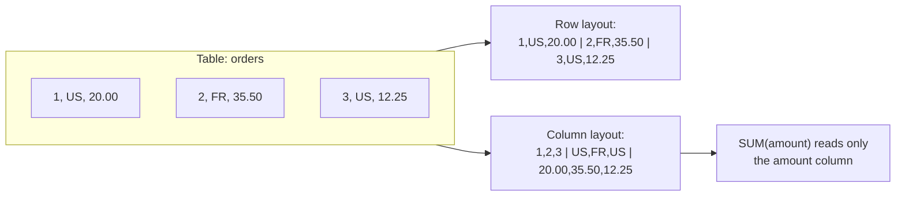

# Columnar Storage

Mastery: `INPUT[inlineSelect(option(new), option(learning), option(solid)):mastery]`

> [!story] Context
> [[Cloudera and Hortonworks]] packaged Hadoop for enterprise analytics. Most early Hadoop data was stored as row-oriented text files (CSV, delimited logs, JSON), so every query read every column of every row. Columnar storage changes the file layout so that analytical queries read only the columns they reference.

> [!eli5] Summary
> Columnar storage saves a table one column at a time instead of one row at a time. A question about two columns of a hundred-column table then reads only those two columns. The values in each column are also similar to each other, so they compress well.

> [!analogy]- Analogy: a filing cabinet
> | Filing cabinet | Storage layout |
> |---|---|
> | One folder per customer containing every detail | Row-oriented storage |
> | One drawer per attribute (all cities, all totals) | Column-oriented storage |
> | "Average order total" requires opening only the totals drawer | A query reads only the referenced column |
> | "Everything about customer 4812" is faster with per-customer folders | Row storage suits single-record access |

## Background

Analytical queries typically read a few columns across many rows: `SELECT region, SUM(revenue) FROM sales GROUP BY region`. Transactional workloads typically read or write all columns of a few rows: fetch one order. See [[OLTP vs OLAP]].

Row-oriented formats such as [[CSV and JSON]] store each record contiguously. A query that needs 2 of 100 columns still reads all 100 from disk. At terabyte scale this makes I/O the dominant cost. In the Hadoop ecosystem, columnar file formats addressed this: [[Apache Parquet]] (announced by Twitter and Cloudera in 2013) and [[Apache ORC]] (created in 2013 as part of an effort to speed up [[Apache Hive]]).

## Overview

Columnar storage writes all values of one column together, then the next column, typically within horizontal groups of rows.

| Property | Row-oriented (CSV, JSON, row databases) | Column-oriented (Parquet, ORC) |
|---|---|---|
| **Physical layout** | All fields of row 1, then row 2 | All values of column A for a group of rows, then column B |
| **Reads for a 2-of-100-column query** | All columns | The 2 referenced columns (**column pruning**) |
| **[[Compression]]** | Moderate; mixed types per record | High; similar values per column enable dictionary and run-length encoding |
| **Skipping data** | Limited without an [[Index\|index]] | Per-group min/max statistics allow skipping row groups ([[Data Skipping\|data skipping]]) |
| **Single-row lookup or update** | Efficient | Inefficient |
| **Typical use** | Transactions, data exchange | Analytics, data lakes, lakehouse tables |

## How it works



Three mechanisms produce most of the performance benefit:

1. **Column pruning.** The reader fetches only the columns referenced by the query.
2. **Encoding and compression per column.** A `country` column with few distinct values is stored as small dictionary codes. Repeated values are stored as runs. Compression codecs then operate on homogeneous data.
3. **Statistics-based skipping.** Files store minimum and maximum values per column for each group of rows. A filter such as `WHERE order_date >= '2025-01-01'` skips groups whose maximum date is earlier.

Example: a 100-column, 1 TB table in CSV. A query using 3 columns reads 1 TB. In a columnar format, the same query reads roughly the compressed size of 3 columns, often a small fraction of the original, before any statistics-based skipping.

Writing columnar files on Databricks:

```python
# Convert a CSV export to a Delta table (Delta stores data in Parquet files)
(spark.read.option("header", True).csv("/Volumes/main/raw/exports/orders.csv")
      .write.saveAsTable("main.sales.orders"))
```

```sql
-- Query only two columns; the engine reads only those columns from storage
SELECT region, SUM(revenue) AS revenue
FROM main.sales.orders
GROUP BY region;
```

## Small-business considerations

> [!smallbiz] Small-business considerations
> Store analytical data in a columnar format. On Databricks, this is the default: [[Delta Lake]] tables store data in Parquet files. Converting large CSV exports to tables usually reduces storage size and query time. Keep CSV for data exchange with other systems, not for repeated analysis.

> [!bridge]- In Databricks today
> Columnar storage is the default physical layout on Databricks. [[Delta Lake]] tables use Parquet data files with a transaction log. The [[Photon]] engine processes data in columnar batches. Features such as [[Data Skipping|data skipping]] and [[Liquid Clustering]] use per-file column statistics to reduce the data read.

## Cloud differences

> [!azure]- Azure Databricks
> Nothing differs by cloud. Columnar files behave the same on ADLS Gen2, Amazon S3, and Google Cloud Storage.

> [!aws]- Databricks on AWS
> Nothing differs by cloud.

> [!gcp]- Databricks on Google Cloud
> Nothing differs by cloud.

## Advanced topics

> [!deepdive]- Advanced topics (301–401)
> - **Hybrid layout.** Parquet and ORC are not purely columnar. They partition rows into groups (Parquet row groups, ORC stripes) and store each column contiguously within a group. This bounds memory use for writers and enables per-group statistics.
> - **Late materialization.** Engines can evaluate filters on one column first and read other columns only for matching rows.
> - **Vectorized execution.** Columnar data maps to CPU-efficient batch processing (SIMD). [[Photon]] and Spark's vectorized Parquet reader use this.
> - **Sort order affects compression and skipping.** Data clustered on frequently filtered columns produces narrow min/max ranges per group, which improves skipping. See [[Z-Ordering]] and [[Liquid Clustering]].
> - **Nested data.** Representing nested and repeated fields (structs, arrays) in a columnar layout requires additional encoding. Parquet adopted the approach described in Google's Dremel paper.
> - **Not for point updates.** Updating a single value in an immutable columnar file requires rewriting the file. Table formats mitigate this with techniques such as [[Deletion Vectors]].

## Common misconceptions

> [!confusion] Columnar storage is not a database
> Columnar storage is a file or storage layout. Parquet and ORC are file formats; engines such as Spark read them. Delta Lake adds table semantics on top.

> [!confusion] Columnar is not always faster
> For workloads that read entire rows or update individual records, row-oriented storage performs better. Columnar layouts optimize analytical scans.

## Recall

What is columnar storage?::A layout that stores all values of each column together rather than storing each row contiguously.
What is column pruning?::Reading only the columns referenced by a query.
Why does columnar data compress well?::Values within a column have the same type and often similar values, enabling dictionary and run-length encoding.
How do columnar files allow skipping data?::They store per-group min/max statistics, so groups that cannot match a filter are skipped.
Which workloads favor row-oriented storage?::Transactional workloads that read or write whole individual records.
What file format does Delta Lake use for its data files?::Apache Parquet.
Name two columnar file formats from the Hadoop ecosystem.::Apache Parquet and Apache ORC.

## Next steps

> [!path] Learning path
> **Needs first:** [[OLTP vs OLAP]], [[Files and File Formats]]
> **Unlocks next:** [[Apache Parquet]], [[Apache ORC]], [[Data Skipping]]

> [!nextup] Next
> [[Apache Parquet]] covers the columnar file format that underlies Delta Lake tables.

> [!sources]- Sources (last verified: 2026-10-25)
> - [Apache Parquet: File format](https://parquet.apache.org/docs/file-format/)
> - [Apache Parquet: Concepts](https://parquet.apache.org/docs/concepts/)
> - [Apache ORC: Background](https://orc.apache.org/docs/)
> - [ORC becomes an Apache Top Level Project (Apache ORC)](https://orc.apache.org/news/2015/04/22/orc-as-tlp/)
> - [Announcing Parquet 1.0 (Twitter Engineering)](https://blog.twitter.com/2013/announcing-parquet-10-columnar-storage-for-hadoop)
> - [Read and write Parquet files (AWS)](https://docs.databricks.com/aws/en/query/formats/parquet)
> - [What is Delta Lake in Databricks? (AWS)](https://docs.databricks.com/aws/en/delta)
