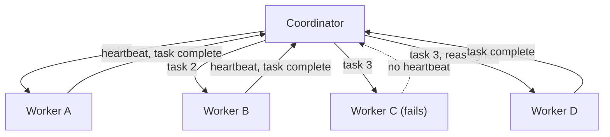

# Distributed Systems

Mastery: `INPUT[inlineSelect(option(new), option(learning), option(solid)):mastery]`

> [!story] Context
> [[Scaling Up vs Scaling Out]] establishes that capacity beyond one machine requires many machines. A group of machines becomes a usable system only when software partitions data, assigns work, and recovers from failures. That software is a distributed system.

> [!eli5] Summary
> A distributed system is a group of computers that work together and appear to users as one computer. It must keep producing correct results even when some of the computers fail, slow down, or lose contact with the others.

> [!analogy]- Analogy: a team coordinating by text message
> | Team project | Distributed system |
> |---|---|
> | Each team member | A [[Node\|node]] |
> | The group chat, where messages can be delayed or lost | The network |
> | The team lead assigning tasks | The coordinator |
> | A member who stops responding | A failed or unreachable node |
> | Everyone holding a copy of the shared notes | [[Replication]] |

## Background

A single computer allows assumptions that do not hold across a network of machines:

- **Partial failure:** On one machine, components work or the machine stops. Across 1,000 machines, some components are failing at any given time. The GFS and MapReduce designs treat component failure as the normal case.
- **Unreliable network:** Messages can be delayed, dropped, or duplicated. A node that does not respond may be failed, overloaded, or slow, and these cases look the same to other nodes.
- **No shared clock:** Each machine's clock drifts, so ordering events across machines requires explicit coordination.
- **[[Straggler Task|Stragglers]]:** One slow machine can delay a job that thousands of other machines have finished.

Every system in the rest of this vault, including [[HDFS]], [[Apache Spark]], and [[Delta Lake]], is a distributed system built to handle these conditions.

## Overview

A distributed system is software running on multiple networked machines that cooperate to present a single service. Data platforms implement the following functions:

| Function | Description | Example |
|---|---|---|
| **Partitioning** | Split data across machines | HDFS blocks; Spark [[Partitions\|partitions]] |
| **Replication** | Store each piece on several machines | HDFS keeps multiple copies of each block (commonly 3) |
| **Coordination** | Assign work and track progress | HDFS NameNode, [[YARN]] ResourceManager, Spark driver |
| **Failure detection** | Identify unresponsive machines | Periodic heartbeat messages |
| **Recovery** | Restore lost data or redo lost work | Rerunning a failed [[MapReduce]] task on another node |
| **Data exchange** | Move related records to the same machine | The MapReduce shuffle; Spark [[Shuffles\|shuffles]] |

Most big data systems use a **coordinator and workers** architecture. One process holds the plan and the [[Metadata|metadata]]; many worker processes perform the computation and storage. Older documentation uses the terms master and slave.

## How it works

Four techniques account for most fault tolerance in big data systems:

1. **Heartbeats:** Workers send periodic status messages. The coordinator marks a worker as failed when messages stop. In HDFS, DataNodes send heartbeats and block reports to the NameNode.
2. **Replication:** Each piece of data is stored on more than one machine, preferably in different racks, so the loss of a machine or a rack does not lose data.
3. **Deterministic re-execution:** Tasks produce the same output from the same input, so a failed or slow task can be rerun on another machine. The MapReduce paper calls duplicate copies of slow tasks *backup tasks*; Spark calls this *[[Speculative Execution|speculative execution]]*.
4. **Data locality:** The scheduler runs each task on or near the machine that stores its input, because network bandwidth is the scarcer resource.

Because systems retry work, pipeline writes must be safe to repeat. See [[Idempotency]] and [[Exactly-Once Processing]].

## Small-business considerations

> [!smallbiz] Small-business considerations
> A small team does not need to build distributed systems. Understanding the basics helps when reading errors and job metrics:
> - "Executor lost" or "node lost" means a worker machine failed. The platform typically retries the affected tasks.
> - A job that stalls near completion often has one task processing far more data than the others. See [[Data Skew]].
> - Retries are expected behavior, so design pipelines to produce the same result when run twice.

> [!bridge]- In Databricks today
> Databricks operates the distributed system. [[Apache Spark]] handles partitioning, scheduling, retries, and shuffles. Cloud [[Object Storage]] handles durability of stored data. The platform replaces failed cluster VMs, and [[Serverless Compute]] removes machine management entirely. The remaining user responsibilities are partitioning-friendly workload design and retry-safe writes.

## Cloud differences

> [!azure]- Azure Databricks
> The concepts do not differ by cloud. Durability of stored data is provided by Azure storage (ADLS Gen2) rather than by the cluster. [[Availability Zone|Availability zones]] provide failure isolation at data-center scale.

> [!aws]- Databricks on AWS
> The concepts do not differ by cloud. Amazon S3, not the cluster, provides durability of stored data.

> [!gcp]- Databricks on Google Cloud
> The concepts do not differ by cloud. Google Cloud Storage, not the cluster, provides durability of stored data.

## Advanced topics

> [!deepdive]- Advanced topics (301–401)
> - **Consistency versus availability:** During a network partition, a system must choose between remaining available and remaining consistent (the CAP trade-off). Analytics storage typically requires strong consistency for table metadata, the record of which files make up a table version, and relies on retries elsewhere.
> - **Single points of failure:** Early Hadoop ran one NameNode and one JobTracker; failure of either stopped the cluster. Hadoop 2 added standby NameNodes, and YARN ResourceManager high availability was added in Hadoop 2.4. Databricks places equivalent coordination in its [[Control Plane and Compute Plane|control plane]].
> - **Common false assumptions:** The network is reliable, latency is zero, bandwidth is unlimited, and topology does not change. Each assumption fails in production clusters.
> - **Commits on object storage:** Writing a table from many machines requires an atomic step that makes the new version visible. HDFS offered atomic directory rename for this purpose. Object stores do not provide equivalent semantics, which is one reason [[Delta Lake]] records commits in a [[Delta Transaction Log|transaction log]].
> - **Stragglers at scale:** With 10,000 tasks and a 1% chance of a slow machine, about 100 tasks run slowly. Speculative execution exchanges extra compute for lower tail latency.

## Common misconceptions

> [!confusion] Distributed is not the same as parallel
> Parallel execution runs operations simultaneously, which one multi-core machine can do. Distributed execution runs across separate networked machines and must handle partial failure and network delay.

> [!confusion] Replication is not a backup
> Replication keeps live copies to survive hardware failure. Deletions and incorrect writes replicate too. Backups and [[Time Travel]] protect against errors.

## Recall

What is a distributed system?::Software running on multiple networked machines that cooperate to present a single service.
Name three conditions that distributed systems must handle and single machines do not.::Partial failure, an unreliable network, and no shared clock; also stragglers.
What is a heartbeat?::A periodic status message from a worker to the coordinator; missing heartbeats mark the worker as failed.
Why are big data tasks designed to be deterministic?::So a failed or slow task can be rerun elsewhere and produce the same result.
What is data locality?::Scheduling each task on the machine that stores its input to minimize network transfer.
What is speculative execution?::Running a duplicate of a slow task on another machine and using the first result to finish.
Why is replication not a backup?::Deletions and incorrect writes are replicated; replication protects against hardware failure, not errors.

## Next steps

> [!path] Learning path
> **Needs first:** [[Scaling Up vs Scaling Out]], [[Servers and the Cloud]]
> **Unlocks next:** [[Google File System and MapReduce Papers]], [[HDFS]], [[Fault Tolerance]]

> [!nextup] Next
> [[Google File System and MapReduce Papers]] covers the 2003 and 2004 Google papers that described a working distributed storage and processing system on commodity hardware.

> [!sources]- Sources (last verified: 2026-10-25)
> - [The Google File System (SOSP 2003, peer-reviewed paper)](https://www.cs.rochester.edu/meetings/sosp2003/papers/p125-ghemawat.pdf)
> - [MapReduce: Simplified Data Processing on Large Clusters (OSDI 2004), Google Research](https://research.google/pubs/pub62/?hl=es)
> - [HDFS Architecture (Apache Hadoop 3.3.2)](https://hadoop.apache.org/docs/r3.3.2/hadoop-project-dist/hadoop-hdfs/HdfsDesign.html)
> - [ResourceManager High Availability (Apache Hadoop YARN)](https://hadoop.apache.org/docs/stable/hadoop-yarn/hadoop-yarn-site/ResourceManagerHA.html)
> - [What is Delta Lake in Databricks? (AWS)](https://docs.databricks.com/aws/en/delta)
