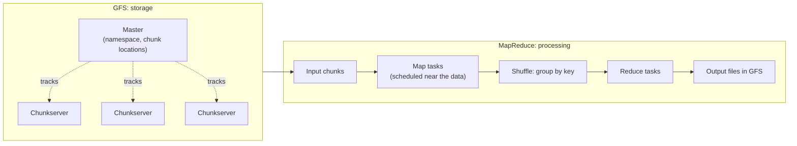

# Google File System and MapReduce Papers

Mastery: `INPUT[inlineSelect(option(new), option(learning), option(solid)):mastery]`

> [!story] Context
> [[Distributed Systems]] describes the problems of running one service across many unreliable machines. In 2003 and 2004, Google published two peer-reviewed papers describing how it stored and processed web-scale data on large clusters of commodity servers. Those papers became the blueprint for [[Apache Hadoop]].

> [!eli5] Summary
> Google published two papers explaining how it stored and processed the entire web on thousands of inexpensive computers. The first describes how to store very large files safely by keeping copies on several machines. The second describes a way to split a large computation into small pieces that many machines run at the same time.

> [!analogy]- Analogy: a published recipe
> | Recipe | Papers |
> |---|---|
> | A restaurant's private kitchen | Google's internal infrastructure |
> | Recipe cards handed out at a conference | The GFS and MapReduce papers |
> | Home cooks building a kitchen from the cards | Open-source implementations in Hadoop |

## Background

Google's search index was built from billions of crawled web pages. The data exceeded the capacity of any single machine, and Google ran on large numbers of inexpensive servers rather than a few large ones (see [[Scaling Up vs Scaling Out]]). This created two requirements:

1. **Storage** for multi-gigabyte files across hundreds of machines, tolerant of daily disk and server failures.
2. **Processing** that allowed programmers to run jobs across thousands of machines without writing scheduling, retry, and networking code for each job.

Google built internal systems for both and described them at academic systems conferences. Google did not release the software. Other organizations with similar problems used the papers as designs to implement.

## Overview

| | The Google File System | MapReduce |
|---|---|---|
| **Title** | *The Google File System* | *MapReduce: Simplified Data Processing on Large Clusters* |
| **Authors** | Sanjay Ghemawat, Howard Gobioff, Shun-Tak Leung | Jeffrey Dean, Sanjay Ghemawat |
| **Venue** | SOSP 2003 (ACM Symposium on Operating Systems Principles) | OSDI 2004 (Symposium on Operating Systems Design and Implementation), pp. 137–150 |
| **Problem** | Reliable storage of very large files on commodity machines | Parallel processing of large datasets without distributed-systems expertise |
| **Core design** | Large fixed-size chunks, replicated on several chunkservers, with one master holding metadata | Users write a `map` function and a `reduce` function; the runtime handles partitioning, scheduling, failures, and communication |
| **Reported scale** | Largest cluster: over a thousand machines and hundreds of terabytes | Typical computations: many terabytes on thousands of machines |
| **Open-source implementation** | [[HDFS]] | Hadoop [[MapReduce]] |

Later Google papers on a distributed table store (Bigtable) and nested columnar data (Dremel) influenced [[Apache HBase]] and [[Apache Parquet]] respectively.

## How it works

### GFS design

1. Files are divided into fixed-size **chunks** of 64 MB, much larger than conventional file system blocks, because the workload consists of large sequential reads.
2. Each chunk is replicated on several **chunkservers** (three by default), placed across racks.
3. A single **master** stores the namespace and the mapping from chunks to chunkservers. Clients obtain locations from the master and then read data directly from chunkservers, so the master does not carry data traffic.
4. Component failure is treated as normal. Chunkservers report to the master, which re-replicates chunks when copies are lost.
5. The system is optimized for appends and large streaming reads, not small random writes, and uses a relaxed consistency model.

### MapReduce design

1. The programmer writes `map(key, value)`, which emits intermediate key/value pairs, and `reduce(key, values)`, which merges all values for one key.
2. The runtime splits the input, schedules map tasks near their input data, and **shuffles** intermediate pairs so that all values for a key reach the same reduce task.
3. Tasks on a failed machine are rerun on another machine. Deterministic functions make the rerun produce the same result.
4. Near the end of a job, the runtime launches **backup tasks** for slow tasks to reduce completion time.
5. The paper's stated goal is that programmers without experience in parallel and distributed systems can use large clusters. The canonical example, word count, is shown in [[MapReduce]].

## Small-business considerations

> [!smallbiz] Small-business considerations
> No small business runs GFS or writes raw MapReduce jobs. The papers explain design properties that appear in every modern data platform: files split into replicated pieces, computation scheduled near data, and automatic retries on failure. They also explain why storing large volumes of data is inexpensive today: the design assumed commodity hardware from the start.

> [!bridge]- In Databricks today
> The papers' ideas underlie the platform:
> - The GFS role is filled by cloud [[Object Storage]]: [[Amazon S3]], [[Azure Data Lake Storage]], and [[Google Cloud Storage]], operated by the cloud provider.
> - The MapReduce role is filled by [[Apache Spark]] and [[Photon]], which keep the partition, shuffle, and combine structure but execute largely in memory.
> - Spark [[Jobs Stages and Tasks|stages and tasks]] are direct descendants of map and reduce tasks.

## Cloud differences

> [!azure]- Azure Databricks
> Nothing differs by cloud. The descendant storage on Azure is ADLS Gen2.

> [!aws]- Databricks on AWS
> Nothing differs by cloud. The descendant storage on AWS is Amazon S3.

> [!gcp]- Databricks on Google Cloud
> Nothing differs by cloud. The descendant storage on Google Cloud is Google Cloud Storage.

## Advanced topics

> [!deepdive]- Advanced topics (301–401)
> - **Single master:** One master simplified placement and replication decisions. It scaled because clients requested only metadata and the master held metadata in memory. HDFS adopted the same design for its NameNode, and NameNode memory became the limit on file count, known as the [[Small Files Problem|small files problem]].
> - **Large chunks reduce metadata:** 64 MB chunks produce far fewer entries for the master than small blocks would. HDFS used 64 MB blocks in Hadoop 1 and 128 MB as the typical size in later versions.
> - **Record append:** GFS allowed concurrent appends to one file with at-least-once semantics. Applications had to tolerate duplicate records, a problem that recurs in streaming as [[Exactly-Once Processing]].
> - **Combiner:** The MapReduce paper describes an optional combiner that partially reduces map output on each machine before the shuffle. Spark applies the same optimization to aggregations.
> - **Disk-bound execution:** Each MapReduce job writes output to the distributed file system, and multi-step pipelines chain jobs, so data is written and reread between every step. This cost motivated [[Apache Spark]]. See [[The Pain of Hadoop]].

## Common misconceptions

> [!confusion] Google did not release GFS or MapReduce as software
> Google published papers describing internal systems. HDFS and Hadoop MapReduce are independent open-source implementations based on those papers.

> [!confusion] "MapReduce" refers to both a model and an implementation
> It names a programming model (map, shuffle, reduce) and specific implementations of it (Google's and Hadoop's). Spark retains the model's structure and replaces the implementation.

## Recall

When and where was the Google File System paper published?::SOSP 2003, by Ghemawat, Gobioff, and Leung.
When and where was the MapReduce paper published?::OSDI 2004, by Jeffrey Dean and Sanjay Ghemawat.
What chunk size did GFS use?::64 MB.
What does the GFS master store, and what does it not do?::It stores the namespace and chunk locations; it does not serve file data, which clients read directly from chunkservers.
Which two functions does a MapReduce programmer write?::A map function that emits intermediate key/value pairs, and a reduce function that merges all values for a key.
How does MapReduce handle a failed machine?::It reruns that machine's tasks on another machine.
What are MapReduce backup tasks?::Duplicate executions of slow tasks near the end of a job, used to reduce completion time.
Which open-source projects implement the GFS and MapReduce designs?::HDFS and Hadoop MapReduce, in Apache Hadoop.

## Next steps

> [!path] Learning path
> **Needs first:** [[Distributed Systems]]
> **Unlocks next:** [[Apache Hadoop]], [[HDFS]], [[MapReduce]]

> [!nextup] Next
> [[Apache Hadoop]] covers the open-source project that implemented both designs.

> [!sources]- Sources (last verified: 2026-10-25)
> - [The Google File System (SOSP 2003 proceedings copy)](https://www.cs.rochester.edu/meetings/sosp2003/papers/p125-ghemawat.pdf)
> - [MapReduce: Simplified Data Processing on Large Clusters (OSDI 2004), Google Research](https://research.google/pubs/pub62/?hl=es)
> - [HDFS Architecture (Apache Hadoop 3.3.2)](https://hadoop.apache.org/docs/r3.3.2/hadoop-project-dist/hadoop-hdfs/HdfsDesign.html)
> - [HDFS Architecture Guide (Apache Hadoop 1.2.1)](https://hadoop.apache.org/docs/r1.2.1/hdfs_design.html)
> - [Apache HBase home page (modeled after Bigtable)](https://hbase.apache.org/2.1/)
> - [Announcing Parquet 1.0 (Twitter Engineering), which cites the Dremel approach](https://blog.twitter.com/2013/announcing-parquet-10-columnar-storage-for-hadoop)
