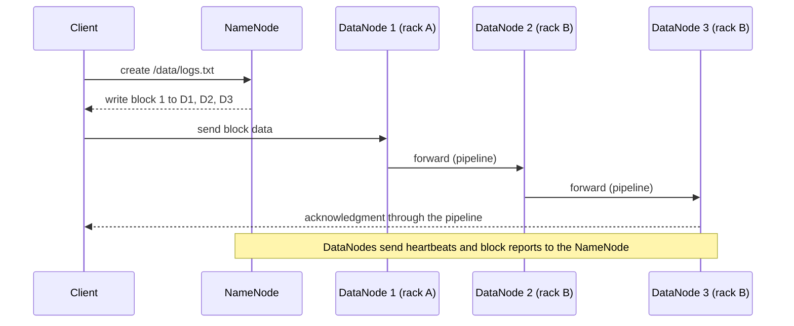

# HDFS

Mastery: `INPUT[inlineSelect(option(new), option(learning), option(solid)):mastery]`

> [!story] Context
> [[Apache Hadoop]] implemented Google's designs as open source. Its storage layer, the Hadoop Distributed File System (HDFS), is the open-source counterpart of GFS from the [[Google File System and MapReduce Papers]]. Every other Hadoop component reads from and writes to it.

> [!eli5] Summary
> HDFS stores very large files by cutting them into large pieces and keeping copies of each piece on several computers. One computer keeps the list of where every piece is stored. When a computer fails, the system creates new copies from the ones that remain.

> [!analogy]- Analogy: a library that copies every chapter
> | Library | HDFS |
> |---|---|
> | A book divided into chapters | A file divided into blocks |
> | Each chapter shelved in three branches | Each block stored on several DataNodes |
> | The central index of which branch holds which chapter | The NameNode |
> | Branches confirming they are open | DataNode heartbeats |
> | Copying a chapter after a branch closes | Re-replication of under-replicated blocks |

## Background

Processing data across many machines requires storage that spans those machines. Conventional file systems are local to one machine, and network file servers of the period were expensive and became bottlenecks.

HDFS targets one workload: large files written once and read sequentially many times, with high [[Throughput|throughput]], on [[Commodity Hardware|commodity hardware]]. The HDFS design documentation lists these assumptions: hardware failure is the norm, applications need streaming data access, datasets are large, files follow a write-once-read-many model, and moving computation is cheaper than moving data.

## Overview

HDFS uses a single coordinator and many workers:

| Component | Role |
|---|---|
| **NameNode** | A single master server. Manages the file system namespace (directories, file names, permissions), regulates client access, and tracks which DataNodes hold each block. |
| **DataNode** | One per worker machine. Stores blocks on local disks, serves client reads and writes, and sends heartbeats and block reports to the NameNode. |
| **Block** | The unit of storage. Files are split into blocks, typically 128 MB in Hadoop 3.x documentation (64 MB in the Hadoop 1.2.1 guide). Block size is configurable per file. |
| **Replication factor** | The number of copies of each block, set per file and stored by the NameNode. The common case is three. |

### Replica placement

For a replication factor of three, the documented default places one replica on the writer's node (or a random node) and the other two on different nodes in one remote rack. This survives the loss of an entire rack while limiting slower inter-rack write traffic.

## How it works



- **Write path:** The client requests target DataNodes for each block from the NameNode, then streams data to the first DataNode, which forwards it along a pipeline to the others. File data does not pass through the NameNode.
- **Read path:** The client requests block locations from the NameNode, then reads each block directly from a DataNode that holds it, preferring the nearest.
- **Recovery:** The NameNode monitors heartbeats and block reports. When a DataNode fails or a disk error leaves blocks under-replicated, it schedules new replicas on healthy nodes.

Common commands:

```bash
hdfs dfs -ls /data/weblogs                       # list a directory
hdfs dfs -put sales_2015.csv /data/raw/          # upload a local file
hdfs dfs -setrep -w 2 /data/raw/sales_2015.csv   # set replication factor to 2
hdfs fsck /data/raw/sales_2015.csv -files -blocks -locations   # show block placement
hdfs dfsadmin -report                            # capacity and live DataNodes
```

HDFS paths use the form `hdfs://namenode-host:port/path`. On Databricks, the equivalent paths are cloud storage URIs: `s3://`, `abfss://`, and `gs://`.

## Small-business considerations

> [!smallbiz] Small-business considerations
> Do not deploy HDFS. Its cost model assumes owned servers running continuously, with every byte stored multiple times on purchased disks. Cloud [[Object Storage]] provides durable storage without servers and is billed by capacity used. See your cloud provider's storage pricing page for the meter.
>
> To migrate inherited HDFS data, copy it to a cloud storage bucket and convert the files to [[Delta Lake]] tables. See [[Migrating from Hadoop]].

> [!bridge]- In Databricks today
> The role of HDFS is filled by **cloud object storage**: [[Amazon S3]], [[Azure Data Lake Storage]] (ADLS Gen2), or [[Google Cloud Storage]]. The cloud provider manages durability. On top of it:
> - **Tables** are [[Delta Lake]] tables whose Parquet data files and transaction log are stored in your cloud storage, governed by [[Unity Catalog]].
> - **Non-tabular files** are stored in Unity Catalog [[Volumes]].
> - **Access** is granted through [[Storage Credentials and External Locations]], not HDFS file permissions.
>
> When migrating, Hive-style table directory layouts may need adjustment, because Databricks uses partitions differently than Hive.

## Cloud differences

> [!azure]- Azure Databricks
> The replacement is **ADLS Gen2**, addressed as `abfss://container@account.dfs.core.windows.net/path`. Unity Catalog accesses it through an Access Connector for Azure Databricks. See [[Azure Data Lake Storage]] and [[ADLS and Access Connectors]].

> [!aws]- Databricks on AWS
> The replacement is **Amazon S3**, addressed as `s3://bucket/path`. See [[Amazon S3]] and [[S3 Access via Unity Catalog]]. On Amazon EMR, HDFS can still run on cluster instance storage, and EMR documentation describes Amazon S3 as an alternative file system for persistent data.

> [!gcp]- Databricks on Google Cloud
> The replacement is **Google Cloud Storage**, addressed as `gs://bucket/path`. See [[Google Cloud Storage]] and [[GCS Access via Unity Catalog]].

## Advanced topics

> [!deepdive]- Advanced topics (301–401)
> - **[[Small Files Problem|Small files problem]]:** The NameNode holds the namespace and block map in memory. Millions of small files exhaust NameNode memory before disks fill. Teams compacted small files into larger ones. The same practice continues in the lakehouse: [[OPTIMIZE and VACUUM|OPTIMIZE]] compacts small files in Delta tables.
> - **NameNode availability:** In Hadoop 1, NameNode failure stopped the cluster. Hadoop 2.2.0 (October 2013) added HDFS high availability with a standby NameNode, and **federation**, which divides the namespace across multiple NameNodes.
> - **Atomic rename as a commit:** Jobs wrote output to a temporary directory and renamed it into place to commit. Object stores do not offer equivalent rename semantics, so cloud table formats such as [[Delta Lake]] and [[Apache Iceberg]] commit through their own metadata logs.
> - **Coupled storage and compute:** Adding HDFS capacity required adding whole servers, including CPUs that might not be needed, and shutting down a cluster made its data unavailable. Cloud architectures keep data in object storage permanently and start and stop compute independently. See [[Storage vs Compute]] and [[The Pain of Hadoop]].

## Common misconceptions

> [!confusion] A replication factor of 3 is not three backups
> Replicas protect against hardware failure. Deleting a file removes all replicas. Protection against deletion or bad writes requires snapshots or separate backups.

> [!confusion] The NameNode does not store file data
> It stores metadata only: names, permissions, and block locations. File data moves directly between clients and DataNodes.

## Recall

What are the two main HDFS server roles?::The NameNode (namespace and block locations) and DataNodes (block storage and serving).
What is the typical HDFS block size in Hadoop 3.x documentation?::128 MB (the Hadoop 1.2.1 guide cites 64 MB).
What is the common HDFS replication factor?::3.
Where does HDFS place three replicas by default?::One on the writer's (or a random) node, and two on different nodes in one remote rack.
How does the NameNode detect a failed DataNode?::The DataNode stops sending heartbeats.
Why does HDFS handle millions of small files poorly?::The NameNode holds all namespace and block metadata in memory, which runs out before disk capacity.
What replaces HDFS on Databricks?::Cloud object storage (S3, ADLS Gen2, GCS) with Delta tables and Unity Catalog volumes.
Which release added HDFS high availability as generally available?::Hadoop 2.2.0 (October 2013).

## Next steps

> [!path] Learning path
> **Needs first:** [[Apache Hadoop]], [[Distributed Systems]]
> **Unlocks next:** [[MapReduce]], [[Object Storage]], [[Storage vs Compute]]

> [!nextup] Next
> [[MapReduce]] covers how Hadoop processes data stored in HDFS by running tasks on the nodes that hold the blocks.

> [!sources]- Sources (last verified: 2026-10-25)
> - [HDFS Architecture (Apache Hadoop 3.3.2)](https://hadoop.apache.org/docs/r3.3.2/hadoop-project-dist/hadoop-hdfs/HdfsDesign.html)
> - [HDFS Architecture (Apache Hadoop 3.1.3)](https://hadoop.apache.org/docs/r3.1.3/hadoop-project-dist/hadoop-hdfs/HdfsDesign.html)
> - [HDFS Architecture Guide (Apache Hadoop 1.2.1)](https://hadoop.apache.org/docs/r1.2.1/hdfs_design.html)
> - [Release 2.2.0 available (Apache Hadoop)](https://hadoop.apache.org/release/2.2.0.html)
> - [Working with storage and file systems with Amazon EMR](https://docs.aws.amazon.com/emr/latest/ManagementGuide/emr-plan-file-systems.html)
> - [What is Delta Lake in Databricks? (AWS)](https://docs.databricks.com/aws/en/delta)
> - [Migrate ETL pipelines to Databricks (GCP)](https://docs.databricks.com/gcp/en/migration/etl)
> - [Migrate data applications to Databricks (AWS)](https://docs.databricks.com/aws/en/migration/)
