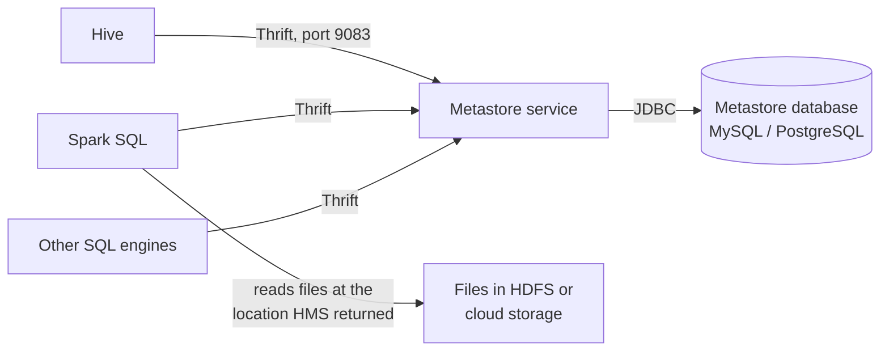

# Hive Metastore

Mastery: `INPUT[inlineSelect(option(new), option(learning), option(solid)):mastery]`

> [!story] Context
> [[Apache Hive]] presents directories of files in HDFS as SQL tables. To do so, it records which directory belongs to which table, the column definitions, and the file format. That record, the Hive Metastore (HMS), became the shared table catalog of the Hadoop ecosystem and of early Databricks.

> [!eli5] Summary
> The Hive Metastore is a directory of tables. Data files have no labels of their own, so the metastore records which folder holds which table, what columns it has, and how its files are formatted. Any tool that reads a table looks it up there first.

> [!analogy]- Analogy: a library card catalog
> | Library | Hive Metastore |
> |---|---|
> | Books on shelves | Data files in HDFS or cloud storage |
> | Catalog cards: title, shelf location, chapters, edition | Table name, location, columns and types, file format |
> | A new branch reusing the same catalog | A new engine, such as Spark, reading the same metastore |
> | No check of the borrower's card | Classic HMS has limited access control |

## Background

Files in [[HDFS]] have paths but no description of their contents. To run `SELECT country, SUM(amount) FROM orders`, an engine needs:

- the storage location of `orders`,
- column names and [[Data Type|types]],
- the file format and the [[SerDe]] that parses it,
- the list of partitions and their locations,
- optional statistics, such as row counts, for the optimizer.

Hive stores this information in a **metastore** backed by a relational database. The 2009 Hive paper describes the metastore as the system catalog holding schemas and statistics. Because the metastore runs as a separate service with a network API, other engines, including [[Spark SQL]], adopted it as their catalog.

## Overview

A Hive Metastore deployment has two parts:

| Part | Description | Typical configuration |
|---|---|---|
| **Metastore database** | A relational database containing the catalog | Embedded Apache Derby for testing; a standalone RDBMS such as MySQL for real use, as the Hive documentation recommends |
| **Metastore service** | A server that clients call over Apache Thrift, which reads and writes the database | Started with `hive --service metastore`; default port 9083 |

What the metastore stores, and what it does not:

| Stores | Does not store |
|---|---|
| Database and table names | Table data |
| Columns, types, comments | Row-level or column-level access policies |
| Table storage location | Data lineage |
| File format and SerDe | Audit records of data access |
| Partitions and their locations | Governance for files, functions, or models |
| Table and column statistics | |

The Hive Metastore uses a **two-level namespace**: `database.table`. Unity Catalog adds a top level: `catalog.schema.table`. See [[Three-Level Namespace]].

## How it works



An engine resolves a table in two steps: it requests the table's location, format, and partitions from the metastore, then reads the files directly from storage. The metastore does not handle table data.

Core configuration in `hive-site.xml`:

```xml
<!-- Metastore service: JDBC connection to its backing database -->
<property>
  <name>javax.jdo.option.ConnectionURL</name>
  <value>jdbc:mysql://metastore-db:3306/hive_meta</value>
</property>
<property>
  <name>javax.jdo.option.ConnectionDriverName</name>
  <value>com.mysql.cj.jdbc.Driver</value>
</property>

<!-- Clients: one or more metastore service endpoints -->
<property>
  <name>hive.metastore.uris</name>
  <value>thrift://metastore-1:9083,thrift://metastore-2:9083</value>
</property>
```

The metastore service is stateless, so multiple instances can share one database for high availability. Clients connect to one URI and reconnect to another on failure.

**On Databricks**, each workspace historically included a built-in Hive Metastore. It appears as a catalog named `hive_metastore` alongside Unity Catalog catalogs:

```sql
-- Table in the workspace's legacy Hive metastore
SELECT * FROM hive_metastore.default.orders LIMIT 10;

-- The same data after upgrade to Unity Catalog
SELECT * FROM main.sales.orders LIMIT 10;

-- List tables remaining in the legacy metastore
SHOW TABLES IN hive_metastore.default;
```

## Small-business considerations

> [!smallbiz] Small-business considerations
> New Databricks workspaces use Unity Catalog, and new tables belong there. The Hive Metastore matters in two cases:
> 1. **An older workspace** has tables under `hive_metastore`. Plan an upgrade to Unity Catalog. See [[Hive Metastore Migration to Unity Catalog]].
> 2. **A Hadoop migration** has tables registered in an on-premises Hive Metastore. Federate it so Unity Catalog can read those tables during the migration, or recreate the table definitions in Unity Catalog.

> [!bridge]- In Databricks today
> The catalog role belongs to [[Unity Catalog]], which adds account-wide scope, fine-grained permissions, lineage, auditing, and governance for files, functions, and models.
>
> The Hive Metastore remains present in three forms:
> - **The legacy `hive_metastore` catalog:** Databricks documents it as a legacy feature and recommends upgrading its tables to Unity Catalog. Joins with data in the legacy metastore work only in the workspace where that data resides.
> - **Hive metastore federation:** Unity Catalog creates a foreign catalog that mirrors a Hive metastore. For a workspace's internal legacy metastore, the foreign catalog supports reads and writes, and writes flow back to the Hive metastore. For external Hive metastores and AWS Glue, access is read-only.
> - **External Hive metastores (legacy):** Older configurations connected clusters directly to an organization's own metastore database. Databricks lists this configuration in its archived legacy documentation.

## Cloud differences

> [!azure]- Azure Databricks
> The `hive_metastore` catalog and Hive metastore federation work as described above; the Azure Databricks documentation covers both. Federation supports external metastores backed by MySQL, SQL Server, or PostgreSQL.

> [!aws]- Databricks on AWS
> In addition to Hive metastores, Unity Catalog can federate an **AWS Glue** catalog as a read-only foreign catalog. See [[Hive Metastore Federation for AWS Glue]].

> [!gcp]- Databricks on Google Cloud
> The `hive_metastore` catalog works the same way, and legacy external-metastore documentation exists for Google Cloud. Federation feature availability varies by cloud; check the Google Cloud edition of the Databricks documentation before planning a federated migration.

## Advanced topics

> [!deepdive]- Advanced topics (301–401)
> - **Partition metadata limits scale:** Each partition is a row in the metastore database. Tables with very large partition counts make partition operations and query planning slow and load the backing database. [[Delta Lake]] and [[Apache Iceberg]] track files in table-level metadata, so the catalog only records the table's location.
> - **Client-side security:** Classic HMS relied on engines and file permissions for authorization. Hive documentation notes that authorization performed on the client side cannot guarantee security on the metastore side, which is why metastore-side authorization was added. The Thrift interface can be secured with SASL and Kerberos. Unity Catalog enforces permissions centrally and issues short-lived storage credentials to compute.
> - **Version pinning:** Engines communicate with HMS through a client library for a specific metastore version. Databricks' legacy external-metastore documentation requires configuring the metastore version and client JARs per cluster.
> - **Federation requirements:** Hive metastore federation requires a connection, plus storage credentials and external locations covering every table path (authorized paths). Supported external HMS versions are 0.13, 2.3, and 3.1. Some Unity Catalog features, including OpenSharing, data quality monitoring, and online tables, are unavailable on federated tables. Tables in DBFS root or mount locations cannot be reached from other workspaces.
> - **After migration:** Clusters continue to connect to the Hive metastore after tables are upgraded unless that access is explicitly disabled. See [[Hive Metastore Migration to Unity Catalog]].

## Common misconceptions

> [!confusion] The Hive Metastore is not Hive
> The metastore can be used without running Hive queries. Spark and other engines use HMS as a catalog while executing queries with their own engines.

> [!confusion] A Unity Catalog metastore is not a Hive Metastore
> A Unity Catalog [[Metastore]] is the top-level account object for one region, with governance built in. The Hive Metastore is a workspace- or cluster-level catalog service with a two-level namespace and limited access control.

> [!confusion] Dropping a table does not always delete its data
> For external tables, dropping the table removes only the catalog entry. For managed tables, the data files are also deleted. See [[Managed vs External Tables]].

## Recall

What does the Hive Metastore store?::Database and table names, columns and types, storage locations and formats, partitions, and statistics; not table data.
What are the two parts of a Hive Metastore deployment?::A relational database holding the catalog, and a metastore service that clients call over Thrift.
What is the default Hive Metastore Thrift port?::9083.
Which namespace does the Hive Metastore use?::Two levels: database.table.
What is the hive_metastore catalog on Databricks?::The workspace's legacy built-in Hive metastore, exposed as a catalog alongside Unity Catalog catalogs.
What replaced the Hive Metastore on Databricks?::Unity Catalog.
Is a federated external Hive metastore writable through Unity Catalog?::No. External Hive metastores and AWS Glue are read-only; a workspace's internal legacy metastore supports reads and writes.
Which external Hive metastore versions does federation support?::0.13, 2.3, and 3.1.

## Next steps

> [!path] Learning path
> **Needs first:** [[Apache Hive]], [[Metadata]]
> **Unlocks next:** [[Unity Catalog]], [[Metastore]], [[Hive Metastore Migration to Unity Catalog]]

> [!nextup] Next
> [[Apache HBase]] covers Hadoop's low-latency key-value store, built for single-row lookups rather than analytical scans.

> [!sources]- Sources (last verified: 2026-10-25)
> - [Apache Hive: Metastore administration](https://hive.apache.org/docs/latest/admin/adminmanual-metastore-administration/)
> - [Apache Hive: Configuration properties](https://hive.apache.org/docs/latest/user/configuration-properties/)
> - [Storage based authorization in the metastore server (Apache Hive wiki)](https://cwiki.apache.org/confluence/display/hive/storage+based+authorization+in+the+metastore+server)
> - [Hive: A Warehousing Solution Over a Map-Reduce Framework (VLDB 2009)](https://www.vldb.org/pvldb/vol2/vldb09-938.pdf)
> - [Database objects in the legacy Hive metastore (AWS)](https://docs.databricks.com/aws/en/database-objects/hive-metastore)
> - [Database objects in the legacy Hive metastore (Azure Databricks)](https://learn.microsoft.com/en-us/azure/databricks/database-objects/hive-metastore)
> - [Work with the legacy Hive metastore alongside Unity Catalog (AWS)](https://docs.databricks.com/aws/en/data-governance/unity-catalog/hive-metastore)
> - [Work with the legacy Hive metastore alongside Unity Catalog (Azure Databricks)](https://learn.microsoft.com/en-us/azure/databricks/data-governance/unity-catalog/hive-metastore)
> - [Hive metastore federation concepts (AWS)](https://docs.databricks.com/aws/en/query-federation/hms-federation-concepts)
> - [Hive metastore federation concepts (Azure Databricks)](https://learn.microsoft.com/en-us/azure/databricks/query-federation/hms-federation-concepts)
> - [Enable Hive metastore federation for a legacy workspace Hive metastore (AWS)](https://docs.databricks.com/aws/en/query-federation/hms-federation-internal)
> - [Enable Hive metastore federation for an external Hive metastore (AWS)](https://docs.databricks.com/aws/en/query-federation/hms-federation-external)
> - [External Apache Hive metastore (legacy) (AWS)](https://docs.databricks.com/aws/en/archive/external-metastores/external-hive-metastore)
> - [External Apache Hive metastore (legacy) (GCP)](https://docs.databricks.com/gcp/en/archive/external-metastores/external-hive-metastore)
