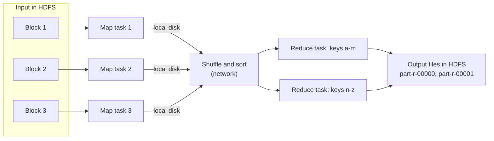

# MapReduce

Mastery: `INPUT[inlineSelect(option(new), option(learning), option(solid)):mastery]`

> [!story] Context
> [[HDFS]] distributes data across many machines in replicated blocks. MapReduce is Hadoop's original engine for processing that data, the open-source implementation of the model Google described in 2004. Its performance and programming costs are the main reasons [[Apache Spark]] replaced it.

> [!eli5] Summary
> MapReduce processes a large job in two rounds. In the first round, every computer examines its own share of the data and writes short notes. The notes are then sorted so that all notes about the same thing are together, and in the second round they are combined into final answers.

> [!analogy]- Analogy: counting election ballots
> | Election count | MapReduce |
> |---|---|
> | Each polling station counts its own ballots | Map tasks process their local data |
> | Tally sheets sorted into one pile per candidate | Shuffle and sort |
> | One clerk totals each candidate's pile | Reduce tasks |
> | A station that loses power recounts its own ballots | A failed task reruns on another node |

## Background

Every distributed job needs the same infrastructure: splitting input, sending code to the machines that hold the data, collecting and grouping partial results over the network, handling machine failures, and writing output. Implementing this for each job is slow and error-prone.

MapReduce reduces a job to **two user-defined functions**. The framework provides everything else. The 2004 paper states that this allows programmers without parallel or distributed systems experience to use large clusters. Hadoop MapReduce implements the model in Java on top of HDFS.

## Overview

A MapReduce job has three phases. The programmer writes the first and the third.

| Phase | Written by | Function | Word-count example |
|---|---|---|---|
| **Map** | Programmer | Reads input records and emits zero or more intermediate `(key, value)` pairs | For `"to be or not to be"`, emit `(to,1) (be,1) (or,1) (not,1) (to,1) (be,1)` |
| **Shuffle and sort** | Framework | Routes all pairs with the same key to the same reduce task, sorted by key | The reducer for `be` receives `be → [1, 1]` |
| **Reduce** | Programmer | Merges all values for one key into a result | Emit `(be, 2)` |

An optional **combiner** applies reduce logic to each map task's output before the shuffle, so `(be,1) (be,1)` leaves the machine as `(be,2)`. This reduces network transfer.

## How it works



The word-count program from the Apache Hadoop MapReduce tutorial, using the `org.apache.hadoop.mapreduce` API (imports omitted):

```java
public class WordCount {

  // Map: emit (word, 1) for every word in a line
  public static class TokenizerMapper
       extends Mapper<Object, Text, Text, IntWritable> {
    private final static IntWritable one = new IntWritable(1);
    private Text word = new Text();

    public void map(Object key, Text value, Context context)
        throws IOException, InterruptedException {
      StringTokenizer itr = new StringTokenizer(value.toString());
      while (itr.hasMoreTokens()) {
        word.set(itr.nextToken());
        context.write(word, one);
      }
    }
  }

  // Reduce: sum the counts for each word
  public static class IntSumReducer
       extends Reducer<Text, IntWritable, Text, IntWritable> {
    private IntWritable result = new IntWritable();

    public void reduce(Text key, Iterable<IntWritable> values, Context context)
        throws IOException, InterruptedException {
      int sum = 0;
      for (IntWritable val : values) {
        sum += val.get();
      }
      result.set(sum);
      context.write(key, result);
    }
  }

  // Driver: configure and submit the job
  public static void main(String[] args) throws Exception {
    Configuration conf = new Configuration();
    Job job = Job.getInstance(conf, "word count");
    job.setJarByClass(WordCount.class);
    job.setMapperClass(TokenizerMapper.class);
    job.setCombinerClass(IntSumReducer.class);   // local pre-aggregation
    job.setReducerClass(IntSumReducer.class);
    job.setOutputKeyClass(Text.class);
    job.setOutputValueClass(IntWritable.class);
    FileInputFormat.addInputPath(job, new Path(args[0]));
    FileOutputFormat.setOutputPath(job, new Path(args[1]));
    System.exit(job.waitForCompletion(true) ? 0 : 1);
  }
}
```

Run it as a jar against HDFS paths:

```bash
hadoop jar wc.jar WordCount /user/joe/wordcount/input /user/joe/wordcount/output
hdfs dfs -cat /user/joe/wordcount/output/part-r-00000
# Bye 1
# Goodbye 1
# Hadoop 2
# Hello 2
# World 2
```

The same computation in [[PySpark]] on Databricks:

```python
from pyspark.sql.functions import explode, split, col

(spark.read.text("/Volumes/main/raw/docs/")
      .select(explode(split(col("value"), r"\s+")).alias("word"))
      .groupBy("word").count()
      .orderBy(col("count").desc())
      .show())
```

And in SQL, using the `read_files` table-valued function:

```sql
SELECT word, COUNT(*) AS n
FROM (
  SELECT explode(split(value, '\\s+')) AS word
  FROM read_files('/Volumes/main/raw/docs/', format => 'text')
)
GROUP BY word
ORDER BY n DESC;
```

## Small-business considerations

> [!smallbiz] Small-business considerations
> Small teams do not write MapReduce. The map, shuffle, and reduce pattern remains relevant because every distributed engine, including Databricks, executes `GROUP BY` and joins this way. When a query plan shows a large shuffle, it refers to the same middle phase. See [[Shuffles]].

> [!bridge]- In Databricks today
> The role of MapReduce is filled by [[Apache Spark]] and the [[Photon]] engine. Spark keeps the partition, shuffle, and combine structure, with three main differences:
> - Intermediate data stays in memory between steps where possible, instead of being written to disk after every job.
> - One Spark job is a multi-step DAG, not a fixed map-then-reduce pair.
> - Users write SQL, Python, or DataFrame code, and the [[Catalyst Optimizer]] plans execution.
>
> Databricks does not run Hadoop MapReduce jobs. MapReduce Java code must be rewritten, typically as Spark SQL or PySpark. The Databricks migration documentation states that most Hive workloads run with minimal refactoring and that ETL written in other languages may require substantial refactoring. See [[Migrating from Hadoop]].

## Cloud differences

> [!azure]- Azure Databricks
> Nothing differs by cloud, because Databricks does not run MapReduce. The rewrite to Spark is identical on every cloud; only storage paths change (`abfss://` on Azure).

> [!aws]- Databricks on AWS
> Nothing differs by cloud. Storage paths use `s3://`.

> [!gcp]- Databricks on Google Cloud
> Nothing differs by cloud. Storage paths use `gs://`.

## Advanced topics

> [!deepdive]- Advanced topics (301–401)
> - **Disk between steps.** Map output is written to local disk and fetched by reducers over the network. Reduce output is written to HDFS with replication. A ten-job pipeline writes and rereads its data ten times, which makes multi-step and iterative workloads, such as machine learning, slow.
> - **Partitioner.** A partitioner assigns each key to a reduce task, by default with a hash of the key. A key with far more values than others produces one oversized reduce task, the original form of [[Data Skew]].
> - **Joins.** A reduce-side join tags records from both inputs in the map phase and matches them in the reduce phase. A map-side join loads the smaller input into each mapper's memory, the precursor of the [[Broadcast Join]].
> - **Task startup cost.** Each task ran in its own [[JVM]] process, and JVM startup added seconds per task. Spark's long-running executors remove this overhead.
> - **Successors.** DAG engines, and then Spark's in-memory [[RDDs]], generalized MapReduce while keeping the map, shuffle, and reduce structure underneath.

## Common misconceptions

> [!confusion] MapReduce is not the same as Hadoop
> MapReduce is one processing engine in Hadoop. Clusters could run other engines on YARN, such as Spark, while still using HDFS.

> [!confusion] Spark did not remove map and reduce
> Spark provides `map` and `reduceByKey` operations, and a `GROUP BY` still shuffles data between stages. Spark removed the mandatory disk write between steps and the fixed two-phase structure.

## Recall

What are the three phases of a MapReduce job?::Map, shuffle and sort, and reduce.
Which phases does the programmer write?::Map and reduce; the framework performs shuffle and sort.
What does a combiner do?::Applies reduce logic to each map task's output locally to reduce data before the shuffle.
In word count, what does the mapper emit for each word?::The pair (word, 1).
Why is MapReduce slow for multi-step pipelines?::Each job writes its output to disk and HDFS, and the next job reads it back.
Which component assigns keys to reduce tasks?::The partitioner, by default a hash of the key.
What fills the role of MapReduce on Databricks?::Apache Spark and the Photon engine, typically programmed with SQL or PySpark.
Can Databricks run Hadoop MapReduce Java jobs unchanged?::No. They must be rewritten, typically as Spark SQL or PySpark.

## Next steps

> [!path] Learning path
> **Needs first:** [[HDFS]], [[Google File System and MapReduce Papers]]
> **Unlocks next:** [[YARN]], [[Apache Hive]], [[Apache Spark]], [[Shuffles]]

> [!nextup] Next
> [[YARN]] covers the resource manager that Hadoop 2 separated from MapReduce so that other engines could share the cluster.

> [!sources]- Sources (last verified: 2026-10-25)
> - [MapReduce Tutorial (Apache Hadoop 3.5.0)](https://hadoop.apache.org/docs/current/hadoop-mapreduce-client/hadoop-mapreduce-client-core/MapReduceTutorial.html)
> - [MapReduce Tutorial (Apache Hadoop 1.2.1, legacy mapred API)](https://hadoop.apache.org/docs/r1.2.1/mapred_tutorial.html)
> - [MapReduce: Simplified Data Processing on Large Clusters (OSDI 2004), Google Research](https://research.google/pubs/pub62/?hl=es)
> - [read_files table-valued function (AWS)](https://docs.databricks.com/aws/en/sql/language-manual/functions/read_files)
> - [Migrate data applications to Databricks (AWS)](https://docs.databricks.com/aws/en/migration/)
> - [Migrate ETL pipelines to Databricks (GCP)](https://docs.databricks.com/gcp/en/migration/etl)
> - [Migrate ETL pipelines to Azure Databricks](https://learn.microsoft.com/en-us/azure/databricks/migration/etl)
