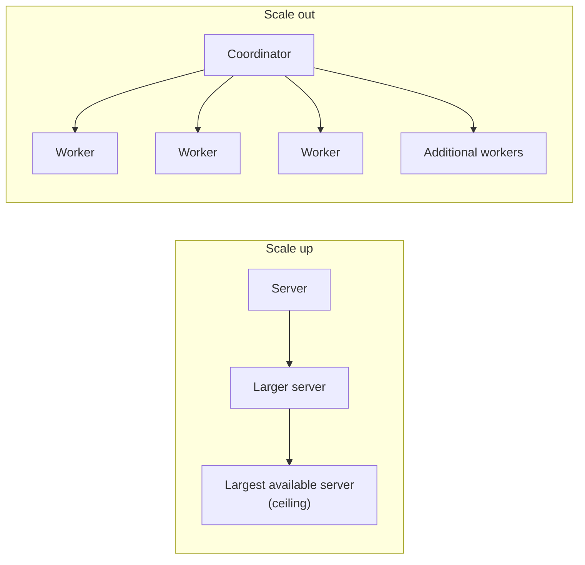

# Scaling Up vs Scaling Out

Mastery: `INPUT[inlineSelect(option(new), option(learning), option(solid)):mastery]`

> [!story] Context
> [[The Three Vs of Big Data]] defines the problem: data volume, velocity, and variety that exceed one machine's capacity. There are two ways to add capacity. This note compares them and explains why the big data era standardized on the second.

> [!eli5] Summary
> When one computer is too slow, you can replace it with a more powerful one or add more computers and divide the work. A bigger computer is simpler but has a maximum size. Many computers have almost no maximum, but they need software that coordinates them.

> [!analogy]- Analogy: moving house
> | Moving house | Scaling |
> |---|---|
> | Renting a larger truck | Scaling up: one larger machine |
> | Recruiting more cars and drivers | Scaling out: more machines |
> | The person assigning boxes to cars | The coordinator, such as the HDFS NameNode or the Spark [[Driver and Executors\|driver]] |
> | A car breaking down mid-move | A node failure that the system must work around |

## Background

When a workload outgrows its server, capacity can be added in two directions.

For decades the default was **scaling up**: replacing a database server with one that has more CPUs, memory, and faster disks. It requires no application changes. It has three structural limits:

1. **A hardware ceiling:** The largest available machine sets a hard limit. By the early 2000s, web-scale indexing exceeded what any single machine could store.
2. **Non-linear cost:** High-end servers cost substantially more per unit of capacity than mass-produced ones.
3. **A single point of failure:** One machine failing stops the workload.

The [[Google File System and MapReduce Papers]] described the alternative: **scale out** on large numbers of inexpensive commodity (standard, mass-produced) machines, with software that treats machine failure as routine. [[Apache Hadoop]] made this approach available outside Google.

## Overview

Scaling up adds capacity by moving a workload to a larger machine, and scaling out adds capacity by spreading the workload across more machines.

| | Scaling up (vertical) | Scaling out (horizontal) |
|---|---|---|
| **Method** | Replace the machine with a larger one | Add machines of similar size |
| **Application changes** | Usually none | Software must partition work across machines |
| **Upper limit** | Largest machine available | Thousands of machines |
| **Cost curve** | Steep at the high end | Approximately linear |
| **Failure impact** | Total outage | Partial; work is rerouted |
| **Main difficulty** | Cost | Coordination (see [[Distributed Systems]]) |
| **Example** | A larger SQL Server instance | A [[Apache Hadoop\|Hadoop]] [[Cluster\|cluster]] of 100 [[Node\|nodes]] |

A system that maintains performance as machines are added has good [[Scalability|scalability]].

Scaling out helps only when the workload can be **partitioned into independent units**. Counting words across a billion documents partitions well: each machine counts a subset, and the partial counts are summed. A computation in which each step depends on the previous step does not benefit from additional machines.

## How it works

Scale-out data systems follow the same four steps. Each tool in this chapter implements them:

1. **Partition the data** across machines. [[HDFS]] splits files into blocks.
2. **Run computation where the data is stored**, so little data crosses the network.
3. **Combine partial results** into a final result. This is the reduce step in [[MapReduce]].
4. **Tolerate failures** by keeping copies of data and rerunning failed work. See [[Fault Tolerance]] and [[Replication]].

Example calculation: scanning 10 TB from one disk at 150 MB/s takes about 18.5 hours. Spread evenly across 100 machines with one disk each, the scan takes about 11 minutes.

In the cloud, both directions are configuration settings. On Databricks classic compute, you select a larger [[Virtual Machine|VM]] type per worker (scale up) or more workers (scale out). [[Autoscaling]] adjusts the worker count to load, and [[Serverless Compute]] sizes compute without user configuration.

## Small-business considerations

> [!smallbiz] Small-business considerations
> Scale up first. A single moderately sized cloud database or a single-node Databricks cluster handles tens of gigabytes without distributed overhead.
>
> Scale out when a job is slow because it reads large amounts of data (large scans and joins), not because the logic is complex. In the cloud, additional machines are rented for the duration of a job and released afterward with [[Auto Termination|auto termination]]. See [[How Databricks Pricing Works]] for how compute usage is metered.

> [!bridge]- In Databricks today
> Scaling is a configuration choice. Classic compute exposes the worker VM type (up) and a fixed worker count or an autoscaling range (out). [[Serverless Compute]] makes the sizing decision automatically. The work-partitioning logic is built into [[Apache Spark]], which was designed for scale-out execution.

## Cloud differences

> [!azure]- Azure Databricks
> The concept is identical on all clouds. Only the list of machine types differs: on Azure, you choose Azure VM sizes for the driver and workers.

> [!aws]- Databricks on AWS
> You choose EC2 instance types, including Graviton (Arm-based) options. See [[EC2 Instance Types and Graviton]].

> [!gcp]- Databricks on Google Cloud
> You choose Compute Engine machine types. See [[Compute on Google Cloud]].

## Advanced topics

> [!deepdive]- Advanced topics (301–401)
> - **Amdahl's law:** If 10% of a job cannot be parallelized, the maximum speedup is 10x regardless of machine count. The serial portion, often a final combine step or a single [[Data Skew|skewed]] key, sets the limit.
> - **Coordination overhead:** Each additional machine adds network and scheduling cost. Jobs dominated by data exchange between machines ([[Shuffles]]) can slow down past a certain cluster size.
> - **Single-node engines:** Many workloads labeled "big data" fit in the memory of one large modern VM. A single-node cluster avoids distributed overhead entirely and is often the correct first choice.
> - **Independent scaling of storage and compute:** Hadoop scaled storage and compute together because each node held both disks and CPUs. Cloud architectures separate them: [[Object Storage]] scales storage, and clusters scale compute independently. See [[Storage vs Compute]] and [[The Pain of Hadoop]].

## Common misconceptions

> [!confusion] Scaling out is not always faster
> Additional machines help only when work divides into independent units. A job limited by one large key or by sequential steps does not speed up.

> [!confusion] "[[Commodity Hardware|Commodity hardware]]" does not mean unreliable hardware
> It means standard, mass-produced servers rather than specialized high-end systems. At large machine counts, failures become routine, so the software is designed to tolerate them.

## Recall

What is scaling up?::Replacing a machine with a more powerful one (vertical scaling).
What is scaling out?::Adding machines and dividing the work among them (horizontal scaling).
Name two structural limits of scaling up.::A maximum available machine size, and steeply rising cost at the high end; also a single point of failure.
What property must a workload have for scaling out to help?::It must partition into independent units that can run in parallel.
Why do scale-out systems replicate data?::Failures are routine across many machines, and copies allow work to continue when a machine fails.
What does Amdahl's law state about parallel speedup?::The non-parallelizable fraction of a job limits total speedup regardless of machine count.
How do you scale up and scale out on Databricks classic compute?::Select a larger worker VM type (up) or more workers or an autoscaling range (out).

## Next steps

> [!path] Learning path
> **Needs first:** [[The Three Vs of Big Data]], [[Servers and the Cloud]]
> **Unlocks next:** [[Distributed Systems]], [[Cluster]], [[Autoscaling]]

> [!nextup] Next
> [[Distributed Systems]] covers the coordination and failure-handling problems that scale-out architectures introduce.

> [!sources]- Sources (last verified: 2026-10-25)
> - [The Google File System (SOSP 2003, peer-reviewed paper)](https://www.cs.rochester.edu/meetings/sosp2003/papers/p125-ghemawat.pdf)
> - [MapReduce: Simplified Data Processing on Large Clusters (OSDI 2004), Google Research](https://research.google/pubs/pub62/?hl=es)
> - [HDFS Architecture (Apache Hadoop 3.3.2)](https://hadoop.apache.org/docs/r3.3.2/hadoop-project-dist/hadoop-hdfs/HdfsDesign.html)
