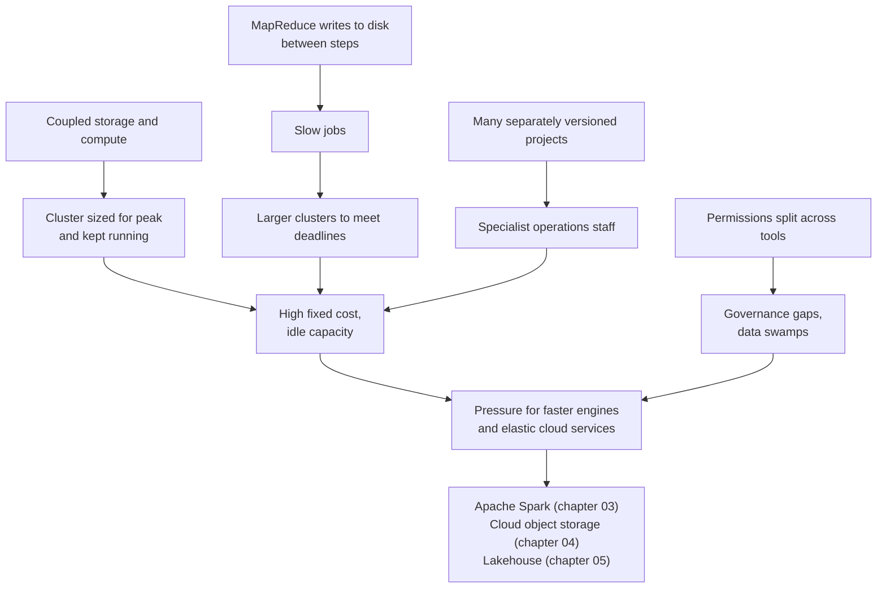

# The Pain of Hadoop

Mastery: `INPUT[inlineSelect(option(new), option(learning), option(solid)):mastery]`

> [!story] Context
> Chapter 02 has covered the Hadoop stack: [[HDFS]] for storage, [[MapReduce]] for processing, [[YARN]] for scheduling, [[Apache Hive]] for SQL, and columnar formats such as [[Apache ORC]] and [[Apache Parquet]]. The stack made web-scale data processing broadly available. It also had performance, cost, and operational limitations, summarized here, that led to [[Apache Spark]] and cloud data platforms.

> [!eli5] Summary
> Hadoop worked, but it was slow, expensive to keep running, and hard to staff. Each question took minutes or hours, companies paid for machines that were idle much of the time, and running the system required specialists. These problems led to faster tools and to renting computers in the cloud only when needed.

> [!analogy]- Analogy: owning a fleet of delivery trucks
> | Truck fleet | Hadoop cluster |
> |---|---|
> | Buying enough trucks for the busiest week of the year | Sizing a cluster for peak load |
> | Trucks parked most nights | Idle capacity |
> | Every package unloaded at the depot between each leg | MapReduce writing to disk between steps |
> | Full-time mechanics for a mixed fleet | Specialists for many separately versioned components |
> | Renting vans only for busy days | Elastic cloud compute |

## Background

By the mid-2010s, many large organizations operated Hadoop clusters. The limitations that accumulated in production fall into four groups: performance, programming effort, operations, and cost. Each one maps to a design decision described in earlier notes.

## Overview

The pain of Hadoop refers to the performance, programming, operational, and cost limitations that organizations hit when running Hadoop clusters in production.

| Problem | Cause | Effect | What replaced it |
|---|---|---|---|
| **Slow multi-step jobs** | MapReduce writes intermediate results to disk and HDFS between every job | Pipelines and iterative algorithms take hours | [[Apache Spark]] in-memory execution ([[Chapter 03 - Apache Spark\|chapter 03]]) |
| **Slow interactive SQL** | Hive queries compile to batch jobs with startup overhead | Minutes per query; poor fit for [[BI Tools\|BI tools]] | [[Spark SQL]], [[Databricks SQL]], [[Photon]] |
| **Verbose programming model** | Java classes for map, reduce, and driver | Small changes require engineering work | SQL, Python, and DataFrames |
| **Coupled storage and compute** | Each node holds both disks and CPUs | Adding storage means adding servers; stopping compute makes data unavailable | Cloud [[Object Storage]] plus elastic compute ([[Storage vs Compute]]) |
| **Peak-sized fixed capacity** | Owned hardware sized for the busiest workload | Idle capacity most of the time | Pay-per-use cloud compute, [[Autoscaling]], [[Serverless Compute]] |
| **Operational complexity** | Many ecosystem projects with separate versions, configuration, and security | Specialist teams; difficult upgrades | Managed platforms |
| **Small files and NameNode limits** | The NameNode (the HDFS server that tracks every file) holds all [[Metadata\|metadata]] in memory | File-count ceilings; compaction work | Object storage and table formats such as [[Delta Lake]] |
| **Weak governance** | Permissions split across HDFS, Hive, and vendor tools; no built-in [[Data Lineage\|lineage]] | Inconsistent access control; [[Data Swamps]] | [[Unity Catalog]] |
| **No reliable table updates** | Files are write-once; Hive transactions arrived late and were Hive-specific | Rewrite-whole-partition patterns; inconsistent reads during writes | [[ACID Transactions]] in Delta Lake |

## How it works

The problems reinforced one another:



A representative multi-step pipeline shows the performance problem. A daily job that cleans logs, joins them to customers, aggregates by region, and ranks results runs as four chained MapReduce jobs. Each job reads its input from HDFS, writes intermediate data to local disk during the [[Shuffles|shuffle]] (the step that moves data between machines), and writes its output back to HDFS with replication. The same pipeline in Spark is one application whose intermediate data stays in memory where possible:

```python
from pyspark.sql import functions as F

logs = spark.read.table("main.raw.web_logs").filter("status = 200")
customers = spark.read.table("main.crm.customers")

(logs.join(customers, "customer_id")
     .groupBy("region")
     .agg(F.countDistinct("customer_id").alias("active_customers"))
     .orderBy(F.desc("active_customers"))
     .write.mode("overwrite").saveAsTable("main.analytics.active_by_region"))
```

## Small-business considerations

> [!smallbiz] Small-business considerations
> These problems explain why a small company should not adopt an on-premises (company-owned hardware) [[The Three Vs of Big Data|big data]] stack. The current alternative removes the main cost drivers:
> - **No idle hardware.** Compute starts for a job and stops afterward.
> - **No component integration.** The platform provider maintains compatible runtime versions.
> - **No separate SQL, storage, and governance products.** One platform covers them.
>
> Evaluate cost by usage, not by hardware purchase. See [[How Databricks Pricing Works]] and [[Total Cost of Ownership]].

> [!bridge]- In Databricks today
> Each limitation has a corresponding Databricks capability:
>
> | Hadoop limitation | Databricks capability |
> |---|---|
> | Disk-bound MapReduce | [[Apache Spark]] and [[Photon]] |
> | Slow SQL | [[Databricks SQL]] on [[SQL Warehouses]] |
> | Coupled storage and compute | Cloud object storage with separate, elastic compute |
> | Fixed capacity | [[Autoscaling]], [[Serverless Compute]], [[Auto Termination]] |
> | Many components to operate | A managed platform and [[Databricks Runtime]] versions |
> | Fragmented permissions | [[Unity Catalog]] |
> | No reliable updates | [[Delta Lake]] ACID transactions |
>
> The Databricks migration documentation states that most Hive workloads run with minimal refactoring. See [[Migrating from Hadoop]].

## Cloud differences

> [!azure]- Azure Databricks
> The limitations are inherent to Hadoop's design and do not differ by cloud. On Azure, Microsoft retired HDInsight on AKS on January 31, 2025, and HDInsight 4.0 and 5.0 in March 2025, which has prompted migrations of managed Hadoop workloads.

> [!aws]- Databricks on AWS
> The limitations do not differ by cloud. Amazon EMR addresses some of them by supporting Amazon S3 as persistent storage instead of HDFS, which decouples storage from cluster lifetime.

> [!gcp]- Databricks on Google Cloud
> The limitations do not differ by cloud. Google's managed service for Hadoop and Spark is now named Managed Service for Apache Spark (formerly Dataproc).

## Advanced topics

> [!deepdive]- Advanced topics (301–401)
> - **Data locality stopped paying off.** Hadoop co-located data and computation because network bandwidth was scarce. Faster networks and object storage made remote reads acceptable, which removed the main reason to couple storage and compute.
> - **Cost of replication.** Triple replication on HDFS means storing three copies of every byte on purchased disks. Cloud object storage provides durability as a service billed by capacity used.
> - **Upgrade risk.** Upgrading a distribution changed many component versions at once, so organizations delayed upgrades and ran outdated software. Managed runtimes with long-term-support versions reduce this risk.
> - **Spark inherited part of the stack.** Early Spark ran on YARN and read HDFS, so Spark first replaced only the processing layer. Cloud object storage replaced HDFS later, and Delta Lake and Unity Catalog replaced the remaining table and catalog functions.
> - **Market signal.** Cloudera and Hortonworks announced an all-stock merger in October 2018 and completed it in January 2019. See [[Cloudera and Hortonworks]].

## Common misconceptions

> [!confusion] Hadoop did not fail
> Hadoop succeeded at making large-scale storage and processing broadly available, and its designs remain inside current systems. Its limitations led to replacement of specific components, not abandonment of its ideas.

> [!confusion] Spark did not replace all of Hadoop at once
> Spark replaced MapReduce first, often running on YARN with HDFS storage. Cloud storage, Delta Lake, and Unity Catalog replaced the other layers later.

## Recall

Why were multi-step MapReduce pipelines slow?::Each job wrote intermediate results to disk and HDFS, and the next job read them back.
What problem does coupling storage and compute cause?::Adding storage requires adding servers, and stopping compute makes the data unavailable.
Why did Hadoop clusters have idle capacity?::They were owned hardware sized for peak load and kept running continuously.
Which Databricks component addresses fragmented Hadoop permissions?::Unity Catalog.
Which Databricks component addresses the lack of reliable table updates?::Delta Lake, with ACID transactions.
Which Hadoop layer did Spark replace first?::The processing layer (MapReduce).
When did HDInsight on AKS retire?::January 31, 2025.

## Next steps

> [!path] Learning path
> **Needs first:** [[Apache Hadoop]], [[MapReduce]], [[HDFS]]
> **Unlocks next:** [[Apache Spark]], [[Storage vs Compute]], [[Migrating from Hadoop]]

> [!nextup] Next
> [[Chapter 03 - Apache Spark]] covers the in-memory engine from UC Berkeley that replaced MapReduce and became the foundation of Databricks.

> [!sources]- Sources (last verified: 2026-10-25)
> - [HDFS Architecture (Apache Hadoop 3.3.2)](https://hadoop.apache.org/docs/r3.3.2/hadoop-project-dist/hadoop-hdfs/HdfsDesign.html)
> - [MapReduce Tutorial (Apache Hadoop 3.5.0)](https://hadoop.apache.org/docs/current/hadoop-mapreduce-client/hadoop-mapreduce-client-core/MapReduceTutorial.html)
> - [MapReduce: Simplified Data Processing on Large Clusters (OSDI 2004), Google Research](https://research.google/pubs/pub62/?hl=es)
> - [Hive: A Warehousing Solution Over a Map-Reduce Framework (VLDB 2009)](https://www.vldb.org/pvldb/vol2/vldb09-938.pdf)
> - [Cloudera and Hortonworks merger announcement (SEC Form 425, Exhibit 99.1)](https://www.sec.gov/Archives/edgar/data/0001610532/000162828018012255/cldr8-k10318ex991.htm)
> - [Cloudera Q4 FY2019 results, Form 8-K exhibit (SEC)](https://www.sec.gov/Archives/edgar/data/1535379/000162828019002873/q4-19cldrexhibit991.htm)
> - [Release notes for Azure HDInsight on AKS](https://learn.microsoft.com/en-us/azure/hdinsight-aks/release-notes/hdinsight-aks-release-notes)
> - [Azure HDInsight retired versions](https://learn.microsoft.com/en-us/azure/hdinsight/hdinsight-retired-versions)
> - [Working with storage and file systems with Amazon EMR](https://docs.aws.amazon.com/emr/latest/ManagementGuide/emr-plan-file-systems.html)
> - [Managed Service for Apache Spark (formerly Dataproc)](https://cloud.google.com/products/managed-service-for-apache-spark)
> - [Migrate data applications to Databricks (AWS)](https://docs.databricks.com/aws/en/migration/)
> - [What is Delta Lake in Databricks? (AWS)](https://docs.databricks.com/aws/en/delta)
