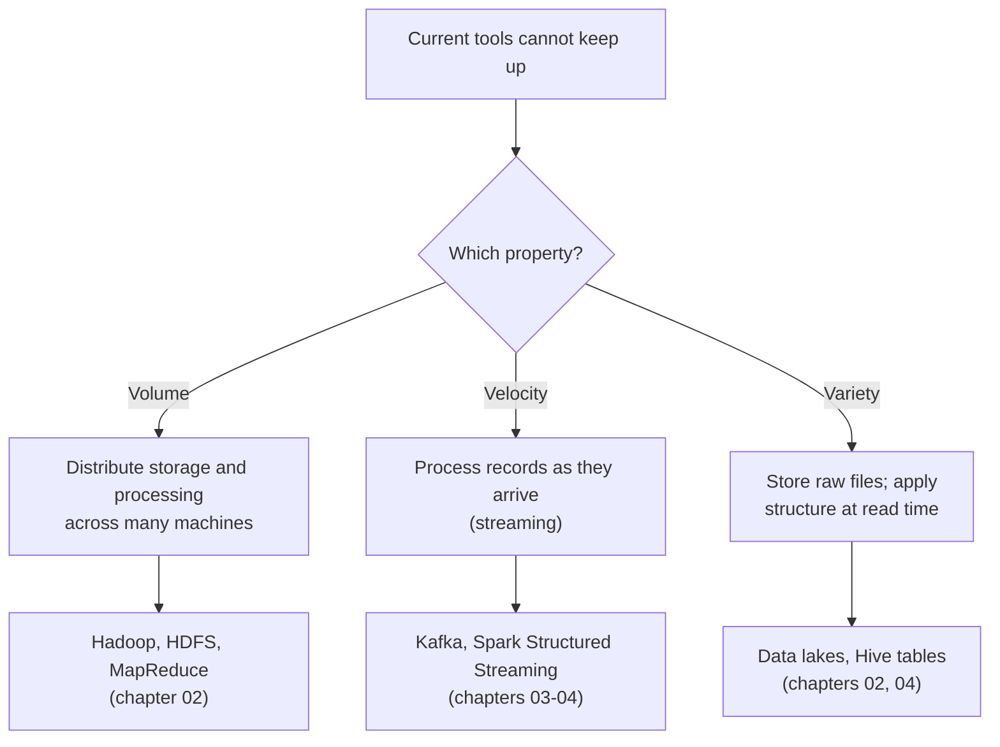

# The Three Vs of Big Data

Mastery: `INPUT[inlineSelect(option(new), option(learning), option(solid)):mastery]`

> [!story] Context
> [[Chapter 01 - Foundations|Chapter 01]] ended with [[Batch vs Streaming]]: processing data in scheduled chunks or continuously. In the early 2000s, web, e-commerce, and log data grew beyond what a single server and a [[Relational Databases|relational database]] could store and process in time. [[Chapter 02 - The Big Data Era|Chapter 02]] covers the tools built in response, starting with the vocabulary used to describe the problem.

> [!eli5] Summary
> "Big data" describes information that is too large, arrives too quickly, or comes in too many different forms for one ordinary computer to handle. These three properties are called the three Vs: volume, velocity, and variety.

> [!analogy]- Analogy: a post office
> | Post office | Big data |
> |---|---|
> | Number of letters per day | Volume |
> | How often trucks arrive, and how fast mail must be sorted | Velocity |
> | Envelopes, parcels, and crates that need different handling | Variety |
> | A network of post offices sharing the load | A distributed system, covered in [[Distributed Systems]] |

## Background

Through the 1990s most business data was structured and modest in size. Orders, invoices, and payroll fit in a relational database on one server, and a nightly batch job produced reports.

Three changes broke that model:

- **More events per business action.** Web servers logged every page view and click, not only purchases. Search engines crawled billions of pages.
- **Continuous arrival.** Servers, ad systems, and later phones and sensors ([[IoT]]) produced data all day instead of once per night.
- **New formats.** Much of the new data was not tabular: log lines, web pages, JSON documents, images. See [[Structured vs Unstructured Data]] and [[CSV and JSON]].

The volume, velocity, and variety framing is generally attributed to analyst Doug Laney in a 2001 META Group research note. This attribution is unconfirmed against the sources used for this vault.

## Overview

The three Vs (volume, velocity, and variety) are the three properties that make data "big": too much of it, arriving too fast, or in too many forms for one machine and its usual tools.

| V | Definition | What it breaks | Tools built in response |
|---|---|---|---|
| **Volume** | Total amount of data stored and scanned | Single-disk capacity and single-machine read speed | [[HDFS]], later cloud [[Object Storage]] |
| **Velocity** | Rate at which data arrives, and how quickly results are needed | Nightly batch windows | [[Apache Kafka]], [[Structured Streaming]] |
| **Variety** | Number of distinct formats and structures | Fixed table [[Schema\|schemas]] enforced at load time | [[Data Lakes]], schema-on-read (structure applied at query time) in [[Apache Hive]] |

Key points:

- **"Big" is relative to the tooling.** Data is "big" when existing tools cannot store, process, or interpret it within the required time. A 50 GB file is routine for a [[Cluster|cluster]] and unusable in a spreadsheet. See [[Bytes and Data Sizes]].
- **The Vs compound.** A high-rate stream of mixed-format events combines velocity and variety and is harder than either alone.
- **Extended lists exist.** Later frameworks add terms such as *veracity* (trustworthiness) and *value*. The original three are the ones that drove the systems in this chapter.

## How it works

The three Vs are a diagnostic framework, not a technology. Identify which property is causing the bottleneck, then select a tool category that addresses it.

Example: web server logs for an online store at three stages of growth.

| Stage | Daily visitors | Daily log volume | Limiting factor |
|---|---|---|---|
| Small | 2,000 | Megabytes | None; a script on one machine is sufficient |
| Medium | 200,000 | Gigabytes | Volume; the script runs for hours |
| Large | 20 million, plus app and ad events | Hundreds of gigabytes, arriving continuously | All three: storage capacity, ingest rate, and mixed text and JSON formats |

At the large stage, a faster single machine does not resolve the bottleneck. [[Scaling Up vs Scaling Out]] covers the alternative.

## Small-business considerations

> [!smallbiz] Small-business considerations
> Most companies with 5–50 employees do not have big data by this definition. A few years of orders, CRM (customer relationship management) records, and analytics exports typically total gigabytes.
>
> Use the three Vs to decide when to move beyond [[Spreadsheets|spreadsheets]] and a single database:
> - **Volume:** files that will not open, or reports that take minutes to refresh.
> - **Velocity:** a requirement for same-day or near-real-time figures.
> - **Variety:** recurring manual work combining CSV exports, API JSON, and documents.
>
> If any of these apply, see [[Signs You Have Outgrown Spreadsheets]]. Cloud platforms bill distributed compute by usage, so a company does not need petabytes to use these tools. See [[How Databricks Pricing Works]] for how compute is metered.

## Cloud differences

> [!azure]- Azure Databricks
> Nothing differs by cloud. The three Vs describe data, not infrastructure. Per-cloud differences start with storage, covered in [[HDFS]] and [[Object Storage]].

> [!aws]- Databricks on AWS
> Nothing differs by cloud.

> [!gcp]- Databricks on Google Cloud
> Nothing differs by cloud.

## Advanced topics

> [!deepdive]- Advanced topics (301–401)
> - **Volume is a read-throughput problem.** Disk capacity became inexpensive before disk read speed improved. A single disk reading roughly 100–200 MB/s needs hours to scan 1 TB. Spreading data across many disks and reading them in parallel is the central technique of the [[Google File System and MapReduce Papers|GFS and MapReduce]] designs.
> - **Velocity has two components.** Ingest rate is how fast data arrives. Decision latency is how fast results are required. A pipeline can ingest from a stream and still deliver results once per day. See [[Latency]] and [[Throughput]].
> - **Variety and schema-on-read.** Traditional [[Data Warehouses|warehouses]] use schema-on-write: data must match the table definition at load time. Hadoop-era tools applied the schema at query time instead. This made heterogeneous data cheap to store and also made it easy for lakes to degrade into [[Data Swamps]].
> - **Lakehouse mapping.** A lakehouse addresses all three properties in one system: [[Object Storage]] for volume, [[Structured Streaming]] and [[Auto Loader]] for velocity, and [[Schema Enforcement and Evolution]] on [[Delta Lake]] tables for variety.

## Common misconceptions

> [!confusion] "Big data" is not a size threshold
> No fixed number of gigabytes defines big data. Data is big when current tools cannot store, process, or interpret it within the required time.

> [!confusion] The three Vs are not products
> They are categories of problem. Hadoop primarily addressed volume, streaming systems addressed velocity, and data lakes and flexible formats addressed variety.

## Recall

What are the three Vs of big data?::Volume (amount), velocity (rate of arrival and required speed of results), and variety (number of formats).
Which V does a nightly batch job fail to address?::Velocity.
Which V led to schema-on-read?::Variety, because heterogeneous data does not fit a fixed schema enforced at load time.
Why is volume primarily a read-speed problem?::A single disk reads too slowly to scan terabytes in an acceptable time, so data must be read in parallel from many disks.
Is there a fixed size at which data becomes big data?::No. Data is big when current tools cannot handle it within the required time.
In a lakehouse, which features address velocity?::Structured Streaming and Auto Loader.

## Next steps

> [!path] Learning path
> **Needs first:** [[What Is Data]], [[Bytes and Data Sizes]]
> **Unlocks next:** [[Scaling Up vs Scaling Out]], [[Distributed Systems]]

> [!nextup] Next
> [[Scaling Up vs Scaling Out]] compares the two ways to add capacity: a larger machine or more machines.

> [!sources]- Sources (last verified: 2026-10-25)
> - [The Google File System (SOSP 2003, peer-reviewed paper)](https://www.cs.rochester.edu/meetings/sosp2003/papers/p125-ghemawat.pdf)
> - [What is Delta Lake in Databricks? (AWS)](https://docs.databricks.com/aws/en/delta)
> - Unconfirmed: the attribution of the three Vs to Doug Laney (2001). No allowed source was available to confirm it during this research pass.
