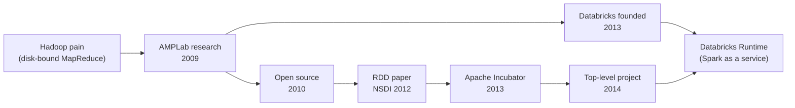

# AMPLab and the Birth of Spark

Mastery: `INPUT[inlineSelect(option(new), option(learning), option(solid)):mastery]`

> [!story] Context
> [[The Pain of Hadoop]] described the limits of [[MapReduce]]: every step read from and wrote to disk, which made iterative and interactive workloads slow. This note covers the UC Berkeley lab where Apache Spark was created and the company its creators founded.

> [!eli5] Summary
> Apache Spark began in 2009 as a research project at a University of California, Berkeley lab. The researchers built a faster way to process large amounts of data by keeping work in memory, released it as free software, and later founded Databricks to offer it as a managed service.

## Background

By the late 2000s, [[Apache Hadoop]] was the standard platform for processing large datasets. Researchers at UC Berkeley identified three limitations:

- **Iterative work was slow.** Machine-learning algorithms run the same steps over the same data again and again. In [[MapReduce]], each pass reads from disk and writes back to disk, so a 10-pass algorithm pays the disk cost 10 times.
- **Interactive questions were not interactive.** Running a quick query on a cluster still meant launching a batch job and waiting.
- **Programs were hard to write.** Anything beyond map and reduce had to be stitched together from many separate jobs.

Servers had large amounts of memory, which is much faster than disk. The research problem was keeping data in memory across many machines while still recovering from machine failures. Spark was the result.

## Overview

**AMPLab** stands for **Algorithms, Machines, and People**. It was a UC Berkeley research lab that brought together machine learning, systems, and databases researchers. Spark was one of several projects that came out of it.

Key dates, from the Apache Spark history page and the Apache Incubator records:

| Year | What happened |
|---|---|
| 2009 | Spark starts as a research project in the AMPLab, led by **Matei Zaharia**, with faculty advisors including **Ion Stoica, Scott Shenker, and Michael Franklin**. |
| Early 2010 | Spark is released as open source. |
| 2012 | The [[RDDs\|RDD]] paper, *Resilient Distributed Datasets: A Fault-Tolerant Abstraction for In-Memory Cluster Computing*, appears at USENIX NSDI 2012 and wins Best Paper. |
| June 2013 | Spark enters the Apache Incubator (Apache 2.0 license from here on). |
| 2013 | The Spark creators found Databricks. See [[The Founding of Databricks]]. |
| February 2014 | Spark graduates to an Apache **Top-Level Project**. |
| May 2014 | Apache Spark 1.0 is released. |
| 2015 | The [[Spark SQL]] paper (SIGMOD 2015) describes DataFrames and the [[Catalyst Optimizer]]. |

Several Databricks founders came from this lab. Databricks remains a major contributor to Apache Spark; for example, it donated its declarative pipeline framework to the project in 2025.

## How it works

Spark moved from research to a commercial service in four steps: a research project, an open-source release, a foundation-governed project, and a managed platform.



Two decisions shaped adoption:

1. **Open source from the start.** An early public release allowed companies to test Spark on production workloads and contribute changes while it was still a research project.
2. **A neutral home.** Moving Spark to the Apache Software Foundation placed it under vendor-neutral governance, so other vendors and cloud providers could adopt and contribute to it. As a result, Spark is offered by many vendors and cloud services in addition to Databricks.

The following example shows the original use case. The data is loaded once, cached in memory, and reused across several passes, which MapReduce could not do without rereading from disk:

```python
# Runs in a Databricks notebook or any local PySpark install (pip install pyspark)
from pyspark.sql import SparkSession
spark = SparkSession.builder.getOrCreate()

points = spark.range(0, 1_000_000).selectExpr("id", "rand() AS x")
points.cache()            # keep it in memory across passes
points.count()            # first pass reads and caches

for i in range(5):        # an "iterative" job: each pass reuses memory, not disk
    print(i, points.filter(f"x > {i / 10}").count())
```

## Small-business considerations

> [!smallbiz] Small-business considerations
> This history is not required to use Databricks. It has two practical implications:
> 1. **No lock-in on the engine.** Your Spark code is standard Apache Spark. If you ever leave Databricks, the same PySpark and SQL run on other Spark services.
> 2. **Upgrades come with the runtime.** New Apache Spark versions reach Databricks through new [[Databricks Runtime]] versions, so you adopt them by selecting a newer runtime rather than upgrading Spark yourself.

> [!bridge]- In Databricks today
> The AMPLab's work lives on in the [[Databricks Runtime]], which is Apache Spark plus Databricks' own improvements such as [[Photon]]. Databricks continues to contribute upstream: in 2025 it donated its declarative pipeline framework to Apache Spark, where it shipped in Spark 4.1 as Spark Declarative Pipelines, and the managed version is [[Lakeflow Spark Declarative Pipelines]]. See also [[The Founding of Databricks]] and [[Open Source vs Databricks - Who Replaced What]].

## Cloud differences

> [!note] No cloud differences
> This is history, so nothing differs by cloud. The Spark born in the AMPLab is the same engine inside Azure Databricks, Databricks on AWS, and Databricks on Google Cloud.

## Advanced topics

> [!deepdive]- Advanced topics (301–401)
> - **Why Mesos mattered.** Spark was first written partly to show what could be built on Mesos, a cluster manager from the same lab. Spark later added its own standalone mode and support for [[YARN]] and [[Kubernetes]], which is how it escaped Hadoop's orbit.
> - **The research lineage.** The RDD paper argued that a restricted model (coarse-grained transformations rather than fine-grained updates to shared memory) was enough to express MapReduce, SQL, graph processing, and iterative ML, while making recovery cheap through lineage. That trade-off defines Spark to this day.
> - **Shark to Spark SQL.** An early AMPLab project, Shark, ran Hive queries on Spark. Its limits led to Spark SQL and the Catalyst optimizer, published at SIGMOD 2015.
> - **Successor labs.** After AMPLab, Berkeley ran RISELab, which produced Ray among other projects. The pattern of lab, open source, then company continued.

## Common misconceptions

> [!confusion] AMPLab did not "invent big data"
> Google's papers and [[Apache Hadoop]] came first (see [[Google File System and MapReduce Papers]]). AMPLab's contribution was making that same scale fast and programmable by keeping data in memory.

> [!confusion] Databricks does not own Apache Spark
> Spark belongs to the Apache Software Foundation, under the Apache 2.0 license. Databricks is the largest contributor and sells a managed platform built on it, but anyone can use Spark for free.

## Recall

What does AMPLab stand for?::Algorithms, Machines, and People, a UC Berkeley research lab.
Who led the original Spark project?::Matei Zaharia, with advisors including Ion Stoica, Scott Shenker, and Michael Franklin.
In what year did Spark start as a research project?::2009.
When was Spark first released as open source?::Early 2010.
When did Spark enter the Apache Incubator and when did it become a top-level project?::June 2013 and February 2014.
Which 2012 paper introduced RDDs?::"Resilient Distributed Datasets: A Fault-Tolerant Abstraction for In-Memory Cluster Computing," NSDI 2012 (Best Paper).
What Hadoop pain was Spark built to fix?::MapReduce wrote to disk between every step, making iterative and interactive work slow.
What company did Spark's creators found in 2013?::Databricks.

## Next steps

> [!path] Learning path
> **Needs first:** [[The Pain of Hadoop]], [[MapReduce]]
> **Unlocks next:** [[Apache Spark]], [[RDDs]], [[The Founding of Databricks]]

> [!nextup] Next
> [[Apache Spark]] covers what the engine is, its components, and its current versions.

> [!sources]- Sources (last verified: 2026-10-25)
> - [Apache Spark history](https://spark.apache.org/history.html)
> - [Spark research page](https://spark.apache.org/research.html)
> - [Spark incubation status (Apache Incubator)](https://incubator.apache.org/projects/spark.html)
> - [The ASF announces Apache Spark as a top-level project](https://news.apache.org/foundation/entry/the_apache_software_foundation_announces50)
> - [Apache Spark now a top-level Apache project (Databricks blog, 2014)](https://www.databricks.com/blog/2014/03/02/spark-apache-top-level-project.html)
> - [The ASF announces Apache Spark v1.0](https://news.apache.org/foundation/entry/the_apache_software_foundation_announces57)
> - [Resilient Distributed Datasets (USENIX NSDI 2012)](https://www.usenix.org/conference/nsdi12/technical-sessions/presentation/zaharia)
> - [Spark SQL: Relational Data Processing in Spark (SIGMOD 2015)](https://people.csail.mit.edu/matei/papers/2015/sigmod_spark_sql.pdf)
> - [Learn about Apache Spark (Databricks)](https://www.databricks.com/spark/about)
> - [Databricks donates Declarative Pipelines to Apache Spark (press release)](https://www.databricks.com/company/newsroom/press-releases/databricks-donates-declarative-pipelines-apache-sparktm-open-source)
