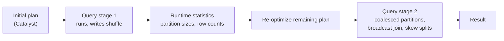

# Adaptive Query Execution

Mastery: `INPUT[inlineSelect(option(new), option(learning), option(solid)):mastery]`

> [!story] Context
> The [[Catalyst Optimizer]] chooses a plan before a query runs, using estimates. When estimates are wrong, the plan can use too many [[Partitions|shuffle partitions]], the wrong join strategy, or leave one task handling a [[Data Skew|skewed]] key. Adaptive Query Execution (AQE), introduced in Spark 3.0, corrects the plan during execution.

> [!eli5] Summary
> Spark plans a query before it has seen the data. Adaptive Query Execution lets Spark pause at checkpoints inside the query, look at how much data actually came through, and change the rest of the plan to match.

> [!analogy]- Analogy: navigation with live traffic
> | Navigation | AQE |
> |---|---|
> | Route planned before departure | Catalyst's initial physical plan |
> | Live traffic reported at each junction | Runtime statistics after each shuffle stage |
> | Rerouting onto a faster road | Switching a sort-merge join to a broadcast join |
> | Merging lanes on an empty road | Coalescing small shuffle partitions |

## Background

Static query planning depends on statistics that are often missing or wrong: a filter may keep 1% of rows instead of the estimated 50%, a table may have no statistics, or one key may hold most of the rows. Before AQE, users compensated by hand-tuning `spark.sql.shuffle.partitions`, adding broadcast hints, and salting skewed keys.

AQE was introduced in Spark 3.0 (2020). In open-source Spark it is enabled by default since Spark 3.2.0 (`spark.sql.adaptive.enabled = true`). Databricks documents AQE as enabled by default in Databricks Runtime.

## Overview

Adaptive Query Execution is a Spark SQL optimization framework that re-optimizes a query plan at stage boundaries using statistics collected from completed stages. It applies to SQL and DataFrame queries; it does not apply to [[RDDs]].

| Feature | What it does | Key setting (open-source name) |
|---|---|---|
| **Coalesce shuffle partitions** | Merges small adjacent shuffle partitions toward a target size, so fewer, larger tasks run | `spark.sql.adaptive.coalescePartitions.enabled`, `spark.sql.adaptive.advisoryPartitionSizeInBytes` (64 MB) |
| **Switch join strategy** | Converts a sort-merge join to a broadcast hash join when one side turns out to be small | `spark.sql.adaptive.autoBroadcastJoinThreshold` |
| **Optimize skew joins** | Splits skewed partitions into smaller tasks (and replicates the matching side) in sort-merge and shuffle hash joins | `spark.sql.adaptive.skewJoin.enabled`, `skewedPartitionFactor` (5), `skewedPartitionThresholdInBytes` (256 MB) |
| **Local shuffle reader** | After converting to a broadcast join, reads shuffle files locally to avoid network transfer | `spark.sql.adaptive.localShuffleReader.enabled` |

A partition is treated as skewed when it is larger than both `skewedPartitionFactor` times the median partition size and `skewedPartitionThresholdInBytes`. AQE does not optimize skew in broadcast joins. Databricks uses some different property names for its runtime (for example, `spark.databricks.optimizer.adaptive.enabled`); see the Databricks AQE page for the current list.

## How it works



AQE divides the plan into **query stages** at each shuffle or broadcast exchange. When a stage finishes, its output sizes are exact. AQE then re-runs optimization on the remaining plan with those sizes.

Example: observe coalescing and a runtime join change.

```python
from pyspark.sql import functions as F

spark.conf.set("spark.sql.adaptive.enabled", "true")   # default; shown for clarity

facts = spark.range(0, 20_000_000).select(
    (F.col("id") % 1000).alias("k"), (F.rand() * 10).alias("v"))
dims = (spark.range(0, 1000).select(F.col("id").alias("k"), (F.col("id") % 7).alias("grp"))
             .filter("grp = 3"))      # selectivity unknown to the planner

q = facts.join(dims, "k").groupBy("grp").agg(F.sum("v"))
q.collect()
q.explain()
# The plan starts with "AdaptiveSparkPlan isFinalPlan=true".
# Look for "AQEShuffleRead coalesced" and, if dims was small at runtime,
# "BroadcastHashJoin" replacing the initial "SortMergeJoin".
```

In SQL:

```sql
SET spark.sql.adaptive.enabled = true;
EXPLAIN FORMATTED
SELECT d.grp, SUM(f.v)
FROM main.default.facts f JOIN main.default.dims d USING (k)   -- replace with your tables
GROUP BY d.grp;
```

In the [[Spark UI]] SQL / DataFrame tab, the query's plan graph shows the final adaptive plan, including `AQEShuffleRead` nodes and the number of partitions after coalescing.

## Small-business considerations

> [!smallbiz] Small-business considerations
> AQE is on by default on Databricks and requires no configuration. Its main effect for small teams is that the default shuffle partition count no longer needs manual tuning. Leave the defaults in place, and investigate AQE settings only when the [[Spark UI]] shows a specific problem such as a skewed stage that AQE did not split.

> [!bridge]- In Databricks today
> AQE is enabled by default in Databricks Runtime and on [[Serverless Compute]] and [[SQL Warehouses]]. Databricks' AQE documentation lists its runtime-specific settings and defaults. [[Photon]] executes adaptive plans. The Databricks Spark UI guide recommends first checking whether AQE already handles an observed skew before tuning thresholds or salting keys.

## Cloud differences

> [!note] No cloud differences
> AQE behavior and settings are the same on Azure, AWS, and Google Cloud.

## Advanced topics

> [!deepdive]- Advanced topics (301–401)
> - **`parallelismFirst`:** In open-source Spark 3.2+, `spark.sql.adaptive.coalescePartitions.parallelismFirst` defaults to `true`, which ignores the advisory size and respects only the minimum partition size, to maximize parallelism. Set it to `false` to coalesce toward the advisory size.
> - **Initial partition number:** `spark.sql.adaptive.coalescePartitions.initialPartitionNum` sets the shuffle partition count before coalescing; a high initial value gives AQE more room to coalesce evenly.
> - **Dynamic partition pruning** (Spark 3.0) is a separate optimization often discussed with AQE. It prunes partitions of a fact table at runtime using filter results from a dimension table. See [[Partition Pruning]].
> - **Limitations:** AQE cannot fix skew in the first stage of a query (there is no shuffle before it) and AQE's skew optimization applies to shuffle-based joins, not to aggregations.
> - **Explain output:** Before execution, `explain()` shows `AdaptiveSparkPlan isFinalPlan=false` with the initial plan. After an action, the final plan shows `isFinalPlan=true`.

## Common misconceptions

> [!confusion] AQE does not replace Catalyst
> Catalyst still produces the initial plan and runs the re-optimization. AQE supplies accurate statistics at stage boundaries so Catalyst can re-plan.

> [!confusion] AQE does not remove the need for good data layout
> AQE improves shuffles and joins after data is read. It does not reduce the amount of data scanned; file layout, [[Liquid Clustering]], and [[Data Skipping]] do that.

## Recall

What is Adaptive Query Execution?::A Spark SQL framework that re-optimizes the remaining query plan at stage boundaries using runtime statistics.
In which Spark version was AQE introduced, and since which version is it on by default?::Introduced in Spark 3.0; enabled by default since Spark 3.2.0.
Name the three main AQE optimizations.::Coalescing shuffle partitions, switching join strategies (to broadcast), and optimizing skew joins.
What is the default advisory partition size for AQE coalescing?::64 MB.
When does AQE treat a partition as skewed?::When it exceeds both skewedPartitionFactor (5) times the median size and skewedPartitionThresholdInBytes (256 MB).
Does AQE handle skew in broadcast joins?::No; only in shuffle-based joins (sort-merge and shuffle hash).
How can you tell from explain() that a plan is adaptive and final?::It shows AdaptiveSparkPlan isFinalPlan=true.

## Next steps

> [!path] Learning path
> **Needs first:** [[Catalyst Optimizer]], [[Shuffles]], [[Partitions]]
> **Unlocks next:** [[Query Performance and Caching]], [[Spark UI]]

> [!nextup] Next
> [[Spark Connect]] covers the client-server architecture that separates application code from the Spark driver.

> [!sources]- Sources (last verified: 2026-10-25)
> - [Adaptive query execution (AWS)](https://docs.databricks.com/aws/en/optimizations/aqe)
> - [Adaptive query execution (GCP)](https://docs.gcp.databricks.com/spark/latest/spark-sql/aqe.html)
> - [Adaptive Query Execution: Speeding Up Spark SQL at Runtime (Databricks blog, 2020)](https://www.databricks.com/blog/2020/05/29/adaptive-query-execution-speeding-up-spark-sql-at-runtime.html)
> - [Deep dive into Adaptive Query Execution (Databricks blog, 2020)](https://www.databricks.com/blog/2020/10/21/faster-sql-adaptive-query-execution-in-databricks.html)
> - [Performance tuning (Spark 4.2)](https://spark.apache.org/docs/latest/sql-performance-tuning.html)
> - [Performance tuning (Spark 3.5.6)](https://spark.apache.org/docs/3.5.6/sql-performance-tuning.html)
> - [Skew and spill (AWS)](https://docs.databricks.com/aws/en/optimizations/spark-ui-guide/long-spark-stage-page)
