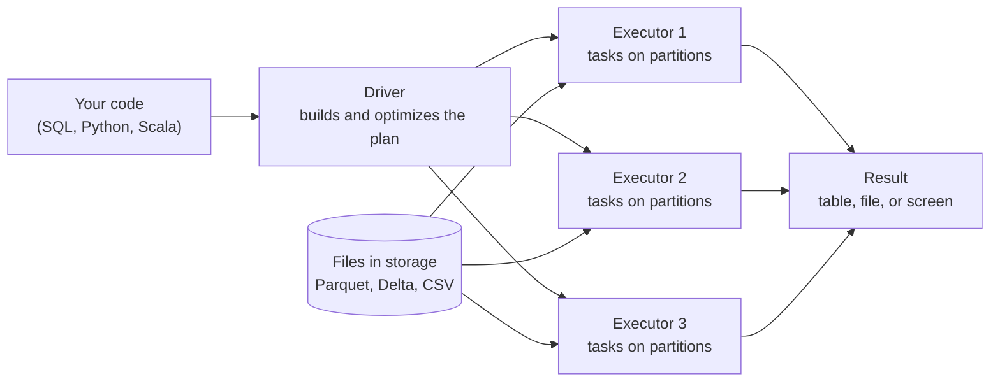

# Apache Spark

Mastery: `INPUT[inlineSelect(option(new), option(learning), option(solid)):mastery]`

> [!story] Context
> [[AMPLab and the Birth of Spark]] covered the origin of Spark as a faster alternative to [[MapReduce]]. This note gives an overview of the engine and its components; the following notes cover each part in detail.

> [!eli5] Summary
> Apache Spark is free software that lets many computers work together on one large dataset. You describe the result you want, and Spark divides the work, runs the pieces in parallel, and combines the results.

## Background

[[MapReduce]] made large-scale processing possible, but every step wrote to disk, programs were long Java classes, and SQL, machine learning, and streaming each required a separate system. Spark addressed these issues with three goals:

- **Speed.** Keep working data in memory between steps instead of writing to disk each time.
- **Ease.** Offer short, readable [[APIs]] in Python, SQL, [[Scala]], Java, and R.
- **One engine for everything.** Batch, SQL, streaming, and machine learning all run on the same engine and can be mixed in one program.

## Overview

Apache Spark is an [[Open Source|open-source]], multi-language engine for data engineering, data science, and machine learning on a single machine or a [[Cluster|cluster]]. It converts your code into many small tasks and runs them in parallel across the cluster's machines.

Spark is a set of layers:

| Layer | What it gives you | Note |
|---|---|---|
| **Spark Core** | Scheduling, memory, fault recovery, the original [[RDDs\|RDD]] API | [[RDDs]], [[Jobs Stages and Tasks]] |
| **Spark SQL and DataFrames** | Tables, SQL, and the optimizer; the primary interface for most workloads | [[DataFrames]], [[Spark SQL]], [[Catalyst Optimizer]] |
| **Structured Streaming** | The same DataFrame code on live data | [[Structured Streaming]] |
| **MLlib** | Distributed machine learning | [[MLlib]] |
| **Language APIs** | Python ([[PySpark]]), Scala, Java, R, SQL | [[PySpark]] |
| **Spark Connect** | A thin client that talks to a remote Spark server | [[Spark Connect]] |
| **Declarative Pipelines** (new in 4.1) | Define tables and flows; Spark works out order and retries | [[Lakeflow Spark Declarative Pipelines]] |

**Versions.** As of October 2026, the newest release is **Spark 4.2.0**, released July 14, 2026. Spark 4.1.0 was released December 16, 2025.

| Release | Headline changes |
|---|---|
| 3.0 | [[Adaptive Query Execution]] introduced |
| 3.4 | [[Spark Connect]] introduced |
| 4.0 | ANSI SQL mode on by default, `VARIANT` type, full Spark Connect clients, Scala 2.13 only |
| 4.1 | Spark Declarative Pipelines, Structured Streaming real-time mode, SQL scripting generally available (GA), `VARIANT` GA |
| 4.2 | Native `GEOMETRY`/`GEOGRAPHY` types, a `CHANGES` clause for [[Change Data Capture\|change data capture]], Arrow-optimized Python [[UDF\|UDFs]] on by default, a modernized Spark UI with dark mode |

## How it works



1. You describe what you want with [[DataFrames]] or SQL. Spark does not run anything yet ([[Lazy Evaluation]]).
2. When you ask for a result (an action, see [[Transformations and Actions]]), the [[Driver and Executors|driver]] (the coordinating process) turns your request into an optimized plan with the [[Catalyst Optimizer]].
3. The plan is split into [[Jobs Stages and Tasks|stages and tasks]], one task per [[Partitions|partition]] of data.
4. Executors (the worker processes) run the tasks in parallel, reading straight from storage such as [[Apache Parquet|Parquet]] or [[Delta Lake]] files.
5. If a machine fails, Spark reruns only the lost tasks from the plan. This is the [[Fault Tolerance|fault tolerance]] model from the original [[RDDs|RDD]] paper.

The same question in Python and in SQL:

```python
# PySpark: total sales per store, top 5
from pyspark.sql import SparkSession, functions as F
spark = SparkSession.builder.getOrCreate()   # already exists as `spark` in Databricks

sales = spark.createDataFrame(
    [("Main St", 120.0), ("Main St", 80.0), ("Airport", 300.0), ("Mall", 45.5)],
    ["store", "amount"],
)
(sales.groupBy("store")
      .agg(F.sum("amount").alias("total"))
      .orderBy(F.desc("total"))
      .show(5))
```

```sql
-- Spark SQL: the same query, the same engine, the same plan
SELECT store, SUM(amount) AS total
FROM VALUES ('Main St', 120.0), ('Main St', 80.0), ('Airport', 300.0), ('Mall', 45.5) AS sales(store, amount)
GROUP BY store
ORDER BY total DESC
LIMIT 5;
```

Both versions compile to the same physical plan, which you can see with `EXPLAIN` or in the [[Spark UI]].

## Small-business considerations

> [!smallbiz] Small-business considerations
> On Databricks you do not install or operate Spark. Every notebook has a `spark` session, and [[Serverless Compute]] provides compute on demand. Key points for a small team:
> - **Small data does not need Spark.** A few thousand rows fit in a spreadsheet or [[Pandas]]. Spark becomes useful when data reaches millions of rows or many files, or when processing must run reliably on a schedule.
> - **You write SQL or Python.** The engine runs underneath and rarely needs configuration.
> - **Cost follows compute time.** Spark itself is free. On Databricks you pay for the compute that runs it, metered in [[DBUs]]. See [[How Databricks Pricing Works]].

> [!bridge]- In Databricks today
> Every Databricks cluster, job, notebook, and SQL warehouse runs Apache Spark inside the [[Databricks Runtime]]. Databricks Runtime 17.3 LTS (long-term support) is built on Spark 4.0, Databricks Runtime 18 LTS on Spark 4.1, and Databricks Runtime 19 (GA July 2026) on Spark 4.2. On top of open-source Spark, Databricks adds [[Photon]] (a C++ execution engine that runs the same APIs faster), [[Delta Lake]] integration, [[Unity Catalog]] security, and [[Serverless Compute]], which runs your code through [[Spark Connect]]. The code you write is standard Spark, so it runs on other Spark services too.

## Cloud differences

Spark behaves the same on all three clouds. What changes is the hardware it runs on and how storage paths look:

> [!azure]- Azure Databricks
> Executors run on Azure [[Virtual Machine|virtual machines]] in your subscription (classic compute) or in Databricks-managed capacity (serverless). Paths look like `abfss://container@account.dfs.core.windows.net/...` for [[Azure Data Lake Storage]]. See [[Azure Databricks Overview]].

> [!aws]- Databricks on AWS
> Executors run on EC2 instances, including Graviton (ARM) types where supported. Paths look like `s3://bucket/...`. See [[EC2 Instance Types and Graviton]] and [[Amazon S3]].

> [!gcp]- Databricks on Google Cloud
> Classic compute runs on Google Compute Engine VMs. Paths look like `gs://bucket/...`. See [[Compute on Google Cloud]] and [[Google Cloud Storage]].

## Advanced topics

> [!deepdive]- Advanced topics (301–401)
> - **Two execution modes.** "Spark Classic" runs your code in the same process as the driver. "Spark Connect" sends unresolved plans from a thin client to a server over gRPC. In Spark 4.0 the `spark.api.mode` setting lets an app switch between them. Databricks serverless supports only Spark Connect APIs. See [[Spark Connect]].
> - **ANSI mode by default (4.0).** Division by zero, invalid casts, and overflows now raise errors instead of silently returning `NULL`. Review this behavior when upgrading code from Spark 3.x.
> - **Cluster managers.** Open-source Spark can run in standalone mode, on [[YARN]], or on [[Kubernetes]]. Databricks uses its own cluster manager, so you never choose one.
> - **Java and Scala.** Spark 4 is built for Scala 2.13 only; Scala 2.12 support was dropped. Spark 4.2 adds support for building and running on Java 25.
> - **Where the speed comes from.** Memory caching is only part of it. Most of the gains in modern Spark come from the [[Catalyst Optimizer]], [[Tungsten]] code generation, columnar file formats with [[Partition Pruning|pruning]], and [[Adaptive Query Execution]].

## Common misconceptions

> [!confusion] Spark is not a database
> Spark does not store your data. It reads files from storage, processes them, and writes files back. The storage layer is something else ([[Delta Lake]], [[Apache Parquet]], a data lake).

> [!confusion] Spark is not "Hadoop 2"
> Spark can run on Hadoop clusters and read from [[HDFS]], but it does not need Hadoop. Most Spark today runs on cloud object storage with no Hadoop cluster at all.

> [!confusion] "Spark is fast because it is in memory" is only half true
> Spark [[Spill|spills]] to disk when data does not fit, and it reads from disk at the start of every job. Its speed comes from planning the whole job, avoiding unnecessary disk writes between steps, and generating efficient code.

## Recall

What is Apache Spark in one sentence?::An open-source engine that runs data engineering, SQL, streaming, and machine learning in parallel across a cluster of machines.
What did Spark evolve from?::Hadoop MapReduce, which wrote to disk between every step.
What is the latest Apache Spark release as of October 2026?::Spark 4.2.0, released July 14, 2026.
Which Spark version made ANSI SQL mode the default?::Spark 4.0.
Which Spark version added Spark Declarative Pipelines and real-time mode?::Spark 4.1 (December 2025).
What are the two kinds of processes in a Spark application?::One driver (plans the work) and many executors (do the work).
Which Spark version is Databricks Runtime 18 LTS built on?::Apache Spark 4.1.
Does Spark store data?::No. It processes data that lives in files or tables in storage.

## Next steps

> [!path] Learning path
> **Needs first:** [[Distributed Systems]], [[Scaling Up vs Scaling Out]], [[MapReduce]]
> **Unlocks next:** [[RDDs]], [[DataFrames]], [[Driver and Executors]], [[Databricks Runtime]]

> [!nextup] Next
> [[RDDs]] covers the resilient distributed dataset, the abstraction that gives Spark its fault tolerance.

> [!sources]- Sources (last verified: 2026-10-25)
> - [Apache Spark 4.2.0 documentation overview](https://spark.apache.org/docs/latest/)
> - [Spark Release 4.2.0](https://spark.apache.org/releases/spark-release-4-2-0.html)
> - [Spark Release 4.1.0](https://spark.apache.org/releases/spark-release-4.1.0.html)
> - [Spark Release 4.0.0](https://spark.apache.org/releases/spark-release-4-0-0.html)
> - [Spark news](https://spark.apache.org/news/)
> - [Spark downloads](https://spark.apache.org/downloads.html)
> - [Databricks Runtime release notes versions and compatibility (AWS)](https://docs.databricks.com/aws/en/release-notes/runtime/)
> - [Databricks Runtime 18 LTS (Azure)](https://learn.microsoft.com/en-us/azure/databricks/release-notes/runtime/18)
> - [Databricks Runtime 17.3 LTS (AWS)](https://docs.databricks.com/aws/en/release-notes/runtime/17.3lts)
> - [July 2026 release notes (AWS)](https://docs.databricks.com/aws/en/release-notes/product/2026/july)
> - [What is Photon? (AWS)](https://docs.databricks.com/aws/en/compute/photon)
> - [Serverless compute limitations (AWS)](https://docs.databricks.com/aws/en/compute/serverless/limitations)
