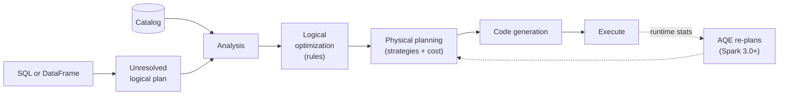

# Catalyst Optimizer

Mastery: `INPUT[inlineSelect(option(new), option(learning), option(solid)):mastery]`

> [!story] Context
> [[Spark SQL]] compiles SQL queries and DataFrame code into the same logical plan. The Catalyst Optimizer, described in the SIGMOD 2015 Spark SQL paper, transforms that plan into an efficient physical plan before execution.

> [!eli5] Summary
> Before Spark runs a query, Catalyst reviews it and finds a faster way to produce the same answer, for example by removing unneeded steps and filtering data as early as possible.

## Background

With [[RDDs]], Spark ran exactly what you wrote, in the order you wrote it. A filter placed after an expensive join stayed after the join. A query that used 2 of 200 columns still read all 200. Performance depended on users ordering operations correctly by hand.

Relational databases address this with query optimizers. The Spark SQL team built one with two additional requirements: it had to be **easy to extend** (new data sources, new rules, new types) and it had to work for **both SQL and code**. They built Catalyst in [[Scala]], using its pattern matching to write optimization rules as short functions over trees.

## Overview

Catalyst is a library inside Spark SQL that represents every query as a **tree** of operators and expressions, then applies **rules** that rewrite the tree into an equivalent but cheaper one. It works in four phases:

| Phase | Input → output | What happens |
|---|---|---|
| **1. Analysis** | Unresolved logical plan → analyzed logical plan | Look up tables and columns in the catalog, resolve names and types. Errors like "column not found" come from here. |
| **2. Logical optimization** | Analyzed plan → optimized logical plan | Rule-based rewrites: predicate pushdown, column pruning, constant folding, combining filters, simplifying expressions, reordering joins. |
| **3. Physical planning** | Optimized logical plan → physical plan(s) | Choose how to run each step, such as broadcast hash join vs sort-merge join, using statistics and cost. |
| **4. Code generation** | Physical plan → Java bytecode | Generate compact code for the plan ([[Tungsten]] whole-stage code generation). |

## How it works



The following example prints all four plans:

```python
from pyspark.sql import functions as F

orders = spark.range(0, 1_000_000).select(
    F.col("id").alias("order_id"),
    (F.col("id") % 100).alias("store_id"),
    (F.rand() * 100).alias("amount"),
    F.lit("unused padding").alias("notes"))
stores = spark.range(0, 100).select(
    F.col("id").alias("store_id"), F.concat(F.lit("Store "), F.col("id")).alias("name"))

q = (orders.join(stores, "store_id")
           .filter(F.col("store_id") == 7)        # written AFTER the join
           .select("name", "amount"))             # 'notes' never used

q.explain(mode="extended")   # parsed, analyzed, optimized, physical
```

In the **optimized logical plan** you will see that Catalyst:

- moved `store_id = 7` **below the join**, onto both sides (predicate pushdown plus inferring the filter for the other side),
- dropped the `notes` column early (column pruning),
- and in the **physical plan**, chose `BroadcastHashJoin` because `stores` is tiny (under the 10 MB `spark.sql.autoBroadcastJoinThreshold`). See [[Broadcast Join]].

SQL works the same way:

```sql
EXPLAIN FORMATTED
SELECT s.name, SUM(o.amount)
FROM main.default.orders o JOIN main.default.stores s USING (store_id)   -- your tables
WHERE o.order_day = DATE'2026-10-01'
GROUP BY s.name;
```

Against files, pushdown means the scan only reads matching files and row groups, using [[Partition Pruning]] and Parquet min/max statistics ([[Data Skipping]]).

## Small-business considerations

> [!smallbiz] Small-business considerations
> Catalyst produces efficient plans from readable SQL and DataFrame code and rarely needs tuning. Two practices help it:
> - **Use built-in functions, not custom Python functions.** Catalyst can see inside `upper()` or `date_trunc()` but not inside your Python [[UDF]].
> - **Keep table statistics current.** `ANALYZE TABLE ... COMPUTE STATISTICS` gives Catalyst row counts and column statistics for better join choices.

> [!bridge]- In Databricks today
> Catalyst plans every query on Databricks, in notebooks, jobs, pipelines, and [[SQL Warehouses]]. Databricks adds its own optimizer rules and statistics on top, and [[Photon]] then executes the physical plan: Databricks' docs note that Catalyst still plans the query while Photon replaces the execution layer. [[Adaptive Query Execution]] is on by default and re-optimizes plans at runtime. Delta features such as [[Liquid Clustering]] and file statistics make Catalyst's pushdowns skip far more data.

## Cloud differences

> [!note] No cloud differences
> Catalyst is part of the engine and behaves identically on Azure, AWS, and Google Cloud.

## Advanced topics

> [!deepdive]- Advanced topics (301–401)
> - **Trees and rules.** Every node is an immutable Scala case class (`Filter`, `Join`, `Project`, `Literal`, `Add`). A rule is a partial function applied with `transform`, for example "replace `Add(Literal(a), Literal(b))` with `Literal(a+b)`" (constant folding). Rules are grouped into batches and run until the tree stops changing (a fixed point).
> - **Rule-based first, cost-based second.** Most logical rewrites are always beneficial and need no statistics. The cost-based optimizer (CBO, `spark.sql.cbo.enabled`) uses table and column statistics for join reordering and selection; it depends on `ANALYZE TABLE` statistics being present.
> - **Extensibility.** `SparkSessionExtensions` lets you inject parser, analyzer, optimizer, and planner rules. Delta Lake and many connectors use this to add their own logic. Data Source V2 lets connectors accept pushed-down filters, column pruning, limits, and aggregates.
> - **The SIGMOD paper's numbers.** The 2015 paper notes that Catalyst's code generator was about 700 lines of code, using Scala quasiquotes to build code trees compiled at runtime.
> - **Static plans have blind spots.** Catalyst plans with estimates. If the estimates are wrong (a filter keeps 1% instead of 50%, or one key holds most rows), the plan can be bad. That limit is why [[Adaptive Query Execution]] was added in Spark 3.0.
> - **Debugging tools.** `df.explain("formatted")`, `df.explain("cost")`, the SQL/DataFrame tab in the [[Spark UI]], and on Databricks the query profile.

## Common misconceptions

> [!confusion] Catalyst does not run your query
> Catalyst plans. Execution is done by Spark's engine ([[Tungsten]] code) or, on Databricks, by [[Photon]].

> [!confusion] Pushdown does not apply to every source
> Filters can only be pushed to sources that support them. Parquet, Delta, and JDBC sources do. A Python UDF in a filter, or a CSV file without partitions, still forces Spark to read everything.

## Recall

What is the Catalyst Optimizer?::Spark SQL's extensible query optimizer, which rewrites logical plans with rules and picks physical plans before execution.
What are Catalyst's four phases?::Analysis, logical optimization, physical planning, and code generation.
What is predicate pushdown?::Moving filters as close to the data source as possible so less data is read.
What is column pruning?::Dropping columns the query never uses so they are not read or moved.
When does Catalyst pick a broadcast hash join?::When one side's estimated size is under spark.sql.autoBroadcastJoinThreshold (10 MB by default), or a BROADCAST hint is used.
What language is Catalyst written in, and what feature does it rely on?::Scala, using pattern matching over immutable trees.
How do you see Catalyst's plans for a DataFrame?::df.explain(mode="extended") or EXPLAIN in SQL.
What Spark 3.0 feature fixes Catalyst's bad estimates at runtime?::Adaptive Query Execution.

## Next steps

> [!path] Learning path
> **Needs first:** [[Spark SQL]], [[Lazy Evaluation]], [[DataFrames]]
> **Unlocks next:** [[Tungsten]], [[Adaptive Query Execution]], [[Photon]]

> [!nextup] Next
> [[Tungsten]] covers the execution-engine work that runs Catalyst's physical plans efficiently on CPUs and memory.

> [!sources]- Sources (last verified: 2026-10-25)
> - [Spark SQL: Relational Data Processing in Spark (SIGMOD 2015)](https://people.csail.mit.edu/matei/papers/2015/sigmod_spark_sql.pdf)
> - [Performance tuning (Spark 4.2)](https://spark.apache.org/docs/latest/sql-performance-tuning.html)
> - [Hints (Spark 4.2)](https://spark.apache.org/docs/latest/sql-ref-syntax-qry-select-hints.html)
> - [What is Photon? (AWS)](https://docs.databricks.com/aws/en/compute/photon)
> - [Adaptive query execution (AWS)](https://docs.databricks.com/aws/en/optimizations/aqe)
> - [Adaptive Query Execution: Speeding Up Spark SQL at Runtime (Databricks blog)](https://www.databricks.com/blog/2020/05/29/adaptive-query-execution-speeding-up-spark-sql-at-runtime.html)
