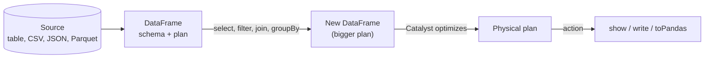

# DataFrames

Mastery: `INPUT[inlineSelect(option(new), option(learning), option(solid)):mastery]`

> [!story] Context
> [[Transformations and Actions]] on [[RDDs]] operate on opaque objects and functions, so Spark cannot inspect or optimize them. DataFrames add named, typed columns, which gives Spark the information it needs to optimize queries.

> [!eli5] Summary
> A DataFrame is a table with named columns, similar to a spreadsheet, that can be far larger than a spreadsheet and is spread across many computers. You describe operations on the table, and Spark chooses an efficient way to perform them.

## Background

RDD code worked, but it had three problems:

- **It was hard to read.** `rdd.map(lambda r: (r[2], r[5])).reduceByKey(...)` hides what columns 2 and 5 are.
- **Spark could not optimize it.** A Python lambda is a black box. Spark cannot tell that it only needs two columns or that a filter could run earlier.
- **Python was slow.** Every Python RDD record had to be [[Serialization|serialized]] and passed between the [[JVM]] and Python processes.

DataFrames were introduced with the [[Spark SQL]] engine. The SIGMOD 2015 paper *Spark SQL: Relational Data Processing in Spark* describes them as a way to mix relational queries with procedural code, all optimized by the [[Catalyst Optimizer]]. The name and design follow data frames in R and [[Pandas]].

## Overview

A Spark DataFrame is a distributed collection of rows organized into **named, typed columns**. It is:

- **Distributed:** split into [[Partitions|partitions]] across executors.
- **Immutable:** every operation returns a new DataFrame.
- **Lazy:** it is a plan, not data, until an action runs ([[Lazy Evaluation]]).
- **Schema-aware:** Spark knows each column's [[Data Type|data type]].

In Scala and Java there is also a typed cousin, the **Dataset** (`Dataset[Order]`), which checks types at compile time. A DataFrame is a `Dataset[Row]`. Python and R have only DataFrames.

| | RDD | DataFrame | pandas DataFrame |
|---|---|---|---|
| Runs on | A cluster | A cluster | One machine |
| Knows column names/types | No | Yes | Yes |
| Optimized by Catalyst | No | Yes | No |
| Works on Databricks serverless | No | Yes | Yes (on the driver) |
| Size limit | Cluster | Cluster | One machine's memory |

## How it works



The following example loads, cleans, joins, aggregates, and saves data:

```python
from pyspark.sql import functions as F

# 1. Create (or read) DataFrames
orders = spark.createDataFrame(
    [(1, "C1", "2026-10-01", 20.0), (2, "C2", "2026-10-01", 55.0),
     (3, "C1", "2026-10-02", None), (4, "C3", "2026-10-02", 99.0)],
    "order_id INT, customer_id STRING, order_day STRING, amount DOUBLE")
customers = spark.createDataFrame(
    [("C1", "Ana", "Chicago"), ("C2", "Ben", "Urbana"), ("C3", "Cy", "Chicago")],
    ["customer_id", "name", "city"])
# Reading real files looks like:
# orders = spark.read.table("main.sales.orders")
# orders = spark.read.option("header", True).csv("/Volumes/main/raw/files/orders.csv")

orders.printSchema()                 # column names and types

# 2. Transform
clean = (orders
         .withColumn("order_day", F.to_date("order_day"))
         .fillna({"amount": 0.0})
         .filter(F.col("amount") > 0))

# 3. Join and aggregate
by_city = (clean.join(customers, "customer_id")
                .groupBy("city")
                .agg(F.count("*").alias("orders"),
                     F.round(F.sum("amount"), 2).alias("revenue")))

# 4. Action: look, then save
by_city.show()
by_city.write.mode("overwrite").saveAsTable("main.default.revenue_by_city")
```

The same DataFrame can be used from SQL by registering a view, which is the bridge to the next note:

```python
by_city.createOrReplaceTempView("revenue_by_city_v")
spark.sql("SELECT * FROM revenue_by_city_v WHERE revenue > 50").show()
```

## Small-business considerations

> [!smallbiz] Small-business considerations
> DataFrames use the same table model as Excel and pandas. Recommended starting points:
> - Read your exported CSVs into DataFrames, clean them, and save them as tables with `saveAsTable`. This replaces manual copy-and-paste steps.
> - Use `display(df)` in a Databricks notebook to render a table and chart.
> - If the final result is small and you prefer pandas, call `df.toPandas()` at the end. Do the filtering and aggregation in Spark first.

> [!bridge]- In Databricks today
> DataFrames are the main API across Databricks: in notebooks, [[Lakeflow Jobs]], [[Lakeflow Spark Declarative Pipelines]], and [[Databricks Connect]] from your IDE. Tables you save land as [[Delta Lake]] tables governed by [[Unity Catalog]]. DataFrame operations run on [[Photon]] when it is enabled, and they are fully supported on [[Serverless Compute]] (unlike RDDs). Spark 4.x additions such as the `VARIANT` type for semi-structured JSON (GA in 4.1) are available in recent [[Databricks Runtime]] versions.

## Cloud differences

> [!note] No cloud differences
> The DataFrame API is identical on Azure, AWS, and Google Cloud. Only file paths differ (`abfss://`, `s3://`, `gs://`), and with [[Unity Catalog]] you usually read tables by name or files under `/Volumes/...` so paths rarely appear in code.

## Advanced topics

> [!deepdive]- Advanced topics (301–401)
> - **Columns are expressions.** `F.col("amount") * 1.08` builds an expression tree, not a value. That tree is what [[Catalyst Optimizer|Catalyst]] rewrites.
> - **Avoid Python UDFs where a built-in exists.** A Python [[UDF]] sends rows to a Python worker and blocks some optimizations. Built-in functions in `pyspark.sql.functions` run in the JVM (or [[Photon]]). If you need custom Python, prefer vectorized pandas UDFs. Spark 4.2 turns on Arrow-optimized Python UDFs by default, which narrows the gap.
> - **Schema inference costs a pass.** Reading CSV or JSON with `inferSchema` scans the data first. In production, pass an explicit schema string as shown above.
> - **ANSI mode (Spark 4.0+).** Invalid casts and divide-by-zero raise errors by default. Use `try_cast`, `try_divide`, or `F.try_to_number` when bad input is expected.
> - **Pandas API on Spark.** `import pyspark.pandas as ps` gives a pandas-like API that runs distributed. Spark 4.0 notes that it raises an error under ANSI mode unless you set `compute.fail_on_ansi_mode` to False or disable ANSI.

## Common misconceptions

> [!confusion] A Spark DataFrame is not a pandas DataFrame
> They look alike, but a pandas DataFrame lives in one machine's memory and runs immediately. A Spark DataFrame is a lazy plan over data that can be spread across a cluster. Convert with `toPandas()` and `spark.createDataFrame(pdf)`.

> [!confusion] DataFrame vs Dataset
> In Scala and Java, a DataFrame is a `Dataset[Row]`. Typed Datasets add compile-time checks. Python has no typed Dataset, so in PySpark there is only the DataFrame.

## Recall

What is a Spark DataFrame?::A distributed, immutable, lazily evaluated table with named, typed columns.
Which paper describes Spark DataFrames and the Spark SQL engine?::"Spark SQL: Relational Data Processing in Spark," SIGMOD 2015.
Why are DataFrames faster than RDDs for most work?::Spark knows the schema and sees a declarative plan, so Catalyst can optimize it; RDD lambdas are opaque.
What is the relationship between DataFrame and Dataset in Scala?::A DataFrame is a Dataset[Row]; Datasets add compile-time typing.
How do you query a DataFrame with SQL?::Register it with createOrReplaceTempView, then run spark.sql(...).
How do you save a DataFrame as a table on Databricks?::df.write.saveAsTable("catalog.schema.table"), which creates a Delta table in Unity Catalog.
What is the main difference between a Spark DataFrame and a pandas DataFrame?::Spark's is distributed and lazy; pandas runs eagerly on one machine.

## Next steps

> [!path] Learning path
> **Needs first:** [[Transformations and Actions]], [[Python for Data]], [[SQL]]
> **Unlocks next:** [[Spark SQL]], [[Catalyst Optimizer]], [[PySpark]], [[Structured Streaming]]

> [!nextup] Next
> [[Spark SQL]] covers the engine under DataFrames and how it runs standard SQL.

> [!sources]- Sources (last verified: 2026-10-25)
> - [Spark SQL: Relational Data Processing in Spark (SIGMOD 2015)](https://people.csail.mit.edu/matei/papers/2015/sigmod_spark_sql.pdf)
> - [Spark Release 4.0.0](https://spark.apache.org/releases/spark-release-4-0-0.html)
> - [Spark Release 4.1.0](https://spark.apache.org/releases/spark-release-4.1.0.html)
> - [Spark Release 4.2.0](https://spark.apache.org/releases/spark-release-4-2-0.html)
> - [Upgrading PySpark (Spark 4.2)](https://spark.apache.org/docs/latest/api/python/migration_guide/pyspark_upgrade.html)
> - [A tour of PySpark data types (Spark 4.2)](https://spark.apache.org/docs/latest/api/python/user_guide/touroftypes.html)
> - [Serverless compute limitations (AWS)](https://docs.databricks.com/aws/en/compute/serverless/limitations)
> - [What is Photon? (AWS)](https://docs.databricks.com/aws/en/compute/photon)
