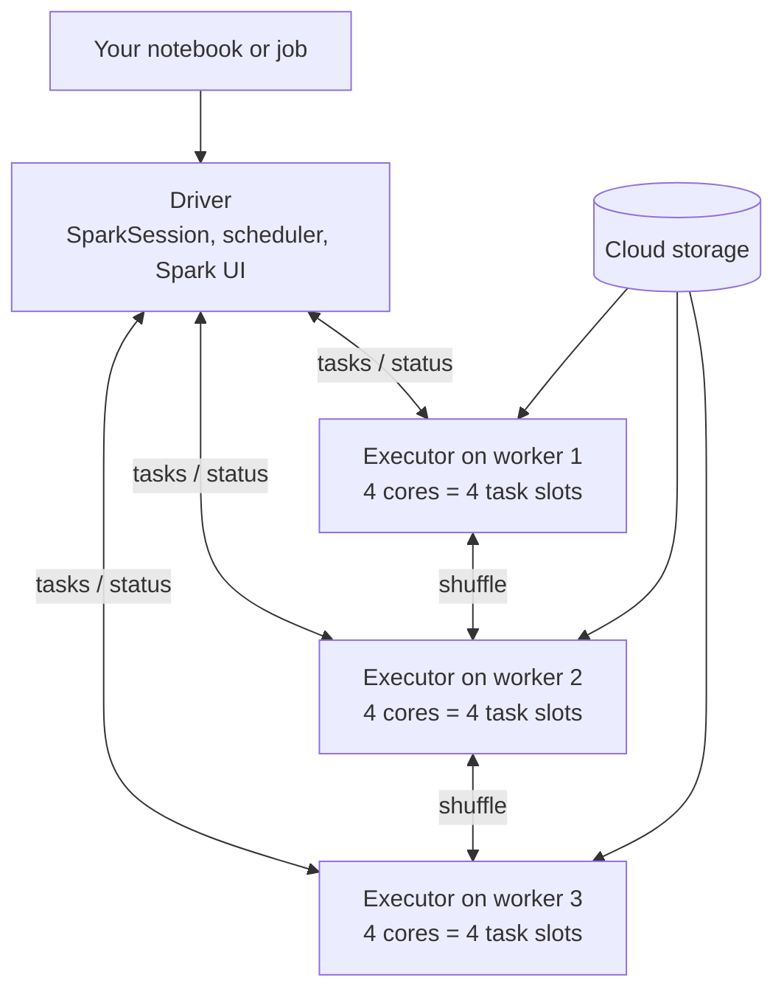

# Driver and Executors

Mastery: `INPUT[inlineSelect(option(new), option(learning), option(solid)):mastery]`

> [!story] Context
> [[Catalyst Optimizer|Catalyst]] and [[Tungsten]] determine what runs and how efficiently. Every Spark application runs that work with the same process layout: one driver and a set of executors.

> [!eli5] Summary
> A Spark program has one coordinating process and many worker processes. The coordinator plans the work and assigns small pieces to the workers, which process their share of the data in parallel.

## Background

Running one program on many machines requires a coordinator that plans, divides the work, tracks progress, and retries failures, and workers that perform the computation. Hadoop split these jobs between a JobTracker and TaskTrackers (later [[YARN]]'s ResourceManager and NodeManagers), and every MapReduce task started a fresh JVM. Spark keeps the same split but makes the workers **long-lived**: an executor stays up for the whole application, so it can keep data cached in memory between steps and start new tasks without launching a new JVM.

## Overview

| Part | What it is | What it does |
|---|---|---|
| **Driver** | One process per Spark application. Runs your `main` program and holds the `SparkSession` (`spark`). | Builds and optimizes the plan, splits it into [[Jobs Stages and Tasks\|jobs, stages, and tasks]], schedules tasks, tracks results, serves the [[Spark UI]]. |
| **Executor** | A worker process (a JVM) on a worker [[Node\|node]], usually one per node on Databricks. | Runs tasks, holds cached data and shuffle files, reports back to the driver. |
| **Core / task slot** | One CPU core on an executor. | Runs one task at a time. Total parallelism = executors × cores per executor. |
| **Cluster manager** | Standalone, [[YARN]], [[Kubernetes]], or Databricks' own. | Starts and stops executors. |

Key facts:

- **The driver is a single point of failure.** If it crashes (often from running out of memory), the whole application fails.
- **Executors are disposable.** If one dies, the driver reschedules its tasks elsewhere and rebuilds lost data from lineage ([[RDDs]]).
- **Data flows between executors, not through the driver,** except when you call an action that returns rows to the driver (`collect`, `toPandas`, `show`).

## How it works



Example: 3 workers with 4 cores each give 12 task slots. A table stored as 120 files of about 128 MB becomes about 120 [[Partitions|partitions]], so the scan runs as 120 tasks in roughly 10 "waves" of 12.

You can ask Spark about its own layout from a notebook:

```python
# Classic compute (or local PySpark) only: SparkContext is not available on serverless
sc = spark.sparkContext
print("Default parallelism:", sc.defaultParallelism)   # usually = total executor cores
print("Application ID:", sc.applicationId)
print("Spark UI:", sc.uiWebUrl)                         # e.g. http://localhost:4040 locally

# Works everywhere, including serverless:
print("Spark version:", spark.version)
print("Shuffle partitions:", spark.conf.get("spark.sql.shuffle.partitions"))  # 200 by default
```

A common driver-killing mistake, and the fix:

```python
big = spark.read.table("samples.nyctaxi.trips")   # Databricks sample data

# BAD: pulls every row into the driver's memory
# rows = big.collect()

# GOOD: let executors do the work, bring back only the small answer
summary = big.groupBy("pickup_zip").count().orderBy("count", ascending=False).limit(20)
display(summary)    # or summary.show()
```

## Small-business considerations

> [!smallbiz] Small-business considerations
> On Databricks you choose a cluster size, not processes. Rules of thumb for a small team:
> - **Start with [[Serverless Compute]]** for notebooks and jobs. Databricks sizes the driver and executors for you, and you pay only while it runs.
> - **On classic compute, a single-node cluster** (driver only, no workers) is sufficient for learning and for small datasets.
> - **Add workers for parallelism, not for driver memory.** If the notebook crashes on `toPandas()`, the driver is too small or the result is too big; more workers will not help.
> - **Turn on [[Auto Termination|auto termination]]** so idle clusters stop accruing charges.

> [!bridge]- In Databricks today
> A Databricks "cluster" is a driver node plus worker nodes, each worker running one executor. You pick them as [[All-Purpose Compute]] (interactive) or [[Jobs Compute]] (scheduled), with optional [[Autoscaling]] that adds and removes workers. On [[Serverless Compute]] you never see the driver or executors: your notebook is a [[Spark Connect]] client, and Databricks runs and scales the server side. [[Databricks Connect]] does the same from your IDE. The driver's logs and the executors' metrics are under the cluster's **Driver logs**, **Spark UI**, and **Metrics** tabs.

## Cloud differences

Driver and worker nodes are cloud [[Virtual Machine|virtual machines]], so instance names differ:

> [!azure]- Azure Databricks
> Nodes are Azure VMs (for example the D-series general purpose and E-series memory optimized families). Azure spot VMs can be used for workers. Classic compute VMs live in your subscription, in the workspace's managed resource group or your own [[VNet Injection|injected VNet]].

> [!aws]- Databricks on AWS
> Nodes are EC2 instances (for example m-, r-, and c- families, including Graviton). Workers can use [[Spot Instances]] with on-demand fallback; keeping the driver on-demand protects the application. See [[EC2 Instance Types and Graviton]].

> [!gcp]- Databricks on Google Cloud
> Nodes are Google Compute Engine VMs; workers can use preemptible or spot VMs. See [[Compute on Google Cloud]].

## Advanced topics

> [!deepdive]- Advanced topics (301–401)
> - **Driver memory.** `spark.driver.memory` and `spark.driver.maxResultSize` (default 1g in open source) limit what actions can return. A "Total size of serialized results is bigger than spark.driver.maxResultSize" error means you are collecting too much.
> - **Executor memory layout.** Executor heap is split into reserved memory, user memory, and a unified Spark pool (`spark.memory.fraction`, default 0.6) shared by execution (shuffles, joins, sorts) and storage (cache). Overhead memory outside the heap covers Python workers and native buffers; PySpark-heavy jobs often need more of it.
> - **Python processes.** In PySpark, executors start Python worker processes for Python UDFs and pandas UDFs. Data crosses JVM-Python boundaries via Arrow.
> - **Dynamic allocation.** Open-source Spark can add and remove executors with `spark.dynamicAllocation.enabled` (needs an external shuffle service or shuffle tracking). Databricks autoscaling serves the same purpose at the node level.
> - **Many small vs few large executors.** Very large executors suffer longer GC pauses; very small ones waste memory on overhead and broadcasts. Databricks' default of one executor per worker using all its cores avoids most of this tuning.
> - **Spark Connect changes the driver's role.** With Connect, your client process is no longer the driver. The driver runs on the server, so client crashes do not kill the cluster and many clients can share one server.

## Common misconceptions

> [!confusion] The driver is not a "master node" that stores data
> The driver holds the plan and small results. Data lives in executors and storage. A big driver does not make a job faster unless the job collects data to it.

> [!confusion] Executors are not the same as nodes
> A node is a machine. An executor is a process on it. On Databricks there is usually one executor per worker node, but in open-source Spark a node can run several.

## Recall

What does the Spark driver do?::Runs your program, builds and optimizes the plan, schedules tasks on executors, tracks results, and serves the Spark UI.
What does an executor do?::Runs tasks on partitions of data, caches data, and stores shuffle files.
How many tasks can one executor run at once?::One per core (task slot) assigned to it.
What happens if an executor dies?::The driver reschedules its tasks on other executors and recomputes any lost data from lineage.
What happens if the driver dies?::The whole Spark application fails.
Why can collect() crash the driver?::It brings every result row into the driver's memory.
On a Databricks classic cluster, how many executors run on each worker node by default?::One.
On serverless compute, where is the driver?::On Databricks-managed infrastructure; your notebook is a Spark Connect client.

## Next steps

> [!path] Learning path
> **Needs first:** [[Apache Spark]], [[Cluster]], [[Distributed Systems]]
> **Unlocks next:** [[Partitions]], [[Jobs Stages and Tasks]], [[Compute Types]], [[Spark UI]]

> [!nextup] Next
> [[Partitions]] covers how Spark divides data so that executors can process it in parallel.

> [!sources]- Sources (last verified: 2026-10-25)
> - [Spark Connect overview (Spark 4.2)](https://spark.apache.org/docs/latest/spark-connect-overview.html)
> - [Tuning (Spark 4.1.1)](https://spark.apache.org/docs/4.1.1/tuning.html)
> - [Configuration (Spark 4.2)](https://spark.apache.org/docs/latest/configuration.html)
> - [Performance tuning (Spark 4.2)](https://spark.apache.org/docs/latest/sql-performance-tuning.html)
> - [Serverless compute limitations (AWS)](https://docs.databricks.com/aws/en/compute/serverless/limitations)
> - [Databricks Connect (AWS)](https://docs.databricks.com/aws/en/dev-tools/databricks-connect)
> - [Spark memory issues (GCP)](https://docs.databricks.com/gcp/en/optimizations/spark-ui-guide/spark-memory-issues)
> - [Debugging with the Spark UI (AWS)](https://docs.databricks.com/aws/en/compute/troubleshooting/debugging-spark-ui)
